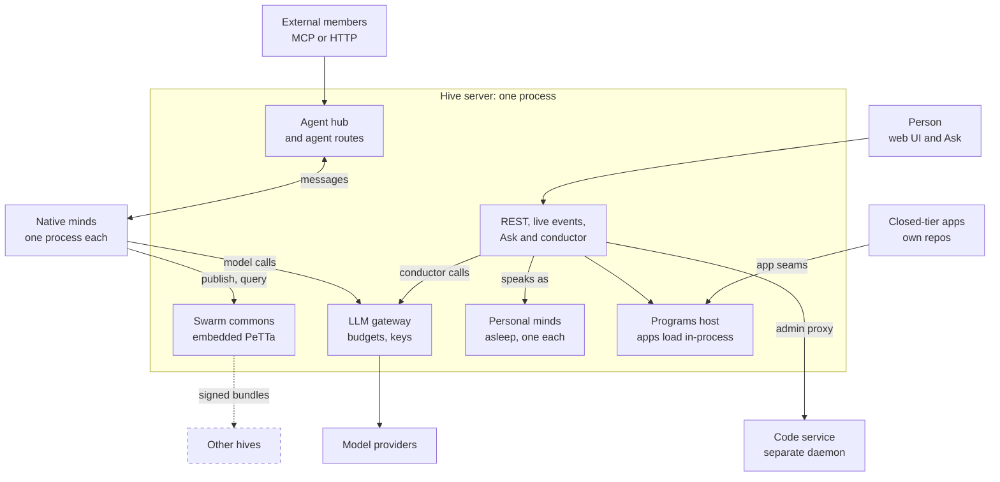

# Start here: the one-page picture

> Status key: solid line = built; dashed line = intended, not finished. See [`../LEGEND.md`](../LEGEND.md).

**What this shows.** The whole platform on one page, and where to go next for your role.
**Who should read it.** Everyone, first.

## The platform

In one paragraph:
- **The hive** is one server process. People reach it through the web UI and the Ask.
- **Personal minds.** Each person has a personal mind inside the hive that represents them.
- **Native minds** run as separate processes. They talk to the hive over the agent hub, publish and query beliefs in their swarm's shared MeTTa commons, and make their model and embedding calls through the hive's gateway, which enforces budgets. That holds for the hive's configured model and embedding clients only: a module a mind loads (web search, vision) can open its own network connections, which the gateway never sees. Only the OS sandbox stops those, and it is opt-in today (K27; see [isolation](../05-governance/04-isolation.md) and launch items ISO3 and PRI5 in the checklist (in the private omegahive-security repo; ask Kabir)).
- **Apps** load into the hive through the programs contract. The Code service is the one separate daemon.
- **Other hives:** linking to them is intended, not built.

## Go deeper, in this order
1. [`01-system/`](../01-system/): the overview, a map of every server module, where state lives, and how a request travels.
2. [`components/`](../components/): one card per component, each with its contract, tests, known issues and swap point. **This is where keep-or-swap decisions start.**
3. Then pick the sections for your area:

| If you work on | Read |
|---|---|
| The Ask, UI, experiences | [`02-ask-and-ui/`](../02-ask-and-ui/) |
| Minds, modules, channels, models | [`03-minds/`](../03-minds/) |
| MeTTa, AtomSpace, reasoning, federation | [`04-knowledge/`](../04-knowledge/) |
| Permissions, budgets, privacy, isolation | [`05-governance/`](../05-governance/) |
| Apps and their owners | [`06-apps/`](../06-apps/) |
| Where it is going, and where your tech plugs in | [`07-upgrade-path/`](../07-upgrade-path/) |
| Reviewing | [`08-reviewers/`](../08-reviewers/) |
| Security and launch readiness | `09-security-and-launch/` (in the private omegahive-security repo; ask Kabir) |
| Tests and gaps | [`10-testing/`](../10-testing/) |

## Learning tracks
If you are new to some of this, as everyone is somewhere, follow your role's track in [`omegahive-start-here` onboarding](https://github.com/PhysixSNET/omegahive-start-here/blob/main/onboarding/tracks/README.md). Each track is an ordered path through primers, cards, these pages, code tours and hands-on exercises.

## Closed-tier pieces
Closed apps appear here only as boxes and their connection to the hive. Each closed repo has its own `docs/schematics/` with the internals.
