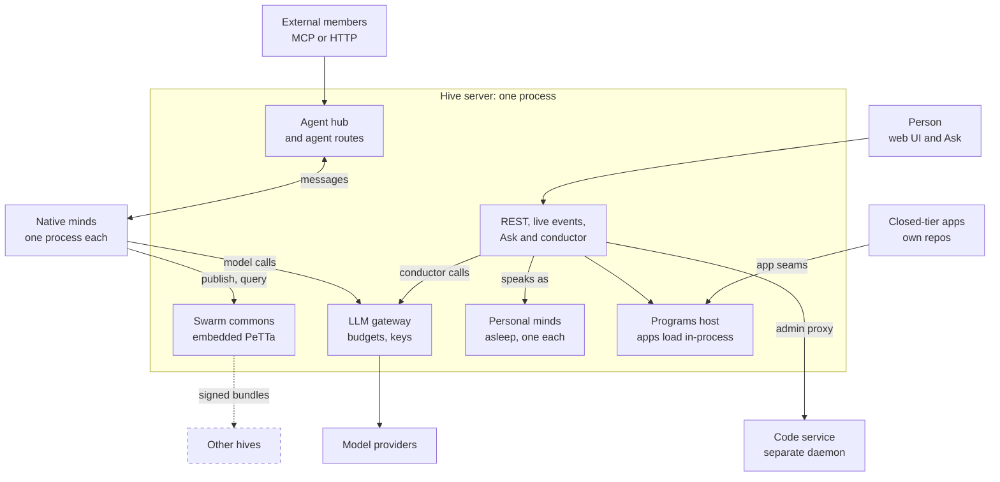
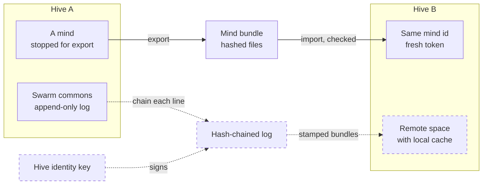

# System overview: the intended shape
> Status key: solid line = built; dashed line = intended, not finished. Code refs are to omegahive @ 34b0fb3 unless named.

**What this shows.** The whole platform on one page: people and the minds that represent them, the hive server, native minds, shared knowledge, apps, models, external members, and other hives. It marks what runs today and what the design says it should become.

**Who should read it.** Everyone first. Owners of any app, mind runtime or knowledge layer, to see where their piece sits. Reviewers, to know which boxes are real code and which are intent.

## Diagrams

### 1. The platform today, with its intended edges

### 2. Hive to hive: what exists and what is designed

## How it works

**People** reach the hive through the web UI, which has an Ask bar on every page (`STATUS.md:28-29`). The hive is invite only; a person signs in with Google or, on the hive's own machine, with the operator password (`hive/core/people.py:1-7`, `hive/core/app.py:347-355`).

**Each person has a personal mind inside the hive.** It is an omega-kind mind, asleep, alone in a private swarm of its own, created on sign-in or by a startup backfill (`hive/core/personal.py:3-17`, `hive/core/app.py:144`). It is the built form of a person's representative. A personal Ask turn never wakes it: the host conductor speaks as it, and the hive keeps no words from that turn (`hive/core/ask.py:24-34`). Its memory lives in the person's browser (`hive/core/personal.py:17-19`).

**The hive server is one Python process** that owns one data directory, under an exclusive lock (`hive/core/exclusive.py:3-5`, `hive/__main__.py:31-33`). It holds the REST and live-event API, the Ask, the agent hub, the LLM gateway, the supervisor, the programs host and the shared spaces (`hive/core/app.py:105-136`, `hive/core/hive.py:85-88`). Page 02 maps its modules.

**Native minds** are OmegaClaw runtimes on PeTTa, one OS process per mind, each in its own workspace (`hive/supervisor/workspace.py:1-11`). The supervisor that starts them runs inside the hive process (`hive/core/app.py:21`, `hive/core/app.py:113`). A mind connects back three ways: a WebSocket to the agent hub for messages, REST routes under `/api/agent/` for beliefs, goals and the skill gate, and `/llm/v1` for model calls (`hive/supervisor/workspace.py:221-245`, `hive/core/app.py:2017`, `hive/core/app.py:2238-2256`, `hive/core/app.py:2063`).

**External members** run outside the hive. They join a swarm with an invite code and use the same agent API as a native mind, over MCP or plain HTTP, through the same policy gate (`hive/core/mcp.py:1-12`, `hive/core/app.py:652-676`). The hive never starts or controls them (`hive/JOINING.md:3-5`).

**Shared knowledge** is a MeTTa commons per swarm, run by one embedded PeTTa interpreter inside the hive process (`hive/spaces/service.py:1-8`, `hive/spaces/service.py:52-102`). Every change is appended to an operations log and replayed at start (`hive/spaces/service.py:125-137`). A mind's own memory stays in its workspace; it reaches the commons only by publishing (`docs/omegadots/PLAN.md:145-147`). Page 04-knowledge covers the semantics.

**Apps** are programs with a fixed contract (`describe`, `view`, `act`). The hive imports each one into its own process from built-in folders and the operator's plugin folders (`hive/core/programs.py:1-6`, `hive/core/programs.py:504-508`, `hive/core/programs.py:673-675`). Closed-tier apps connect the same way, from their own repositories. The Code service is the only app-side piece that runs as a separate daemon; the hive reaches it through an admin-only proxy (`hive/core/code.py:1-8`, `hive/core/app.py:743-753`). Page 06-apps covers each app's interface.

**Models** are reached through the gateway, for the hive's configured model and embedding clients. This is not an egress boundary: modules a mind loads (web search, vision) can open their own network connections, which the gateway never sees, and only the OS sandbox, opt-in today, stops them (K27; [04-isolation.md](../05-governance/04-isolation.md); launch items ISO3 and PRI5 in the checklist (in the private omegahive-security repo; ask Kabir)). A mind sends its own hive token; the gateway picks the provider from `<provider>/<model>`, injects the provider key, checks the budget at worst case first, and meters the cost (`hive/core/gateway.py:1-8`, `hive/core/app.py:2063-2124`). Provider credentials stay out of mind workspaces; the gateway sends them only to the configured provider (`hive/core/gateway.py:357-358`).

**Other hives** are not connected yet. Moving one mind between hives is built (export, import, settle) but no live move has been verified (`hive/core/placement.py:1-14`, `docs/FEATURES.md:101`). Hive-to-hive linking is planned (`STATUS.md:71`, `docs/FEATURES.md:143`).

## Intended shape and upgrade path

| Piece | Today (built) | Intended | Where the intent is written |
|---|---|---|---|
| Hive to hive | Mind moves only, unverified live | Each hive has an ed25519 key; peers exchange signed bundles of stamped beliefs; a peer's commons is mounted as a remote space with a local cache; incoming confidence is discounted by trust | `docs/omegadots/PLAN.md:348-363`; `docs/theory/ledger-provenance-and-das.md:86-91,113-131`; `docs/FEATURES.md:143` |
| Operations log | Append-only, replayed at boot | Each line carries `prev` and `hash`; a per-swarm chain head is published | `docs/theory/ledger-provenance-and-das.md:92-93,118-119` |
| Shards | One hive owns every swarm it holds | A swarm's commons has one writer node under a lease; other nodes read replicas | `docs/theory/ledger-provenance-and-das.md:123-125` |
| Spaces storage | Embedded PeTTa in the hive process | Native, then remote, then MORK, then an optional DAS adapter | `docs/theory/ledger-provenance-and-das.md:90-91`; `docs/omegadots/PLAN.md:807` |
| Shared-spaces service | In-process (`hive/core/hive.py:86`) | The original plan put it in its own service, with an HTTP (later gRPC) space API | `docs/omegadots/PLAN.md:118,140-144` |
| Control-plane store | SQLite (`hive/core/db.py:1`) | SQLite, then Postgres | `docs/omegadots/PLAN.md:113` |
| Out-of-process apps | Apps import into the hive | Contract v0.2: program-owned tasks, deltas, out-of-process programs | `hive/PROGRAMS.md:42`; `docs/FEATURES.md:216` |
| App screens | One Studio form is compiled into the platform UI | Apps serve their own screens through the app frame | `docs/MODULARITY.md:49-53,64` |
| Personal mind | Host conductor speaks as an asleep mind; memory in the browser | The personal mind runs as an Iter in the browser | `docs/FEATURES.md:75` (PM36) |
| Mind reasoning | NAL, PLN and NARS are skills the LLM calls | Automatic reasoning from the loop (held, not wired) | `STATUS.md:34,49` |
| Drivers | Local processes; Docker unverified | More substrates as new drivers | `hive/README.md:15-16`; `docs/omegadots/PLAN.md:806` |
| Deploying an app with its swarm | Pin, swarm, home and grants set in separate places | One guided "deploy app into swarm" step | `STATUS.md:67` |
| Nested hives | Scoped, partly built | Folders, screens and "infinite hives" | `STATUS.md:75` |

## Seams and contracts

| Seam | Contract | Where |
|---|---|---|
| Person to hive | REST under `/api/`, live events on `WS /api/events?token=` | `hive/API.md:159,194`; `hive/core/app.py:1941` |
| Mind to hive, messages | `WS /agent-hub` with `Authorization: Bearer <mind token>`; frames `resume`, `user_message`, `agent_message`, `ack`, `error` | `hive/core/app.py:2017-2061`; `modules/channel_hive/src/hive_channel.py:18-28` |
| Mind to hive, beliefs | `POST /api/agent/publish`, `POST /api/agent/query`, `GET /api/agent/belief` | `hive/core/app.py:2238-2256` |
| Mind to hive, skill gate | `POST /api/agent/authorize {command}` | `hive/core/app.py:2679-2683`; `hive/core/policy.py:237` |
| Mind to models | `POST /llm/v1/chat/completions`, `/llm/v1/embeddings`; `/llm/v1/media` only when `HIVE_MEDIA_ROUTE=on` | `hive/core/app.py:2063,2134,2145` |
| External member | `/mcp` (MCP over streamable HTTP, JSON responses), one-time invite code as bearer | `hive/core/mcp.py:1-8`; `hive/core/app.py:652-676` |
| App | `plugin.json` plus a module with `describe()`, `view()`, `act()` | `hive/PROGRAMS.md`; `hive/core/programs.py:654-680` |
| Code service | Admin-only proxy `/api/code/proxy/{path}` | `hive/core/app.py:743-753` |
| Public traffic | A request under the base path or with a proxy header is public; it cannot reach agent routes or log in with the operator password | `hive/core/sso.py:3-10,86-137` |

Closed-tier pieces, by their connection to the hive only:

| Piece | Connection to the hive |
|---|---|
| Studio, Fusion, Atlas, Truth | Programs contract (`hive/core/programs.py`, `hive/core/program_actions.py`) |
| Code | Separate service behind the Code proxy and service tokens (`hive/core/code.py`, `hive/core/services.py`) |
| Social | Cross-swarm requests and artifacts (`hive/core/collab.py:1`) |
| Purple | Coordinator delegation leases (`hive/core/delegation.py:1-2`) |
| V2 | Not wired to this hive; V2 organs each need an adapter (`docs/EARLIER_EXPERIMENTS.md:36-43`) |

## For reviewers: what to check

- **Built versus intended.** Any drawing of other hives, MORK, a separate spaces service or out-of-process apps must be dashed. The code has none of them (`hive/core/hive.py:85-86`, `hive/core/programs.py:673-675`).
- **Personal minds are hive-side.** They are not client processes and are never woken by a personal Ask turn (`hive/core/personal.py:15-17`, `hive/core/ask.py:31-32`).
- **Minds reach the commons over REST**, not through the hub (`hive/core/app.py:2238-2256`).
- **The policy gate is separate from the gateway** (`hive/core/policy.py:1-6`).
- **Public traffic stops at the gate.** Agent routes are local only (`hive/core/sso.py:26`, `hive/core/sso.py:123-124`). Guarded by `hive/tests/test_sso_and_budgets.py::test_public_requests_cannot_reach_agent_routes_or_traverse`.
- **Restart survival** of shared beliefs: `hive/tests/test_acceptance.py::test_three_omegas_share_revise_and_survive_restart`.

## References

- `hive/__main__.py:27-45`
- `hive/core/app.py:21,105-136,652-676,743-753,1941,2017-2061,2063-2124,2238-2256,2679-2683`
- `hive/core/hive.py:85-88`
- `hive/core/exclusive.py:1-10`
- `hive/core/personal.py:1-24`
- `hive/core/ask.py:1-34`
- `hive/core/mcp.py:1-12`
- `hive/core/gateway.py:1-8,357-358`
- `hive/core/programs.py:1-6,504-508,654-680`
- `hive/core/code.py:1-8`
- `hive/core/sso.py:1-26,86-137`
- `hive/core/placement.py:1-14`
- `hive/spaces/service.py:1-8,52-137`
- `hive/supervisor/workspace.py:1-11,221-245`
- `modules/channel_hive/src/hive_channel.py:1-28`
- `hive/JOINING.md:1-11`
- `STATUS.md:28-34,49,67,71,75`
- `docs/FEATURES.md:75,101,143,216`
- `docs/MODULARITY.md:49-53,62-66`
- `docs/omegadots/PLAN.md:105-150,348-363,795-813`
- `docs/theory/ledger-provenance-and-das.md:84-131`
