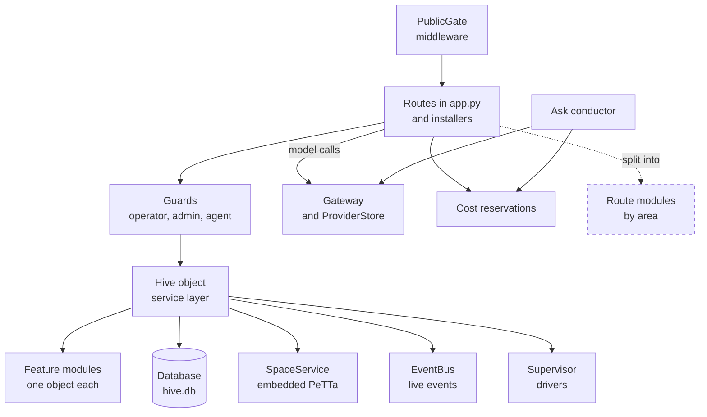
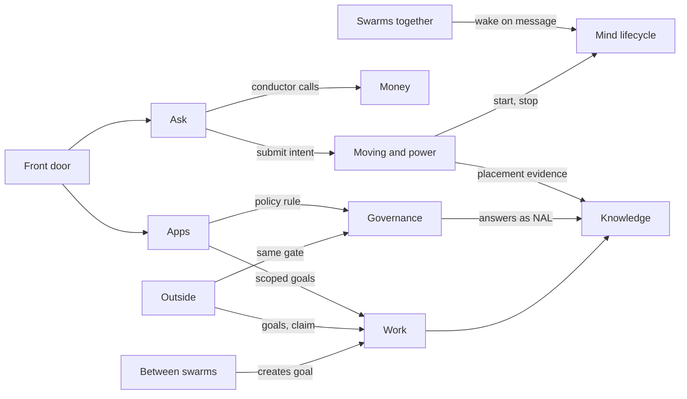
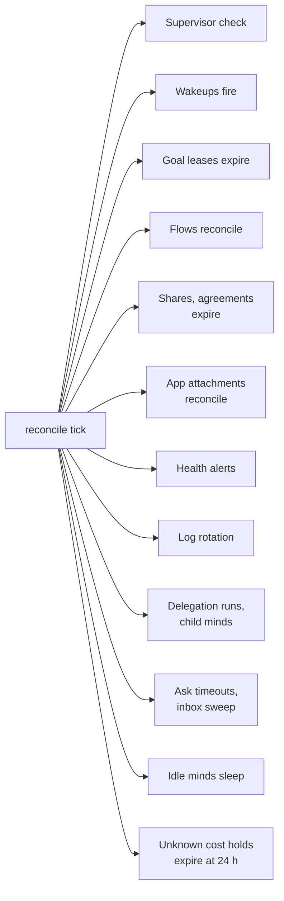

# Hive server map
> Status key: solid line = built; dashed line = intended, not finished. Code refs are to omegahive @ 34b0fb3 unless named.

**What this shows.** Every module in `hive/core`, grouped into twelve areas by responsibility, with one line each. Three small diagrams show the call spine (who builds and owns what), how the areas call each other, and the background reconcile loop.

**Who should read it.** Owners adding a route, a module or a background job to the hive. Reviewers who need to know which module owns a rule before they check that it holds everywhere.

## Diagrams

### 1. The call spine: what `create_app` builds and who owns what

### 2. How the areas call each other

### 3. The reconcile loop (every few seconds)

## How it works

**`create_app` builds everything once.** It makes the `Supervisor`, then the `Hive`, then attaches the supervisor to it, then makes the `Gateway`, the cost `Reservations`, the Ask `Conductor`, the `ProviderStore`, the sign-in objects and `UiPrefs` (`hive/core/app.py:105-146`). The routes are closures inside `create_app`, so each one sees the same objects (`hive/core/app.py:262-345`).

**The `Hive` object is the service layer.** Its constructor opens the database, starts the shared spaces, makes the event bus and then builds one object per feature module, passing itself in (`hive/core/hive.py:78-180`). Feature modules reach each other through `hive.<name>`, for example `hive.goals`, `hive.policy`, `hive.rooms` (`hive/core/hive.py:89-176`). Most modules create their own tables in their constructor (page 03).

**Routes are mostly in one file.** `hive/core/app.py` holds almost every HTTP route (about 3,400 lines). Two areas install their own routes: boards and motivations (`hive/core/app.py:3368-3371`). An optional host factory can add a confidential boundary before the UI catch-all (`hive/core/app.py:3373-3376`). The UI is served last, by a GET catch-all that never answers `api`, `llm` or `agent-hub` paths (`hive/core/app.py:3380-3392`).

**Middleware wraps the app.** CORS is added first and `PublicGate` last, so `PublicGate` runs first on every request (`hive/core/app.py:220`, `hive/core/app.py:3419`). With a base path, an outer app mounts the hive under each prefix and at `/`, and owns the lifespan (`hive/core/app.py:3409-3417`).

**Background work runs in one loop.** The lifespan binds the event bus to the running loop, restores minds, then starts `reconcile()` (`hive/core/app.py:155-159`). Each tick calls the supervisor and about a dozen modules in a fixed order; an exception ends the rest of that tick, is printed, and the next tick starts again from the top (`hive/core/app.py:181-201`). Unknown-outcome cost holds expire in a second guarded step (`hive/core/app.py:202-213`).

**Shutdown stops minds and drains the conductor.** It cancels the loop, stops every mind through the supervisor, lets open conductor calls settle, then closes the HTTP client (`hive/core/app.py:160-179`).

## Modules by area

Each module appears once. The line cited is its module docstring.

| Area | Module | One line |
|---|---|---|
| **Front door** | `app.py` | FastAPI app: REST, live events, agent hub, gateway routes (`hive/core/app.py:1`) |
| | `events.py` | Fan-out of live events to UI websockets, safe from any thread (`hive/core/events.py:1`) |
| | `people.py` | Invite-only people and the hive's own Google sign-in (`hive/core/people.py:1`) |
| | `sso.py` | Companion-webhost sign-in, and what a public request may do (`hive/core/sso.py:1`) |
| | `session_ref.py` | Opaque per-session attribution reference, never authority (`hive/core/session_ref.py:1`) |
| | `exclusive.py` | One process per data directory; the one startup recovery (`hive/core/exclusive.py:1`) |
| | `config.py` | Settings from the environment and an optional providers file (`hive/core/config.py:1`) |
| | `ui_prefs.py` | Per-person look and layout, data only (`hive/core/ui_prefs.py:1`) |
| **Ask** | `ask.py` | Universal Ask, host side: routing, threads, turns, frames (`hive/core/ask.py:1`) |
| | `ask_intents.py` | An Ask turn's host-held intents and links (`hive/core/ask_intents.py:1`) |
| | `conductor.py` | The conductor: one model loop steering the screen with typed acts; off unless enabled (`hive/core/conductor.py:1`) |
| | `personal.py` | One personal mind per named person (`hive/core/personal.py:1`) |
| | `personal_inbox.py` | Held copies for a person's browser memory (`hive/core/personal_inbox.py:1`) |
| | `person_requests.py` | Requests from people to the hive's admins (`hive/core/person_requests.py:1`) |
| **Work** | `goals.py` | Swarm goals with leases, heartbeats and stalls (`hive/core/goals.py:1`) |
| | `motivations.py` | Motivations: the why above tasks (`hive/core/motivations.py:1`) |
| | `result_schema.py` | The shape a goal's result must have before it is done (`hive/core/result_schema.py:1`) |
| | `schedule.py` | Wakeups: cron or one-shot messages that wake a mind (`hive/core/schedule.py:1`) |
| | `flows.py` | Durable, actor-scoped flow reconciliation over goals (`hive/core/flows.py:1`) |
| **Knowledge** | `db.py` | SQLite control-plane store; beliefs are not here (`hive/core/db.py:1`) |
| | `assets.py` | Content-addressed binary assets, local or S3-compatible store (`hive/core/assets.py:1`) |
| | `governance_evidence.py` | People's answers as NAL evidence in a commons (`hive/core/governance_evidence.py:1`) |
| | `archive.py` | Trace archive and log rotation; nothing a mind did is deleted (`hive/core/archive.py:1`) |
| **Swarms together** | `hive.py` | Service layer: minds, swarms, messages, beliefs, usage (`hive/core/hive.py:1`) |
| | `rooms.py` | DMs, groups, channels and projects as one thing (`hive/core/rooms.py:1`) |
| | `sessions.py` | A focused working thread with one mind, built on rooms (`hive/core/sessions.py:1`) |
| | `shares.py` | Timed, consented sharing of private memory between minds (`hive/core/shares.py:1`) |
| | `explore.py` | Every thing in the hive as a node with facets, paged on the server (`hive/core/explore.py:1`) |
| | `boards.py` | Read-only board and service discovery (legacy UI) (`hive/core/boards.py:1`) |
| **Between swarms** | `connections.py` | Connection agreements between swarms, time-limited (`hive/core/connections.py:1`) |
| | `services.py` | Registered services, capability tokens, grants and exact approvals (`hive/core/services.py:1`) |
| | `collab.py` | Cross-swarm requests, immutable artifact revisions and findings (`hive/core/collab.py:1`) |
| **Mind lifecycle** | `roles.py` | Reusable bundles that shape a mind (`hive/core/roles.py:1`) |
| | `inventory.py` | Per-mind tool inventory from boot receipts, read-only (`hive/core/inventory.py:1`) |
| | `health.py` | Error checking across minds from existing records (`hive/core/health.py:1`); with the omegahive pull request `port/idle-minds`, also `IdleWatch`, which notices idle minds and asks each one question (`hive/core/health.py:290`) |
| | (`hive/supervisor/`) | Workspaces and local or Docker drivers, run inside the hive process (`hive/supervisor/workspace.py:1-11`, `hive/core/app.py:21`) |
| **Moving and power** | `placement.py` | Where a mind lives; export, import and settle between hives (`hive/core/placement.py:1`) |
| | `power.py` | Off, Wake all and Stop all with a durable snapshot (`hive/core/power.py:1`) |
| | `delegation.py` | A coordinator starts and stops its members under person-issued leases (`hive/core/delegation.py:1`) |
| | `lifecycle_broker.py` | The lease broker that delegation calls, host-only (`hive/core/lifecycle_broker.py:1`) |
| | `minds.py` | Child minds a team's controller runs for one request; activation held (`hive/core/minds.py:1`) |
| **Governance** | `policy.py` | Skill policy and approvals: allow, ask or deny before a skill (`hive/core/policy.py:1`); the native local skip list and unknown-skill default bypass it (K10, K30) |
| | `visibility.py` | Private, shared or public minds and swarms; the live-event filter (`hive/core/visibility.py:1`) |
| **Money** | `gateway.py` | OpenAI-compatible model endpoint; meters cost and enforces local-only egress (`hive/core/gateway.py:1`) |
| | `providers.py` | Operator-set provider keys, catalogue and per-model routing (`hive/core/providers.py:1`) |
| | `budgets.py` | Spending rules at every level, checked before each paid call (`hive/core/budgets.py:1`) |
| | `limits_auto.py` | Automatic limits worked out from one hive total (`hive/core/limits_auto.py:1`) |
| | `limits_view.py` | The Limits page read model, from the same calls admission uses (`hive/core/limits_view.py:1`) |
| | `cost_reservations.py` | Durable held liabilities for paid calls (`hive/core/cost_reservations.py:1`) |
| | `media.py` | One host-metered image route, off unless enabled (`hive/core/media.py:1`) |
| **Apps** | `programs.py` | Programs: discovery, pins, loading, context and homes (`hive/core/programs.py:1`) |
| | `program_actions.py` | Minds acting in programs under explicit policy rules (`hive/core/program_actions.py:1`) |
| | `program_attachments.py` | App activations and attachments of reviewed minds (`hive/core/program_attachments.py:1`) |
| | `app_drafts.py` | Per-person app drafts with optimistic revisions (`hive/core/app_drafts.py:1`) |
| | `ui_parts.py` | Rules for an app interface that declares scripts (`hive/core/ui_parts.py:1`) |
| | `sandbox_run.py` | Run an app's pinned tool bundle in the OS sandbox (`hive/core/sandbox_run.py:1`) |
| | `updates.py` | What is waiting to load, holds, and applying it (`hive/core/updates.py:1`) |
| **Outside** | `mcp.py` | Invite codes and the MCP endpoint for external members (`hive/core/mcp.py:1`) |
| | `code.py` | Edit targets and the proxy to the separate Code service (`hive/core/code.py:1`) |
| | `proposal_tests.py` | Proposal-test claims and holds; off unless enabled (`hive/core/proposal_tests.py:1`) |
| | `tools.py` | Reviewed native Tools, default disabled (`hive/core/tools.py:1`) |
| | `tools_worker.py` | Disposable child that runs one host-built Tools request (`hive/core/tools_worker.py:1`) |
| | `lab.py` | Test suites and benchmarks run as child processes, with history (`hive/core/lab.py:1`) |
| | `repomap.py` | Repository maps (`repo-map/1`, Slice A): an admin loader and one read engine for people, minds and MCP members, routes under `/api/repo-maps`; with the omegahive pull request `port/repo-map-host` (`hive/core/repomap.py:1-17`) |
| | `evolve.py` | Immutable, swarm-scoped Evolve claims and registrations (`hive/core/evolve.py:1`) |
| | `evolve_preflight.py` | Offline experiment preflight, no authority (`hive/core/evolve_preflight.py:1`) |
| | `evolve_projection.py` | Data-only projection with digest identifiers (`hive/core/evolve_projection.py:1`) |
| | `evolve_seed.py` | Evolve's two initial subjects (`hive/core/evolve_seed.py:1`) |
| | `evolve_state.py` | Derived lineage and dependency state (`hive/core/evolve_state.py:1`) |

Also in the process but outside `hive/core`: `hive/spaces/` (shared spaces, `hive/spaces/service.py:1-8`) and the vendored `hive/core/vendor/`. The Evolve app itself is a closed-tier plugin folder (`docs/MODULARITY.md:20`); the `evolve*.py` modules above are its host-side records only.

## Intended shape and upgrade path

- **Split `app.py` into route modules** by area (people, minds, swarms, Ask, apps, assets), each calling one shared visibility layer. Planned, not started (`docs/MODULARITY.md:40-44,62`).
- **One settings module.** There are 93 `HIVE_*` settings read across many modules; `config.py` holds only some (`docs/MODULARITY.md:54-57,66`). Example of a setting read outside it: `HIVE_LOCAL_ONLY_SWARMS` in `hive/core/gateway.py:232`.
- **Built-in apps become normal apps.** Evolve and Commons Explorer still live in this repo (`docs/MODULARITY.md:58,65`).

## Seams and contracts

- **Adding a feature object:** construct it in `Hive.__init__` after the objects it needs (`hive/core/hive.py:126-176`). Order matters: for example `Visibility` comes before `PersonalMinds` (`hive/core/hive.py:122-125`).
- **Adding a route:** inside `create_app`, guarded by `operator`, `admin` or `agent_from` (`hive/core/app.py:274-316`). A route installer takes the guards it needs, as `boards.install_routes(app, hive, admin, agent_from, viewer)` does (`hive/core/app.py:3368-3371`).
- **Adding a background job:** one awaited call in `reconcile()` (`hive/core/app.py:181-201`). It must be idempotent and short.
- **Errors:** raise `HiveError(status, code, message)`; the handler returns `{"error": {"code", "message"}}` (`hive/core/hive.py:46-48`, `hive/core/app.py:222-227`).

## For owners: how to plug in

1. Write the module in `hive/core/<name>.py` with a docstring that says what it owns. Create its tables in its constructor (page 03).
2. Construct it in `Hive.__init__` as `self.<name> = <Class>(self)` (`hive/core/hive.py:126-176`).
3. Add routes in `create_app` (or an `install_routes` function) behind a guard. Pass every list or read through `hive.visibility` (`docs/MODULARITY.md:43-44`).
4. Register every new live event kind in `EVENT_RULES` (`hive/core/visibility.py:232-256`), or members never receive it.
5. Run the changed area's tests and a smoke run: `python -m pytest -q hive/tests/test_<area>.py` with PeTTa on the path (`hive/README.md:85-90`).

## For reviewers: what to check

- **Visibility at every list and read route.** The privacy fix that touched 16 paths came from this (`docs/MODULARITY.md:43-44`). Guarded by `hive/tests/test_visibility.py`.
- **Every event kind has a rule.** Guarded by `hive/tests/test_visibility.py::test_every_published_event_kind_has_a_rule` (line 67).
- **Construction order** in `Hive.__init__`: a module that reads another in its constructor must come after it.
- **Reconcile steps** must not raise for one bad row; one exception skips every later step in that tick and is only printed, so a step that always fails starves the steps after it (`hive/core/app.py:200-201`).
- **Public versus agent routes:** agent routes must stay under `/agent-hub`, `/llm/` or `/api/agent/` so the gate keeps them local (`hive/core/sso.py:26`).

## References

- `hive/core/app.py:1,21,105-146,155-215,220-227,262-345,3368-3419`
- `hive/core/hive.py:1,46-48,78-180`
- `hive/core/visibility.py:232-262`
- `hive/core/sso.py:26`
- `hive/core/gateway.py:232`
- `hive/core/programs.py:93,290-306`
- Module docstrings: line 1 onward of each file in `hive/core/`
- `docs/MODULARITY.md:20,40-66`
- `hive/README.md:85-90`
