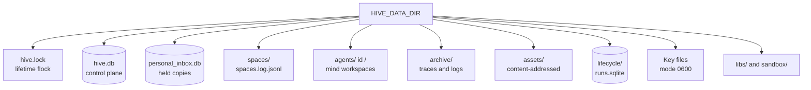
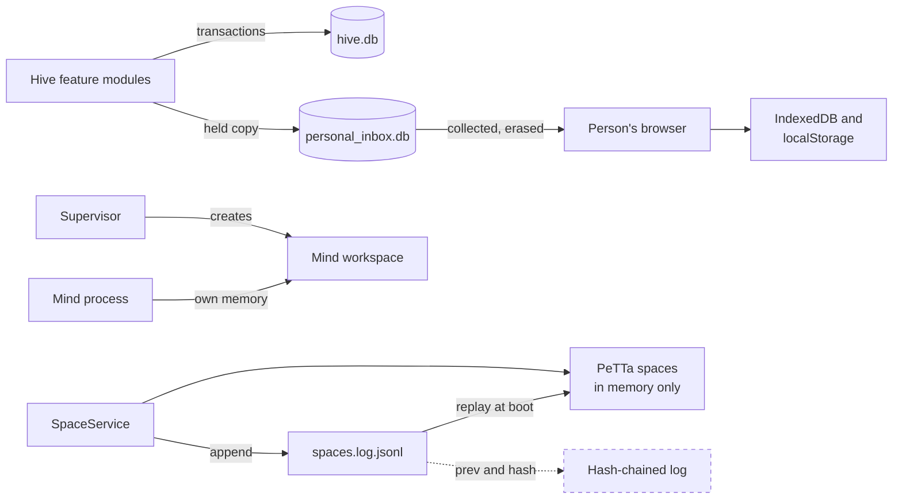
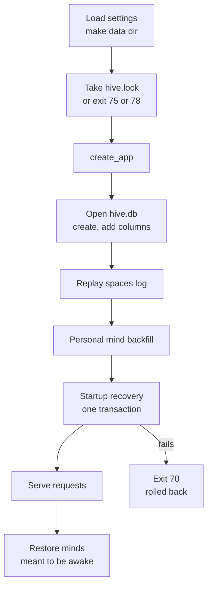

# State and storage
> Status key: solid line = built; dashed line = intended, not finished. Code refs are to omegahive @ 34b0fb3 unless named.

**What this shows.** Where every piece of hive state lives: the data directory and its lock, the SQLite tables and the modules that create them, the shared-spaces operations log, each mind's workspace, what the browser keeps, and how to back up and restore.

**Who should read it.** Owners adding a table, a file or a browser store. Operators planning backups. Reviewers checking that state stays consistent across a restart or a crash.

## Diagrams

### 1. The data directory

### 2. Who writes where

### 3. Start-up order

## How it works

**One process owns one data directory.** `main()` takes a non-blocking exclusive `flock` on `hive.lock` before building the app and never closes it; the kernel releases it on any exit, so there is no stale lock (`hive/core/exclusive.py:3-5`, `hive/__main__.py:31-32`). A second start exits 75; a lock that cannot be taken exits 78 (`hive/core/exclusive.py:21-22,133-144`). The lock fd is not inherited by mind processes (`hive/core/exclusive.py:106`). The file's text (pid, start time, nonce) is informational only (`hive/core/exclusive.py:124-130`).

**Startup recovery runs once, under the lock.** It runs after `create_app` and before serving. It verifies the lock from kernel state, checks that the open database is the locked directory's own `hive.db`, then runs its steps (cost reservations, Ask intents) in one transaction. Any failure rolls all of them back and the hive exits 70 (`hive/core/exclusive.py:7-9,157-224`, `hive/__main__.py:34-40`).

**`hive.db` is the control plane.** It is SQLite in WAL mode with foreign keys on, one connection shared across threads behind a re-entrant lock (`hive/core/db.py:96-102`). Beliefs are not stored here; they live in the spaces (`hive/core/db.py:1`). `db.py` creates fourteen base tables (`hive/core/db.py:12-84`). Every other table is created by the module that owns it, in its constructor (table below).

**Transactions commit together, and notices wait for the commit.** `Database.transaction()` opens `BEGIN IMMEDIATE`, or a savepoint when nested, and holds the connection lock for its whole length (`hive/core/db.py:170-203`). `after_commit(fn)` queues a callback that runs only after the outermost commit, outside the lock, and is dropped on rollback (`hive/core/db.py:205-215`). `guarded_execute` re-checks host read guards inside one write (`hive/core/db.py:256-282`).

**Some rows must leave no trace.** `erase()` and `secure_writes()` turn SQLite `secure_delete` on for the statement and then checkpoint and truncate the WAL, so deleted content leaves no freed cell or old frame (`hive/core/db.py:217-254`). The held copies for a person's browser use this, in their own file `personal_inbox.db` (`hive/core/personal_inbox.py:14-15`, `hive/core/personal_inbox.py:39,90`).

**Schemas grow in place.** There are no migration files. Each constructor runs `CREATE TABLE IF NOT EXISTS` and then adds missing columns with `ALTER TABLE` after reading `PRAGMA table_info` (`hive/core/db.py:105-159`, `hive/core/hive.py:104-120`, `hive/core/visibility.py:182-192`). Several modules add columns to tables they do not create: `agents` gains columns from `hive.py`, `visibility.py`, `roles.py`, `placement.py` and `personal.py` (`hive/core/hive.py:116`, `hive/core/visibility.py:183-190`, `hive/core/roles.py:65`, `hive/core/placement.py:66`, `hive/core/personal.py:45`).

**Shared spaces persist through an operations log.** PeTTa has no persistence. `SpaceService` appends each grant, revoke, vocabulary term and accepted publish to `spaces/spaces.log.jsonl` and replays the whole file when it starts, which happens inside `Hive.__init__` (`hive/spaces/service.py:1-5,108-137`, `hive/core/hive.py:86`). Denied, quarantined and duplicate publishes are not logged (`hive/spaces/service.py:226-228`). The log is append-only and not hash-chained (`docs/theory/ledger-provenance-and-das.md:92-93`).

**A belief is written twice.** `Hive.publish` calls the spaces service (which appends to the log) and then inserts a row into `assertions` in `hive.db` (`hive/core/hive.py:1569-1578`). The two writes are not in one transaction.

**Each native mind has a workspace** at `agents/<id>/`: `run.metta`, links to the shared runtime checkout and ChromaDB library, its `memory/` folder, its token file (mode 0600) and its log (`hive/supervisor/workspace.py:1-11,167-192`). `memory/` holds the mind's own spaces as `.metta` files, its history, its hive-channel files (`inbox.jsonl`, `outbox.jsonl`, `state.json`) and the tools loader (`modules/channel_hive/src/hive_channel.py:7-15`, `hive/supervisor/workspace.py:203-216`). The hive can list and read those `.metta` files (`hive/core/hive.py:1932-1975`). External members get only an empty folder (`hive/supervisor/workspace.py:172-177`). The database keeps only a hash of each mind's token (`hive/core/hive.py:1162-1165`).

**Nothing a mind did is deleted, only moved.** The database keeps each mind's latest 2,000 traces; older ones move to `archive/traces/<mind>/<day>.jsonl.gz`. Process logs roll over at 10 MB into `archive/logs/` with a sha256 (`hive/core/archive.py:1-11,20-21`). A mind's own memory is never pruned by the platform (`hive/core/archive.py:8-9`).

**Other files in the data directory:** `admin-password` (generated if unset, 0600) (`hive/core/app.py:107-112`); `providers.json` with provider keys, 0600 (`hive/core/providers.py:1-5,90`); the session-reference key `auth-session-ref.key` (`hive/core/session_ref.py:24,53`); `motivations-cursor.key` (`hive/core/motivations.py:101`); `health-mind.json` (`hive/core/health.py:171`); `assets/` for the local asset store (`hive/core/assets.py:142`); `lifecycle/runs.sqlite`, the delegation broker's own database (`hive/core/delegation.py:69`, `hive/core/lifecycle_broker.py:17-22`); `libs/` and `sandbox/` used when starting minds (`hive/supervisor/workspace.py:73-85`, `hive/supervisor/drivers.py:193-195`).

**The browser keeps a person's private memory.** The personal mind's beliefs and journal live in IndexedDB, one database per person per hive, and are never sent anywhere (`hive/ui/src/lib/askMemory/backend.ts:1-3`). A linked folder's handle is kept in IndexedDB too (`hive/ui/src/features/mind/folder.ts:1-9,156-163`). The person can download and restore the memory as a file (`docs/FEATURES.md:45`). Swarm-answered exchanges wait on the host in `personal_inbox.db` for at most 7 days, until the browser collects and acknowledges them (`hive/core/personal_inbox.py:1-15,37`).

**The browser also keeps conveniences in `localStorage`:** the hive session token (`hive/ui/src/api/live.ts:75-90`), navigation pins (`hive/ui/src/shell/navPrefs.ts:6-9`), a cached look (`hive/ui/src/shell/uiVariant.ts:245-256`), the default model choice (`hive/ui/src/features/models/modelUtil.ts:141-151`) and voice choices (`hive/ui/src/features/ask/useAskVoice.ts:62-81`). The look a person chooses is also stored on the host, per principal, in `ui_prefs` (`hive/core/ui_prefs.py:16-26`).

## Tables and owners

The base tables come from `hive/core/db.py:12-84`. "Used by" names the module that mainly writes them.

| Tables | Created in | Used by |
|---|---|---|
| `swarms`, `agents`, `messages`, `assertions`, `usage`, `traces`, `reads`, `control_ops` | `db.py:13-83` | `hive.py` |
| `health_idle` (Health's idle questions and replies); column `agents.last_input_at` (the idle signal); index `messages(agent_id, direction, conversation_id, created_at)` | `db.py:32`, `:85-92`, `:148` in the omegahive pull request `port/idle-minds` | `health.py`, `hive.py` |
| `budgets` | `db.py:45-48` | `budgets.py` |
| `repo_maps`, `repo_map_nodes`, `repo_map_edges`, `repo_map_atoms` (repository maps: the envelope, its nodes and edges, and the derived atoms kept beside the revision) | `repomap.py:65-84` in the omegahive pull request `port/repo-map-host` | `repomap.py`; mounted into read-only spaces by `hive/spaces/service.py` |
| `sessions` | `db.py:49` | `app.py` sign-in routes, `people.py` |
| `policy_rules`, `approvals` | `db.py:50-59` | `policy.py` |
| `goals` | `db.py:60-65` | `goals.py` |
| `wakeups` | `db.py:72-75` | `schedule.py`, `placement.py` |
| `mind_cleanup` | `hive.py:104` | `hive.py` |
| `people`, `invites`, `oauth_states`, `signins` | `people.py:74-87` | `people.py` |
| `ui_prefs`, `ui_prefs_revision`, `ui_prefs_epoch` | `ui_prefs.py:18-24` | `ui_prefs.py` |
| `ask_turns`, `ask_events`, `ask_boundaries`, `ask_trace_scopes`, `ask_prefs`, `ask_steers` | `ask.py:59-78` | `ask.py` |
| `ask_intents`, `ask_links` | `ask_intents.py:30-40` | `ask_intents.py` |
| `person_requests`, `person_request_rules` | `person_requests.py:27-30` | `person_requests.py` |
| `personal_inbox`, `personal_inbox_dropped` (in `personal_inbox.db`) | `personal_inbox.py:43-48` | `personal_inbox.py` |
| `goal_reviews`, `goal_attempts` | `goals.py:47-49` | `goals.py` |
| `motivations`, `motivation_tasks`, `motivation_ops` | `motivations.py:36-46` | `motivations.py` |
| `flow_layouts`, `flow_adoptions`, `flow_runs`, `flow_steps`, `flow_skills` | `flows.py:20-44` | `flows.py` |
| `rooms`, `room_members`, `room_messages`, `coffee_prefs` | `rooms.py:70-79` | `rooms.py` |
| `work_sessions`, `session_caps` | `sessions.py:23-26` | `sessions.py` |
| `shares`, `exhibits`, `share_reads` | `shares.py:27-40` | `shares.py` |
| `node_meta`, `explore_groups`, `explore_views` | `explore.py:25-30` | `explore.py` |
| `connections` | `connections.py:26` | `connections.py` |
| `services`, `service_enrolments`, `capabilities`, `goal_grants` | `services.py:57-71` | `services.py` |
| `swarm_services`, `requests`, `artifacts`, `artifact_revisions`, `findings`, `finding_target_checks` | `collab.py:36-52` | `collab.py` |
| `roles` | `roles.py:20` | `roles.py` |
| `inventory_receipts` | `inventory.py:32` | `inventory.py` |
| `trace_archive`, `log_archive` | `archive.py:27-29` | `archive.py` |
| `hive_identity`, `mind_moves` | `placement.py:59-61` | `placement.py` |
| `power_snapshots`, `power_operations` | `power.py:17-19` | `power.py` |
| `delegations`, `lifecycle_authorities` | `delegation.py:24,68` | `delegation.py` |
| `runs` (in `lifecycle/runs.sqlite`) | `lifecycle_broker.py:20` | `lifecycle_broker.py` |
| `mind_leases`, `mind_children`, `mind_reservations`, `mind_prompts`, `mind_controls`, `mind_operations`, `copy_apply_bindings`, `copy_apply_consents` | `minds.py:82-106` | `minds.py` |
| `governance_evidence`, `placement_evidence` | `governance_evidence.py:43` (one per commons) | `governance_evidence.py` |
| `cost_reservations`, `cost_reservation_scopes`, `cost_reservation_details`, `cost_reservation_subjects`, `cost_overruns`, `cost_reservation_resolutions` | `cost_reservations.py:25-30,244` | `cost_reservations.py` |
| `media_results` | `media.py:360` | `media.py` |
| `program_homes`, `app_admissions`, `app_authority` | `programs.py:355-366` | `programs.py` |
| `program_actions`, `confirm_tokens` | `program_actions.py:24-31` | `program_actions.py` |
| `app_activations`, `app_attachments` | `program_attachments.py:20-21` | `program_attachments.py` |
| `app_drafts`, `app_draft_keys` | `app_drafts.py:20-26` | `app_drafts.py` |
| `update_requests`, `update_holds`, `update_history` | `updates.py:27-32` | `updates.py` |
| `assets`, `asset_owners` | `assets.py:37-42` | `assets.py` |
| `mcp_idempotency`, `harness_invites` | `mcp.py:49-53` | `mcp.py` |
| `proposal_tests`, `proposal_test_holds`, `hold_observations` | `proposal_tests.py:56-72` | `proposal_tests.py` |
| `lab_runs`, `lab_cases` | `lab.py:24-30` | `lab.py` |
| `evolve_records` | `evolve.py:10` | `evolve.py` |

All paths in this table are under `hive/core/`. The governance and placement evidence tables are named `<commons>_evidence` (`hive/core/governance_evidence.py:40-41`, `hive/core/placement.py:67`).

## Intended shape and upgrade path

- **Hash-chained spaces log.** Each line gains `prev` and `hash`, with a published chain head per swarm (`docs/theory/ledger-provenance-and-das.md:92-93,118-119`).
- **Other storage backends.** Native, then remote, then MORK, then an optional DAS adapter (`docs/theory/ledger-provenance-and-das.md:90-91`). MORK was never built or run (`docs/EARLIER_EXPERIMENTS.md:82`).
- **SQLite to Postgres** for the control plane (`docs/omegadots/PLAN.md:113`).
- **Backups as a platform feature**, with metrics and tracing (`docs/omegadots/PLAN.md:809`). Today backup is a manual stop-and-copy (below).
- **Cloud-hosted personal memory** is "coming soon"; today it is browser-only (`hive/core/conductor.py:10-11`).

## Seams and contracts

- `Database(path, hive_schema=True)`; `transaction()`, `after_commit(fn)`, `erase(sql, params)`, `secure_writes()`, `guarded_execute(sql, params, guards)` (`hive/core/db.py:95-282`).
- `SpaceService(data_dir, petta_path)`; operations `grant`, `revoke`, `add_vocab`, `publish`, each with an `_apply_<op>` that replay calls by name (`hive/spaces/service.py:108-137,141-233`).
- Settings: `HIVE_DATA_DIR` (default under the home folder), `PETTA_PATH` (`hive/core/config.py:158`, `hive/spaces/service.py:112`, `hive/README.md:50,54`).
- Exit codes: 75 in use, 78 no lock, 70 recovery failed (`hive/core/exclusive.py:21-23`).

## For owners: how to plug in

1. **A new table:** create it in your module's constructor with `CREATE TABLE IF NOT EXISTS`. Add later columns with the `PRAGMA table_info` then `ALTER TABLE` pattern (`hive/core/db.py:107-111`).
2. **A write with a notice:** do the writes inside `with hive.db.transaction():` and send the event or message through `hive.db.after_commit(...)`, so a rollback sends nothing (`hive/core/db.py:205-215`).
3. **Content that must be erasable:** delete it with `erase()`, or keep it in a side database as `personal_inbox.py` does (`hive/core/personal_inbox.py:14-15,90`).
4. **A new spaces operation:** add `_apply_<op>`, call it, then `_log("<op>", ...)` with the same fields, so replay can rebuild it (`hive/spaces/service.py:125-137`).
5. **Startup repair of your own state:** add a step to `exclusive.STEPS`; it gets the open transaction and returns a row count (`hive/core/exclusive.py:198-200`). Never repair in a constructor (`hive/core/exclusive.py:9`).

## For reviewers: what to check

- **Backup and restore.** The runbook's backup is: stop the service, copy the data directory whole, start again (`deploy/RUNBOOK.md:193`). A copy while running can catch `hive.db`, its WAL and `spaces.log.jsonl` at different moments. Restore is the reverse: stop, put the directory back, start; the spaces log replays and the startup recovery runs (`hive/spaces/service.py:129-137`, `hive/__main__.py:34-40`). A code rollback does not change the data directory (`deploy/RUNBOOK.md:199`). One mind can be moved or kept as an export bundle with hashed files; its token, log and runtime links are left out (`hive/core/placement.py:4-9,34`).
- **The two belief writes** (log then `assertions`) can diverge on a crash between them (`hive/spaces/service.py:226-228`, `hive/core/hive.py:1569-1578`).
- **The spaces log is appended with a plain `open(..., "a")`**, no fsync and no chain (`hive/spaces/service.py:125-127`).
- **Visibility defaults.** The `visibility` column defaults to `public` at the database level for rows that existed before the column; new minds and swarms default to `private` in the create routes (`hive/core/visibility.py:187-188`, `hive/core/app.py:1254`).
- **Long transactions** hold the one connection lock and block every other database call (`hive/core/db.py:172-173`).
- **Tests:** lock and recovery `hive/tests/test_startup_exclusive.py`; restart survival `hive/tests/test_acceptance.py::test_three_omegas_share_revise_and_survive_restart`; erasure of held copies `hive/tests/test_personal_mind_r2.py`, `hive/tests/test_personal_mind_r3.py`; archive `hive/tests/test_archive.py`; moves `hive/tests/test_placement.py`.

## References

- `hive/__main__.py:27-45`
- `hive/core/exclusive.py:1-224`
- `hive/core/db.py:1-302`
- `hive/core/hive.py:85-120,1162-1165,1520-1588,1932-1975`
- `hive/spaces/service.py:1-233`
- `hive/supervisor/workspace.py:1-11,73-85,167-256`
- `modules/channel_hive/src/hive_channel.py:1-16`
- `hive/core/personal_inbox.py:1-48,84-90`
- `hive/core/archive.py:1-40`
- `hive/core/placement.py:1-67`
- `hive/core/ui_prefs.py:14-26`
- `hive/ui/src/lib/askMemory/backend.ts:1-30`
- `hive/ui/src/features/mind/folder.ts:1-15,150-165`
- `hive/ui/src/api/live.ts:75-90`
- `deploy/RUNBOOK.md:193-204`
- `docs/theory/ledger-provenance-and-das.md:86-93,118-119`
- `docs/omegadots/PLAN.md:113,807-809`
