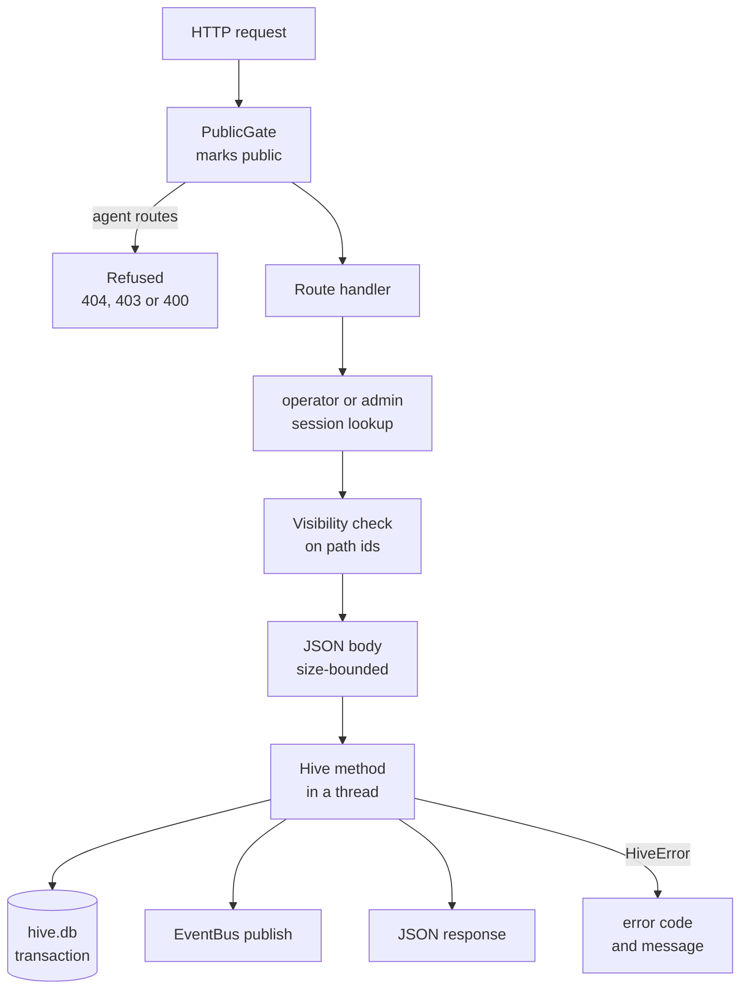
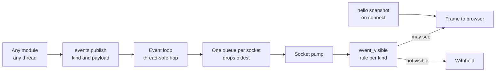
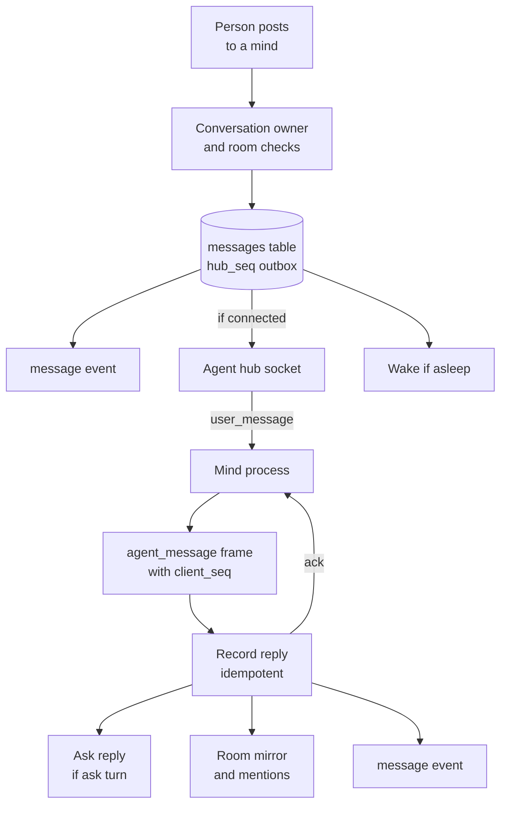

# Request lifecycle
> Status key: solid line = built; dashed line = intended, not finished. Code refs are to omegahive @ 34b0fb3 unless named.

**What this shows.** The path of three things through the hive: a REST request from a person, a live event to a browser, and a message between a person and a mind over the agent hub. Each step names the auth check, the visibility check, the handler and the event that follows.

**Who should read it.** Owners adding a route, an event kind or a message type. Reviewers checking that auth and visibility are applied on every path.

## Diagrams

### 1. A REST request from a person

### 2. A live event to a browser

### 3. A message to a mind and its reply

## How it works

### A REST request

**The gate decides first whether a request is public.** A request is public if its path is under a configured base path or it carries a proxy header (`Cf-Ray`, `Cf-Connecting-Ip`, `X-Forwarded-For`). Public requests may not traverse paths, may not reach `/agent-hub`, `/llm/` or `/api/agent/`, and may not use the operator password unless that is enabled (`hive/core/sso.py:24-26,92-137`). The gate is the outermost middleware (`hive/core/app.py:3416-3419`).

**The guard finds the session.** `operator()` reads a bearer token from the `Authorization` header or `?token=`, looks up its hash in `sessions`, and refuses an expired one. From a public request only a sign-in session (`kind = 'sso'`) counts (`hive/core/app.py:263-280`). The operator password session is always an admin; a named person's role comes from `people`; a disabled person has none (`hive/core/app.py:297-304`). `admin()` adds a role check (`hive/core/app.py:306-310`).

**Visibility runs inside the guard.** `operator()` calls `Visibility.check_path` with the route's path parameters. A mind, swarm or goal the person may not see is answered as `404 not_found`, so its existence is not revealed (`hive/core/app.py:279`, `hive/core/visibility.py:299-310`). Lists go through `filter_items` or a module's own filter in the handler (`hive/core/visibility.py:553-557`, `hive/core/app.py:1230-1237`). A body that names a destination is checked again in the handler, as `PATCH /api/agents/{id}` does for `swarm_id` (`hive/core/app.py:1297-1298`).

**The handler parses a JSON object** and refuses anything else with `400 bad_request`; some routes read the body as a capped stream (`hive/core/app.py:318-345`). It calls a `Hive` method, usually through `run_in_threadpool` because the database and PeTTa calls block (`hive/core/app.py:1250-1255`). The method writes in a transaction and publishes events (`hive/core/db.py:170-203`).

**Errors are typed.** A `HiveError(status, code, message)` becomes `{"error": {"code", "message"}}` with that status; gateway, provider, MCP, role, Code, service and sign-in errors have the same shape (`hive/core/app.py:222-260`).

**A mind's REST request** uses `agent_from()` instead: the bearer is the mind's own token, matched by hash against live minds (`hive/core/app.py:312-316`, `hive/core/hive.py:1162-1165`). The hive, not the body, decides who is acting; for app actions a body that names the actor is refused (`hive/core/program_actions.py:1-4`).

### A live event

**Any module can publish from any thread.** `EventBus.publish(kind, **payload)` serialises one frame with a `type` and an `at` time, then delivers it on the event loop, hopping threads with `call_soon_threadsafe` when needed (`hive/core/events.py:36-48`). Before the loop is bound at start-up, events are dropped (`hive/core/events.py:38-40`).

**Each socket has its own bounded queue.** A full queue drops its oldest frame, so a slow browser loses old events rather than blocking the hive (`hive/core/events.py:19-34`).

**The socket authenticates once.** `WS /api/events?token=` uses the same session lookup as REST and closes with 4401 when it fails. It subscribes before it sends the `hello` snapshot of `GET /api/hive`, so no event falls between them, and it answers `ping` with `pong` (`hive/core/app.py:1941-1990`).

**Every frame is filtered per person.** `event_visible` checks Ask frames first (to the asker only), then other people's chats, then admin rules, then the kind's rule (`hive/core/visibility.py:499-551`). Each kind is registered as `scoped`, `public`, `admin`, `share`, `requester`, `motivation` or `asker`; an unregistered kind is withheld from members (`hive/core/visibility.py:224-268`). A scoped frame that names no mind, swarm or room is withheld and logged once (`hive/core/visibility.py:539-545`).

### An agent message

**Person to mind.** `POST /api/agents/{id}/messages` speaks as the caller's principal. A named person speaks only in a conversation bound to them, or in a room they belong to; nobody speaks into another person's conversation (`hive/core/app.py:1338-1369`). `send_to_agent` refuses empty text, `ask:` conversations, and the Coffee Room or team rooms unless the call comes from the room itself (`hive/core/hive.py:1296-1311`).

**The message is stored before it is sent.** `enqueue_message` writes it to `messages` with the mind's next `hub_seq` in one transaction (`hive/core/hive.py:1284-1294`). Then the hive mirrors it into the mind's DM room, publishes a `message` event, sends a `user_message` frame if the mind is connected, and wakes the mind if it is asleep (`hive/core/hive.py:1318-1326`, `hive/core/hive.py:1339-1350`). The frame's text is a JSON envelope with sender, conversation and message id (`hive/core/hive.py:1328-1337`).

**The hub admits a mind in two steps.** `WS /agent-hub` checks the bearer, then `admit_connection` refuses a hive-run mind that is not meant to be awake. After the accept, a registration fence re-checks under the mind's lock that it is still meant to be awake and that its lifecycle generation has not moved; otherwise the socket closes with 4409 (`hive/core/app.py:2017-2031`, `hive/core/hive.py:1406-1472`). External members (kind `module`) are admitted without that check (`hive/core/hive.py:1411-1415`).

**Reconnects replay.** On every connect the mind's channel daemon sends `resume` with its `last_seen_seq`; the hub resends every stored inbound message after it (`hive/core/app.py:2043-2044`, `hive/core/hive.py:1352-1358`, `modules/channel_hive/src/hive_channel.py:20-24`).

**Mind to person.** The mind sends `agent_message` with a `client_seq`. `record_agent_message` returns the stored row for a repeated `client_seq`, so a resend is not a second message (`hive/core/hive.py:1360-1365`). It stores the reply, hands an `ask:` reply to the Ask, mirrors it into its room (where @mentions reach other minds), publishes a `message` event, and the hub acks with the message id (`hive/core/hive.py:1366-1395`, `hive/core/app.py:2052-2055`). The same recording runs for `POST /api/agent/messages` over REST (`hive/core/app.py:2711-2715`).

**An Ask turn** follows the same delivery when the swarm's coordinator answers: the turn goes out in its own `ask:<turn>` conversation and the mind's reply there is the answer. With the conductor on, the host answers instead and nothing is sent to the mind (`hive/core/ask.py:19-20`, `hive/core/conductor.py:6-8`). The full Ask path is drawn in `02-ask-and-ui/`.

## Intended shape and upgrade path

- **Visibility in one layer.** Today each list and read route must call `Visibility` itself; the plan is route modules that all call one shared visibility layer (`docs/MODULARITY.md:43-44,62`).
- **Hive-to-hive requests.** Peering and signed bundle routes (`POST /federation/peers`, `POST /federation/bundles`) are designed, not built (`docs/omegadots/PLAN.md:350-354`).

## Seams and contracts

| Contract | Shape | Where |
|---|---|---|
| Person auth | `Authorization: Bearer <token>` or `?token=`; token from `POST /api/auth/login` (local only) or a sign-in exchange | `hive/core/app.py:263-280,347-355`; `hive/core/sso.py:13-14` |
| Mind auth | `Authorization: Bearer <mind token>` on `/agent-hub`, `/llm/v1/*`, `/api/agent/*` | `hive/core/app.py:312-316,2017-2021` |
| Error body | `{"error": {"code", "message", ...details}}` | `hive/core/app.py:222-227` |
| Live event frame | `{"type": <kind>, "at": <time>, ...payload}` | `hive/core/events.py:36-37` |
| Hub, hive to mind | `{"type": "user_message", "seq", "text"}`; `ack`; `error`; `prompt_ack` | `hive/core/hive.py:1343-1344`; `hive/core/app.py:2043-2057` |
| Hub, mind to hive | `{"type": "resume", "last_seen_seq"}`; `{"type": "agent_message", "client_seq", "text", "conversation_id"?}` | `modules/channel_hive/src/hive_channel.py:20-24` |
| Message envelope | `{"hive": 1, "sender", "conversation_id", "message_id", "text", "sender_name"?, ...extra}` | `hive/core/hive.py:1328-1337` |
| Socket close codes | 4401 bad token, 4409 not admitted or withdrawn, 4403 public refused, 4000 replaced | `hive/core/app.py:1946,2021,2030`; `hive/core/sso.py:127-130`; `hive/core/hive.py:1469` |

## For owners: how to plug in

1. **A person route:** start the handler with `session = operator(request)` (or `admin(request)`), name path ids `agent_id`, `swarm_id` or `goal_id` so `check_path` sees them, and filter any list with `hive.visibility.filter_items(viewer(session), items)` (`hive/core/app.py:274-292`, `hive/core/visibility.py:553-557`).
2. **A mind route:** put it under `/api/agent/` and start with `agent = agent_from(request)`; the gate then keeps it local (`hive/core/sso.py:26`).
3. **A new event kind:** publish with `hive.events.publish("<kind>", ...)`, name the mind, swarm or room in the payload, and add the kind to `EVENT_RULES` (`hive/core/visibility.py:232-256`). If the event is about committed data, send it through `db.after_commit` (`hive/core/db.py:205-215`).
4. **A new hub frame type:** handle it in the hub loop; unknown types get `error unknown_type` (`hive/core/app.py:2043-2057`). The mind side lives in `modules/channel_hive/`.

## For reviewers: what to check

- **Every person route starts with a guard**, and every route that returns ids of minds, swarms, rooms, shares or assets goes through `Visibility` (`docs/MODULARITY.md:43-44`). Tests: `hive/tests/test_visibility.py`, `hive/tests/test_request_visibility.py`, `hive/tests/test_personal_visibility.py`.
- **Every event kind has a rule.** `hive/tests/test_visibility.py::test_every_published_event_kind_has_a_rule`.
- **Public requests never reach agent routes.** `hive/tests/test_sso_and_budgets.py::test_public_requests_cannot_reach_agent_routes_or_traverse`.
- **Hub admission races.** A stop during the accept must refuse registration; a stop after it must withdraw the socket. `hive/tests/test_stop_reconcile_race.py` (the `test_hub_*` cases) and `hive/tests/test_core_api.py::test_hub_refuses_a_stopped_mind_and_keeps_it_stopped`.
- **Replay and idempotency.** `hive/tests/test_core_api.py::test_hub_delivers_replays_and_records_replies`.
- **Events socket cleanup.** `hive/tests/test_events_websocket.py`.
- **Events and transactions.** Some events are published right after a commit rather than through `after_commit`; a publish inside an open transaction that later rolls back would announce data that never existed (`hive/core/db.py:205-208`).
- **The CORS policy allows every origin** (`hive/core/app.py:220`); the bearer token, not a cookie, is what authorizes an API call (`hive/core/sso.py:13-14`).

## References

- `hive/core/sso.py:1-26,86-137`
- `hive/core/app.py:220-345,1230-1369,1941-2061,2711-2715,3409-3419`
- `hive/core/visibility.py:205-268,299-310,499-557`
- `hive/core/events.py:1-48`
- `hive/core/hive.py:1162-1165,1284-1515`
- `hive/core/db.py:170-215`
- `hive/core/program_actions.py:1-10`
- `hive/core/ask.py:19-20`
- `hive/core/conductor.py:6-8`
- `modules/channel_hive/src/hive_channel.py:1-28`
- `docs/MODULARITY.md:43-44,62`
- `docs/omegadots/PLAN.md:350-354`
