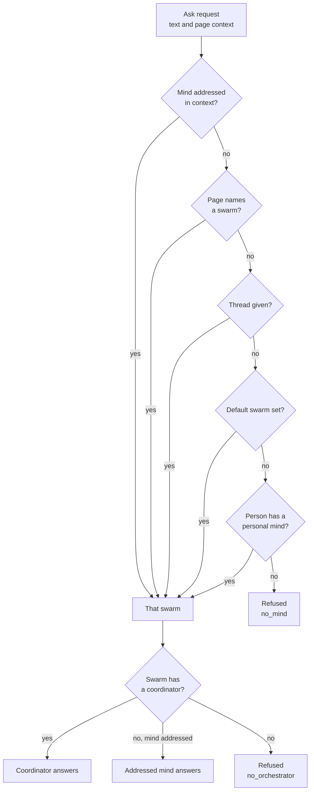
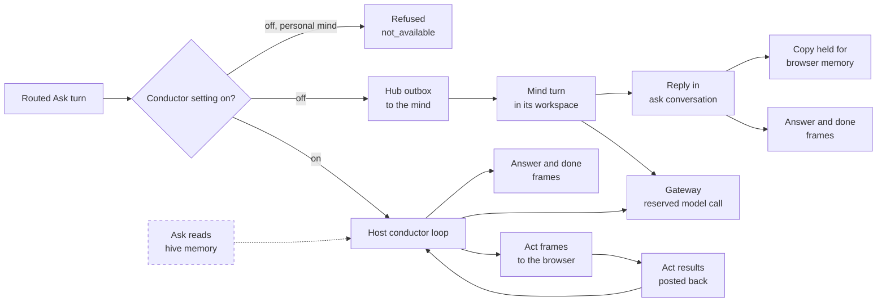
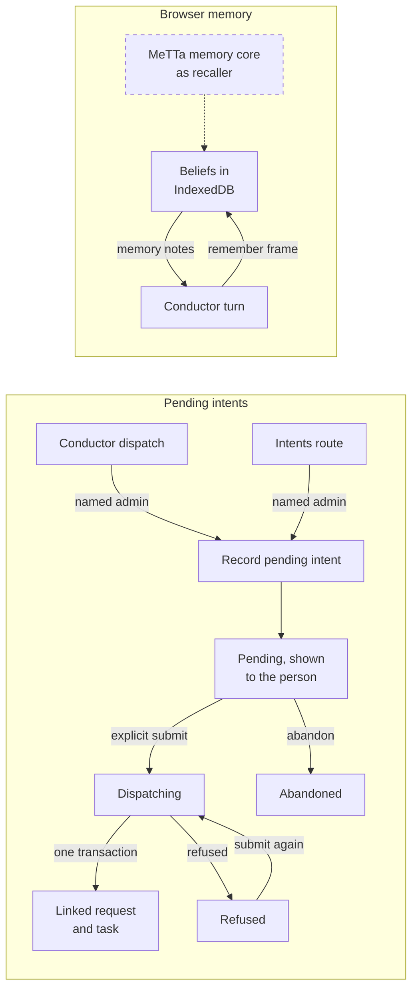

# Ask and conductor
> Status key: solid line = built; dashed line = intended, not finished. Code refs are to omegahive @ 34b0fb3 unless named. Refs marked *(followups PR)* or *(demo PR)* point at the omegahive pull request branches `port/surface-followups-r4` and `port/demo-mode-fix`, which bring live UI fixes into this repository.

**What this shows.** How a typed or spoken Ask is routed to one answering mind, and the two ways that turn is then executed: by the host conductor, or by an ordinary mind turn. It also covers screen acts, pending intents, spend caps, browser-kept memory and how personal turns stay private.

**Who should read it.** Owners of the Ask host (`hive/core/ask.py`, `conductor.py`, `ask_intents.py`), the Ask UI (`hive/ui/src/features/ask/`, `store/ask.ts`, `lib/askMemory/`), and any app or experience that exports a page view. Reviewers of routing, privacy, money and dispatch.

## Diagrams

### 1. Who answers

The host picks the answering swarm in a fixed order, then checks the asker against that swarm. The personal mind is only the last fallback.

### 2. Two execution paths

One setting chooses the path for every turn. The two paths do not mix within a turn.

### 3. Intents and browser memory

The conductor never sends work. It records a pending intent; the person submits it. Memory is kept by the browser, not the hive.

## How it works

**Admission.** `POST /api/ask` needs a named, signed-in person (`ask.py:633-636`; `app.py:1554-1561`). The body carries only `operation_id`, `text`, `context`, `thread`, `via` and optional `memory_notes` (`ask.py:123`, `ask.py:131-135`). Any authority, model or money field is refused (`ask.py:146-152`). One transaction writes the turn row, the room message, the hub outbox message and the `accepted` frame, or nothing (`ask.py:16-18`, `ask.py:671-731`). A replay of the same `operation_id` returns the original turn (`ask.py:604-609`).

**Routing order.** `_route` walks the order in diagram 1: the addressed mind's swarm, then the page's swarm, then the given thread's mind, then the person's default swarm, then the person's own personal mind (`ask.py:316-362`). The page's Ask store builds its body without `thread` (`store/ask.ts:1164`), so the host routes each request afresh; the field is optional (`api/ask.ts:88-89`).

**Coordinator checks.** `orchestrator` refuses an archived or unseen swarm, a person who does not participate (admin, owner, or named in `shared_with`; a public swarm is not enough), an unseen mind, and another person's personal mind (`ask.py:283-314`). There is no fallback to another mind.

**Answer-through.** A swarm with no coordinator, asked with an explicitly addressed mind of that swarm, is answered by that mind under the same checks; an external member (`kind == "module"`) is refused (`ask.py:9-11`, `ask.py:303-307`). The page may add the addressed mind itself when the page's swarm has no coordinator (`features/ask/answerer.ts:85-148`). The thread's info line calls the mind the swarm's orchestrator only when it is that swarm's coordinator; with no coordinator it says "<mind> answers directly, because <swarm> has no coordinator", and for another coordinator, or when the page does not know, it claims no role ("in <swarm>") (`features/ask/answerer.ts:161-176`) *(followups PR)*.

**Personal mind.** Each named person has one personal mind, asleep, alone in its own private swarm, created at sign-in (`personal.py:1-24`). It answers only when nothing else decides who answers, and only for its own person (`ask.py:312-313`). It answers only through the conductor: with the conductor off, a personal-mind turn is refused (`ask.py:615-618`). A personal turn never wakes that mind (`ask.py:613`, `ask.py:30`).

**Path A, the host conductor.** The conductor is off unless `HIVE_ASK_CONDUCTOR=1` (`conductor.py:71-72`). When it is on, every admitted turn opens as `conducting` and nothing is queued for the mind (`ask.py:638-639`, `ask.py:659-669`, `ask.py:706-718`). The host runs one model with a fixed tool set: `navigate`, `open`, `look`, `point`, `highlight`, `fill`, `scroll`, `tour_step`, `dispatch`, `say`, and `remember` when memory is on (`conductor.py:205-248`). A turn ends when the model replies with no tool call (`conductor.py:704-707`). The coordinator need not be awake (`ask.py:613`).

**Path B, an ordinary mind turn.** With the conductor off, the turn goes into the mind's hub outbox in conversation `ask:<turn_id>` (`ask.py:705-710`). The mind must be awake or starting; it is never woken (`ask.py:613-614`). The mind's own reply in that conversation is the only thing that answers the turn (`ask.py:19-20`, `ask.py:866-882`). Its skills run in its own workspace; only model calls go through the gateway.

**Screen acts and results.** Each on-screen tool call becomes an `act` frame with a fresh `act_id` (`conductor.py:969-990`). The browser applies it on screen only and posts `POST /api/ask/{op}/acts/{act_id}/result` with the new page view (`features/ask/conductor.ts:1-36`; `app.py:1738-1752`). The result route is owner-only, once per act, at most 8 KB (`conductor.py:1097-1133`). No result in 15 seconds reads as `no_result` (`conductor.py:106`, `conductor.py:997-1020`). `fill` types into a declared field and never submits (`conductor.py:220-221`). Results are held in the turn's memory only and never stored (`conductor.py:16-18`).

**Frames.** Frames are stored in order and published to the asker only (`ask.py:21`). The host emits `accepted`, `thinking`, `act`, `answer` (deltas from `say`, then one whole answer), `dispatched`, `memory`, `intent`, `link`, `steer`, `done` and `refused` (`ask.py:723`, `ask.py:851-858`, `ask.py:1016`, `conductor.py:657-687`, `ask_intents.py:102-105`). A conductor turn's `done` carries an outcome from a fixed enum (`conductor.py:115`).

**Steer, stop and takeover.** The person may stop a turn (`app.py:1714`). Steering words join an open mind turn, but are refused on a conducting turn (`ask.py:1167`). Takeover ends a conductor turn when the person takes the page back (`ask.py:1042-1057`; `app.py:1718-1736`).

**Pending intents and explicit submit.** `dispatch` calls `Intents.record` in process; it records one pending intent on the person's own turn and never calls `submit` (`conductor.py:1064-1095`). Only a named, enabled admin may record, in process and on the route (`conductor.py:1084-1086`; `app.py:1660-1665`). The only kind is `code.request` (`ask_intents.py:44`, `ask_intents.py:205-206`). Submit is a separate person action: claim to `dispatching`, then `Minds.instruct` with the stored body, linked inside instruct's own transaction (`ask_intents.py:285-317`, `ask_intents.py:269-283`). The browser never re-sends the body (`ask_intents.py:310`). The linked work is an ordinary work item in the receiving swarm (`ask.py:32-34`).

**Spend caps.** A thread is a session with a cap: $0.25 by default, raisable by the person to $5, and a cap only tightens (`ask.py:14-15`, `ask.py:118`, `ask.py:650-652`). A spent thread is refused with `spend_limit` (`ask.py:626-629`). A conductor turn also has its own cap (`HIVE_ASK_CONDUCTOR_TURN_USD`, default $0.25), 32 acts, 12 model calls and 120 seconds (`conductor.py:93-108`). Every paid call is reserved through cost reservations under scope `askturn:<turn_id>` (`conductor.py:770-786`). Calls use the hive's own key, are billed as the turn's mind and paid by the asking person (`conductor.py:26-30`, `conductor.py:750-751`). A personal-mind turn is paid from the person's month allowance (`conductor.py:28-31`; `personal.py:7-11`). Rate limits are 10 turns a minute and 300 a day per person (`ask.py:119`, `ask.py:572-576`).

**Memory kept in the browser.** The hive keeps no conductor memory (`conductor.py:9-11`). The browser holds beliefs in IndexedDB per person and hive (`lib/askMemory/store.ts:1-6`; `lib/askMemory/backend.ts:368`). Each turn it recalls up to 20 notes, 8 KB, and sends them as `memory_notes` (`lib/askMemory/recall.ts:1-12`; `store/ask.ts:1164`). They reach the model only while the conductor and `HIVE_ASK_MEMORY=on` are both set, and are never stored or logged (`ask.py:131-134`, `ask.py:562-566`). With memory on, `remember` publishes a live `memory` frame to the asker; the stored copy keeps only `op` and a digest (`conductor.py:12-14`, `conductor.py:1041-1062`). On the mind path, a copy of the exchange waits in a separate inbox database until the browser collects and acknowledges it (`personal_inbox.py:1-20`; `app.py:1784-1790`).

**Personal privacy.** A personal turn keeps no words or context on the host: its row has no text, nothing goes to the room or hub, and its stored frames pass an allowlist of ids, enums, money and digests (`ask.py:24-31`, `ask.py:158-162`, `ask.py:762-782`). The question reaches the conductor in memory only (`ask.py:661-663`; `conductor.py:604-613`). Every read, admin audit included, returns no content for it (`ask.py:1236`, `ask.py:1253-1256`, `ask.py:1277-1289`). The answer is not written to the room (`conductor.py:667-669`). Acts and memory naming a private app (Atlas, Truth) are dropped, with a fail-closed canonical check (`conductor.py:126-176`; `features/ask/view.ts:25-51`).

**The fast path.** Before anything reaches the host, the page tries a local, model-free resolver (`lib/intent/index.ts:1-8`). Confident moves and looks run at once with Back or Undo; below a score of 0.55 the turn goes to `POST /api/ask` (`lib/intent/score.ts:1-12`). Fast-path turns stay device-local (`features/ask/run.ts:1-6`).

**Context from the Tasks page.** On Tasks, the page's swarm and mind filters, and the open tasks it shows, reach the Ask as context (`features/ask/context.ts:79`, `:99-109`) *(demo PR)*.

## Intended shape and upgrade path

- **Built:** routing, both execution paths, act results, intents with explicit submit, caps, browser memory and personal privacy, as above.
- **Intended, not built:** the Ask reading hive memory (`/api/me/recall`), an "about this swarm" context, and minds seeing the screen on demand (`see_view`) (`docs/STATUS.md:60`). No `/api/me/recall` or `see_view` exists in `hive/core` at this base.
- **Intended:** hive-hosted memory for the person is described as "coming soon" (`conductor.py:9-11`). Recall sits behind a `Recaller` interface so a MeTTa memory core can replace the lexical recaller later (`lib/askMemory/recall.ts:10-12`). A browser-hosted personal mind is a reviewed plan awaiting approval (`docs/STATUS.md:59`).
- **Intended:** a per-thread spend raise, and `program_homes.mind_id` to pick an app's declared mind for answer-through (`docs/STATUS.md:61`; `features/ask/answerer.ts:93-95`).
- **Client ahead of host:** the page's frame parser accepts `proposal`, `ui-change`, `action-needs-confirm`, `presence` and `revert` frames (`api/ask.ts:279-284`). The host emits none of these at this base; phase 1 is documented as text only, with no app tools or confirm tokens (`ask.py:3-5`). App acts reach a person through the app's own confirm (see `03-app-frame-bridge.md`).

## Seams and contracts

| Seam | Shape | Ref |
|---|---|---|
| `POST /api/ask` | `{operation_id, text, context, thread?, via?, memory_notes?}` → 202 turn view | `app.py:1554`; `ask.py:123-134` |
| `GET /api/ask/{op}` | turn and frames after `seq`, 100 per page | `app.py:1709`; `ask.py:1240` |
| `POST /api/ask/{op}/steer`, `/stop`, `/takeover` | steer words; stop; take the page back | `app.py:1699-1736` |
| `POST /api/ask/{op}/acts/{act_id}/result` | `{ok, reason?, view, route, experience}`, ≤ 8 KB | `app.py:1738`; `conductor.py:416-433` |
| `POST /api/ask/{op}/intents` | `{kind: "code.request", request}`, admin | `app.py:1660`; `ask_intents.py:189` |
| `POST /api/ask/intents/{id}/submit`, `/abandon` | explicit send; abandon | `app.py:1667-1677` |
| `GET/PUT /api/me/ask` | default swarm, thread budget, eligible swarms, `capabilities` | `app.py:1759-1770`; `ask.py:568-570` |
| `GET /api/me/mind/inbox`, `POST .../ack` | held exchange copies for the browser | `app.py:1784-1790` |
| Context | `route, experience, program, swarm_id, mind, selection, view` | `ask.py:141` |
| Page view | `refs, acts, summary, fields, regions`, ≤ 2 KB | `ask.py:142`; `features/ask/view.ts:12-23` |
| Settings | `HIVE_ASK_CONDUCTOR`, `HIVE_ASK_CONDUCTOR_MODEL`, `HIVE_ASK_CONDUCTOR_AB_MODELS`, `HIVE_ASK_CONDUCTOR_TURN_USD`, `HIVE_ASK_MEMORY`, `HIVE_ASK_TIMEOUT_SECONDS` | `conductor.py:71-98`; `ask.py:120` |

## For owners: how to plug in

1. **A page that the conductor can see.** Call `useAskView(view)` with ids, act ids, a summary, declared fields and named regions (`features/ask/view.ts:1-23`). It is exported to experiences by `experiences/sdk.ts:85`. Keep it under 2 KB.
2. **A field the conductor may fill.** Declare it with `features/ask/fields.ts` `useAskFillable`; undeclared fields answer `not_declared` (`features/ask/conductor.ts:15-21`).
3. **In-place acts for an experience.** Register a handler with `registerActHandler(experience, fn)` (`features/ask/handlers.ts:1-17`). Do not fork the runner.
4. **A private app.** Add it to both fences together: `PRIVATE_APPS` in `conductor.py:126` and `features/ask/view.ts:25`. Its page then sends only `{private: true}`.
5. **A new intent kind.** Not supported yet: `ask_intents.py` accepts only `code.request` (`ask_intents.py:44`). Raise it with the Ask host owner first.

## For reviewers: what to check

- **No silent fallback.** A refusal never routes to another mind (`ask.py:6-8`). Tests: `hive/tests/test_ask.py:131`, `:151`, `:204`; `hive/tests/test_personal_mind_ask.py:74`, `:89`.
- **The conductor never wakes or queues to the mind.** Tests: `hive/tests/test_ask_conductor.py:255`, `:282`; `hive/tests/test_personal_mind_ask.py:135`, `:192`.
- **Dispatch only records.** No `Intents.submit` call outside the submit route. Tests: `hive/tests/test_ask_conductor.py:372`; `hive/tests/test_ask_intents.py:115`, `:254`; `hive/tests/test_personal_ask_control.py:34`.
- **Personal content stays off the host.** Check every new read path against `_is_personal`. Tests: `hive/tests/test_personal_mind_ask.py:41`, `:151`; `hive/tests/test_personal_ask_control.py:67`; `hive/tests/test_ask_memory.py:132`, `:166`.
- **Caps hold.** Tests: `hive/tests/test_ask_conductor.py:189-235`, `:588`, `:708`; `hive/tests/test_ask.py:475`, `:601`; `hive/tests/test_personal_mind_ask.py:103`.
- **Private-app fence.** Both fences must list the same apps. Tests: `hive/tests/test_ask_conductor.py:236`, `:527-573`, `:734`, `:764-773`.
- **Authority from the body is refused.** Test: `hive/tests/test_ask.py:278`.
- **Risk:** `ask.py` is about 1,300 lines of cross-cutting rules (`docs/MODULARITY.md:42`); a new read route must apply the personal and visibility checks itself.

## References

- `hive/core/ask.py:1-34`, `:116-162`, `:283-362`, `:559-570`, `:600-731`, `:762-782`, `:866-882`, `:1042-1057`, `:1167`, `:1236-1289`
- `hive/core/conductor.py:1-43`, `:71-122`, `:126-176`, `:205-260`, `:570-613`, `:657-707`, `:747-786`, `:942-1062`, `:1064-1133`
- `hive/core/ask_intents.py:1-50`, `:102-105`, `:189-261`, `:269-317`
- `hive/core/personal.py:1-24`, `:80-93`; `hive/core/personal_inbox.py:1-20`
- `hive/core/app.py:1554-1566`, `:1660-1790`
- `hive/ui/src/features/ask/answerer.ts`, `conductor.ts:1-36`, `view.ts:1-51`, `run.ts:1-6`, `handlers.ts:1-17`, `fields.ts`
- `hive/ui/src/store/ask.ts:1164`; `hive/ui/src/api/ask.ts:279-284`
- `hive/ui/src/lib/intent/index.ts:1-8`, `lib/intent/score.ts:1-12`; `lib/askMemory/store.ts:1-6`, `recall.ts:1-12`, `backend.ts:368`
- `docs/STATUS.md:59-61`; `docs/MODULARITY.md:42`
