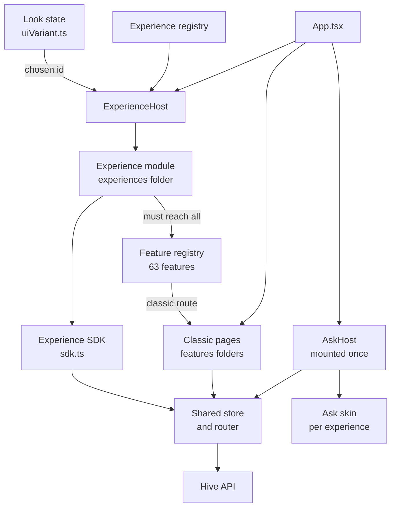
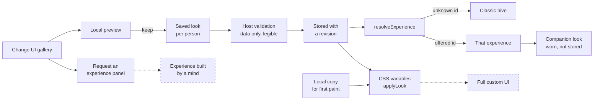
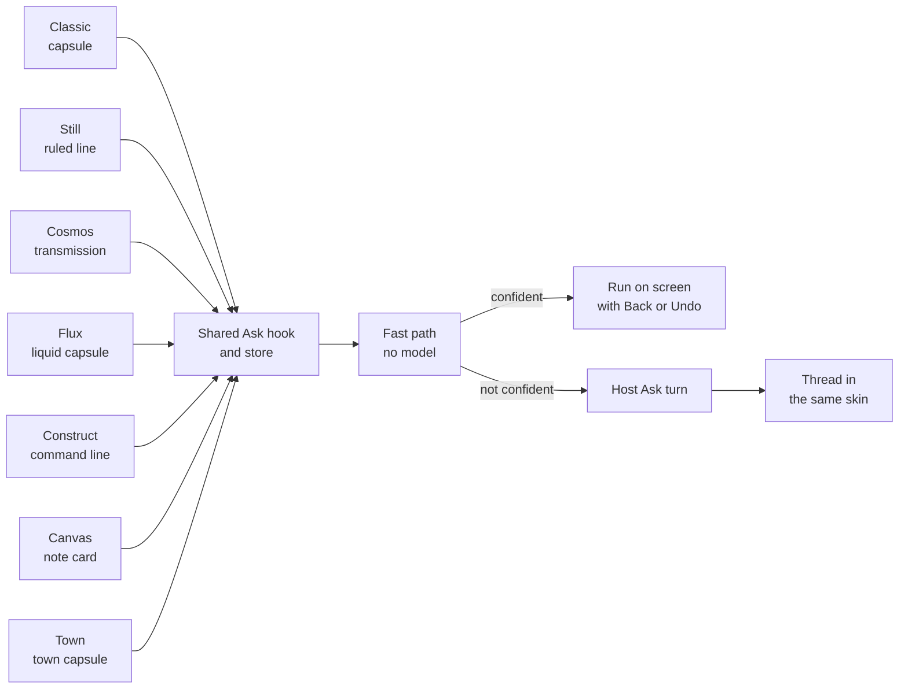

# UI, experiences and looks
> Status key: solid line = built; dashed line = intended, not finished. Code refs are to omegahive @ 34b0fb3 unless named. Refs marked *(followups PR)* or *(demo PR)* point at the omegahive pull request branches `port/surface-followups-r4` and `port/demo-mode-fix`, which bring live UI fixes into this repository. Refs marked *(hive-scale PR)*, *(health-idle UI PR)*, *(workbench-map PR)*, *(lab-compare PR)*, *(followups-r5 PR)* or *(lab-reports PR)* point at the second round of branches (`port/hive-scale`, `port/health-idle-ui`, `port/workbench-map`, `port/lab-compare`, `port/followups-r5`, `port/lab-pc-band`), stacked in that order.

**What this shows.** How the web UI is organised: feature folders, one feature registry, whole alternative front ends called experiences, data-only looks, and the one Universal Ask bar that every experience draws in its own style. It ends with how to add an experience or a look.

**Who should read it.** Owners of the web UI shell and of any experience or look. Reviewers of UI changes, look validation and the "every page has the Ask" rule.

## Diagrams

### 1. How the UI is put together

### 2. Looks, experiences and the saved choice

### 3. One Ask, many skins

## How it works

**Feature folders.** UI code lives in `hive/ui/src/features/<area>/` (37 folders at this base), with shared code in `lib/`, `store/`, `shell/`, `ui/` and `api/` (`docs/MODULARITY.md:33-35`). One list, `features/registry.ts`, names everything a person can do: 63 entries in 11 groups, each with its classic route or `null` for a known gap (`features/registry.ts:1-24`, `:95-122`).

**Experiences.** An experience is a whole alternative front end: it owns layout, navigation, interaction and motion. A look only recolours the classic UI (`experiences/registry.ts:4-9`). Each entry has an id, name, swatch, an optional companion look and a lazy `load` (`experiences/registry.ts:10-28`). The registry lists Classic, OmegaTown, Cosmos, Construct, Still, Flux and Canvas, plus the Professional candidate (`experiences/registry.ts:30-139`).

**Reviewed only.** A production build offers only experiences marked `reviewed: true`. Unreviewed candidates compile out except in the preview build (`experiences/registry.ts:22-27`, `:47-64`, `:140-145`). An unknown or unoffered id resolves to Classic, so a saved choice never strands anyone (`experiences/registry.ts:149-151`).

**Mounting and safety.** `App.tsx` mounts `ExperienceHost` for the chosen experience and `AskHost` once, outside the route switch (`App.tsx:185`, `App.tsx:390`; `features/ask/AskHost.tsx:1-14`). If an experience throws, the person is sent back to Classic at once; the Omega menu stays outside the guard as an escape hatch (`experiences/ExperienceHost.tsx:8-25`, `:62-68`). Classic pages still open over any experience (`experiences/registry.ts:7-8`).

**The experience SDK.** An experience uses only `experiences/sdk.ts`: the same store, router and reviewed actions as Classic. It must never call `fetch` or the client directly (`experiences/sdk.ts:1-5`). The SDK also exports the Ask's page view, mind addressing and act handlers (`experiences/sdk.ts:85-97`).

**Coverage.** Every experience must reach every feature, natively or by opening the classic page. `experiences/coverage.ts` lists each experience's native features; the test fails on any unknown id (`experiences/coverage.ts:1-30`; `experiences/coverage.test.ts:1-20`).

**Looks.** A look (variant) is data only: 19 colour tokens, font stacks, and enums for scheme, layout, density, radius and motion (`shell/uiVariant.ts:7-38`). The host validates it and refuses an illegible one rather than repairing it; no CSS text, URLs or scripts are accepted (`core/ui_prefs.py:1-6`, `:28-40`). It is saved per person at `GET/PUT/DELETE /api/me/ui` with a revision, and a stale write is refused (`app.py:910-936`; `core/ui_prefs.py:16-26`). The saved prefs are `variant`, `layout`, `apps` and `experience` (`core/ui_prefs.py:134-149`). Five seed looks ship in `shell/uiVariants.seed.json`.

**Companion looks.** An experience may wear a companion look so classic pages opened from it match. It is worn while active and never stored as the person's own look (`shell/uiVariant.ts:40-50`, `:161-167`).

**Universal Ask bar.** Every experience has the Ask. `ASK_SKINS` maps each experience to a skin, and a test fails if one is missing (`features/ask/AskHost.tsx:60-74`; `experiences/ask.test.ts:35-38`). A skin is only words and a look; behaviour is the one shared hook and store, never a fork (`features/ask/skins.ts:1-15`). Still and Construct draw their own field; the host's floating line is the fallback (`features/ask/AskHost.tsx:76-80`). `⌘K`, `Ctrl+K` and `/` summon it everywhere (`features/ask/AskHost.tsx:8`). Voice input uses the same field (`features/ask/useAskVoice.ts`).

**The fast path.** The Ask first runs a local resolver with no model and no network (`lib/intent/index.ts:1-8`). A confident view or look runs at once with Back or Undo. Decisions and money only open their existing dialog. Below 0.55, the host answers (`lib/intent/score.ts:1-12`). See `01-ask-and-conductor.md` for the host side.

**Who said it, in a mind's chat.** Mind chats carry each message's real sender principal, and an admin's audit (or the loopback operator's whole stream) shows other people's messages. The chat labels a message "You" only when the sender is the viewer's own principal; the hive-password operator is "the operator"; anyone else is shown by their display name from the people list, which is read once per chat and only for an admin when someone else's words are present, else by their principal without `user:` (`lib/personNames.ts:30-39`; `features/dot/Chat.tsx:55-62`) *(followups PR)*. Coffee Room member names follow the same rule (`features/messages/coffee.ts:225`) *(followups PR)*.

**Demo mode and guided demos.** The showreel (`?sim=1`), the guided demos and the tour run on the real page. Fixes live since the handover snapshot:
- **The page starts when browser storage is blocked.** The setup checklist read storage outside its `try` (`features/setup/checklist.ts:96-120`) *(demo PR)*.
- **A thread the person reopens stays open** for the rest of that demo run, instead of refolding at each step (`features/guided/play.ts:150-168`) *(followups PR)*.
- **No mark once its element has gone.** A mark bound to an element draws on that element only, and disappears when it leaves the page, instead of ringing a different element (`features/ink/ink.ts:34`; `features/ink/InkLayer.tsx:33`) *(followups PR)*.
- **An empty press on the map stays empty** on release, rather than selecting a dot that drifted under the pointer (`scene/engine.ts:985`) *(followups PR)*.
- **Routes the demos use.** `?tab=commons` opens a swarm's commons as its constellation, and a new `?tab=` on the open page moves it there, while the same tab again keeps the person's choice (`features/swarm/commonsView.ts:22`; `features/swarm/SwarmView.tsx:48`) *(demo PR)*. `?view=graph` opens an app's graph view and goes through the unsaved-edits guard first; kept edits keep the page and the route (`features/programs/viewLink.ts:6`; `features/programs/ProgramPage.tsx:209`) *(demo PR)*. The tour reaches the commons by its route, never by a click, and opens an app in a home picked as the page would, never a private one (`tour/script.ts:169`, `:199`) *(demo PR)*.
- **Approval asks show one card at a time;** a second says more decisions wait, with no global count (`shell/approvalToasts.ts:81-91`) *(demo PR)*. **The desktop activity ticker stands clear above the Ask** (`shell/tickerPlace.ts:11`) *(demo PR)*.
- **In the simulator, a swarm's coordinator never dozes off by itself,** so the demo's requests reach it (`api/sim/SimClient.ts:1544-1546`) *(demo PR)*. The showreel's code-layer references follow the current files.

**The hive map as a universe of galaxies.** Each person's hive is a galaxy, with their own mind drawn as "You" at its centre, and the cloud hive in the middle (`scene/rings.ts:131` `universeLayout`) *(hive-scale PR)*. One visibility helper fixes what a viewer is shown before anything is grouped, sized, counted, linked or handed to the Ask; the map, the Ask's hive context and the Still and Professional swarm lists all take it (`scene/visibleSet.ts:91`) *(hive-scale PR)*. A private app's homes fail closed until the hive has said which swarms they are: nothing that could be one is shown while that is pending, and after a failed read such objects are at most unattributed placeholders (`scene/privateHomes.ts:12-21`) *(hive-scale PR)*. A galaxy can be dragged by its name; the arrangement is kept per person in this browser, and a drag never crosses an identity change (`scene/galaxyDrag.ts:29`) *(hive-scale PR)*. Galaxy names keep clear of the HUD's stats tile and of the docked Ask (`scene/engine.ts:81` `GALAXY_LABEL_ROOM`; `features/ask/askRoom.ts:7-16`) *(followups-r5 PR)*.

**Health's Idle minds section.** Health shows who it noticed awake with no input, what it asked and whether the mind answered, each mind's history, and Remind and Sleep (`features/health/IdleMinds.tsx:39`, `:98`) *(health-idle UI PR)*. Only the host's per-viewer flags decide who may act (`api/idleMinds.ts:282` `hostAllows`); the store re-reads `GET /api/agents/{id}` at the press, sends nothing unless the flag and an awake status hold then, and binds the act to the identity it started under (`store/store.ts:643`) *(health-idle UI PR)*. The Ask offers "remind <mind>" and "put <mind> to sleep" under the same rules.

**Workbench Map, a Map mode of the Code page.** `#/code/map/<repo>@<sha>` reads the repository-map routes and draws an overview, levels by directory that hold at 10,000 nodes, a node card, drift between revisions and the Ask's words as an editable preset (`features/code/map/MapView.tsx:24`, `:139`; `api/repoMap.ts:19-31`; `lib/router.ts:69`) *(workbench-map PR)*. The revision's own state is shown on every view, and the repo space's mount (queued, mounting, mounted, failed, incomplete, unmounted) is shown as the host reports it. Answers for a previous revision are dropped; 401, 403 and 404 close the map. The simulator plays the host's shapes from synthetic fixtures (`?sim=1&repomap=…`).

**Lab: comparable measures and research reports.** Compare and the Epistemic board call one run better or worse on a measure only when the two are comparable: units recorded and declared (`features/lab/stallCompare.ts:114` `UNIT_TABLE`, `:251` `judgeMetric`), the same definition and direction; anything else says "not comparable" or "unknown" with its reason (`features/lab/epistemicCompare.ts:43-65`) *(lab-compare PR)*. A read-only predictive-coding band shows OmegaEvolve's recorded contributions as claims, with each evidence reference's origin, custody and verification as the host records them; authority words fail closed, and nothing in it is counted in totals, Compare, History or Health (`features/lab/pc/PcFamily.tsx:219`; `features/lab/pc/model.ts:98-111`) *(lab-reports PR)*.

**Smaller fixes.** A new source and the graph view in one route event ask one unsaved-edits question (`features/programs/viewLink.ts:22`); a guided demo forgets a thread the person kept open when its run ends (`features/guided/play.ts:174-175`); with no `/me`, nobody is labelled "You" and the chat says its labels are degraded; the Constellation has its own tour target; simulator-heavy tests have timeouts measured under load *(followups-r5 PR)*. Showreel code references are anchored by their quoted text, so a moved line warns instead of failing (`features/showreel/layers.test.ts:78-79`) *(showreel PR)*.

## Intended shape and upgrade path

- **Built:** the registry, reviewed-only offering, the SDK, coverage, data-only looks with revisions, and one Ask skin per experience.
- **Intended:** experiences built by a mind from a description. Today the "Request an experience" panel previews look changes and says a new experience is "coming next" (`features/requestExperience/RequestPanel.tsx:1-13`).
- **Intended, untested:** full custom "any UI" is mostly finished and untested (`docs/STATUS.md:54`).
- **Planned:** hive view as galaxies, one per person, is a reviewed plan awaiting approval (`docs/STATUS.md:59`).
- **Design direction:** each experience keeps one material for its windows, pages and Ask, from its chrome tokens (`features/ask/skins.ts:14-15`; `experiences/registry.ts:153-175`). Apps receive the same tokens through the frame `context` message (see `03-app-frame-bridge.md`).

## Seams and contracts

| Seam | Shape | Ref |
|---|---|---|
| `ExperienceDef` | `{id, name, tagline, blurb, companionLook?, swatch, load?, reviewed?}` | `experiences/registry.ts:10-28` |
| Experience chrome | `experiences/<id>/chrome.ts` exporting `chrome`, else from the swatch | `experiences/registry.ts:153-175` |
| Experience navigation | `experiences/<id>/nav.ts` exporting `NAV_FEATURES` | `experiences/coverage.test.ts:9` |
| Native coverage | `NATIVE[id]`: feature ids | `experiences/coverage.ts:9-24` |
| Ask skin | `ASK_SKINS[id]` | `features/ask/AskHost.tsx:64-74` |
| In-place act handler | `registerActHandler(experience, fn)` | `features/ask/handlers.ts:12-17` |
| Page view for the Ask | `useAskView(view)` | `features/ask/view.ts:1-23`; `experiences/sdk.ts:85` |
| Look | `omegasurface.variant/0.1` | `shell/uiVariant.ts:23-38`; `core/ui_prefs.py:29` |
| Saved prefs | `GET/PUT/DELETE /api/me/ui` with `rev` | `app.py:910-936`; `shell/uiVariant.ts:52-60` |
| Feature | `{id, label, blurb, group, classic, decision?, money?, keywords?}` | `features/registry.ts:9-22` |

## For owners: how to add an experience

1. Create `hive/ui/src/experiences/<id>/` with `index.tsx` (default export), `chrome.ts` and `nav.ts` exporting `NAV_FEATURES`. Use only `experiences/sdk.ts` for data and actions.
2. Add an `ExperienceDef` to `experiences/registry.ts`. Leave `reviewed` unset; it stays a candidate until review signs off the whole experience (`experiences/registry.ts:22-27`).
3. Add `NATIVE['<id>']` in `experiences/coverage.ts`, naming only real feature ids.
4. Add a skin in `ASK_SKINS` (`features/ask/AskHost.tsx:64`), and its words in `features/ask/skins.ts` if it is a new floating look. Export page views with `useAskView`.
5. If the experience needs a grammar for app forms or frames, add it to `GRAMMARS` in `forms/contract.ts:11-12`; otherwise apps use Classic.
6. Run the UI tests: `cd hive/ui && npx vitest run src/experiences`. Coverage, Ask presence and chrome tests must pass.

Adding an experience touches these shared lists; it does not edit other experiences (`docs/MODULARITY.md:35`).

## For owners: how to add a look

1. Add a variant object to `hive/ui/src/shell/uiVariants.seed.json` with schema `omegasurface.variant/0.1`, all 19 colour keys and the enums (`shell/uiVariant.ts:20-38`).
2. Text and edge colours must be solid `#rrggbb`; only `line`, `line-2`, `glass` and `glass-2` may carry alpha (`core/ui_prefs.py:39-40`). The host refuses an illegible look.
3. Run `hive/tests/test_ui_prefs.py` and the look tests in `hive/ui/src/shell/`.

## For reviewers: what to check

- **No direct network calls in an experience.** All data through `sdk.ts` (`experiences/sdk.ts:1-5`).
- **Reviewed gate.** `reviewed: true` only with a whole-experience verdict; production builds compile candidates out (`experiences/registry.ts:22-27`, `:47-57`).
- **Every experience has the Ask and reaches every feature.** Tests: `hive/ui/src/experiences/ask.test.ts`, `coverage.test.ts`, `askSkins.test.ts`.
- **Looks stay data only.** No CSS text, URLs or scripts; illegible looks refused. Test: `hive/tests/test_ui_prefs.py`.
- **Closed tier.** `experiences/omegatown` is a closed folder; open code reaches it only through the registry (`docs/MODULARITY.md:20-24`).
- **Chat labels.** "You" only for the viewer's own principal, never for every `user:` sender. Tests: `features/dot/chatSender.test.ts`, `lib/personNames.test.ts`, `features/messages/coffee.test.ts` *(followups PR)*.
- **Demo routes and guards.** Tests: `tour/scriptRoutes.test.ts`, `features/swarm/commonsView.test.ts`, `features/programs/viewLink.test.ts`, `features/setup/checklist.test.ts`, `api/sim/coordinatorAwake.test.ts` *(demo PR)*; `features/guided/play.test.ts`, `features/ink/ink.test.ts` *(followups PR)*.
- **One visibility helper before the map.** Nothing hidden from a viewer may change what the map draws, counts or links; private-app homes stay hidden until known. Tests: `scene/hiveScale.privacy.test.ts`, `scene/hiveScale.r1_1.test.ts`, `scene/hiveScale.r1_2.test.ts`, `scene/galaxyFit.r5.test.ts` *(hive-scale PR, followups-r5 PR)*.
- **Only the host's flags decide Remind and Sleep.** Tests: `features/health/idleMinds.test.ts`, `store/askHostFlags.test.ts`, `store/healthIdleR13.test.ts`, `store/healthIdleR14.test.ts` *(health-idle UI PR)*.
- **Map answers belong to their revision; measures are judged only when comparable; reports never count.** Tests: `features/code/map/workbenchMap.test.ts`, `revisionChange.test.ts` *(workbench-map PR)*; `features/lab/labCompare.r1.test.ts`, `labCompare.r1_1.test.ts` *(lab-compare PR)*; `features/lab/pc/pcFamily.test.ts`, `pcFamilyScope.test.ts` *(lab-reports PR)*.
- **Risk:** the host checks only that `experience` is a slug (`core/ui_prefs.py:146-148`); the UI decides what is offered. Keep `resolveExperience` falling back to Classic.

## References

- `hive/ui/src/App.tsx:20`, `:32`, `:185`, `:390`
- `hive/ui/src/features/registry.ts:1-122`
- `hive/ui/src/experiences/registry.ts:1-175`, `sdk.ts:1-97`, `ExperienceHost.tsx:1-68`, `coverage.ts:1-30`, `coverage.test.ts:1-20`, `ask.test.ts:35-38`
- `hive/ui/src/shell/uiVariant.ts:1-60`, `:161-167`; `shell/uiVariants.seed.json`
- `hive/core/ui_prefs.py:1-41`, `:134-149`; `hive/core/app.py:910-936`
- `hive/ui/src/features/ask/AskHost.tsx:1-80`, `skins.ts:1-88`, `handlers.ts:1-17`, `view.ts:1-23`
- `hive/ui/src/lib/intent/index.ts:1-8`, `score.ts:1-12`
- `hive/ui/src/features/requestExperience/RequestPanel.tsx:1-13`
- `docs/MODULARITY.md:10`, `:20-24`, `:33-35`; `docs/STATUS.md:54`, `:59`
