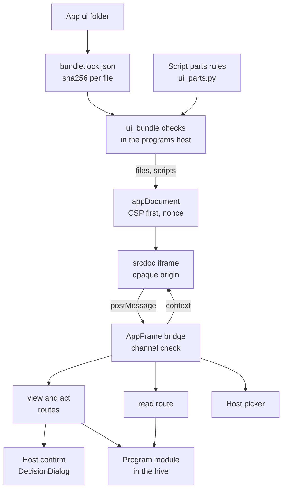
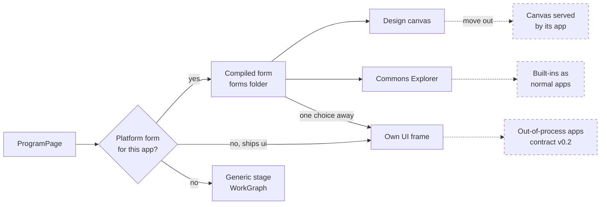

# App frame bridge
> Status key: solid line = built; dashed line = intended, not finished. Code refs are to omegahive @ 34b0fb3 unless named.

**What this shows.** How an app serves its own screen from its `ui/` folder: the hive checks the pinned files, builds a locked-down frame, and talks to it only by messages. It also shows which app screens are still compiled into the platform UI, and the planned move of those screens out to their apps.

**Who should read it.** App owners who want their own interface. Owners of the programs host and the UI frame code. Reviewers of frame isolation, host confirm and the modularity plan.

## Diagrams

### 1. Serving and isolating an app's own screen

### 2. Where an app's screen comes from

## How it works

**Pinned files.** An app ships `ui/index.html`, `ui/app.js` and `ui/style.css`, each pinned by sha256 in `ui/bundle.lock.json`. A changed, extra or unpinned file answers 404 `no_app_ui`; a changed app digest answers 403 `app_integrity` (`hive/PROGRAMS.md:498-501`, `:530-533`; `hive/core/programs.py:737-760`). Each file is at most 600,000 bytes (`hive/core/programs.py:735`, `:756-760`).

**Script parts.** The lock may list 1 to 3 script parts, with `app.js` last and total size at most 1,800,000 bytes. The markup must end with exactly one module script tag per part (`hive/PROGRAMS.md:503-528`). The rules live in `hive/core/ui_parts.py` and are mirrored in `hive/ui/src/lib/appFrameParts.ts`; both suites check `tests/fixtures/ui_parts_cases.json` (`hive/PROGRAMS.md:530-536`; `hive/core/ui_parts.py:1-10`).

**The route.** `GET /api/programs/{id}/ui` returns `{program, files}` or `{program, files, scripts}` (`hive/core/app.py:2855-2858`; `hive/PROGRAMS.md:530`).

**The frame document.** The client writes the host's doctype, `<html>` with `data-app-host-origin` and `data-app-channel`, and a CSP meta tag before any app byte. Inline scripts and styles run only with the nonce (`hive/ui/src/lib/appFrame.ts:15-34`; `hive/PROGRAMS.md:486-497`). The policy allows no network, no forms and only `data:` or `blob:` images (`hive/ui/src/lib/appFrame.ts:15-17`).

**The iframe.** The app runs in a `srcdoc` iframe sandboxed with `allow-scripts allow-downloads` and no same-origin, so its origin is opaque (`hive/ui/src/features/programs/AppFrame.tsx:386`; `hive/PROGRAMS.md:480-484`).

**Messages only.** The host accepts a message only from that exact frame window, from origin `null`, on that channel (`hive/ui/src/lib/appFrame.ts:51-53`; `hive/ui/src/features/programs/AppFrame.tsx:189-190`). Every request is bound to the identity it arrived under; a request from a document loaded for an earlier person is not sent (`hive/ui/src/features/programs/AppFrame.tsx:195-204`). Each frame has a rate bucket of 60, refilled 20 a second (`hive/PROGRAMS.md:715-718`).

**Base messages.** `app-ready` gets `app-context` with `program` and `swarm_id`. `app-request` with op `view` or `act` gets `app-reply`; the host fixes the swarm and the person, and the frame cannot choose them. `subscribe` sends `artifact.revision` notices, never a body (`hive/PROGRAMS.md:536-544`).

**Context and picker.** After `app-ready`, the host sends a data-only `context`: the experience, its chrome tokens, the app's identity in the current look, reduced motion, capabilities and insets (`hive/PROGRAMS.md:551-581`). Every chrome value is checked and replaced if it fails. `pick` opens the host's own picker; the frame gets one chosen reference and never sees the list. A picked reference grants nothing (`hive/PROGRAMS.md:583-621`; `hive/ui/src/lib/appBridge.ts:1-15`).

**Frame operations.** `read`, `act` with a file, `show-file`, `open-url`, `back-request` and `escape`, `layout`, and goal status subscriptions are host operations with exact keys. A message naming a program, swarm or person is refused (`hive/PROGRAMS.md:704-714`). The read route is `POST /api/programs/{id}/read` for a read the app declares in `describe().reads` (`hive/core/app.py:2887`; `hive/PROGRAMS.md:711-733`).

**Host confirm.** An action with `confirm: true` or `person_activity: true` is confirmed in the host's DecisionDialog, not in the frame. The host mints a token bound to the exact payload digest through `POST /api/programs/{id}/confirm`; the act route checks it (`hive/PROGRAMS.md:883-930`; `hive/core/app.py:2899-2914`; `hive/ui/src/features/programs/HostConfirm.tsx`; `hive/ui/src/lib/hostConfirm.ts`).

**Forms first, frame one choice away.** `ProgramPage` opens a compiled platform form when one is registered for the app, else the app's own frame, else the generic WorkGraph stage (`hive/ui/src/features/programs/ProgramPage.tsx:112-113`, `:246`). Two forms are compiled in: `commons` for Commons Explorer and `design-canvas` for Studio (`hive/ui/src/forms/contract.ts:78-102`). Studio ships its own frame too; its form opens first and the frame stays one choice away (`hive/ui/src/forms/contract.ts:83-88`). A form gets the same `act()` contract as the generic host (`hive/ui/src/forms/contract.ts:4-9`, `:14-24`).

## Intended shape and upgrade path

The written direction is that each app ships its own screens through the frame, and the platform UI holds none of them.

- **Built:** the frame, its isolation, parts, context, picker, frame operations and host confirm, as above. `docs/FEATURES.md` lists AP12 (own interface) and AP13 (frame operations) as live (`docs/FEATURES.md:204-205`).
- **Done in the handover round:** the life-map and case-file forms moved out of the platform UI into their closed app repositories (`docs/MODULARITY.md:49-51`). The platform keeps only an interface for them: such a program opens on the generic stage or in its own pinned frame (`hive/ui/src/forms/contract.ts:74-77`).
- **Planned, not started:** serve those forms from their apps through the frame, then move the design canvas out of the platform UI (`docs/MODULARITY.md:60-64`). Until then, a design canvas change needs a platform release (`docs/MODULARITY.md:52`).
- **Planned, not started:** turn Evolve and Commons Explorer into normal apps (`docs/MODULARITY.md:58`, `:65`).
- **Planned:** contract v0.2 with out-of-process apps. Programs are imported into the hive process today (`docs/FEATURES.md:216`).
- **Not yet:** keyboard forwarding beyond `escape`, presence and hand-off in the frame; capabilities report them `false` (`hive/PROGRAMS.md:623-624`).

## Seams and contracts

| Seam | Shape | Ref |
|---|---|---|
| App folder | `ui/index.html`, `ui/app.js`, `ui/style.css`, `ui/bundle.lock.json` `{"files": {name: hex}, "scripts"?: [...]}` | `hive/PROGRAMS.md:498-536` |
| Bundle route | `GET /api/programs/{id}/ui` → `{program, files, scripts?}` | `hive/core/app.py:2855`; `hive/core/programs.py:737` |
| View, read, act, confirm | `POST /api/programs/{id}/view`, `/read`, `/act`, `/confirm` | `hive/core/app.py:2875-2914` |
| Frame markers | `<html data-app-channel>`, `<html data-app-host-origin>` | `hive/PROGRAMS.md:480-484`; `hive/ui/src/lib/appFrame.ts:24-26` |
| Messages | every message carries `channel`; exact keys; ≤ 2048 bytes for §9a messages | `hive/PROGRAMS.md:538-550` |
| Context | `omegahive.app-context/0.1` | `hive/PROGRAMS.md:555-569` |
| Confirm field | `describe().actions[].confirm: bool` | `hive/PROGRAMS.md:887-893` |
| Confirm digest | `sha256` over canonical `{items, params, base_revision, file?}` | `hive/PROGRAMS.md:893-910`; `hive/tests/fixtures/confirm_digest_vectors.json` |
| Platform forms | `FormId`, `FormProps`, `FORM_OVER_FRAME` | `hive/ui/src/forms/contract.ts:14-102` |
| Wire names | one place for every frame op name and the read route | `hive/ui/src/lib/frameWire.ts` |

## For owners: how to plug in

1. In your app repo, add `ui/index.html`, `ui/app.js` and `ui/style.css`. End `index.html` with your script tag, then `</body>`. Do not rely on your own `<head>`; the host's comes first.
2. Write `ui/bundle.lock.json` with the sha256 of each file. Add `"scripts"` only if you need 2 or 3 parts, with `app.js` last.
3. In `app.js`, read the channel from `<html data-app-channel>` and the host origin from `<html data-app-host-origin>`. Send `{type:'app-ready', channel}` to the host origin, then wait for `app-context` and `context`.
4. Ask for data with `{type:'app-request', id, op:'view', body}` and act with `op:'act'`. Never send a program, swarm or person id; the host supplies them.
5. Mark consequential actions `confirm: true` in `describe().actions`. Declare reads in `describe().reads` before using `read`.
6. Style from the `context` chrome tokens as your own CSS custom properties. Load no fonts or images from the network.
7. Check the bundle with `hive/tests/test_app_ui.py` and `hive/tests/test_app_ui_parts.py` against a local plugin folder. See `06-apps/` for the program contract itself.

## For reviewers: what to check

- **CSP first.** Nothing app-authored may precede the CSP meta tag. Test: `hive/ui/src/lib/appFrame.browser.test.ts` (adversarial heads, real browser).
- **Opaque origin.** The iframe sandbox never gains `allow-same-origin` (`hive/ui/src/features/programs/AppFrame.tsx:386`).
- **Sender check.** Origin `null`, exact window, exact channel (`hive/ui/src/lib/appFrame.ts:51-53`). Tests: `hive/ui/src/lib/appFrame.test.ts`, `frameIdentity.test.ts`, `frameOps.test.ts`.
- **Pins hold.** Changed, extra or unpinned files refused. Tests: `hive/tests/test_app_ui.py`, `test_app_ui_parts.py`, `test_app_pins.py`.
- **Confirm binds the exact payload.** Tests: `hive/tests/test_program_confirm.py:88`, `:101`, `:180`, `:270`, `:294`; `hive/ui/src/lib/hostConfirm.test.ts`.
- **Risk:** a new compiled form adds platform coupling the plan is removing (`docs/MODULARITY.md:49-53`). Prefer the frame.

## References

- `hive/PROGRAMS.md:478-544` (§9), `:546-624` (§9a), `:626-703` (§9b), `:704-882` (§9c), `:883-977` (§9d)
- `hive/core/programs.py:735-760`; `hive/core/ui_parts.py:1-10`; `hive/core/app.py:2855-2914`
- `hive/ui/src/lib/appFrame.ts:15-53`, `appFrameParts.ts`, `appBridge.ts:1-15`, `frameOps.ts`, `frameWire.ts`, `hostConfirm.ts`
- `hive/ui/src/features/programs/AppFrame.tsx:186-204`, `:386`; `ProgramPage.tsx:112-113`, `:246`; `HostConfirm.tsx`; `FrameOpsDialogs.tsx`
- `hive/ui/src/forms/contract.ts:1-102`
- `docs/MODULARITY.md:28-35`, `:49-53`, `:58-65`; `docs/FEATURES.md:204-205`, `:216`
