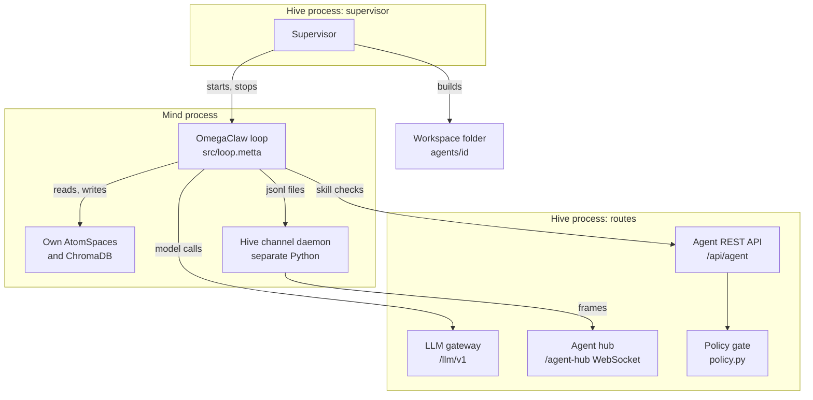
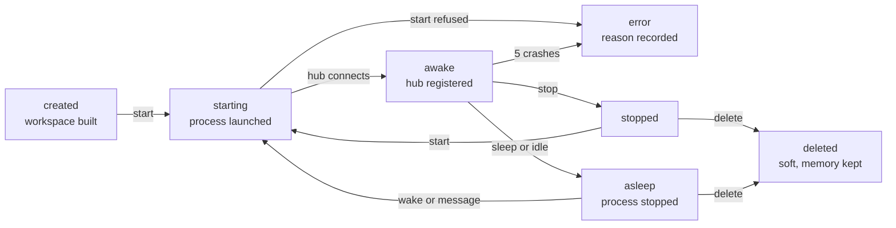
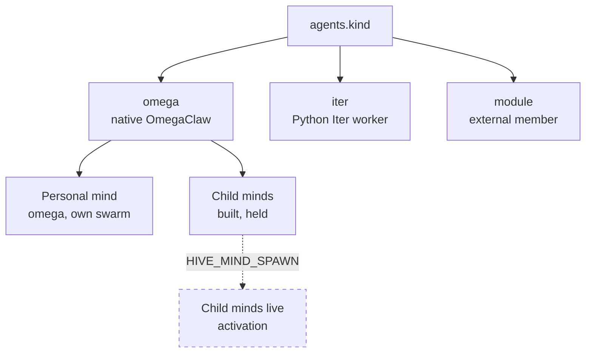

# Mind runtime and lifecycle
> Status key: solid line = built; dashed line = intended, not finished. Code refs are to omegahive @ 34b0fb3 unless named. Refs marked *(idle-minds PR)* point at the omegahive pull request branch `port/idle-minds`, which brings the live chosen-wait and idle-input changes into this repository.

**What this shows.** What a native mind is: one PeTTa process running the inherited OmegaClaw loop in its own workspace, wired to the hive by three connections. It also shows the mind kinds and the lifecycle a mind moves through, from create to delete.

**Who should read it.** Owners of the OmegaClaw runtime (`run.metta`, `lib_omegaclaw*.metta`, `src/`, `modules/`), owners of mind lifecycle in the hive (`hive/core/hive.py`, `hive/supervisor/`), and reviewers of any change to how minds start, stop or connect.

## Diagram(s)

### 1. One native mind and its three connections

### 2. Lifecycle of a native mind

### 3. Mind kinds

## How it works

**A native mind is one process.** The supervisor starts `sh $PETTA_PATH/run.sh <workspace>/run.metta --silent` with the workspace as its working directory (`hive/supervisor/workspace.py:109-114`, `hive/supervisor/drivers.py:197-201`). The supervisor itself runs inside the hive server process; the app creates it at startup (`hive/core/app.py:21`, `hive/core/app.py:113`).

**The workspace is the mind's body on disk.** `Workspace.create` writes `run.metta`, links `repos/OmegaClaw-Core` to the shared checkout and `repos/petta_lib_chromadb` to the ChromaDB library, writes a mode-0600 `token`, the prompt and the tools files (`hive/supervisor/workspace.py:167-192`). The layout is listed at `hive/supervisor/workspace.py:1-11`. The `memory/` folder holds the mind's spaces, history and hive channel files.

**The entry file loads the inherited runtime in a fixed order.** `run.metta` imports `lib_omegaclaw` (`hive/supervisor/workspace.py:24-28`). That file loads the core substrate, then the modules, then attention, then the loop (`lib_omegaclaw.metta:8-11`). The order matters: PeTTa compiles calls at import time, so the loop must load after the module affordances it calls (`lib_omegaclaw.metta:3-6`).

**The core substrate is reasoning libraries, skills and spaces.** `lib_omegaclaw_core.metta` imports NAL, PLN and NARS, the LLM and Python bridges, the skill catalogues, signatures and affordances for core, memory, energy, reasoning and affordance skills, and the memory organ (`lib_omegaclaw_core.metta:7-38`). It binds seven named spaces: `&persistent`, `&agenda`, `&beliefs`, `&world`, `&events`, `&activity` and `&cleanup` (`lib_omegaclaw_core.metta:40-46`). Attention is an optional organ with its own space and a response hook (`lib_omegaclaw_attention.metta:3-17`).

**The loop is receive, think, gate, act.** Each iteration reads the channel, builds a context (prompt, skills, recall, history, last results), calls the model, parses up to five command lines, and runs each one (`src/loop.metta:139-190`, `src/loop.metta:87-104`). Before a command runs on a hive, `command-gate` asks the hive's policy gate; off a hive every command is allowed (`src/loop.metta:111-117`). The gate does not yet see every skill: the native loop skips it for the `LOCAL_ALLOW` list (`modules/hive/src/hive_commons.py:932-956`), and unknown skills default to allow (`hive/core/policy.py:219`). Universal gating is a launch requirement (K10, K30; FINDINGS.md (in the private omegahive-security repo; ask Kabir)). After the turn it bounds and saves its spaces, sleeps, and recurses (`src/loop.metta:185-190`).

**A chosen wait rests the mind.** A reply that is nothing but `wait` is the mind choosing to wait. `honor-chosen-wait` sets the remaining turns (`&loops`) to 0, so the mind makes no model call until a new hub message arrives (a person's or mind's message, or the hive's goal, claim, approval and schedule notes) or its wake comes round (`src/loop.metta:134-147`, called at `:195`) *(idle-minds PR)*. `wait 900` (or `wait 10 minutes`, `wait 2h`) moves the next wake to that many seconds, clamped to 30 to 86400; a bare reason keeps the mind's own wake interval. The runtime's own provider-error wait (`wait "LLM-PROVIDER-..."`) is not the mind's choice and retries after 60 seconds (`src/helper.py:264-297`) *(idle-minds PR)*. Any other reply leaves the loop as it was. It is an efficiency inside the mind's loop, never a limit. Before this change the `wait` skill was a no-op, so one message bought up to 12 model calls and each autonomous wake 8, all of them waits. The base prompt and the `wait` skill text tell the mind this (`hive/templates/omega/prompt.txt:36`; `src/skill_catalog_core.metta:11`) *(idle-minds PR)*.

**Skills are MeTTa functions with declared signatures.** Core catalogues name skills such as `send`, `remember`, `query`, `shell`, `read-file` (`src/skill_catalog_core.metta:5-6`), memory-space skills (`src/skill_catalog_memory.metta:5`), and reasoning skills `nal-step`, `pln-step`, `nars-query` (`src/skill_catalog_reasoning.metta:5`). Reasoning is callable, not automatic: the loop does not invoke it on its own in this build (`STATUS.md:49`).

**Memory has two layers.** The AtomSpaces above, persisted as `.metta` files in `memory/`, and ChromaDB vector recall beside them (`src/memory.metta:66`, `src/memory.metta:100`). The hive default embedder is `mock/hash` (`STATUS.md:52`); embeddings go through the gateway like model calls (`hive/supervisor/workspace.py:242-246`).

**Three connections tie a mind to its hive.** The supervisor sets them in the mind's environment (`hive/supervisor/workspace.py:221-256`):
- the **agent hub**: `commchannel=hive` with `HIVE_WS_URL` and `HIVE_WS_TOKEN`. A separate daemon process holds the WebSocket and talks to the loop through `inbox.jsonl` and `outbox.jsonl` (`modules/channel_hive/src/hive_channel.py:1-30`);
- the **agent REST API**: `HIVE_API_URL` plus the token, used by the hive skills for publish, query and belief (`modules/hive/src/hive_commons.py:102-125`) and by the policy gate (`modules/hive/src/hive_commons.py:947-962`);
- the **gateway**: `provider=Hive` and `HIVE_LLM_URL`, so every model and embedding call goes to `/llm/v1` (`lib_llm_ext.py:288-290`, `hive/supervisor/workspace.py:241-246`).

**The prompt is written by the hive.** On the hive channel the base prompt is `hive/templates/omega/prompt.txt`, followed by the hive kit text, then the role and persona (`hive/supervisor/workspace.py:124-165`). A model, persona or name change rewrites it (`hive/core/hive.py:906-907`).

**Lifecycle: create.** `POST /api/agents` (`hive/core/app.py:1239-1255`) calls `Hive.create_agent`. The row is written with `status=created`, `desired=stopped` and a hashed token; the token is returned once (`hive/core/hive.py:742-805`). The workspace is built at once; the process is not started.

**Lifecycle: start and wake.** `POST /api/agents/{id}/start|stop|sleep|wake` share one handler (`hive/core/app.py:1315-1320`). Start and wake set `starting` and `desired=awake`, then call the supervisor (`hive/core/hive.py:1124-1149`). The mind becomes `awake` only when its hub connection registers (`hive/core/hive.py:1450-1451`). A `StartRefused` (for example an Iter without Docker) records `error` and leaves the mind stopped (`hive/core/hive.py:1144-1148`).

**Lifecycle: sleep.** Sleep stops the process and sets `asleep` (`hive/core/hive.py:1155-1157`). A mind with `idle_sleep_minutes` sleeps after that long without real input (`hive/core/hive.py:2009-2021`). Real input is the idle signal `agents.last_input_at`: an inbound message from a person or mind, a goal claim, heartbeat or result, a published belief, or a message the mind sends. The hive's own housekeeping notes (`hive:*` senders) do not count, except a goal assigned to this mind, and model spend never counts (`hive/core/hive.py:1348-1366`, `:1811-1823`, `:2092-2099`) *(idle-minds PR)*. A bounded child's `idle_minutes` counts from the same signal (`hive/core/minds.py:828-833`) *(idle-minds PR)*. Health notices an awake mind with no input and asks it one question; it never sleeps a mind by itself. What counts as input is drawn on [budgets and spend, diagram 3](../05-governance/02-budgets-and-spend.md#3-spend-is-not-input); Health's side is on the [mind observability card](../components/mind-observability.md). A message to an asleep mind wakes it (`hive/core/hive.py:1324-1325`). On reconnect the channel sends `resume` and the hub replays what the mind has not seen (`hive/core/app.py:2043-2044`, `hive/core/hive.py:1352-1358`).

**Lifecycle: crash and restart.** A reconcile pass every few seconds restarts minds that should be awake (`hive/core/app.py:181-185`). Five crashes in five minutes set `error` with the log tail (`hive/supervisor/drivers.py:597-610`).

**Lifecycle: delete.** Delete is soft. The stop must be confirmed by the driver first, then the row is marked deleted, its tasks are released and it leaves its team room in one transaction (`hive/core/hive.py:936-1000`). Memory stays on disk (`hive/core/hive.py:937`).

**Personal minds live in the hive.** Every named person has one: an omega-kind mind, asleep, alone in a private swarm of its own, created on sign-in without a start (`hive/core/personal.py:3-17`). A personal Ask turn uses the conductor and never wakes it (`hive/core/ask.py:30`).

**Iter minds are a second runtime.** Kind `iter` copies a small Python agent and the hive tool template into the workspace (`hive/supervisor/workspace.py:95-107`, `hive/templates/iter/`). It talks to the hive over HTTP polling, not the hub (`hive/templates/iter/channels/hive.py:28`, `hive/templates/iter/channels/hive.py:60`). Its tools are not covered by the policy gate, so it must run in the Docker driver (`hive/supervisor/workspace.py:39-42`, `hive/supervisor/drivers.py:175-177`).

**External members are kind `module`.** No workspace process is built; they use their token against the agent API or `/mcp` (`hive/supervisor/workspace.py:172-177`). See [04-channels-and-external-members.md](04-channels-and-external-members.md).

**Child minds are built and held.** A team's controller can spawn child minds from operator templates for one person's request, under a lease and a budget root (`hive/core/minds.py:1-31`). Live spawning stays off unless `HIVE_MIND_SPAWN=1` (`hive/core/minds.py:20`). A child that exits is observed, never restarted by the host (`hive/supervisor/drivers.py:593-596`). State: 139 tests, activation held, never spawned live (`STATUS.md:53`).

## Intended shape and upgrade path

- **Reasoning inside the loop.** Built and held: a reasoning foundation (69 tests) and a default-off OBSERVE organ (64 tests). The entry seam is the per-cycle `RuntimeHook` (`docs/EARLIER_EXPERIMENTS.md:23-24`, `docs/EARLIER_EXPERIMENTS.md:36-37`; `src/loop.metta:139-142`).
- **Attention.** Today a heuristic classifier with ECAN naming; full ECAN is intent (`STATUS.md:51`). The path is an adapter behind `lib_omegaclaw_attention.metta` (`docs/EARLIER_EXPERIMENTS.md:42`).
- **AtomSpace as state of record.** Today long-term recall is ChromaDB beside the AtomSpace; a journal-backed state spine is intent (`docs/EARLIER_EXPERIMENTS.md:38`).
- **Child minds live.** Built; activation is a ruling, not code (`STATUS.md:53`).
- **The runtime as a pinned dependency.** The OmegaClaw core is vendored, not pinned (`docs/MODULARITY.md:45-48`, `docs/MODULARITY.md:63`).
- **A single-mind deployer.** Wanted; not built (`STATUS.md:68`).
- **Task loops tuned to purpose.** In review (`docs/FEATURES.md:111`).

## Seams and contracts

| Seam | Where | Shape |
|---|---|---|
| Workspace layout | `hive/supervisor/workspace.py:1-11` | `run.metta`, `repos/`, `memory/`, `token`, `agent.log` |
| Entry file | `hive/supervisor/workspace.py:24-28` | imports `lib_omegaclaw`, then `!(omegaclaw)` |
| Mind environment | `hive/supervisor/workspace.py:221-256` | `commchannel`, `HIVE_WS_URL`, `HIVE_WS_TOKEN`, `HIVE_API_URL`, `HIVE_AGENT_ID`, `OMEGACLAW_MEMORY_DIR`, `provider=Hive`, `HIVE_LLM_URL`, `OPENAI_BASE_URL` |
| Launch identity | `hive/supervisor/drivers.py:496-498` | `HIVE_LAUNCH_ID`, new per launch |
| Hub frames | `modules/channel_hive/src/hive_channel.py:18-30`; `hive/core/app.py:2042-2057` | `user_message`, `resume`, `agent_message`, `ack`, `prompt_ack` |
| Policy check | `src/loop.metta:114-117`; `hive/core/app.py:2679-2683` | `POST /api/agent/authorize {command}` returns a decision |
| Lifecycle routes | `hive/core/app.py:1315-1320` | `POST /api/agents/{id}/start|stop|sleep|wake` |
| Editable fields | `hive/core/hive.py:40` | name, swarm, model, persona, hue, budget, idle sleep, options, driver |
| Kinds | `hive/core/hive.py:39` | `omega`, `iter`, `module` |
| Child minds | `hive/core/minds.py:1-31`; `/api/agent/minds*` (`hive/core/app.py:3159-3178`) | operation ids, leases, prompt revisions |

## For owners: how to plug in

1. **Change what every native mind is told.** Edit `hive/templates/omega/prompt.txt`. The hive kit lines are in `HIVE_PROMPT` (`hive/supervisor/workspace.py:44-62`). A mind's prompt is rewritten on its next reconfigure.
2. **Add a capability to the runtime.** Add a module, not a core edit. See [03-modules.md](03-modules.md).
3. **Add a per-cycle organ.** Declare a `RuntimeHook` with phase `cycle` or `response` and a matching `TrustedRuntimeHook`, as `lib_omegaclaw_attention.metta:16-17` does.
4. **Run the runtime tests** from the repo root: `python -m unittest discover -s tests` (`hive/README.md:90`).

## For reviewers: what to check

- **Load order.** Nothing may load before `lib_omegaclaw_core` or after `src/loop` (`lib_omegaclaw.metta:3-11`). Guard: `tests/test_module_organs.py` (`test_standard_run_loads_modules_from_one_composition_hook`).
- **Fail closed.** If the hive cannot answer the gate, the command must not run (`modules/hive/src/hive_commons.py:957-959`).
- **Local shortcut.** `LOCAL_ALLOW` skips the round trip for a fixed list (`modules/hive/src/hive_commons.py:932-936`). Any addition widens what runs without a hive decision.
- **Stop wins.** Every start and stop moves a per-mind generation; a hub connection admitted before a stop must not register (`hive/supervisor/drivers.py:401-410`, `hive/core/hive.py:1425-1452`). Guard: `hive/tests/test_stop_reconcile_race.py`.
- **Delete only over a confirmed stop** (`hive/supervisor/drivers.py:552-567`). Guards: `hive/tests/test_docker_driver_stop.py`, `hive/tests/test_swarm_delete.py`.
- **Personal minds.** Never woken by a personal Ask turn; alone in their swarm. Guards: `hive/tests/test_personal_mind*.py`.
- **A chosen wait makes no model calls, and spend is not input.** A reply of only `wait` must end the remaining turns; model spend must never move `last_active_at` or `last_input_at`. Guards: `tests/test_wait_quiet_runtime.py` (a no-input boot soak on the real runtime), `hive/tests/test_idle_minds.py` *(idle-minds PR)*.
- **Child minds.** Never restarted by the host; spawning only with `HIVE_MIND_SPAWN=1`. Guard: `hive/tests/test_mind_control.py`.

## References

- `run.metta:1-5`; `lib_omegaclaw.metta:1-11`; `lib_omegaclaw_core.metta:7-46`; `lib_omegaclaw_attention.metta:1-17`
- `src/loop.metta:20-63`, `src/loop.metta:72-117`, `src/loop.metta:139-190`
- `src/skill_catalog_core.metta:5-7`; `src/skill_catalog_memory.metta:5`; `src/skill_catalog_reasoning.metta:5`; `src/memory.metta:16`, `src/memory.metta:66`
- `lib_llm_ext.py:288-295`
- `hive/supervisor/workspace.py:1-256`; `hive/supervisor/drivers.py:353-610`
- `hive/core/app.py:21`, `hive/core/app.py:113`, `hive/core/app.py:181-195`, `hive/core/app.py:1239-1320`, `hive/core/app.py:2017-2061`, `hive/core/app.py:2679-2683`
- `hive/core/hive.py:39-40`, `hive/core/hive.py:742-1160`, `hive/core/hive.py:1284-1358`, `hive/core/hive.py:1418-1472`, `hive/core/hive.py:2009-2021`
- `hive/core/personal.py:1-20`; `hive/core/ask.py:28-33`; `hive/core/minds.py:1-31`
- `modules/channel_hive/src/hive_channel.py:1-40`; `modules/hive/src/hive_commons.py:102-125`, `modules/hive/src/hive_commons.py:929-962`
- `hive/templates/iter/`; `hive/templates/omega/prompt.txt`
- *(idle-minds PR)* `src/loop.metta:134-147`, `:195`; `src/helper.py:264-297`; `hive/core/hive.py:1348-1366`, `:2092-2099`; `hive/core/minds.py:828-833`
- `STATUS.md:49-54`, `STATUS.md:68`; `docs/EARLIER_EXPERIMENTS.md:19-47`; `docs/MODULARITY.md:45-48`, `docs/MODULARITY.md:63`; `docs/FEATURES.md:101-111`
