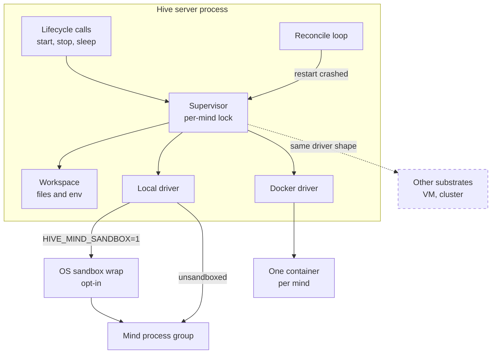
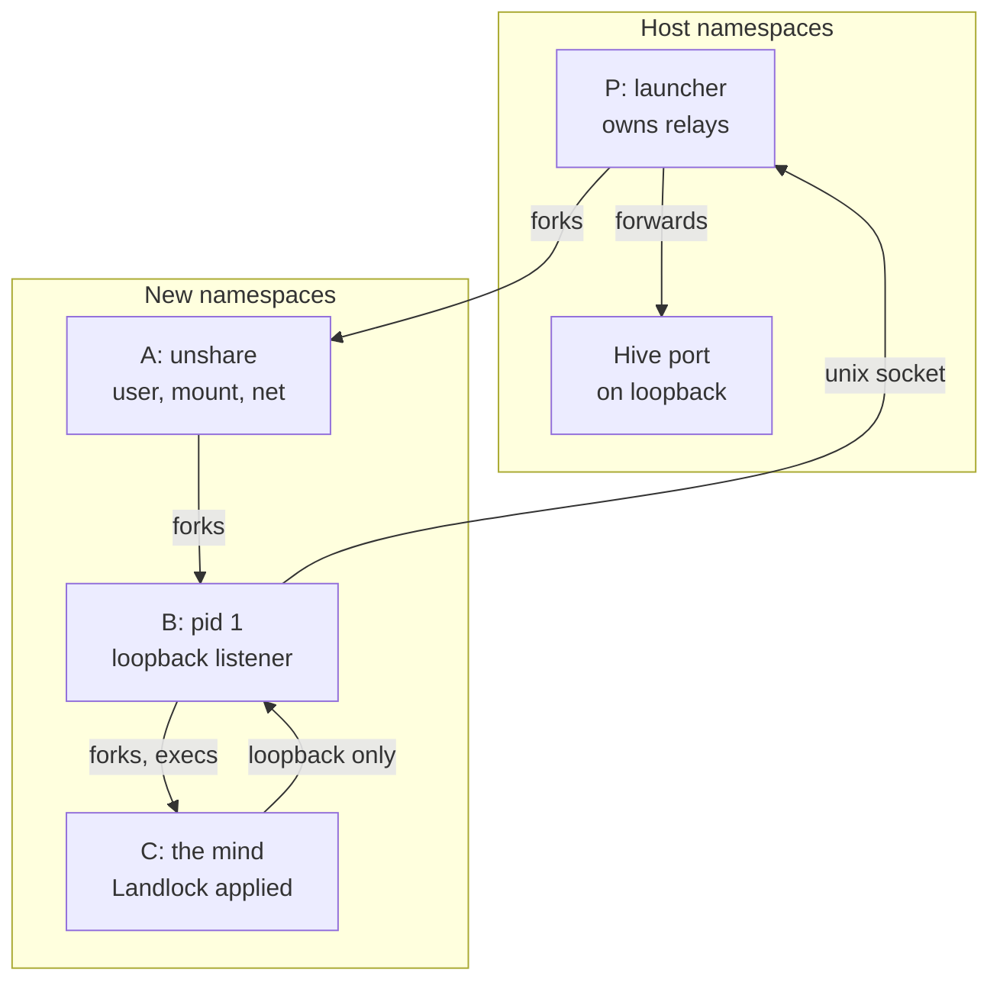

# Supervisor, drivers and sandbox
> Status key: solid line = built; dashed line = intended, not finished. Code refs are to omegahive @ 34b0fb3 unless named.

**What this shows.** How the hive runs mind processes: the supervisor inside the hive process, the two built drivers (local and Docker), and the opt-in OS sandbox that wraps a local mind's command. It also states the limits each path does and does not apply.

**Who should read it.** Owners of `hive/supervisor/`, anyone adding a new place for minds to run, and reviewers of isolation, process control and resource limits.

## Diagram(s)

### 1. Supervisor and drivers

### 2. Linux sandbox process layout

## How it works

**The supervisor is part of the hive.** It is imported and built by the app (`hive/core/app.py:21`, `hive/core/app.py:113`) and holds a dict of drivers, `local` and `docker` (`hive/supervisor/drivers.py:353-362`). Each mind gets one re-entrant lock; start, stop, reconfigure and every reconcile decision hold it (`hive/supervisor/drivers.py:371-376`).

**A driver only runs one process.** The interface is `start(agent, env)`, `stop(agent_id)`, `status(agent_id)` returning `running`, `exited` or `absent`, `logs(agent_id, tail)`, and an optional `execution(agent_id)` identity (`hive/supervisor/drivers.py:1-7`, `hive/supervisor/drivers.py:62-79`). A mind's row names its driver; the default is `HIVE_DRIVER` (`hive/supervisor/drivers.py:421-422`, `hive/core/config.py:165`).

**Start computes the environment fresh each time.** `Supervisor.env` picks the address the mind dials, builds the workspace env, adds a new `HIVE_LAUNCH_ID`, and for local minds passes the hive's own Python as `HIVE_PYTHON` (`hive/supervisor/drivers.py:493-505`). A local mind dials where the hive listens, not the public URL; a Docker mind keeps `HIVE_PUBLIC_URL` (`hive/supervisor/drivers.py:452-491`).

**The local driver runs a process group on this host.** It starts the command in a new session, writes the group id to `mind.pid`, and logs to `agent.log` (`hive/supervisor/drivers.py:172-203`). After a hive restart it adopts a still-running group whose members run from that mind's workspace, instead of starting a duplicate (`hive/supervisor/drivers.py:105-137`). Stop sends TERM, waits, then KILL, and raises if anything survives (`hive/supervisor/drivers.py:155-170`, `hive/supervisor/drivers.py:205-224`).

**A local mind never inherits the hive's environment.** `mind_environment` passes an allowlist (`PATH`, `HOME`, `LANG`, `PETTA_PATH` and a few more), plus `OMEGACLAW_*` names that do not look secret, then the mind's own variables (`hive/supervisor/sandbox.py:22-36`). This applies with or without the OS sandbox (`hive/supervisor/drivers.py:180-181`).

**The OS sandbox wraps the command, and only when asked.** With `HIVE_MIND_SANDBOX=1` the local driver calls `sandbox.wrap`. If the host has no sandbox it refuses to start the mind (`hive/supervisor/drivers.py:184-196`). Without the variable the mind runs unsandboxed, as the hive's own OS user (`hive/supervisor/sandbox.py:3-5`). Deployments set it; development does not (`STATUS.md:54`).

**On macOS the wrap is `sandbox-exec` with a deny-by-default profile.** The mind may read system paths and the runtime roots, read and write only its own folder, and connect only to the allowed loopback ports (`hive/supervisor/sandbox.py:53-62`, `hive/supervisor/sandbox.py:100-125`). Runtime roots never include `/`, the home folder or their ancestors (`hive/supervisor/sandbox.py:128-157`).

**On Linux the wrap is a namespace launcher plus Landlock.** The command becomes `python landlock.py <profile.json> -- <command>` (`hive/supervisor/sandbox.py:63-68`). The launcher unshares user, mount, network, pid and ipc namespaces, keeps only loopback, relays the allowed hive port through a unix socket, and applies Landlock file rules; with Landlock ABI 4 or later it also limits TCP connect to those ports (`hive/supervisor/landlock.py:1-32`, `hive/supervisor/landlock.py:166-172`). If setup fails it exits 78 and the mind never starts (`hive/supervisor/landlock.py:29-32`).

**The allowed ports are the hive's own and the operator's extras.** `HIVE_PORT` plus `HIVE_MIND_SANDBOX_PORTS`; when neither is set, a default extra port for the Code service is kept (`hive/supervisor/sandbox.py:82-97`). A sandboxed mind can reach nothing else, so every model call must go through the gateway (`hive/supervisor/sandbox.py:8-12`).

**The Docker driver runs one container per mind.** Native minds use `HIVE_AGENT_IMAGE` with the core checkout and ChromaDB library mounted read-only and `memory/` the only writable mount (`hive/supervisor/drivers.py:243-298`). Iter minds use `HIVE_ITER_IMAGE` with the whole workspace mounted, after a preflight that checks Docker and the image (`hive/supervisor/drivers.py:36-56`, `hive/supervisor/drivers.py:266-284`). Stop is confirmed by Docker's own "no such container" answer (`hive/supervisor/drivers.py:300-335`).

**Limits differ by path.**

| Path | Environment | File and network boundary | Resource limits |
|---|---|---|---|
| Local, unsandboxed | allowlisted (`hive/supervisor/sandbox.py:27-36`) | none; runs as the hive's user | none set by the driver |
| Local, sandboxed | allowlisted | sandbox-exec or namespaces plus Landlock | none set by the driver |
| Docker, native mind | only the mind's env (`hive/supervisor/drivers.py:285-294`) | read-only code mounts; host network by default (`hive/supervisor/drivers.py:255`) | none set |
| Docker, Iter | only the mind's env | workspace mount; host network by default | `--memory 1g`, `--pids-limit 256` (`hive/supervisor/drivers.py:276-277`) |
| Reconcile, all | n/a | n/a | 5 restarts in 5 minutes, then `error` (`hive/supervisor/drivers.py:597-603`) |

`hive/supervisor/limits.sh` sets CPU and file-size limits, but only for app tool runs through `hive/core/sandbox_run.py` (`hive/core/sandbox_run.py:37`, `hive/core/sandbox_run.py:224`), not for minds.

**The hive can report what boundary a running mind has.** The local driver records environment, sandbox flag and profile per start (`hive/supervisor/drivers.py:189-196`); `GET /api/agents/{id}/isolation` reads it (`hive/core/app.py:1911-1917`).

## Intended shape and upgrade path

- **More substrates as drivers.** Kubernetes, VMs or other hosts are meant to be new drivers with the same shape (`hive/supervisor/drivers.py:5-6`, `hive/README.md:15-16`). None exists.
- **Docker hardening.** Host networking by default and no hardening flags are a stated gap (`STATUS.md:55`, `docs/theory/governance-and-gating.md:227`). The Docker driver is unverified (`docs/FEATURES.md:109`).
- **Sandbox always on.** Today opt-in (`STATUS.md:54`, `docs/theory/governance-and-gating.md:226`).
- **Reach-boundary gating.** The intended rule keys policy on where an effect reaches (own folder, hive, outside host), enforced at the OS boundary; today the gate decides on the skill name and the sandbox is a separate layer (`docs/theory/governance-and-gating.md:25`, `docs/theory/governance-and-gating.md:61-72`).

## Seams and contracts

| Seam | Where | Shape |
|---|---|---|
| Driver interface | `hive/supervisor/drivers.py:62-79` | `start`, `stop`, `status`, `logs`, `execution`; optional `verify_stopped` (`hive/supervisor/drivers.py:552-567`) |
| Refusal type | `hive/supervisor/drivers.py:31-33` | `StartRefused(reason)`; the hive records it as `error` and leaves the mind stopped |
| Driver registry | `hive/supervisor/drivers.py:359-362` | `{"local": LocalDriver, "docker": DockerDriver}`; `PATCH /api/agents/{id} {driver}` is admin-only (`hive/core/app.py:1295-1296`) and checked against this set (`hive/core/hive.py:895-900`) |
| Sandbox wrap | `hive/supervisor/sandbox.py:53-69` | `wrap(command, mind_dir, read_roots, profile_dir, agent_id, ports)` returns `(command, profile_path)` |
| Settings | `hive/README.md:53`, `hive/README.md:60` | `HIVE_DRIVER`, `HIVE_MIND_SANDBOX`, `HIVE_MIND_SANDBOX_PORTS`, `HIVE_AGENT_IMAGE`, `HIVE_ITER_IMAGE`, `HIVE_DOCKER_NETWORK`, `HIVE_ALLOW_LOCAL_ITER` |
| Images | `hive/docker/agent.Dockerfile`, `hive/docker/iter.Dockerfile` | built locally; code is mounted at run time |

## For owners: how to plug in

To add a driver for a new substrate:
1. Subclass `Driver` in a new file under `hive/supervisor/` and implement `start`, `stop`, `status` and `logs` (`hive/supervisor/drivers.py:62-79`). Return `running`, `exited` or `absent` only.
2. Raise `StartRefused` with an actionable reason when the substrate is missing (pattern: `iter_preflight`, `hive/supervisor/drivers.py:36-56`).
3. Make `stop` prove the process is gone, or raise; add `verify_stopped` if `status` alone cannot prove it (`hive/supervisor/drivers.py:300-326`).
4. Implement `execution` so the hive can tell a new launch from an old one (`hive/supervisor/drivers.py:235-240`, `hive/supervisor/drivers.py:347-350`).
5. Register it in `Supervisor.__init__` (`hive/supervisor/drivers.py:359-362`). If it is not local, decide what address the mind dials (`hive/supervisor/drivers.py:464-466`).
6. Add tests beside `hive/tests/test_agent_driver.py` and `hive/tests/test_docker_driver.py`, then run `python -m pytest -q hive/tests` with the pinned toolchain (`STATUS.md:15`).

## For reviewers: what to check

- **No hive secrets reach a mind.** Guard: `hive/tests/test_mind_sandbox.py`. Any new `PASS` entry in `hive/supervisor/sandbox.py:22-23` widens the environment.
- **Sandbox requested means sandbox enforced.** A host without one must refuse (`hive/supervisor/drivers.py:185-188`). Guards: `hive/tests/test_mind_sandbox.py`, `hive/tests/test_mind_sandbox_linux.py`.
- **The mind dials only an address the sandbox allows** (`hive/supervisor/drivers.py:479-483`). Guard: `hive/tests/test_mind_url.py`.
- **Adoption is safe.** A recorded group is adopted only if it runs from this mind's workspace (`hive/supervisor/drivers.py:125-137`). Guard: `hive/tests/test_local_driver_adopt.py`.
- **Iter stays contained.** The local driver refuses Iter unless `HIVE_ALLOW_LOCAL_ITER=1` (`hive/supervisor/drivers.py:175-177`).
- **Docker stop proof.** Only Docker's exact missing-container text counts as gone (`hive/supervisor/drivers.py:328-335`). Guard: `hive/tests/test_docker_driver_stop.py`.
- **Limits.** Native minds have no CPU, memory or file-size limits on any path in this build. `docs/FEATURES.md:402` lists "limits" under the mind sandbox and cites `limits.sh`, but `limits.sh` is used only by app tool runs (`hive/core/sandbox_run.py:37`).
- **Landlock version.** The start refusal text says "Landlock ABI 4+" (`hive/supervisor/drivers.py:187-188`, also `hive/supervisor/sandbox.py:40`), but `available()` accepts ABI 1 or later (`hive/supervisor/landlock.py:135-136`). On ABI 1 to 3 the network namespace still isolates the mind, but TCP connect is not port-limited by Landlock (`hive/supervisor/landlock.py:172`).

## References

- `hive/supervisor/drivers.py:1-610`
- `hive/supervisor/sandbox.py:1-157`
- `hive/supervisor/landlock.py:1-80`, `hive/supervisor/landlock.py:135-172`
- `hive/supervisor/limits.sh:1-23`; `hive/core/sandbox_run.py:1-40`, `hive/core/sandbox_run.py:224`
- `hive/supervisor/workspace.py:109-114`, `hive/supervisor/workspace.py:221-256`
- `hive/core/app.py:21`, `hive/core/app.py:113`, `hive/core/app.py:181-185`, `hive/core/app.py:1295-1296`, `hive/core/app.py:1911-1917`
- `hive/core/hive.py:895-900`, `hive/core/hive.py:1124-1160`
- `hive/docker/agent.Dockerfile`, `hive/docker/iter.Dockerfile`
- `hive/README.md:15-16`, `hive/README.md:53-60`; `STATUS.md:54-55`; `docs/FEATURES.md:98`, `docs/FEATURES.md:108-109`, `docs/FEATURES.md:402`; `docs/theory/governance-and-gating.md:25`, `docs/theory/governance-and-gating.md:61-72`, `docs/theory/governance-and-gating.md:226-227`
