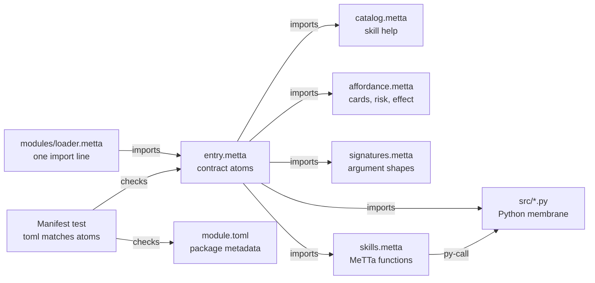
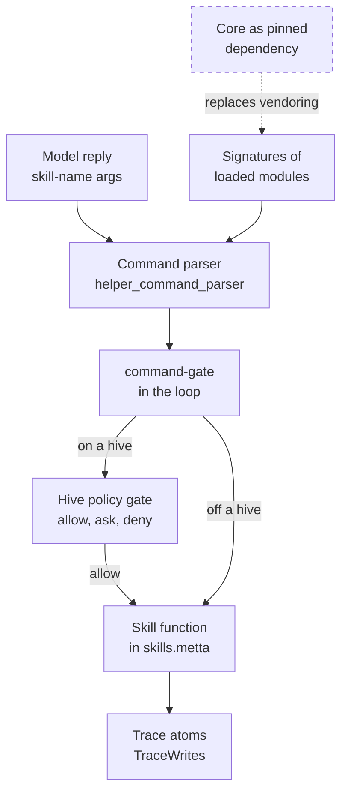

# OmegaClaw modules
> Status key: solid line = built; dashed line = intended, not finished. Code refs are to omegahive @ 34b0fb3 unless named.

**What this shows.** The module contract of the inherited OmegaClaw runtime: the files a module ships, how a mind loads it, and how its skills become callable and gated. It ends with a worked example of adding a new skill module.

**Who should read it.** Anyone adding a skill, sense, channel or body app to native minds; owners of `modules/` and `src/helper_command_parser.py`; reviewers of any new module.

## Diagram(s)

### 1. The files of one module



### 2. From a model line to a module skill



## How it works

**A module is a folder under `modules/`.** The contract lists `module.toml`, `entry.metta`, `catalog.metta`, `signatures.metta`, a README, optional `src/` and tests (`docs/reference-omegaclaw-module-contract.md:13-24`). The doc is marked legacy (`docs/reference-omegaclaw-module-contract.md:1`), but the shape is what the shipped modules use and what the tests check.

**`module.toml` is metadata only.** It holds `id`, `kind`, `version`, `entrypoint`, `catalog`, `signatures`, `optional`, `default_enabled`, `provides`, `requires`, `[env]` and `[trace]` (`modules/web_search/module.toml:1-28`, `modules/scratch_space/module.toml:1-39`). Kinds in use include `channel`, `sense`, `memory-organ`, `external-info-organ`, `runtime-organ` and `body-app` (`modules/channel_hive/module.toml:2`, `modules/sense_vision/module.toml:2`, `modules/scratch_space/module.toml:2`, `modules/web_search/module.toml:2`, `modules/body_container/module.toml:2`, `modules/home_assistant/module.toml:2`).

**`entry.metta` is the cognitive contract.** It declares the module into `&self` as atoms such as `(Module id)`, `(ModuleKind id kind)`, `(Provides id (Skill name))` and `(TraceWrites id Event)`, then imports the module's other files (`modules/web_search/entry.metta:4-32`). The mind can query what is mounted with `match` (`docs/reference-omegaclaw-module-contract.md:108-126`).

**The four MeTTa files split the surface.**
- `catalog.metta`: `SkillCatalog` and `SkillHelp` lines the mind reads (`modules/web_search/catalog.metta:1-4`).
- `affordance.metta`: `SkillTopic`, `SkillCardLine`, `SkillTrigger`, `Risk` and `Effect` (`modules/scratch_space/affordance.metta:1-26`).
- `signatures.metta`: one `SkillSignature` per skill, with typed `Arg` slots (`modules/scratch_space/signatures.metta:1-15`).
- `skills.metta`: the skill functions; boundary work is a `py-call` into `src/` (`modules/web_search/skills.metta:1-5`).

**A module that owns a space registers it.** It binds the space, then calls `register-space`, `register-space-alias`, and optionally `register-space-limit` and `register-space-persistence` (`modules/scratch_space/skills.metta:3-9`; `docs/reference-omegaclaw-module-contract.md:73-106`). Generic memory skills then work on it without core edits.

**Runtime organs and hooks are declared too.** `(RuntimeOrgan name call)` with `(TrustedRuntimeOrgan name)` runs at boot; `(RuntimeHook response name call)` with `(TrustedRuntimeHook response name)` runs after each model turn (`modules/scratch_space/entry.metta:19-24`; `src/loop.metta:65-70`).

**Loading is explicit.** `modules/loader.metta` lists one `import!` per enabled module (`modules/loader.metta:1-21`). `lib_omegaclaw.metta` imports that loader after the core substrate and before the loop (`lib_omegaclaw.metta:8-11`). Order inside the loader matters when one module's hooks call another's functions (`modules/loader.metta:7-9`).

**The command parser reads the same loader.** It finds enabled module names from the loader's import lines and reads each module's `signatures.metta` and `catalog.metta` (`src/helper_command_parser.py:105-157`, `src/helper_command_parser.py:160-200`). So a module is callable only when it is imported (`modules/loader.metta:3`). `OMEGACLAW_MODULE_LOADER` can point at a different loader file (`src/helper_command_parser.py:132-136`).

**On a hive, skills are gated, with two bypasses.** The loop asks the hive before a command (`src/loop.metta:111-117`), except for the native loop's `LOCAL_ALLOW` skip list, which never reaches the gate (`modules/hive/src/hive_commons.py:932-956`, K10). Universal gating is a launch requirement (K10, K30). A skill matching no rule and no default list is allowed by default (`hive/core/policy.py:213-219`). Skills named `hive-*` are the exception: an unreviewed one is "ask" until listed in `REVIEWED_HIVE_SKILLS` (`hive/core/policy.py:23-28`, `hive/core/policy.py:193-214`).

**A mind's environment limits what a module can use.** The hive passes only allowlisted variables and non-secret `OMEGACLAW_*` names to a mind (`hive/supervisor/sandbox.py:22-36`). A module secret declared in `[env]`, such as a search or device token, does not reach a hive mind. With the sandbox on, a module also cannot reach the network except the hive (`hive/supervisor/sandbox.py:8-12`).

**Hive minds also get per-mind tool wrappers.** When a mind's `options.tools` is set, the workspace writes `memory/tools-loader.metta`, `tools-signatures.metta` and `tools-affordance.metta`, and the parser picks them up through `OMEGACLAW_EXTRA_LOADER` (`hive/supervisor/workspace.py:203-216`, `hive/supervisor/workspace.py:252-255`, `src/helper_command_parser.py:155-156`). That path serves app-provided tools and is covered in `06-apps/`.

## Intended shape and upgrade path

- **The runtime as a pinned dependency.** Today `src/`, `modules/`, `channels/`, `lib_*.metta` and `run.metta` are copied in, so fixes drift from upstream (`docs/MODULARITY.md:45-48`). The plan is to pin OmegaClaw Core instead (`docs/MODULARITY.md:63`).
- **Ported modules.** Many modules are not fully ported to this hive; their compatibility is untested (`STATUS.md:76`).
- **Organs through module seams.** Assume, native attention and the predictive-coding lab are meant to enter through the module contract and its hooks (`docs/EARLIER_EXPERIMENTS.md:26`, `docs/EARLIER_EXPERIMENTS.md:42`, `docs/EARLIER_EXPERIMENTS.md:45`).
- **Module scope per module (owner design, 2026-10-10).** Each module declares where it applies: **per mind**, **hive-wide**, **both**, or **neither** (installed but enabled for nobody until chosen). The right scope depends on the module and the use case. A sense or body app may belong to one mind; a shared channel or tool may serve the whole hive; a skill may be offered hive-wide and switched on per mind. Today every module is effectively hive-wide, because each mind links the shared core checkout (`hive/supervisor/workspace.py:181`, `lib_omegaclaw.metta:9`). The intended shape adds a scope field to `module.toml`, plus a per-mind enable list read at mind start. A mind's own enable list always narrows, never widens, what the hive allows. This is not designed in detail yet.
- **Deployment-specific selections.** Installers are meant to write a local loader (`modules/loader.metta:2`); the hive itself uses the checked-in loader for every mind.

## Seams and contracts

| Seam | Where | Shape |
|---|---|---|
| Manifest | `modules/*/module.toml` | keys above; `provides` entries are `kind:name` |
| Provides mapping | `tests/test_module_contract.py:27-45` | `skill:x` maps to `(Provides id (Skill x))`; also `channel`, `sense`, `space`, `provider`, `app`, `affordance`, `runtime-organ`, `surface`, `simulation` |
| Requires mapping | `tests/test_module_contract.py:48-56` | `python>=3.10` maps to `(RuntimeDependency id python ">=3.10")` |
| Manifest test | `tests/test_module_organs.py:157-193` | toml and entry atoms must agree, including `default_enabled`, trace writes, runtime state, catalog and signatures |
| Loader | `modules/loader.metta:4-21` | `!(import! &self (library OmegaClaw-Core ./modules/<name>/entry.metta))` |
| Signature arg types | `modules/scratch_space/signatures.metta:5-15` | e.g. `metta-raw`, `optional-number`, `rest-text` |
| Policy defaults | `hive/core/policy.py:48-58` | `HUMAN_ONLY`, `DEFAULT_ALLOW`, `DEFAULT_ASK` |
| Reviewed hive skills | `hive/core/policy.py:23-41` | the set a new `hive-*` skill must join |

## For owners: how to plug in

**Worked example: a new skill module, `word_count`.** It adds one skill, `word-count text`, implemented in Python. A sense, channel or body app follows the same steps with a different `kind` and `provides`.

1. Create `modules/word_count/module.toml`:
   ```toml
   id = "omegaclaw.example.word-count"
   kind = "skill"
   version = "0.1.0"
   entrypoint = "entry.metta"
   catalog = "catalog.metta"
   signatures = "signatures.metta"
   optional = true
   default_enabled = true
   provides = ["skill:word-count"]
   requires = ["python>=3.10"]
   [trace]
   writes = ["WordCounted"]
   ```
2. Create `modules/word_count/entry.metta`, mirroring every manifest field as an atom (the manifest test checks each one), then import the other files. Copy the structure of `modules/web_search/entry.metta:4-32`:
   ```metta
   (Module omegaclaw.example.word-count)
   (ModuleKind omegaclaw.example.word-count skill)
   (ModuleVersion omegaclaw.example.word-count "0.1.0")
   (ModuleEntrypoint omegaclaw.example.word-count "entry.metta")
   (ModuleOptional omegaclaw.example.word-count True)
   (ModuleDefaultEnabled omegaclaw.example.word-count True)
   (Provides omegaclaw.example.word-count (Skill word-count))
   (RuntimeDependency omegaclaw.example.word-count python ">=3.10")
   (TraceWrites omegaclaw.example.word-count WordCounted)
   !(import! &self (car-atom (collapse (library OmegaClaw-Core ./modules/word_count/src/word_count.py))))
   !(import! &self (library OmegaClaw-Core ./modules/word_count/catalog.metta))
   !(import! &self (library OmegaClaw-Core ./modules/word_count/affordance.metta))
   !(import! &self (library OmegaClaw-Core ./modules/word_count/signatures.metta))
   !(import! &self (library OmegaClaw-Core ./modules/word_count/skills.metta))
   ```
3. Create `modules/word_count/signatures.metta` with `(SkillSignature word-count (Arg rest-text text))`.
4. Create `modules/word_count/catalog.metta` with a `SkillCatalog` line and a `SkillHelp` line, and `affordance.metta` with a `SkillCardLine`, plus `Risk` and `Effect` if it acts outside the mind.
5. Create `modules/word_count/skills.metta` with `(= (word-count $text) (py-call (word_count.count $text)))`, and `modules/word_count/src/word_count.py` with a `count(text)` function that returns a string.
6. Add one line to `modules/loader.metta`: `!(import! &self (library OmegaClaw-Core ./modules/word_count/entry.metta))`. Put it after any module whose functions it calls (`modules/loader.metta:7-9`).
7. Decide its policy. A plain name like `word-count` is allowed by default (`hive/core/policy.py:219`). If it writes files, runs code or reaches outside the mind, add its name to `DEFAULT_ASK` (`hive/core/policy.py:55-58`) or ship a hive or swarm rule. If you name it `hive-*`, add it to `REVIEWED_HIVE_SKILLS` (`hive/core/policy.py:23-28`); `hive/tests/test_policy_hive_skills.py` fails otherwise.
8. Do not rely on secrets or outside network on a hive. Secrets do not reach minds (`hive/supervisor/sandbox.py:22-36`), and sandboxed minds reach only the hive. Route model calls through the gateway the mind already has (`hive/supervisor/workspace.py:241-246`).
9. Test from the repo root: `python -m unittest tests.test_module_organs tests.test_module_contract`, then the full core suite `python -m unittest discover -q -s tests` (`STATUS.md:16`). Add a MeTTa smoke beside `tests/module_scratch_space_smoke.metta` if the module owns a space.
10. Restart a mind to load it: the loader is read at boot (`lib_omegaclaw.metta:9`).

**For a channel**, see [04-channels-and-external-members.md](04-channels-and-external-members.md): a channel module also needs a branch in the channel router.

## For reviewers: what to check

- **Manifest and atoms agree.** Guard: `tests/test_module_organs.py:157-193`.
- **Contract shape.** Guard: `tests/test_module_contract.py` (fixtures under `tests/fixtures/modules/`).
- **Removable.** A module should be removable without breaking boot (`docs/reference-omegaclaw-module-contract.md:62-71`).
- **Policy for side effects.** A new skill with a `Risk` card but no ask rule runs by default on a hive (`hive/core/policy.py:213-219`).
- **Hidden egress.** A module that opens its own network connection bypasses the gateway's budgets and local-only rule. Two shipped default modules do this: `modules/web_search/src/websearch.py:42-48` and `modules/sense_vision/src/vision.py:14`. Only the OS sandbox stops it.
- **Load order.** Hooks that call another module's functions must load after it (`modules/loader.metta:7-9`).
- **Declared secrets.** `[env]` secrets must never be committed (`docs/reference-omegaclaw-module-contract.md:67`).

## References

- `docs/reference-omegaclaw-module-contract.md:1-151`
- `modules/loader.metta:1-21`; `lib_omegaclaw.metta:8-11`; `lib_omegaclaw_body.metta:1-7`
- `modules/web_search/module.toml:1-28`, `modules/web_search/entry.metta:1-32`, `modules/web_search/skills.metta:1-5`, `modules/web_search/catalog.metta:1-4`, `modules/web_search/signatures.metta:1-2`, `modules/web_search/src/websearch.py:42-48`
- `modules/scratch_space/module.toml:1-39`, `modules/scratch_space/entry.metta:1-66`, `modules/scratch_space/skills.metta:1-19`, `modules/scratch_space/signatures.metta:1-15`, `modules/scratch_space/affordance.metta:1-26`
- `modules/sense_vision/module.toml:1-25`, `modules/sense_vision/src/vision.py:14-24`; `modules/home_assistant/module.toml:1-30`; `modules/body_container/module.toml:1-20`
- `src/helper_command_parser.py:105-200`; `src/loop.metta:65-70`, `src/loop.metta:111-117`
- `hive/core/policy.py:23-58`, `hive/core/policy.py:181-219`; `hive/supervisor/sandbox.py:8-36`; `hive/supervisor/workspace.py:203-255`
- `tests/test_module_contract.py:1-60`; `tests/test_module_organs.py:20-23`, `tests/test_module_organs.py:157-193`
- `docs/MODULARITY.md:45-48`, `docs/MODULARITY.md:63`; `STATUS.md:76`; `docs/EARLIER_EXPERIMENTS.md:26`, `docs/EARLIER_EXPERIMENTS.md:42`, `docs/EARLIER_EXPERIMENTS.md:45`
