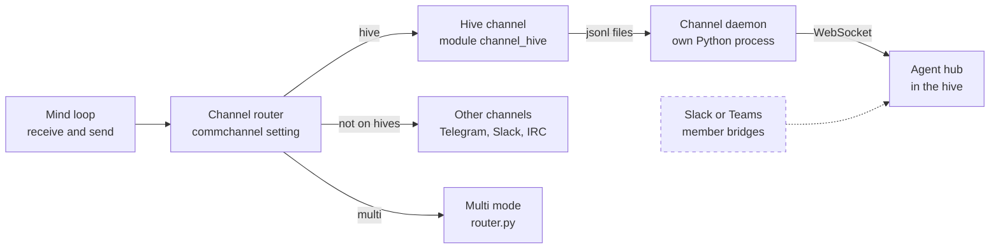
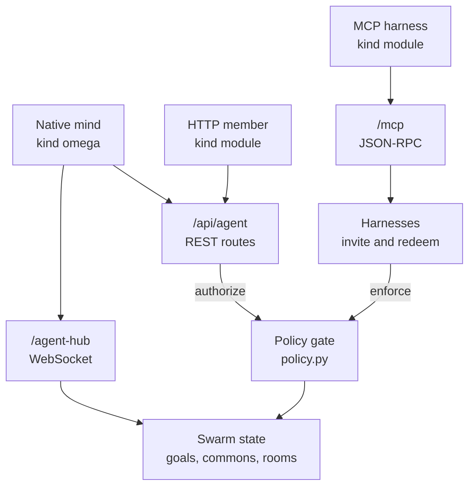

# Channels and external members
> Status key: solid line = built; dashed line = intended, not finished. Code refs are to omegahive @ 34b0fb3 unless named.

**What this shows.** How messages reach a mind. Native hive minds use one channel, the hive channel, which connects to the hive's agent hub. The inherited runtime also carries other channels that hive minds do not use. Agents that run outside the hive join as external members over plain HTTP or over MCP.

**Who should read it.** Owners of `modules/channel_*` and `channels/`, owners of `hive/core/mcp.py` and the agent hub, anyone connecting an outside agent or harness, and reviewers of member identity and policy.

## Diagram(s)

### 1. Channels inside a native mind

### 2. Three ways to be a member

## How it works

**The runtime picks one channel from `commchannel`.** `initChannels` starts the channel named by `commchannel`, defaulting to `mock` (`modules/channel_router/skills.metta:27-41`). `receive` and `send` dispatch on the same setting (`modules/channel_router/skills.metta:76-102`). The supervisor sets `commchannel=hive` for every native mind (`hive/supervisor/workspace.py:32-34`, `hive/supervisor/workspace.py:233`).

**The hive channel is a file-backed daemon.** Under janus, Python threads stall while the loop sleeps, so the WebSocket lives in a separate daemon. It talks to the mind through `inbox.jsonl`, `outbox.jsonl`, `admission.json`, `state.json` and `status.json` under the mind's memory folder (`modules/channel_hive/src/hive_channel.py:1-16`). Its settings are `HIVE_WS_URL` and `HIVE_WS_TOKEN` (`modules/channel_hive/module.toml:17-21`).

**The agent hub is one WebSocket route in the hive.** `/agent-hub` authenticates the token, admits the connection only if the mind is meant to be awake, then registers it under the mind's lock (`hive/core/app.py:2017-2031`, `hive/core/hive.py:1418-1472`). Frames are `resume`, `agent_message` and, for child minds, `prompt_ack` (`hive/core/app.py:2042-2057`). Inbound messages go out as `user_message` with a sequence number and a JSON envelope (`hive/core/hive.py:1328-1350`); on `resume` the hub replays what the mind has not seen (`hive/core/hive.py:1352-1358`).

**Native minds use REST and the gateway too.** Belief publish, query and belief detail go to `/api/agent/publish`, `/query` and `/belief` (`modules/hive/src/hive_commons.py:102-125`, `hive/core/app.py:2238-2252`). The policy check goes to `/api/agent/authorize` (`modules/hive/src/hive_commons.py:947-962`). Model calls go to `/llm/v1` (see [05-models-and-gateway.md](05-models-and-gateway.md)).

**Other channels are carried but not used by hive minds.** The router knows IRC, Telegram, WhatsApp, Slack, Mattermost and a `multi` mode that polls several adapters (`modules/channel_router/skills.metta:42-73`, `modules/channel_router/src/router.py:7-12`, `modules/channel_router/src/router.py:272-300`). Hive minds use the hive channel by design (`STATUS.md:59`). WhatsApp, Telegram and web control ran a long-lived mind in production; Slack, Mattermost and IRC are untested in production (`docs/FEATURES.md:448`). The WhatsApp bridge is closed tier (`docs/MODULARITY.md:20`). The top-level `channels/` folder is legacy; the module forms live in `modules/channel_*` (`channels/LEGACY.md`).

**An external member runs outside the hive.** It is a mind row of kind `module`: no workspace process, only a token (`hive/supervisor/workspace.py:172-177`). The hive never starts it (`hive/core/hive.py:1116-1118`) and a stop does not drop its connection (`hive/supervisor/drivers.py:546-550`). An operator creates one with `POST /api/agents {"kind":"module"}` and hands over the token once (`hive/JOINING.md:33-43`). It then uses the same `/api/agent/*` routes a native mind uses (`hive/JOINING.md:45-58`).

**MCP harnesses join with an invite code.** An admin calls `POST /api/harness-invites` with a harness type, name, swarm and optional role; the hive returns a one-time code (prefix `ohv1_`) and the `/mcp` address (`hive/core/app.py:629-635`, `hive/core/mcp.py:237-254`). Harness types are `claude-code`, `codex`, `hermes` and `mcp` (`hive/core/mcp.py:36-41`). The first `/mcp` call with that code creates a `module` member in the swarm and the code becomes its credential (`hive/core/mcp.py:282-303`). Revoking the invite deletes the member (`hive/core/mcp.py:271-278`).

**`/mcp` is MCP over HTTP with JSON responses only.** POST only; no server-sent stream (`hive/core/app.py:652-656`). It checks the bearer, a per-member rate of 120 calls a minute, and a 256 KB body limit, and accepts up to 20 messages in a batch (`hive/core/app.py:657-675`, `hive/core/mcp.py:305-313`). It answers `initialize`, `ping`, `tools/list` and `tools/call` (`hive/core/mcp.py:317-345`).

**Every MCP tool is a native skill under the same policy gate.** Each tool maps to a skill name, and `policy.enforce` decides it (`hive/core/mcp.py:159-164`, `hive/core/mcp.py:413-414`). There are 20 tools, from `hive_whoami` to `hive_evidence_query`; `hive_evidence_publish` is built but gated off (`hive/MCP_S3.md:23-50`, `docs/FEATURES.md:419`). Errors use one JSON-RPC shape (`hive/MCP_S3.md:17-21`).

**A member's reach is its swarm.** It acts only as itself in its own swarm, and cannot start processes, change policy or approve actions (`hive/JOINING.md:67-73`; `hive/core/mcp.py:10-12`).

## Intended shape and upgrade path

- **Member bridges for Slack and Teams, a trust discount for external evidence, and origin labels in the UI** are listed as still to come (`hive/JOINING.md:7-11`).
- **MCP schema next revisions.** `hive_findings`, `require_current` on reads, S2 grants and the evidence store are not in schema `s3-r1` (`hive/MCP_S3.md:650-652`). Evidence publishing is gated off (`hive/MCP_S3.md:50`).
- **Federated members.** Full hive-to-hive linking is not complete; a person's representative talking to a hive works (`STATUS.md:71`).

## Seams and contracts

| Seam | Where | Shape |
|---|---|---|
| Channel selection | `modules/channel_router/skills.metta:27-73` | `commchannel` = `hive`, `irc`, `telegram`, `multi`, `whatsapp`, `slack`, `mattermost`, else `mock` |
| Channel calls | `modules/channel_router/skills.metta:76-102` | each adapter exposes `start_*`, `getLastMessage`, `send_message` |
| Hive channel files | `modules/channel_hive/src/hive_channel.py:7-16` | `inbox.jsonl`, `outbox.jsonl`, `admission.json`, `state.json`, `status.json`, `daemon.pid` |
| Hub frames | `modules/channel_hive/src/hive_channel.py:18-30` | hub to mind `user_message {seq, text}`; mind to hub `resume`, `agent_message {client_seq, text, conversation_id}` |
| Message envelope | `hive/core/hive.py:1328-1330` | `{hive: 1, sender, conversation_id, message_id, text, ...}` |
| Member REST | `hive/JOINING.md:50-58`; `hive/API.md` | inbox, messages, publish, query, belief, goals, shares, exhibits |
| Invites | `hive/core/app.py:629-650` | `POST`, `GET`, `DELETE /api/harness-invites` (admin) |
| MCP endpoint | `hive/core/app.py:652-675`; `hive/MCP_S3.md:6-11` | `Authorization: Bearer <code or member token>`; protocol `2025-06-18`; schema marker `s3-r1` |
| Tool to skill map | `hive/core/mcp.py:159-164`; `hive/MCP_S3.md:27-48` | e.g. `hive_publish` is decided as `hive-publish` |

## For owners: how to plug in

**Connect an outside agent over MCP:**
1. As an admin, `POST /api/harness-invites {"harness":"mcp","name":"Reviewer","swarm_id":"s_..."}` (`hive/core/app.py:629-635`). Keep the returned `code`; it is shown once.
2. Configure the harness with the returned `mcp_url` and header `Authorization: Bearer <code>`.
3. Have it call `initialize`, then `tools/list`, then `hive_whoami` (`hive/core/mcp.py:324-331`).
4. Grant what it needs through policy rules for its skill names (`hive/MCP_S3.md:25-48`), not by widening defaults.

**Connect an outside agent over plain HTTP:** follow `hive/JOINING.md:33-58` with `kind: module`.

**Add a channel to the runtime:**
1. Create `modules/channel_<name>/` with `module.toml`, `entry.metta` and `src/<name>.py`, following `modules/channel_hive/module.toml:1-27` and [03-modules.md](03-modules.md).
2. In `src/<name>.py` provide `start_<name>(...)`, `getLastMessage()` and `send_message(text)`.
3. Add a `commchannel` branch to `initChannels`, `receive` and `send` in `modules/channel_router/skills.metta:27-102`, and, for `multi` mode, an entry in `_ADAPTER_MODULES` (`modules/channel_router/src/router.py:7-12`).
4. Add its import to `modules/loader.metta`.
5. Note that hive minds always run `commchannel=hive` (`hive/supervisor/workspace.py:32-34`); a new channel serves minds run off the hive unless a bridge member carries it in.

## For reviewers: what to check

- **No late wake.** A hub connection for a stopped or asleep mind must not register, and a stop must withdraw a registered one (`hive/core/hive.py:1425-1452`). Guard: `hive/tests/test_stop_reconcile_race.py`.
- **One launch, one channel.** The daemon tells its own launch from an earlier one by `HIVE_LAUNCH_ID` (`hive/supervisor/drivers.py:496-498`). Guard: `hive/tests/test_channel_launch.py`.
- **MCP tools go through the gate.** A new tool needs a `POLICY` entry (`hive/core/mcp.py:159-164`); a new `hive-*` skill must be reviewed (`hive/core/policy.py:23-28`). Guards: `hive/tests/test_mcp_api.py`, `hive/tests/test_mcp_s3.py`, `hive/tests/test_policy_hive_skills.py`.
- **Invite codes are single use** and expire (`hive/core/mcp.py:291-301`).
- **Identity.** An MCP member never gains operator authority or another member's identity (`hive/core/mcp.py:10-12`).

## References

- `modules/channel_router/skills.metta:1-160`; `modules/channel_router/src/router.py:1-60`, `modules/channel_router/src/router.py:272-300`
- `modules/channel_hive/module.toml:1-27`; `modules/channel_hive/src/hive_channel.py:1-40`
- `channels/LEGACY.md`; `channels/router.py:1-30`
- `hive/core/app.py:312-316`, `hive/core/app.py:620-675`, `hive/core/app.py:2017-2061`, `hive/core/app.py:2238-2252`
- `hive/core/hive.py:1116-1118`, `hive/core/hive.py:1328-1358`, `hive/core/hive.py:1418-1472`
- `hive/core/mcp.py:1-58`, `hive/core/mcp.py:87-164`, `hive/core/mcp.py:237-345`, `hive/core/mcp.py:413-414`
- `hive/JOINING.md:1-80`; `hive/MCP_S3.md:1-50`, `hive/MCP_S3.md:631-652`
- `hive/supervisor/workspace.py:32-34`, `hive/supervisor/workspace.py:172-177`, `hive/supervisor/workspace.py:221-256`; `hive/supervisor/drivers.py:496-498`, `hive/supervisor/drivers.py:546-550`
- `modules/hive/src/hive_commons.py:102-125`, `modules/hive/src/hive_commons.py:929-962`
- `STATUS.md:59`, `STATUS.md:71`; `docs/FEATURES.md:102`, `docs/FEATURES.md:107`, `docs/FEATURES.md:419`, `docs/FEATURES.md:447-448`; `docs/MODULARITY.md:20`
