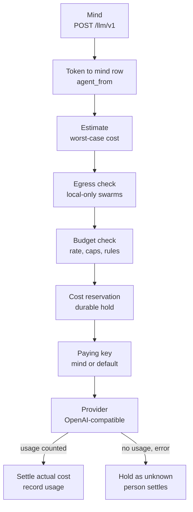
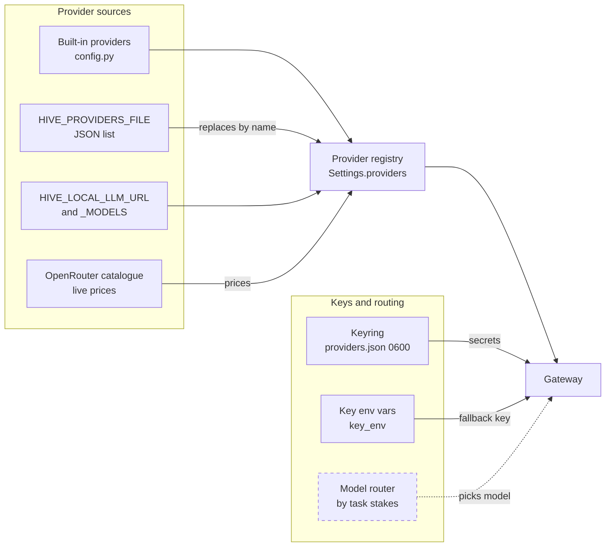

# Models and the gateway
> Status key: solid line = built; dashed line = intended, not finished. Code refs are to omegahive @ 34b0fb3 unless named.

**What this shows.** How a mind's model call is admitted, paid for and sent. Every native mind calls the hive's OpenAI-compatible gateway with its own token; the gateway picks the upstream from the mind's `provider/model`, checks egress and money at worst case, holds a cost reservation, injects the key and settles the real cost. It ends with how to add a model or a provider.

**Who should read it.** Owners of `hive/core/gateway.py`, `providers.py`, `budgets.py` and `cost_reservations.py`; operators adding models or providers; reviewers of spending, key handling and egress.

## Diagram(s)

### 1. One paid chat call



### 2. Where providers and prices come from



## How it works

**The gateway is three routes in the hive.** `POST /llm/v1/chat/completions` (`hive/core/app.py:2063-2125`), `POST /llm/v1/embeddings` (`hive/core/app.py:2145-2200`) and, only when `HIVE_MEDIA_ROUTE=on`, `POST /llm/v1/media` (`hive/core/app.py:2127-2143`, `hive/core/config.py:112-114`). A mind's token identifies it (`hive/core/app.py:312-316`). Minds reach it because the supervisor sets `provider=Hive`, `HIVE_LLM_URL` and `OPENAI_BASE_URL` to `/llm/v1` (`hive/supervisor/workspace.py:241-246`, `lib_llm_ext.py:288-290`).

**A mind's model is `provider/model`.** The string is split at the first slash (`hive/core/gateway.py:58-62`), so `openrouter/anthropic/claude-sonnet-5.5` is provider `openrouter`, model `anthropic/claude-sonnet-5.5`. The default for new minds is `HIVE_DEFAULT_MODEL`, `mock/echo` (`hive/core/config.py:167`). `mock/echo` is an offline model that speaks the skill-line format (`hive/core/gateway.py:87-166`).

**Estimate first, at worst case.** `Gateway.estimate` checks egress, then the price, then bounds the cost: every billable request byte counts as a token, and output is the requested maximum, 4096 if none is set (`hive/core/gateway.py:286-334`, `hive/core/app.py:2067-2068`). Multi-output calls, streaming and non-text content are refused on paid calls (`hive/core/gateway.py:307-330`, `hive/core/gateway.py:345-346`). Local and mock providers skip budget reservation; mock and zero-priced local models cost nothing, but prices configured for a local provider are still recorded as spend (K53) (`hive/core/gateway.py:295-296`).

**Unpriced remote models are refused.** A remote model with no price raises 402 `unpriced_model` (`hive/core/gateway.py:297-302`). A price is an entry for the model, or a `"*"` default for the provider (`hive/core/config.py:37-42`).

**Egress policy lives at the gateway.** `HIVE_LOCAL_ONLY_SWARMS` is a JSON list of swarm ids. A mind in one of them may use only `mock` or a provider marked `local` whose base URL is a literal loopback address with no credentials, query or fragment; anything else is 403 `egress_refused` (`hive/core/gateway.py:230-253`). The check runs on chat, embeddings and estimates (`hive/core/gateway.py:293`, `hive/core/gateway.py:343`, `hive/core/gateway.py:378`).

**The gateway is not the skill policy gate.** Allow, ask and deny per skill, with approvals, is a separate engine (`hive/core/policy.py:1-7`) that the mind's loop calls before each command (`src/loop.metta:111-117`). The gateway only admits model calls.

**Budget checks run before the call.** `Hive.check_budget` applies, in order: a per-mind calls-per-minute ceiling (`HIVE_MAX_LLM_CALLS_PER_MINUTE`, default 60, 429 `rate_limited`); the rule that a paid call needs a budget unless an allowance or hive total covers it (402 `no_budget`); the mind's own cap (`budget_usd`); every spending rule that applies; and the hive's hard cap (`hive/core/hive.py:1687-1733`, `hive/core/config.py:170`).

**Spending rules apply at every level.** A rule is `(scope, period, limit_usd)`. Scopes are `hive`, `swarm:<id>`, `agent:<id>`, `person:<id>`, `key:<id>` and `every-mind`; periods are `day`, `month` and `total` (`hive/core/budgets.py:1-17`). For each call the hive collects the stored rules, the automatic limits derived from a hive total, the default team month (`HIVE_SWARM_MONTHLY_USD`, 500) and a person's allowance; the first rule the call would break refuses it with 402 `spend_limit` (`hive/core/budgets.py:263-302`). Automatic limits are pure integer micro-dollar arithmetic (`hive/core/limits_auto.py:1-33`).

**Who pays is decided per call.** A person's own key pays as that person; otherwise the asker of an open Ask turn on that mind, the owner of an active session, the mind's named owner, or the hive (`hive/core/hive.py:1666-1685`). The key is the mind's assigned key (`options.key`), else the provider's default stored key, else the provider's environment key (`hive/core/gateway.py:265-278`). An assigned key that is gone fails; it never falls back silently (`hive/core/providers.py:156-163`).

**A reservation makes the estimate a hard hold.** In one SQLite transaction the hive checks every applicable scope against its recorded spend plus all outstanding holds plus this call, then writes the hold as dispatched (`hive/core/cost_reservations.py:119-154`, `hive/core/app.py:2076-2085`). Only a hash of the payload is kept (`hive/core/cost_reservations.py:126-128`).

**After the call the hold settles or stays.** With valid token counters, the actual cost settles the hold and usage is recorded; an overrun is recorded and flagged, never hidden (`hive/core/cost_reservations.py:170-190`, `hive/core/app.py:2113-2119`). With missing usage, an exception or a cancel, the hold becomes `unknown` until a person settles or releases it (`hive/core/app.py:2088-2112`, `hive/core/app.py:2120-2124`; `docs/FEATURES.md:373`).

**Keys stay in the hive.** Keys set in the UI live in `<data>/providers.json` with mode 0600 and are shown only as a hint (`hive/core/providers.py:1-5`, `hive/core/providers.py:126-148`). The gateway sends a key only to its configured provider (`hive/core/gateway.py:357-358`; `docs/FEATURES.md:376`). Minds never get provider keys: their environment is allowlisted (`hive/supervisor/sandbox.py:22-36`).

**The upstream call is OpenAI-shaped.** The gateway posts to `<base_url>/chat/completions` with `Authorization: Bearer <key>`, replacing the model name (`hive/core/gateway.py:354-367`). For OpenRouter it adds the mind's routing preference from `options.route` (`hive/core/gateway.py:359-364`, `hive/core/providers.py:385-451`).

**The OpenRouter catalogue feeds prices.** Fetched on demand and cached for an hour; each model's prompt and completion prices are written into the provider's price table (`hive/core/providers.py:337-358`).

## Intended shape and upgrade path

- **A model router.** The ruled shape picks the cheapest model whose predicted quality clears the bar for the task's stakes, inside what is admissible and affordable, with danger gated by authority, never by score (`docs/theory/language-routing-reasoning.md:40-62`). Today each mind has one fixed model.
- **A local core loop.** The long-run target is a local core loop with remote models as dispatched specialists (`docs/theory/language-routing-reasoning.md:59-62`).
- **A self-expanding registry.** New models enter as proposed providers, tested and ranked by results (`docs/theory/language-routing-reasoning.md:51-52`). Today providers come from code, a file and environment settings.
- **One settings module.** Settings are spread across modules (`docs/MODULARITY.md:54-57`, `docs/MODULARITY.md:66`).
- **Media route.** Live but switched off; output quality not qualified (`docs/FEATURES.md:231`).
- **Streaming.** Refused today (`hive/core/gateway.py:345-346`).

## Seams and contracts

| Seam | Where | Shape |
|---|---|---|
| Chat route | `hive/core/app.py:2063-2125` | OpenAI chat body; `Authorization: Bearer <mind token>` |
| Embeddings route | `hive/core/app.py:2145-2200` | uses the hive-wide `HIVE_EMBEDDING_MODEL` (`hive/core/config.py:168`) |
| Provider record | `hive/core/config.py:16-42` | `name`, `base_url`, `key_env`, `local`, `prices {model: {in, out}}` in USD per million tokens, `models`, `media` |
| Built-in providers | `hive/core/config.py:45-62` | `mock`, `anthropic`, `openai`, `openrouter`, `local` |
| Providers file | `hive/core/config.py:121-131` | `HIVE_PROVIDERS_FILE`: a JSON list; each object is passed to `Provider(**raw)` and replaces any provider with the same name |
| Local server | `hive/core/config.py:60-61`, `hive/core/config.py:128-130` | `HIVE_LOCAL_LLM_URL`, `HIVE_LOCAL_LLM_MODELS` (comma list), `HIVE_LOCAL_LLM_KEY` |
| Mind options | `hive/core/providers.py:388-431` | `key` (`k_<8 hex>` or `env:<provider>`), `route {order, allow_fallbacks, sort}`, `max_output_tokens` 256 to 32768 |
| Spending rules | `hive/core/budgets.py:1-30`; `/api/budgets` (`hive/core/app.py:1036-1073`) | `(scope, period, limit_usd)` |
| Error codes | `hive/core/gateway.py`; `hive/core/hive.py:1704-1733`; `hive/core/budgets.py:294-302` | `bad_model`, `unknown_provider`, `unpriced_model`, `egress_refused`, `rate_limited`, `no_budget`, `budget_exhausted`, `spend_limit`, `hive_budget_exhausted`, `reservation_refused` |
| Provider routes | `hive/core/app.py:1003-1031`, `hive/core/app.py:1133-1138` | `GET /api/models`, `GET /api/providers`, `PUT`/`DELETE /api/providers/{name}/key`, OpenRouter catalogue and endpoints |

## For owners: how to plug in

**Worked example: add a model or a provider.**

1. **A model of a built-in provider with a known price** (Anthropic): set `ANTHROPIC_API_KEY` in the hive's environment, or add the key in the UI (`PUT /api/providers/anthropic/key`, `hive/core/app.py:1021`). The built-in list already prices its models (`hive/core/config.py:47-51`).
2. **Any OpenRouter model:** set `OPENROUTER_API_KEY` or add the key in the UI. Prices arrive with the catalogue (`hive/core/providers.py:337-358`). Choose `openrouter/<vendor>/<model>`.
3. **A model with no built-in price.** The built-in `openai` provider lists models but no prices (`hive/core/config.py:52`), so its calls are refused as unpriced until you add prices. Write a providers file, for example `providers.json`:
   ```json
   [
     {"name": "openai", "base_url": "https://api.openai.com/v1", "key_env": "OPENAI_API_KEY",
      "models": ["gpt-6.1"], "prices": {"gpt-6.1": {"in": 2.5, "out": 10}}},
     {"name": "acme", "base_url": "https://<acme-base-url>/v1", "key_env": "ACME_API_KEY",
      "models": ["acme-large"], "prices": {"*": {"in": 1, "out": 4}}}
   ]
   ```
   Set `HIVE_PROVIDERS_FILE=<path to providers.json>` and `ACME_API_KEY`, then restart the hive: the file is read at startup (`hive/core/config.py:121-127`, `hive/core/config.py:166`). An entry with an existing name replaces the built-in one whole, so restate `base_url`, `key_env` and `models`. The figures here are placeholders: use the provider's real prices, in USD per million tokens (`hive/core/config.py:24-25`). Only the fields of the provider record are accepted (`hive/core/config.py:16-31`); do not put a key in the file.
4. **A local OpenAI-compatible server** (vLLM, SGLang, Ollama, llama.cpp): set `HIVE_LOCAL_LLM_URL` to its `/v1` base and `HIVE_LOCAL_LLM_MODELS=model-a,model-b` (`hive/core/config.py:59-61`, `hive/core/config.py:128-130`). Calls to `local/<model>` skip budget admission (prices you configure are still recorded as spend, K53) (`hive/core/gateway.py:295-296`). For a second local server, add a providers-file entry with `"local": true` and a loopback `base_url`. Only a literal loopback address is allowed for local-only swarms (`hive/core/gateway.py:246-253`).
5. **Choose it per mind:** `PATCH /api/agents/{id} {"model": "acme/acme-large"}` (`hive/core/app.py:1284-1308`, `hive/core/hive.py:40`). The gateway reads the mind's model on each call. A role can set a default model (`hive/core/hive.py:768-769`).
6. **Give it money:** a paid call needs a mind budget (`budget_usd`), or a hive total or person allowance that covers it (`hive/core/hive.py:1722-1723`). Set limits on the Limits page or with `/api/budgets` (`hive/core/app.py:1036-1073`).
7. **Optionally pin who pays:** set the mind's `options.key` to a stored key id (`hive/core/providers.py:408-412`).
8. **Check:** `GET /api/providers` shows each provider as connected, with key source and models (`hive/core/providers.py:264-287`). Then send the mind a message and watch its spend.

Notes:
- The model string is not validated when you set it. An unknown provider fails at call time with 400 `unknown_provider` (`hive/core/gateway.py:280-284`).
- `HIVE_ALLOW_UNPRICED=1` exists (`hive/core/config.py:171`), but see "For reviewers": with it, a paid chat call estimates to $0 and the reservation step refuses a zero hold. Price the model instead.
- The Ask conductor picks only models it can bound in money, and ignores `HIVE_ALLOW_UNPRICED` (`hive/core/conductor.py:583`).

## For reviewers: what to check

- **Worst case is a true bound.** Every forwarded field counts; `n>1`, `best_of>1`, streaming and non-text content are refused (`hive/core/gateway.py:303-334`). Guards: `hive/tests/test_cost_reservations.py`, `hive/tests/test_drift_guards.py`.
- **Holds see each other.** A reservation counts all outstanding holds on the same subjects, including rules added later (`hive/core/cost_reservations.py:15-21`, `hive/core/cost_reservations.py:145-153`). Guards: `hive/tests/test_cost_reservations.py`, `hive/tests/test_reservation_resolvable.py`, `hive/tests/test_auto_budgets.py`.
- **After the provider answers, nothing raises to the caller;** every failure becomes a held liability (`hive/core/app.py:2101-2125`).
- **Local-only swarms.** Only loopback `local` providers or `mock` (`hive/core/gateway.py:230-253`). Guard: `hive/tests/test_local_only_egress.py`. The rule covers model and embedding calls only: a module skill that opens its own connection, such as web search, is stopped only by the OS sandbox (see [03-modules.md](03-modules.md)).
- **Keys.** Never in a mind's environment, never returned by the API except as a hint (`hive/core/providers.py:146-148`). Guard: `hive/tests/test_providers_api.py`.
- **Unpriced models.** Refusal path guarded by `hive/tests/test_providers_api.py` and `hive/tests/test_drift_guards.py`. The `HIVE_ALLOW_UNPRICED=1` path for chat has no test: `estimate` returns `(True, 0.0)` (`hive/core/gateway.py:298-299`), and `reserve` refuses a non-positive amount (`hive/core/cost_reservations.py:134-135`), which surfaces as 402 `reservation_refused` (`hive/core/app.py:2084-2085`). This is a reading of the code, not a run.

## References

- `hive/core/gateway.py:1-391`
- `hive/core/providers.py:1-451`
- `hive/core/config.py:12-62`, `hive/core/config.py:110-131`, `hive/core/config.py:157-180`
- `hive/core/budgets.py:1-60`, `hive/core/budgets.py:263-302`; `hive/core/limits_auto.py:1-40`
- `hive/core/cost_reservations.py:1-40`, `hive/core/cost_reservations.py:119-200`
- `hive/core/hive.py:40`, `hive/core/hive.py:768-769`, `hive/core/hive.py:1666-1735`
- `hive/core/app.py:312-316`, `hive/core/app.py:1003-1073`, `hive/core/app.py:1284-1308`, `hive/core/app.py:2063-2200`
- `hive/core/policy.py:1-7`; `src/loop.metta:111-117`; `lib_llm_ext.py:288-295`; `hive/supervisor/workspace.py:241-246`; `hive/supervisor/sandbox.py:22-36`
- `hive/core/conductor.py:583-593`
- `hive/README.md:42-60`; `docs/FEATURES.md:231`, `docs/FEATURES.md:369-376`; `docs/theory/language-routing-reasoning.md:40-66`; `docs/MODULARITY.md:54-57`, `docs/MODULARITY.md:66`
