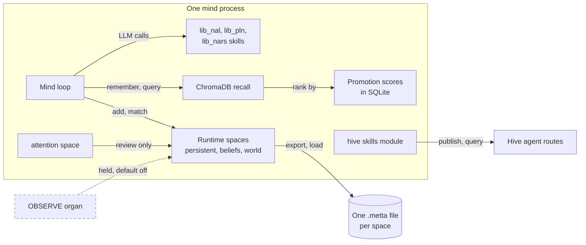
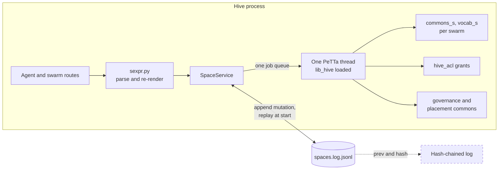
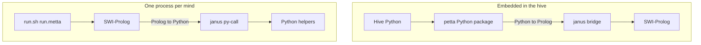

# MeTTa and AtomSpace

> Status key: solid line = built; dashed line = intended, not finished. Code refs are to omegahive @ 34b0fb3 unless named.

**What this shows.** Where knowledge lives as MeTTa atoms. There are two places: each mind's own spaces, inside the mind's own PeTTa process, and the hive's shared spaces, inside one PeTTa interpreter embedded in the hive process. It also shows how PeTTa runs on SWI-Prolog in both places.

**Who should read it.** Owners of the mind runtime, the spaces service and the reasoning libraries. Reviewers of anything that writes atoms, changes persistence or touches the PeTTa toolchain.

## Diagrams

### 1. A mind's own spaces

### 2. The hive's shared spaces

### 3. PeTTa on SWI-Prolog, two ways

## How it works

**A mind is a PeTTa program.** `run.metta` imports `lib_omegaclaw` and calls `(omegaclaw)` (`run.metta:1-5`). That loads the core substrate, then modules, then attention, then the loop, in that order, because PeTTa compiles calls at import time (`lib_omegaclaw.metta:1-11`). The supervisor starts each mind as `sh <PETTA_PATH>/run.sh <workspace>/run.metta --silent` (`hive/supervisor/workspace.py:109-114`).

**The substrate loads the libraries.** `lib_omegaclaw_core.metta` imports `lib_nal`, `lib_pln`, PeTTa's own `lib_nars`, the skill catalogues, memory and the ChromaDB library (`lib_omegaclaw_core.metta:7-38`).

**A mind has named runtime spaces.** They are `&persistent`, `&agenda`, `&beliefs`, `&world`, `&events`, `&activity` and `&cleanup` (`lib_omegaclaw_core.metta:40-46`). Each is registered with a role, a size limit and a persistence file, `memory/<name>.metta` (`src/skills_runtime_spaces.metta:70-97`). Saves write a temp file and rename it, so a failed save leaves the old file (`src/skills_runtime_spaces.metta:5-12`).

**Over the limit, atoms are evicted, with a record.** Protected atoms (identity, pins, goals, commitments) are never dropped, and every drop is written to `memory/evicted.metta` (`src/skills_runtime_spaces.metta:14-16`).

**Long-term recall is ChromaDB beside the AtomSpace.** `remember` embeds text and stores it in ChromaDB (`src/memory.metta:65-67`). `query` asks ChromaDB for an inflated candidate set and re-ranks it by promotion (`src/memory.metta:98-111`). The hive's default embedder is `mock/hash` (`hive/core/config.py:168`; `STATUS.md:52`).

**Promoted memory decays.** `promote` and `demote` move a memory's score by one, capped at 10 (`src/memory.metta:116-134`). The score decays with time since last use (`src/memory.metta:92-96`). The top `mostPromotedMemories` (10) are fed back as hints (`src/memory.metta:33-34,69-85`).

**Attention is an optional organ.** It binds an `&attention` space, persists it to `attention.metta` and hooks the response phase (`lib_omegaclaw_attention.metta:1-17`). Its scoring is a keyword classifier in Python (`src/attention_ledger.py:157-211`). The pass defaults to `review-only` (`src/attention_ledger.py:362`). See [03-reasoning.md](03-reasoning.md).

**The hive has one embedded PeTTa.** `SpaceService` loads `lib_hive.metta` into a PeTTa interpreter (`hive/spaces/service.py:79-86`). janus binds the interpreter to the thread that first calls it, so every call goes through one worker thread and a job queue (`hive/spaces/service.py:52-102`). The hive creates one service at start, with data under `<data_dir>/spaces` (`hive/core/hive.py:86`).

**Each swarm owns two spaces.** Swarm `s` has `&commons_s` (beliefs) and `&vocab_s` (shared terms). Publish grants live in one hive-wide `&hive_acl` (`hive/spaces/service.py:7`; `hive/spaces/lib_hive.metta:3-4`). Two more commons hold the hive's own evidence: `governance` for people's answers (`hive/core/governance_evidence.py:1-13`) and `placement` for where minds have run (`hive/core/placement.py:13,67`).

**Vocabulary opens on publish.** When a member publishes, its statement's symbols are added to the swarm vocabulary first (`hive/spaces/service.py:214-220`). Operators can read and add terms through `/api/swarms/{id}/vocab` (`hive/core/app.py:1202-1215`).

**The operations log makes the commons durable.** PeTTa has no persistence. Each grant, revoke, vocabulary term and accepted publish is appended to `spaces.log.jsonl` and replayed on start (`hive/spaces/service.py:1-5,125-137`). Denied, quarantined and duplicate publishes are not logged (`hive/spaces/service.py:225-227`). The log is append-only and not hash-chained (`docs/theory/ledger-provenance-and-das.md:92-93`).

**Repository maps become read-only spaces.** With the omegahive pull request `port/repo-map-host`, each loaded repository revision is mounted into its own space `repo:<repo>@<sha>` (handle `&repo_<hash>`), written only by the loader and under one lock, so a load, a retention drop and a restart remount never interleave (`hive/spaces/service.py:283-328`). Strings that become atoms refuse every control character. Members do not query these spaces yet; the repository-map routes answer from the database rows (see [hive spaces card](../components/hive-spaces.md#repository-maps)).

**Agent text never reaches the interpreter raw.** `sexpr.py` parses it and re-renders it from a small grammar: symbols, numbers, strings and nested lists. It refuses `!`, `&` handles, comments and (outside patterns) variables, with depth 16 and 256 nodes at most (`hive/spaces/sexpr.py:1-8,17-18,130-148`).

**`lib_evolve.metta` is not loaded by the service.** It is a typed record prototype for Evolve claims, and its header says so (`hive/spaces/lib_evolve.metta:1`). Only a test loads it, in a standalone PeTTa run (`hive/tests/test_evolve_native.py:27-33`).

**The same libraries also run in the browser.** The personal mind's space runs vendored `lib_nal`, `lib_pln` and `lib_hive` in MeTTaScript (`hive/ui/src/lib/mindSpace/sources.ts:2-11`; `hive/ui/src/lib/mindSpace/core.ts:1-13`). A parity run matched 79 of 86 cases against PeTTa, with 0 mismatches (`docs/EARLIER_EXPERIMENTS.md:27`).

**The toolchain is pinned.** Python 3.12, SWI-Prolog 10.1.14 built against that Python, janus-swi 1.5.3 and PeTTa `ae66fa8` (`scripts/dev/setup_petta_env.sh:5-8,29-34`). A stock packaged SWI-Prolog loads, but its Prolog-to-Python bridge fails, so the script builds a private prefix (`scripts/dev/setup_petta_env.sh:10-12`).

## Intended shape and upgrade path

| Piece | Today | Intended | Source |
|---|---|---|---|
| Spaces log | Append-only, replayed at start | Each line carries `prev` and `hash`; a per-swarm chain head | `docs/theory/ledger-provenance-and-das.md:92-93,118-119` |
| Space snapshots | None; full replay | Periodic S-expression snapshot plus log tail | `docs/omegadots/PLAN.md` §3 "Persistence for hive-spaces" |
| Storage backend | Native PeTTa only | Native, then remote, then MORK, then an optional DAS adapter | `docs/theory/ledger-provenance-and-das.md:90-91`; `docs/omegadots/PLAN.md` §4.3 |
| Spaces as a service | A class inside the hive process | Its own service with match, publish, promote, subscribe and snapshot routes | `docs/omegadots/PLAN.md` §2, §4.3 |
| Attention in the commons | None | ECAN-lite `hive-attend!`, `hive-rent!`, `hive-forget!`; later `metta-attention` | `docs/omegadots/PLAN.md` §4.3 |
| OBSERVE organ | Held, default off (64 passed) | Experience written to atoms by the core | `docs/EARLIER_EXPERIMENTS.md:24` |
| AtomSpace as state of record | ChromaDB beside the AtomSpace | V2-style journal and state spine; needs an adapter | `docs/EARLIER_EXPERIMENTS.md:38` |
| Native attention bank | Python keyword classifier | V2 attention bank behind `lib_omegaclaw_attention.metta` | `docs/EARLIER_EXPERIMENTS.md:42` |
| Distributed AtomSpace | Single host by choice | Between hives only; see [04-federation.md](04-federation.md) | `docs/theory/hyperon-alignment-and-peer-work.md:30` |

## Seams and contracts

- **Mind spaces registry:** `(register-space name handle role)`, `register-space-limit`, `register-space-persistence` (`src/skills_runtime_spaces.metta:30-48`). Default spaces at `src/skills_runtime_spaces.metta:70-97`.
- **Mind memory settings:** `maxRecallItems` 20, `promotionInflationFactor` 10, `mostPromotedMemories` 10, `embeddingprovider` (`src/memory.metta:16-37`).
- **Hive embedder setting:** `HIVE_EMBEDDING_MODEL`, default `mock/hash` (`hive/core/config.py:168`).
- **Spaces service API (Python, in process):** `grant`, `revoke`, `is_member`, `add_vocab`, `vocab`, `publish`, `beliefs`, `belief`, `query` (`hive/spaces/service.py:153-264`).
- **Log line shapes:** `{"op":"grant"|"revoke", agent_id, swarm_id}`, `{"op":"vocab", swarm_id, term, agent_id}`, `{"op":"publish", swarm_id, agent_id, statement, f, c, stamp}` (`hive/spaces/service.py:157,161,175,226-227`). Replay calls `_apply_<op>` (`hive/spaces/service.py:129-137`).
- **Atom shapes in a commons:** `(Current stmt tv stamp)`, `(Asserted agent stmt tv stamp)`, `(Chosen stmt kept rejected)`, `(Quarantined agent stmt unmapped)`, `(EvCounter agent n)` (`hive/spaces/lib_hive.metta:49-57,98-133`). In `&hive_acl`: `(Grant agent space pattern publish)` (`hive/spaces/service.py:143`). In a vocabulary: `(Term sym)` (`hive/spaces/lib_hive.metta:91-94`).
- **Interpreter path:** `PETTA_PATH`, else `~/PeTTa` (`hive/spaces/service.py:112`).

## For owners: how to plug in

1. **Add a mind space.** Bind it with `!(bind! &name (new-space))`, then call `register-space`, `register-space-limit` and `register-space-persistence` the way the attention organ does (`lib_omegaclaw_attention.metta:7-11`). Load your file before the loop (`lib_omegaclaw.metta:1-11`).
2. **Add a hive commons for host evidence.** Follow `GovernanceEvidence`: pick a commons name, grant the speaker, publish with a fresh evidence id (`hive/core/governance_evidence.py:61-62`; second user at `hive/core/placement.py:67`).
3. **Add a shared-space rule.** Write it in `hive/spaces/lib_hive.metta`. It must import nothing, because PeTTa resolves imports against the main file (`hive/spaces/lib_hive.metta:14-16`). Compute values with `let` before `add-atom` (`hive/spaces/lib_hive.metta:11-12`). Add a case to `tests/hive_lib_smoke.metta`.
4. **Add a log operation.** Add `_apply_<op>` and a `_log("<op>", ...)` call together in `hive/spaces/service.py`, or replay will fail on start (`hive/spaces/service.py:129-137`).
5. **Set up PeTTa locally.** Run `scripts/dev/setup_petta_env.sh`, then put the prefix's `bin` on `PATH` and set `PETTA_PATH` as the script prints (`scripts/dev/setup_petta_env.sh:17-20`).

## For reviewers: what to check

- **One interpreter thread.** No code may call PeTTa outside `_Interpreter.run` (`hive/spaces/service.py:52-102`). A second thread deadlocks.
- **Nothing raw reaches MeTTa.** Every agent string must pass `sexpr.safe_statement`, `safe_pattern` or `safe_symbol` before it is spliced (`hive/spaces/service.py:142,150,205-206,261-262`).
- **Log and state stay in step.** Every mutation that changes a space must be logged, and every logged op must have an `_apply_` handler. Note: `Quarantined` atoms are written to the commons but not logged, so they do not survive a restart (`hive/spaces/lib_hive.metta:128`; `hive/spaces/service.py:225`).
- **Mind saves are atomic and evictions are recorded** (`src/skills_runtime_spaces.metta:5-16`).
- **Import order.** A loop loaded before its affordances compiles calls as inert literals (`lib_omegaclaw.metta:3-6`).
- **Tests:** `tests/hive_lib_smoke.metta` (ACL, quarantine, stamps, echo, revision), `tests/space_registry_smoke.metta`, `tests/runtime_memory_boot_composition_smoke.metta`, `tests/test_memory_runtime.py`, `tests/test_memory_safety.py`, `hive/tests/test_acceptance.py:69` (three minds share, revise and survive a restart), `hive/tests/test_evolve_native.py`.

## References

- `run.metta:1-5`; `lib_omegaclaw.metta:1-11`; `lib_omegaclaw_core.metta:7-46`; `lib_omegaclaw_attention.metta:1-17`
- `src/skills_runtime_spaces.metta:5-16,30-48,70-97`; `src/memory.metta:16-37,65-134`; `src/attention_ledger.py:157-211,362`
- `hive/supervisor/workspace.py:109-114`; `hive/core/config.py:168`; `hive/core/hive.py:86`
- `hive/spaces/service.py:1-264`; `hive/spaces/sexpr.py:1-18,130-148`; `hive/spaces/lib_hive.metta:1-152`; `hive/spaces/lib_evolve.metta:1-26`
- `hive/core/governance_evidence.py:1-13,61-62`; `hive/core/placement.py:13,67`; `hive/core/app.py:1202-1215`
- `hive/ui/src/lib/mindSpace/core.ts:1-13`; `hive/ui/src/lib/mindSpace/sources.ts:2-11`
- `scripts/dev/setup_petta_env.sh:5-37`
- `STATUS.md:52`; `docs/EARLIER_EXPERIMENTS.md:24,27,38,42`; `docs/theory/ledger-provenance-and-das.md:90-93,118-119`; `docs/theory/hyperon-alignment-and-peer-work.md:30`; `docs/omegadots/PLAN.md` §2, §3, §4.3
