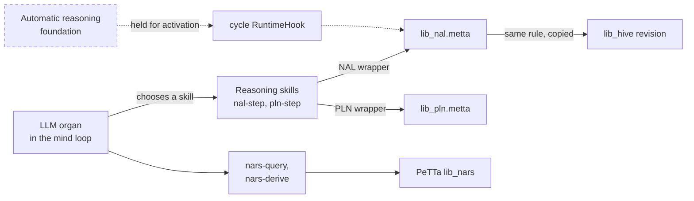
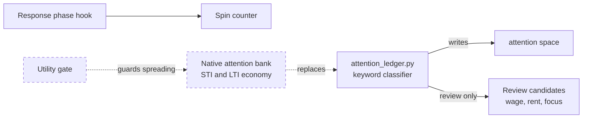

# Reasoning: NAL, PLN, NARS and attention

> Status key: solid line = built; dashed line = intended, not finished. Code refs are to omegahive @ 34b0fb3 unless named.

**What this shows.** Which reasoning libraries a mind has, how it calls them, and where the same truth rules are used in the swarm commons. It separates what is on (skills the mind's LLM calls), what is held (built and tested, deliberately off) and what is only intended.

**Who should read it.** The reasoning-library author and owners of the mind loop and attention organ. Reviewers of any change to truth semantics, skill wiring or the loop's runtime hooks.

## Diagrams

### 1. How reasoning is reached today

### 2. Attention: what exists and what is intended

## How it works

**The mind loads three reasoning libraries.** `lib_omegaclaw_core.metta` imports this repo's `lib_nal` and `lib_pln`, and PeTTa's own `lib_nars` (`lib_omegaclaw_core.metta:12-14`).

**Reasoning is a set of skills.** `nal-step` calls `|-`, `pln-step` calls `|~`, and `nars-query` and `nars-derive` call PeTTa's NARS. `truth-expectation` is also exposed (`src/skills_reasoning_spaces.metta:1-22`). Their signatures and help text are in `src/skill_signatures_reasoning.metta:7-10` and `src/skill_catalog_reasoning.metta:4-21`.

**`|-` is a two-order NAL wrapper.** It tries both premise orders and removes duplicates (`lib_nal.metta:201`). The rules are `|-nal` clauses, for example revision, deduction, induction and abduction (`lib_nal.metta:108-112`).

**`|~` is the PLN wrapper.** It tries both orders of `|~pln` and removes duplicates (`lib_pln.metta:306-307`). Every term prior is the constant `STV` ⟨0.1, 0.9⟩ (`lib_pln.metta:49`). PLN revision caps at 1.0 (`lib_pln.metta:117`).

**The LLM decides when to reason.** Nothing in the loop calls these skills on its own. Automatic invocation is deliberately not wired in this release (`STATUS.md:49`; `docs/FEATURES.md` CR11). A read-only baseline found 0 executed reasoning calls in 876 non-private traces (`docs/EARLIER_EXPERIMENTS.md:25`).

**The commons uses the same revision rule.** `hive-truth-revision` in `lib_hive.metta` is a copy of `Truth_Revision` in `lib_nal.metta` (`hive/spaces/lib_hive.metta:20-31`; `lib_nal.metta:92`). Unlike the skills, the commons checks evidence stamps. See [02-beliefs-sharing.md](02-beliefs-sharing.md).

**Governance answers are NAL evidence.** People's approvals become observations with c 0.5 in the governance commons, so n consistent answers give c = n/(n+1) (`hive/core/governance_evidence.py:4-10`).

**The deviations are documented, not fixed.** By the owner's ruling the libraries stay unchanged; any change to truth semantics goes to the domain author first (`docs/reasoning-deviations.md:7-9`). The main hazards:
- loading both `lib_nal` and `lib_nars` defines `|-` and every `Truth_*` helper twice, so in a running mind `nal-step` returns duplicates (`docs/reasoning-deviations.md:33-39`);
- the skill path carries no stamps, so revising a belief with itself raises confidence (`docs/reasoning-deviations.md:40-43`);
- five revision rules exist across the estate, with different caps (`docs/reasoning-deviations.md:49-52`);
- several PLN specifics differ from the references (`docs/reasoning-deviations.md:53-63`).

**Attention is a heuristic.** The attention organ registers an `&attention` space and a response-phase spin counter (`lib_omegaclaw_attention.metta:7-17`). `attention_ledger.py` scores atoms by matching keyword lists for protected, stale, event and malformed text (`src/attention_ledger.py:157-211`). Its pass defaults to `review-only` (`src/attention_ledger.py:362`). It uses ECAN names (STI, LTI, wage, rent), but full ECAN is design intent (`STATUS.md:51`).

**The theory pages are design, not build authority.** They say so (`docs/theory/README.md:14-24`). Attention theory sets one line: attention determines the choice set, never the choice (`docs/theory/cognition-attention-importance.md:85-88`).

## Intended shape and upgrade path

| Item | State | To bring it in | Source |
|---|---|---|---|
| Reasoning foundation: NAL/NARS through the skill path, honest ERROR/EMPTY, collision fix | **Held.** Assembly gate passed, 69 passed | The operator-naming ruling, then the activation ladder | `docs/EARLIER_EXPERIMENTS.md:23`; `docs/FEATURES.md` CR15 |
| OBSERVE organ | **Held.** Default off, 64 passed | Shared gates and telemetry, then a two-mind cohort | `docs/EARLIER_EXPERIMENTS.md:24` |
| NAL inside the autonomous cycle | Built in the V2 body | An adapter on the `cycle` RuntimeHook; persist salience first | `docs/EARLIER_EXPERIMENTS.md:36`; `src/skills_reasoning_spaces.metta:24` |
| MeTTa sequencing the cycle | Built in the V2 body | Same `cycle` hook seam | `docs/EARLIER_EXPERIMENTS.md:37` |
| Native attention bank | Built in the V2 body | An adapter behind `lib_omegaclaw_attention.metta`, replacing `attention_ledger.py` | `docs/EARLIER_EXPERIMENTS.md:42` |
| ECAN spreading | Qualified negative | Needs a utility gate | `docs/EARLIER_EXPERIMENTS.md:42,85` |
| PLN in a loop | Never invoked in any body | Skill only today | `docs/EARLIER_EXPERIMENTS.md:80` |
| Standalone PLN as a library swap | Compatible in principle | Changes truth semantics; goes to the PLN author first | `docs/EARLIER_EXPERIMENTS.md:54` |
| Honest truth values (evidence counts) | Plan cleared review, waits for the owner | One representation, f and c derived | `docs/reasoning-deviations.md:93-96` |
| Temporal reasoning | Partial, private, default off | Host admission and owner choices | `docs/FEATURES.md` CR14 |
| Inspectable-inert reasoning | Reviewed design | The mind audits its LLM organ's reasoning; it never auto-affects | `docs/theory/language-routing-reasoning.md:6-18` |

## Seams and contracts

- **Skill call shapes:** `(nal-step "((--> A B) (stv f c))" "((--> B C) (stv f c))")`, `(pln-step "((Inheritance A B) (stv f c))" "...")`, `(nars-query kb term)`, `(nars-derive tasks beliefs)`. Results are strings prefixed `NAL-STEP`, `PLN-STEP`, `NARS-QUERY`, `NARS-DERIVE` (`src/skills_reasoning_spaces.metta:1-19`).
- **Truth value:** `(stv f c)` everywhere; expectation via `Truth_Expectation` (`lib_nal.metta:101`).
- **Runtime hooks:** `(register-runtime-hook phase name call)`, trusted with `trust-runtime-hook`, run by `run-runtime-hooks` (`src/skills_reasoning_spaces.metta:24-61`). The attention organ uses phase `response` (`lib_omegaclaw_attention.metta:16-17`).
- **Library load order:** `lib_omegaclaw_core.metta:12-14`.
- **Reference probe:** `docs/probes/nal_pln_reference_probe.metta` and its `.out` (`docs/reasoning-deviations.md:13-14`).

## For owners: how to plug in

1. **Change a truth function.** Write it up against `docs/reasoning-deviations.md` and send it to the domain author before merge (`docs/reasoning-deviations.md:7-9`). Re-run `docs/probes/nal_pln_reference_probe.metta` and update its `.out`.
2. **Keep the commons in step.** If `Truth_Revision` changes, change `hive-truth-revision` too, and keep `tests/hive_lib_smoke.metta` agreeing (`hive/spaces/lib_hive.metta:20-21`). The browser copies are vendored byte-for-byte (`hive/ui/src/lib/mindSpace/sources.ts:2`).
3. **Add automatic reasoning.** Register a `cycle` hook with `register-runtime-hook` and mark it trusted. Ship it default-off and follow the activation ladder in `docs/EARLIER_EXPERIMENTS.md:23`.
4. **Replace attention.** Keep the `&attention` registration and persistence in `lib_omegaclaw_attention.metta`; swap what `attention_ledger.py` computes.

## For reviewers: what to check

- **Truth semantics did not drift.** Compare against `docs/reasoning-deviations.md` and the probe output. Any change without the domain author's sign-off is a blocker.
- **Collision.** A change that adds another `|-` or `Truth_*` definition makes duplicates worse (`docs/reasoning-deviations.md:33-39`).
- **Skill path stamps.** Do not cite skill-path revision as evidence: it has no echo guard (`docs/reasoning-deviations.md:40-43`).
- **Nothing activates by accident.** Automatic reasoning and OBSERVE must stay off unless an activation review says otherwise (`STATUS.md:49`).
- **Attention never decides.** It may rank and propose; it must not confer truth, consent or authority (`docs/theory/cognition-attention-importance.md:85-88`).
- **Tests:** `tests/reasoning_space_smoke.metta`, `tests/nars_assimilation_smoke.metta`, `tests/hive_lib_smoke.metta`, `tests/attention_ledger_smoke.metta`, `tests/attention_spin_counter_smoke.metta`, `tests/test_attention_ledger.py`.

## References

- `lib_omegaclaw_core.metta:12-14`; `lib_omegaclaw_attention.metta:1-17`
- `lib_nal.metta:92,101,108-112,201`; `lib_pln.metta:49,117,306-307`
- `src/skills_reasoning_spaces.metta:1-61`; `src/skill_signatures_reasoning.metta:7-10`; `src/skill_catalog_reasoning.metta:4-21`
- `src/attention_ledger.py:157-211,362`
- `hive/spaces/lib_hive.metta:20-31`; `hive/core/governance_evidence.py:4-10`
- `STATUS.md:49-51`; `docs/FEATURES.md` CR7, CR8, CR11, CR14, CR15
- `docs/reasoning-deviations.md`; `docs/EARLIER_EXPERIMENTS.md:23-25,36-42,54,80,85`
- `docs/theory/README.md:7-24`; `docs/theory/cognition-attention-importance.md`; `docs/theory/language-routing-reasoning.md:6-18,93-104`
