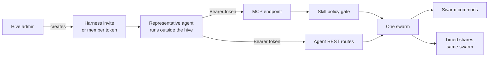
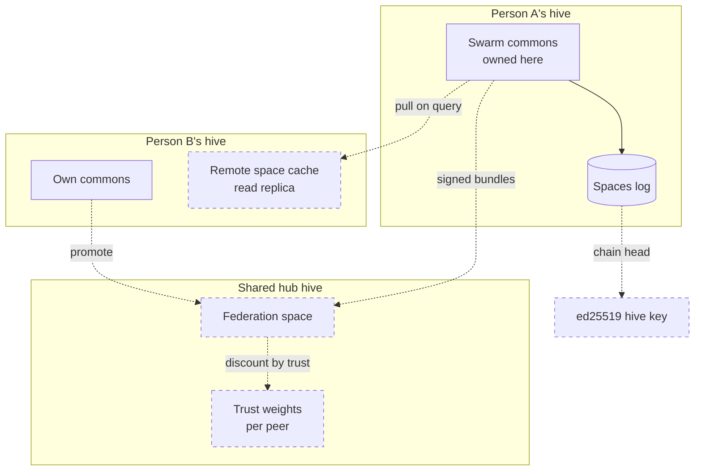
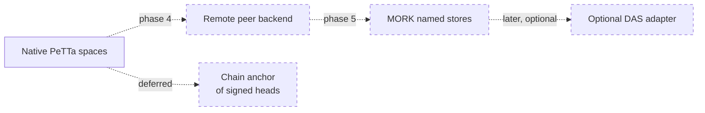

# Federation: hives as nodes

> Status key: solid line = built; dashed line = intended, not finished. Code refs are to omegahive @ 34b0fb3 unless named.

**What this shows.** The intended shape of a network of hives. Each person's hive is a node. Hives link hive-to-hive, each swarm's commons is a shard owned by one node, and the shared store grows from native PeTTa toward MORK and an optional Distributed AtomSpace (DAS) adapter. Today only the representative connection (an outside agent joining a hive as a member) and moving a mind between hives are built; the rest is design.

**Who should read it.** Owners of the spaces service, external member and harness integrations, and placement. Reviewers of any proposal that lets data or beliefs cross a hive or swarm boundary.

## Diagrams

### 1. Built today: representatives join one hive

### 2. Intended: hive-to-hive, sharded by swarm

### 3. Intended storage path

## How it works

**A hive is self-contained today.** All of its state lives under its own data directory: SQLite, the spaces log and agent memory (`hive/JOINING.md` §1). The shared spaces run in one embedded PeTTa inside the hive process (`hive/spaces/service.py:52-114`). See [01-metta-and-atomspace.md](01-metta-and-atomspace.md).

**The representative connection is built.** An outside agent joins a swarm as an external member (`kind: module`) with a member token, stored hashed (`hive/JOINING.md` §2). It talks to the hive over REST (`/api/agent/inbox`, `/messages`, `/publish`, `/query`, `/belief`, goals and shares) (`hive/JOINING.md` §3; `hive/core/app.py:312-316,2238-2255`). Harnesses can join through an admin's invite code and the `/mcp` endpoint instead (`hive/core/app.py:629-660`). This is the "representative-to-hive connection" that works today (`STATUS.md:71`; `docs/STATUS.md:48`).

**A representative stays inside its swarm.** A member token acts only for that member, in its own swarm. Members cannot start processes, change policy, approve actions or reach other swarms (`hive/JOINING.md` §4). MCP tools pass the skill policy gate (`hive/core/mcp.py:535-541`).

**Belief queries do not leave the swarm.** `Hive.query` passes only the caller's own swarm to the spaces service (`hive/core/hive.py:1637-1642`). Memory shares never cross swarms (`hive/core/shares.py:14`). The MCP evidence query refuses grants, because cross-scope grants do not exist on this host yet (`hive/core/mcp.py:668-669`).

**Swarms in one hive can connect by agreement.** A connection between two swarms grants only its scopes, only while active: a time-limited memory read share to the other side's coordinator, or cross-swarm requests of named kinds. Repository and channel scopes are refused for now (`hive/core/connections.py:1-15`).

**Moving a mind between hives is built, not verified live.** Export packs a manifest with the sha256 of every workspace file. Import checks every hash and revives the mind with the same id and a fresh token. Settle leaves a tombstone at the source. Each move is recorded as evidence in the placement commons (`hive/core/placement.py:1-14`; routes at `hive/core/app.py:1872-1893`). No successful live move has been verified (`docs/FEATURES.md` MI15).

**Provenance pieces for federation already exist.** Assets, exhibits, library originals and app releases are addressed by sha256. Shared beliefs carry evidence stamps, so revision across sources stays honest. The spaces log is append-only (`docs/theory/ledger-provenance-and-das.md:18-52`).

## Intended shape and upgrade path

The owner's direction: each person's hive is a node, or shard, that talks to a shared hive hive-to-hive, in the DAS style (`docs/theory/ledger-provenance-and-das.md:113-116`; `docs/STATUS.md:60`). No reviewed plan for it was found (`docs/FEATURES.md` SW23). The road is written as six steps, each useful alone (`docs/theory/ledger-provenance-and-das.md:118-136`):

| Step | What it adds | Built? | Source |
|---|---|---|---|
| 1. Chain the log | `prev` and `hash` on every spaces-log line; a per-swarm chain head | Intended | `ledger-provenance-and-das.md:118-119` |
| 2. A key per hive | ed25519 identity; signed pin sets, chain heads, bundles and bench receipts | Intended | `ledger-provenance-and-das.md:120-122`; `docs/omegadots/PLAN.md` §4.5 |
| 3. Shard by swarm | One node owns and writes a swarm's commons under a lease; others mount it as a remote space with a local cache, as in DAS `RemoteAtomDB` | Intended | `ledger-provenance-and-das.md:123-125` |
| 4. Federate beliefs with stamps | Signed bundles of stamped beliefs; incoming confidence discounted by trust, `c' = c·trust`; trust learned from track record | Intended | `ledger-provenance-and-das.md:126-127`; `docs/omegadots/PLAN.md` §4.5 |
| 5. Address by digest | Move assets, exhibits and releases with no new identity scheme | Partly built (digests exist) | `ledger-provenance-and-das.md:128-129` |
| 6. Anchor on a chain | Commit signed heads to a chain; on-chain multisig | Deliberately deferred | `ledger-provenance-and-das.md:100-111,130-134` |

**Storage backends.** The design puts spaces behind a backend adapter: native PeTTa now, a remote peer cache in phase 4, MORK named stores with MM2 batch revision in phase 5, and an optional DAS adapter later (`docs/omegadots/PLAN.md` §4.3; `docs/theory/ledger-provenance-and-das.md:90-91`). MORK has never been built or run here; it was evaluated from source only (`docs/EARLIER_EXPERIMENTS.md:82`).

**DAS sits between hives, not inside one.** DAS has no PeTTa bridge yet, and inside one mind it would break the single-writer rule. So it is optional, never a hard dependency (`docs/theory/ledger-provenance-and-das.md:105-107`). Inside one hive, a distributed AtomSpace is a gap by choice (`docs/theory/hyperon-alignment-and-peer-work.md:30`).

**Admission and access.** Publishing into the federation would cost attention credit, check the federation vocabulary, and be granted per pattern, after the DAS `AuthorizationManifest` (`docs/omegadots/PLAN.md` §4.5; `docs/theory/ledger-provenance-and-das.md:86-91`). The `Grant` atom already has a pattern slot (`hive/spaces/lib_hive.metta:61-64`).

**Promotion.** A swarm would lift selected revised beliefs into the federation through an approval-gated `promote` (`docs/omegadots/PLAN.md` §4.3).

**Acceptance for phase 4.** Two hives on different hosts federate; a conflicting belief from the other hive is discounted by trust and revised, and its provenance is visible across hives (`docs/omegadots/PLAN.md` "Phase 4: federation").

**Stronger forms exist in the V2 body.** A hash-chained journal, two-signer Ed25519 receipts and Merkle inclusion proofs were built there and are ready to port when hives federate (`docs/theory/ledger-provenance-and-das.md:61-82`; `docs/EARLIER_EXPERIMENTS.md:43-44`).

## Seams and contracts

- **Member routes (built):** `POST /api/agent/publish`, `POST /api/agent/query`, `GET /api/agent/belief`, all with `Authorization: Bearer <member token>` (`hive/core/app.py:2238-2255`; `hive/core/app.py:312-316`).
- **Agent hub (built):** WebSocket `/agent-hub` (`hive/core/app.py:2017`).
- **MCP (built):** `POST /mcp`, JSON-RPC over streamable HTTP, JSON responses only (`hive/core/app.py:652-656`; `hive/MCP_S3.md` "Negotiation").
- **Harness invites (built):** `POST|GET /api/harness-invites`, `GET|DELETE /api/harness-invites/{id}`, admin only (`hive/core/app.py:629-650`).
- **Mind moves (built, unverified live):** `POST /api/agents/{id}/export`, `POST /api/agents/import`, `POST /api/agents/{id}/settle` (`hive/core/app.py:1872-1893`). Placement evidence: `(--> (x <mind> <hive>) placed)` (`hive/core/placement.py:51`).
- **Union view (built, not wired past the swarm):** `(hive-view (space ...) pattern)` (`hive/spaces/lib_hive.metta:147-152`).
- **Intended routes (design only):** `POST /federation/peers`, `POST /federation/bundles`, `POST /spaces/{swarm}/promote`, `WS /spaces/{space}/subscribe` (`docs/omegadots/PLAN.md` §4.3, §4.5).
- **Intended atoms (design only):** `(Peer hive url (trust t))`, `(Swarm id handle)` in `&federation`, `(Credit principal n)` (`docs/omegadots/PLAN.md` §3).

## For owners: how to plug in

1. **Connect a representative.** An admin creates a swarm and an external member (`kind: module`), or a harness invite. Hand the token or code over out of band (`hive/JOINING.md` §2; `hive/core/app.py:629-635`).
2. **Use the member protocol.** Read the inbox, reply, publish and query as in `hive/JOINING.md` §3, or use the MCP tools listed in `hive/MCP_S3.md`.
3. **Exchange files outside the hive.** The hive carries messages, beliefs and goals, not files; refer to files by path or commit (`hive/JOINING.md` §4).
4. **Propose a federation step.** Pick one step from the road above. Each must be correct and testable alone (`docs/theory/ledger-provenance-and-das.md:136`). Start with step 1, the chained log, in `hive/spaces/service.py:125-137`.

## For reviewers: what to check

- **Nothing crosses a swarm by accident.** Queries are own-swarm only (`hive/core/hive.py:1642`), shares stay in the swarm (`hive/tests/test_shares_api.py:82`), and members cannot reach other swarms (`hive/JOINING.md` §4).
- **Documentation overstates query scope.** `docs/FEATURES.md` CR3 says the query covers "the federation"; the code covers one swarm. Read "federation" there as intended.
- **Outside evidence is not yet discounted.** A trust discount for external evidence is still to come (`hive/JOINING.md:7-11`). Treat an external member's beliefs at full weight today.
- **Moves keep identity and hashes.** Import must check every file hash and refuse non-plain files (`hive/core/placement.py:7-9`). Tests: `hive/tests/test_placement.py`.
- **Federation claims need a step and a test.** No proposal should call a hive "federated" without step 3 or 4 built and a two-host test as in the phase 4 acceptance.
- **Tests:** `hive/tests/test_mcp_api.py`, `hive/tests/test_shares_api.py`, `hive/tests/test_placement.py`, `hive/tests/test_core_api.py:168`.

## References

- `hive/JOINING.md` §1-4; `hive/MCP_S3.md`
- `hive/core/app.py:312-316,629-660,1872-1893,2017,2238-2255`; `hive/core/mcp.py:535-541,668-669`
- `hive/core/hive.py:1637-1642`; `hive/core/shares.py:14`; `hive/core/connections.py:1-15`; `hive/core/placement.py:1-14,51`
- `hive/spaces/service.py:52-137`; `hive/spaces/lib_hive.metta:61-64,147-152`
- `STATUS.md:71`; `docs/STATUS.md:48,60`; `docs/FEATURES.md` CR3, MI15, SW23
- `docs/theory/ledger-provenance-and-das.md:18-136`; `docs/theory/hyperon-alignment-and-peer-work.md:30`; `docs/EARLIER_EXPERIMENTS.md:43-44,82`; `docs/omegadots/PLAN.md` §2, §3, §4.3, §4.5, Phase 4
