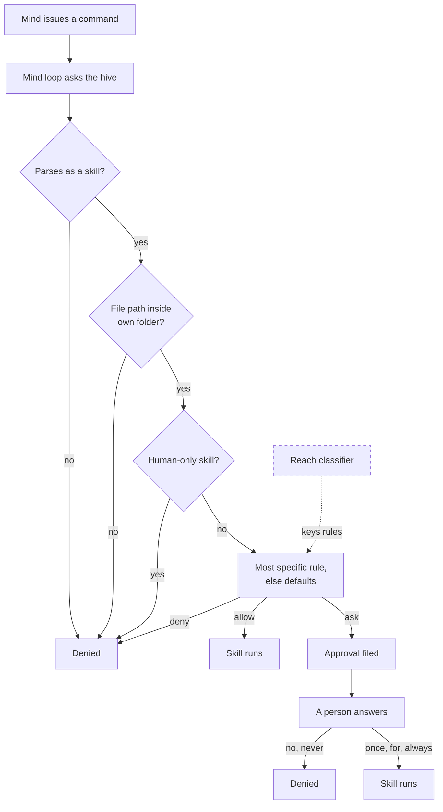
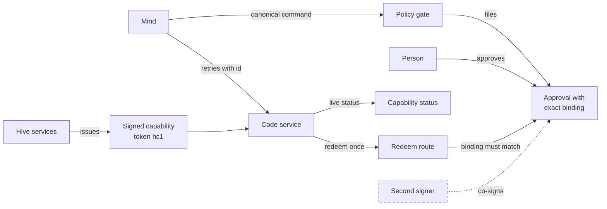
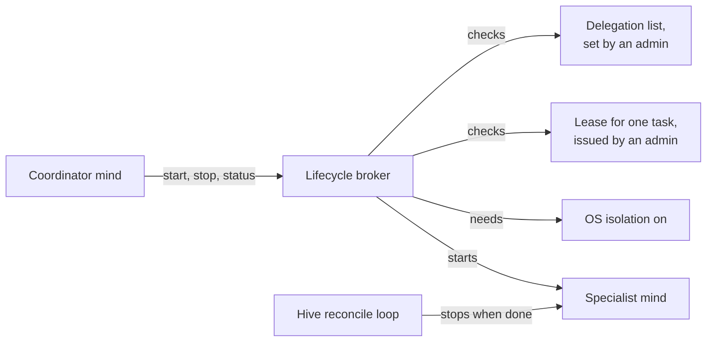

# Permissions, policy and approvals
> Status key: solid line = built; dashed line = intended, not finished. Code refs are to omegahive @ 34b0fb3 unless named.

**What this shows.** Who may do what in a hive. People have one of two roles. Each mind's actions pass a skill policy gate that allows, asks or denies, with two built bypasses today: a native mind's local skip list (`modules/hive/src/hive_commons.py:932-956`) and the unknown-skill default allow (`hive/core/policy.py:219`). Universal gating is a launch requirement (K10, K30). A person answers an "ask" with Once, For a time, Always, No or Never. Code operations need exact, digest-bound approvals and signed capability tokens. A coordinating mind may start and stop other minds only under a lease that an admin person issues.

**Who should read it.** Owners of roles, people and sign-in, the policy gate, the Code service and any app that acts through minds. Reviewers of any change to `policy.py`, `services.py`, `roles.py`, `people.py` or `delegation.py`.

## Diagrams

### 1. One skill command through the policy gate

### 2. Exact-bound Code approvals and capability tokens

### 3. Delegation leases for a coordinating mind

## How it works

**People and roles.** A person is a `people` row with role `admin` or `member` (`hive/core/people.py:36`, `:69`). The hive is invite only; an optional domain allowlist enrols verified Workspace accounts as members, never admins (`people.py:3-15`, `:452-463`). Listed admin addresses are always promoted to admin and never demoted (`people.py:38-45`, `:174-194`). Removing admin, disabling, or clearing the Google binding revokes the person's sessions (`people.py:217-238`). The loopback operator password and webhost sign-ins also count as admin (`hive/core/app.py:297-304`).

**Mind roles are a different thing.** A mind role (`hive/core/roles.py`) is a reusable bundle: prompt template, default model, default budget and approval rules (`roles.py:1-10`). Each rule is `{skill, mode}` with mode allow, ask or deny (`roles.py:41`, `:100-112`). Assigning or editing a role rewrites that mind's rules at `agent:<id>` scope, tagged `role:<name>` (`roles.py:200-216`). A role holds at most 100 rules and never drops one silently (`roles.py:50`, `:109-111`).

**The gate is its own engine.** The policy gate lives in `hive/core/policy.py`. It is separate from the model gateway, which handles keys, budgets and egress. A native mind's loop calls `POST /api/agent/authorize` before a skill (`modules/hive/src/hive_commons.py:947-962`, `hive/core/app.py:2679-2683`), except for the skills on its `LOCAL_ALLOW` list, which return before the call (`hive_commons.py:932-956`; Open point A below). If the hive can't be reached, the command doesn't run (`hive_commons.py:951-959`). Routes that external members call directly use `Policy.enforce`, which applies the same rules (`policy.py:290-322`, `hive/core/mcp.py:414`).

**Order of a decision.**
1. An unparseable command is denied.
2. File skills must stay inside the mind's own folder; symlinks are resolved first (`policy.py:160-179`, `:237-245`).
3. Human-only skills are always denied. These are payments, purchases, fund transfers, password changes, and Code network or publish (`policy.py:48`, `:183-184`).
4. `EXPLICIT_ONLY` skills need an exact allow rule at the mind's own scope (`policy.py:22`, `:185-189`).
5. Otherwise the most specific rule wins: agent scope, then swarm, then hive, with an exact name before a glob. At a tie, the most restrictive mode wins, then the newest (`policy.py:206-212`).
6. With no rule, built-in defaults apply (`policy.py:50-58`, `:213-219`).

**Reviewed hive skills.** A `hive-*` skill not in `REVIEWED_HIVE_SKILLS` can never be allowed by a glob, and it defaults to ask (`policy.py:24-41`, `:193-201`, `:213-214`). Discovery skills such as `skill-help` stay readable under a glob deny (`policy.py:43-46`, `:202-203`).

**Approvals and the five answers.** "Ask" files an approval. Medium is the default risk; a fixed set is high risk (`policy.py:61`, `:324-333`). A person answers with one of five decisions (`policy.py:348-379`, route `app.py:2298-2304`):
- **Once:** the approval is used up by one matching retry (`policy.py:271-277`).
- **For a time:** an allow rule at the mind's scope that expires after 1 minute to 7 days.
- **Always:** a standing allow rule.
- **No:** refuse this request.
- **Never:** refuse it and add a standing deny rule.

High-risk skills and app actions (`program:*`) are approved one exact request at a time; For a time and Always are refused for them (`policy.py:357-361`, `:386-389`). A new answer for the same mind and skill expires the person's earlier answers. Old answers are kept, not deleted (`policy.py:148-153`). Every answer is also written as NAL evidence in the governance commons. It informs the next card and never decides (`hive/core/governance_evidence.py:1-13`, `policy.py:396-397`).

**Exact-bound approvals.** Code-mutating skills must use one canonical command shape: `(code-edit task=… swarm=… workspace=… op=… generation=… digest=sha256:…)`. The hive parses that shape into a binding stored on the approval (`hive/core/services.py:52-54`, `:86-95`; `policy.py:255-269`). The gate never uses these approvals itself. The Code service redeems one approval once, through `POST /api/agent/approvals/{id}/redeem`, and only if the canonical binding matches byte for byte (`services.py:363-380`, `app.py:591-595`). App actions follow the same idea: an approval bound to the exact canonical request, redeemed once by the hive just before `act` (`hive/core/program_actions.py:1-10`).

**HMAC capability tokens.** An admin issues a one-time enrolment token. A service registers from the local machine only, and gets a service token plus a capability secret (`services.py:3-6`, `:119-140`). The hive issues `hc1.<payload>.<sig>` tokens. The payload is canonical JSON claims; the signature is HMAC-SHA256 over it with that secret (`services.py:8-11`, `:292-310`). Claims name actor, task, swarm, repository, actions, paths, argv prefixes, expiry, run limits and the grant (`services.py:292-297`). The service checks the signature locally. Before every mutation it also checks live status: revoked, expired, grant withdrawn, task closed, plus purpose-specific reasons (`services.py:12-13`, `:312-349`). A person's capability never carries more than their grant's scope allows (`services.py:43-51`, `:278-282`). Revoking a grant revokes its capabilities in the same transaction (`services.py:218-227`).

**Delegation leases.** A signed-in admin person decides which minds a coordinator may run. They must be in the same swarm, native, and not the coordinator itself (`hive/core/delegation.py:4`, `:129-138`). The same kind of person issues a lease for one run (`delegation.py:145-160`). The lease names coordinator, specialist and an open task assigned to that specialist. It lasts at most 900 seconds, and never past the task deadline. Its budget must fit within the specialist's remaining cap (`hive/core/lifecycle_broker.py:35-52`). The coordinator redeems it once to start the specialist (`delegation.py:173-180`). A lease stops being valid in any of these cases (`delegation.py:74-82`, `:84-92`, `:104-122`):
- the issuing admin is no longer a current admin;
- the delegation grant is gone;
- OS isolation is not deployed.

The hive's reconcile loop stops runs that finished, failed, expired, went over budget or lost isolation (`delegation.py:8-10`, `lifecycle_broker.py:123`, `app.py:195`).

## Intended shape and upgrade path

- **Built:** a per-skill gate keyed on the verb, five answers, one signer, two risk levels, and exact binding for Code and app actions. Reported in `STATUS.md:35-36` and `STATUS.md:56`.
- **Intended: reach-based rules.** A reach classifier inside `Policy.authorize` would key rules on where an effect reaches: own folder, the hive, egress to a host, or another party. "For a time" would become a reach lease. Source: `docs/theory/governance-and-gating.md:70-72`.
- **Intended: one bound record for every ask.** The bound record that Code approvals use would extend to every ask-mode skill. Source: `governance-and-gating.md:93`.
- **Intended: co-sign.** Multi-party co-sign, with a signatures table and a per-skill quorum. Source: `governance-and-gating.md:124-130`.
- **Intended: graded risk.** A gravity function that advises the gate and never lowers a floor. Source: `governance-and-gating.md:80`.
- **Intended: skill lifecycle.** The reviewed-skill list would become a lifecycle table. Source: `governance-and-gating.md:99-101`.

## Seams and contracts

| Seam | Where |
|---|---|
| Mind asks the gate | `POST /api/agent/authorize` `{command}` → `{decision: allow, deny or pending, approval_id?, message?}`, `app.py:2679-2683`, `policy.py:237-288` |
| Skills a mind's prompt may list | `POST /api/agent/skills/decisions` `{skills: [...]}` (at most 400), `app.py:2685-2690`, `policy.py:221-233` |
| Policy rules | `GET/POST /api/policy`, `DELETE /api/policy/{id}`; scope `hive`, `swarm:<id>` or `agent:<id>`; mode allow, ask or deny, `app.py:2259-2273`, `policy.py:132-146` |
| Approvals | `GET /api/approvals`, `POST /api/approvals/{id}/decide` `{decision, minutes?}`, `/approve`, `/deny`, `/track-record`, `app.py:2275-2309` |
| Exact redeem by a service | `GET /api/agent/approvals/{id}`, `POST /api/agent/approvals/{id}/redeem` `{binding}`, `app.py:576-595` |
| Service enrolment and capabilities | `POST /api/services/enrol`, `/register`, `GET`/`DELETE /api/services/capabilities/{id}`, `app.py:426-468` |
| Roles | `GET/POST /api/roles`, `PATCH`/`DELETE /api/roles/{id}`, `/duplicate`, `app.py:678-698` |
| People and invitations | `GET /api/people`, `POST /api/invites`, `DELETE /api/invites/{id}`, `PATCH /api/people/{id}`, `app.py:755-776` |
| Delegation | `PUT /api/lifecycle/delegations/{coordinator}`, `POST /api/lifecycle/leases` (signed-in admin person), `POST /api/agent/lifecycle/{start,stop,status}`, `app.py:3124-3150`, `:3031-3036` |
| Events | `policy.updated`, `approval.created`, `approval.updated` (`policy.py:145`, `:331`, `:399`) |

## For owners: how to plug in

1. **A new hive skill.** Add the name to `REVIEWED_HIVE_SKILLS` in `hive/core/policy.py` only after review. `hive/tests/test_policy_hive_skills.py` fails if a module, skill file or the MCP bridge defines a hive skill that is not listed.
2. **A skill with outside effects.** Add it to `DEFAULT_ASK` (`policy.py:55-58`). If a person must never delegate it, add it to `HUMAN_ONLY` (`policy.py:48`).
3. **A service that mutates on approval.** Register through the enrolment flow. Have minds issue the canonical bound command. Redeem with the exact binding, and check the capability status route before every mutation (`services.py:1-17`).
4. **An external member route.** Call `hive.policy.enforce(agent, skill, canonical_command)` before acting, as `hive/core/shares.py:148` and `hive/core/motivations.py:855` do.

## For reviewers: what to check

- **Most restrictive wins at a tie.** A role or admin rule must never outvote a person's Never. Check the sort key at `policy.py:210`. Test: `hive/tests/test_five_way_decisions.py`.
- **No glob widening.** No glob may allow an unreviewed `hive-*` skill or an `EXPLICIT_ONLY` skill (`policy.py:185-201`). Test: `hive/tests/test_policy_hive_skills.py`.
- **Exact only for risky actions.** High-risk and `program:*` approvals stay one-at-a-time (`policy.py:357-361`, `:386-389`).
- **Byte-for-byte binding.** Code redeem compares canonical bindings, and a concurrent second redeem fails (`services.py:372-377`). Tests: `hive/tests/test_services_api.py`, `hive/tests/test_sensitive_action_revalidation.py`.
- **Live checks.** The capability live status re-checks the grant and the task (`services.py:312-349`). Test: `hive/tests/test_services_api.py`.
- **Leases.** A lease must fail when its issuing admin loses admin, and a specialist must not start without OS isolation (`delegation.py:74-122`). Test: `hive/tests/test_delegation.py`.
- **People and roles.** Tests: `hive/tests/test_people_api.py`, `hive/tests/test_roles_api.py`, `hive/tests/test_program_actions.py`.
- **Open point A: some skills skip the gate.** Native minds skip the hive gate for a fixed local list (`modules/hive/src/hive_commons.py:932-956`): `send`, `query`, `remember`, `hive-publish`, `hive-goal-create`, `hive-shares` and others. So an agent, role or hive rule that denies or asks for one of these is not consulted for a native mind's loop. External members go through `Policy.enforce` and are gated. The `policy.py:3` docstring says the loop asks before *each* skill.
- **Open point B: who may change policy and answer approvals.** `POST /api/policy`, `DELETE /api/policy/{id}` and the approval answer routes use the `operator()` guard, not `admin()` (`app.py:2264-2309`, `:274-285`, `:306-310`). Any signed-in person can reach them; the path's visibility check is the only filter. Confirm whether members are meant to edit hive-scope rules or answer approvals for minds they cannot see.

## References

- `hive/core/policy.py:1-412`
- `hive/core/roles.py:1-216`
- `hive/core/people.py:1-69`, `:174-238`, `:362-440`
- `hive/core/services.py:1-140`, `:185-380`
- `hive/core/delegation.py:1-195`
- `hive/core/lifecycle_broker.py:35-52`, `:80-123`
- `hive/core/program_actions.py:1-20`
- `hive/core/governance_evidence.py:1-13`
- `hive/core/app.py:195`, `:274-310`, `:426-468`, `:576-595`, `:678-698`, `:755-776`, `:2259-2309`, `:2679-2690`, `:3031-3036`, `:3124-3150`
- `modules/hive/src/hive_commons.py:932-962`
- `STATUS.md:35-36`, `:56`
- `docs/theory/governance-and-gating.md:48-130`
