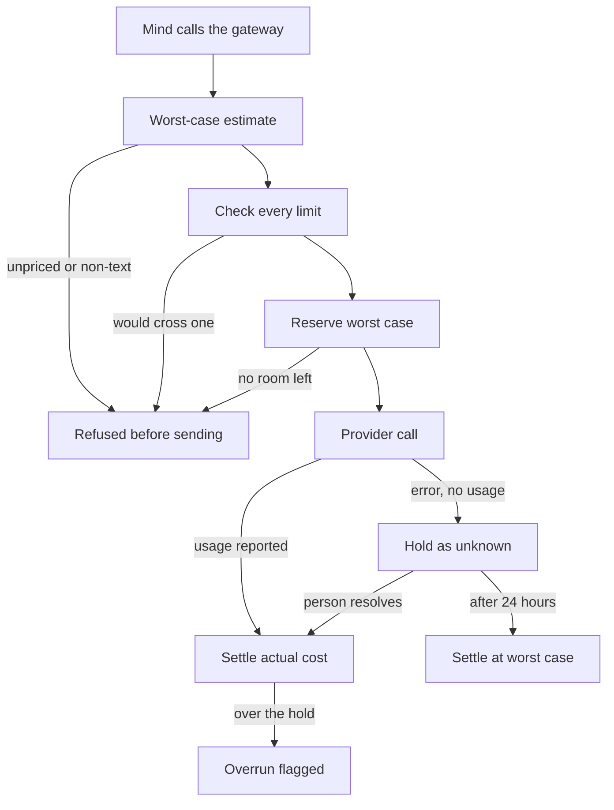
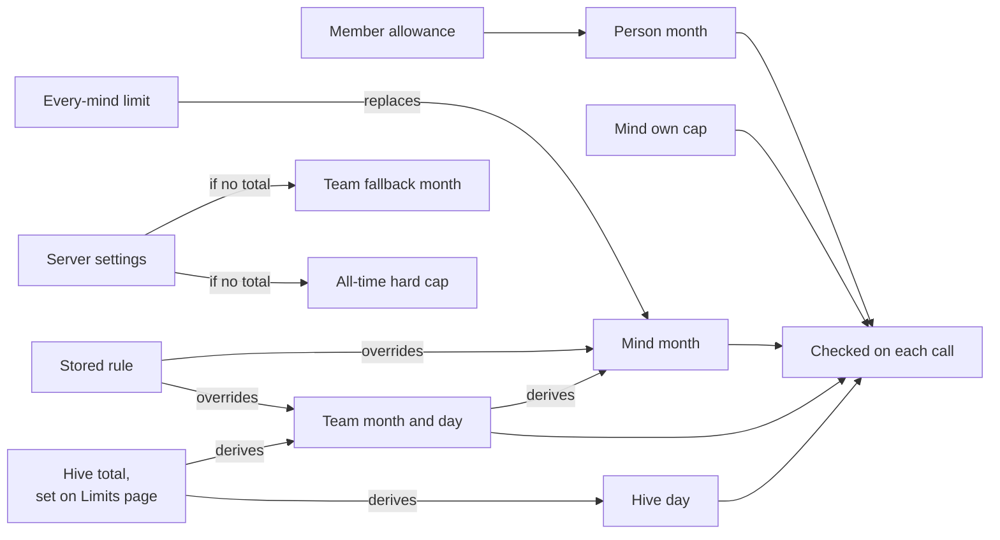
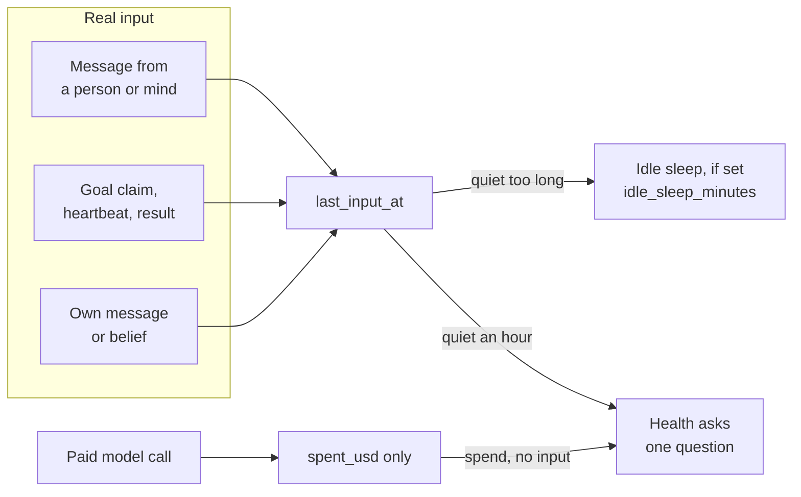

# Budgets and spend
> Status key: solid line = built; dashed line = intended, not finished. Code refs are to omegahive @ 34b0fb3 unless named. Refs marked *(idle-minds PR)* point at the omegahive pull request branch `port/idle-minds`, which brings the live idle-input change into this repository.

**What this shows.** How a hive keeps paid model calls inside spending limits. Every paid call is costed at its worst case before it is sent. It is checked against every limit that applies, and held as a durable reservation until the real cost is known. Most limits come automatically from one hive total that a person sets on the Limits page.

**Who should read it.** Owners of the gateway, the media route, the Ask conductor, sessions and any route that spends money. Reviewers of `budgets.py`, `cost_reservations.py`, `limits_auto.py`, `limits_view.py` and the paid routes in `app.py`.

## Diagrams

### 1. One paid model call

### 2. Where each limit comes from

### 3. Spend is not input

## How it works

**Limit rules.** A rule is `(scope, period, limit_usd)`. Scope is one of `hive`, `swarm:<id>`, `agent:<id>`, `person:<id>`, `key:<id>` or `every-mind`. Period is `day`, `month` (calendar UTC) or `total` (`hive/core/budgets.py:1-8`, `:28-29`, `:54-78`). One stored rule exists per (scope, period); setting it again updates it (`budgets.py:72-78`).

**The worst-case estimate.** The gateway costs a call before sending it (`hive/core/gateway.py:286-334`):
- Local and mock models skip budget admission. Mock and zero-priced local models cost nothing; prices configured for a local provider are still recorded as spend, without being enforced (K53).
- A remote model with no price is refused (`unpriced_model`).
- Input is counted as UTF-8 bytes of everything billable, since a token covers at least one byte.
- Output is counted at `max_tokens`, which the route sets to 4096 when absent (`hive/core/app.py:2067-2069`).
- `n>1`, `best_of>1`, and non-text content (images, audio, files) are refused, because their cost is not bounded.

**The admission check.** `Hive.check_budget` runs before any reservation (`hive/core/hive.py:1687-1733`):
1. A per-mind calls-per-minute ceiling (default 60).
2. `no_budget` when a mind has cap 0 and nothing above it lets the call through.
3. `budget_exhausted` when the mind's own cap is reached.
4. `Budgets.check`, which tests every applicable rule at worst case and refuses with 402 `spend_limit` (`budgets.py:294-302`).
5. The server's all-time hard cap, which applies only while the hive has no total.

**Which rules apply.** `Budgets.applicable` gathers stored rules for the hive, the mind, its team, the key, and the paying person (`budgets.py:263-292`). The paying person counts only when they pay from the hive's money. It then adds automatic limits, or the fallback team month when there is no total, and the member allowance (`budgets.py:279-291`). Spend on a person's own key is theirs and is not held to their allowance (`budgets.py:264-270`).

**Automatic limits.** With a hive total T (the hive month rule, or the day rule × 30), `limits_auto.derive` works out the values below on every read. Nothing derived is stored (`hive/core/limits_auto.py:1-22`, `:102-178`).
- **Team month:** twice an equal share of the pool, at least $1 and never above T.
- **Team day:** a tenth of the team month.
- **Hive day:** a tenth of T.
- **Mind month:** the every-mind limit, or a share of its team's month. Only minds with no limit of their own get one.

A stored rule always replaces the auto value at its own key (`limits_auto.py:8-11`). All arithmetic is in integer micro-dollars (`limits_auto.py:24-27`, `:42-50`).

**Durable reservations.** For a paid call the route reserves the worst case in one SQLite write transaction, marked dispatched in that same transaction (`app.py:2076-2085`, `hive/core/cost_reservations.py:119-154`). For each limit row, three amounts are added: recorded spend, the open holds about the same subject, and this call. If the sum would pass the floored limit, the call is refused (`cost_reservations.py:145-148`). Holds are counted by *subject* (hive, team, mind, person, key), so a rule added later still sees older holds (`cost_reservations.py:14-20`, `:102-118`). Only a hash of the payload is stored, never the call content (`cost_reservations.py:127-139`).

**Settling.**
- A successful call settles at its actual cost, and usage is recorded (`app.py:2101-2125`, `cost_reservations.py:170-190`).
- A failed, cancelled or usage-less call keeps its worst case held as `unknown` (`app.py:122-125`, `:2090-2124`).
- A person may settle or release an unknown hold, with a reason. A long-stuck reserved or dispatched hold, past 900 seconds, may be resolved the same way (`cost_reservations.py:282-326`, route `app.py:2217`).
- After 24 hours an unknown hold settles at its held worst case, recorded as `hive:expiry` (`cost_reservations.py:329-358`, `app.py:202-211`).
- A cost above what was held is recorded in `cost_overruns` and published as `budget.overrun` (`cost_reservations.py:248-255`, `app.py:127-133`).
- At startup, still-open holds move to unknown inside the one recovery transaction (`cost_reservations.py:39-52`).

**Spend stops.** These are the ways spending stops today:
- **Refused before sending.** A call that could cross a limit gets 402. The first refusal and every 20th after it publish `budget.refused` (`hive.py:1690-1702`).
- **Member allowance.** When a person's month allowance refuses a call, the hive files one allowance request a month for admins to decide (`hive.py:1700-1701`, `hive/core/person_requests.py:102-116`).
- **Delegated runs.** The lifecycle broker treats a run's budget as exhausted and stops the specialist (`hive/core/lifecycle_broker.py:80`, `:92`, `:123`).
- **Ask turns.** A past-deadline Ask turn closes as `timed_out` or `spend_limit` (`app.py:196`). One conductor turn may spend at most `HIVE_ASK_CONDUCTOR_TURN_USD` (`hive/core/conductor.py:93-98`).

**Spend is not input (diagram 3).** Recording a paid call adds its cost to the mind's `spent_usd` and publishes `usage`; it moves neither `last_active_at` nor the idle signal `last_input_at` (`hive/core/hive.py:1811-1823`) *(idle-minds PR)*. Before this change every paid call counted as activity, so a mind spending with nothing coming in never reached its `idle_sleep_minutes`. Now idle sleep and a bounded child's `idle_minutes` count from real input only: a message from a person or mind, a goal claim, heartbeat or result, a published belief, or the mind's own message. The hive's own `hive:*` notes do not count, except a goal assigned to the mind (`hive/core/hive.py:1348-1366`, `:2092-2099`; `hive/core/goals.py:474`, `:496`, `:583`; `hive/core/minds.py:828-833`) *(idle-minds PR)*. A child's progress view reads its last turn from `usage` instead (`minds.py:1052-1058`). Health also notices spend with no input and asks the mind one question; that is a signal, never a limit or a stop (see the [mind observability card](../components/mind-observability.md)). A chosen `wait` now makes no model calls at all ([mind runtime](../03-minds/01-mind-runtime.md#how-it-works)).

**The Limits page shows what is enforced.** `limits_view.limits` builds the page from the same `Budgets` calls that admission and reservations use (`hive/core/limits_view.py:1-18`). Each row has a `source`: `set`, `auto`, `session`, `server-settings`, `default` or `owner-ruling`. Each row also has the exact reservation `key`. Rows pass the viewer's visibility as defence in depth (`limits_view.py:36-50`).

## Intended shape and upgrade path

- **Built:** worst-case checks before every paid call, durable reservations across scopes, automatic limits from one total, and resolvable unknown holds. In the V2 terms this is "budget as physics", ruled and enforced here (`docs/theory/governance-and-gating.md:179-183`).
- **Built: personal minds.** A personal mind is paid from its person's allowance (`budgets.py:191-207`, `hive/core/personal.py:7-11`).
- **Intended: one attribution record.** A gated effect pair would write intent and terminal effect rows in the same transaction as an approval redemption. Spend would then sit in the same record as the effect it paid for. Source: `governance-and-gating.md:207-211`.
- **Intended: priced media.** Media, image and vision routes share the reservation helper (`cost_reservations.py:217-222`, `hive/core/media.py:10`). Treat any provider kind not yet priced as intended, and confirm it with the owner of media.

## Seams and contracts

| Seam | Where |
|---|---|
| Paid chat call | `POST /llm/v1/chat/completions`, `app.py:2063-2125` |
| Embeddings | `app.py:2170-2171` |
| Worst-case estimate | `Gateway.estimate(agent, body, allow_unpriced)` → `(paid, usd)`, `gateway.py:286-334` |
| Admission | `Hive.check_budget(agent, paid, estimate, key_id, payer, own_key)`, `hive.py:1687-1733` |
| Reserve, settle and hold | `Reservations.reserve(key, payload, maximum, budgets, metadata, dispatched, subjects)`; `settle`; `unknown`; `abort_before_dispatch`, `cost_reservations.py:119-190` |
| Budget snapshot | `host_budget_snapshot(hive, agent_id, key_id, payer, own_key)` → `[(label, limit, spent)]`; labels are `<subject>:<period>`, `cost_reservations.py:206-235` |
| Rules (admin only) | `GET /api/budgets`, `POST /api/budgets` `{scope, period, limit_usd, note}`, `DELETE /api/budgets/{id}`, `app.py:1038-1074` |
| Limits page | `GET /api/budgets/limits`, `GET /api/budgets/auto-candidates`, `app.py:1046-1059` |
| Holds | `GET /api/budgets/reservations`, `GET /api/budgets/overruns`, `POST /api/budgets/reservations/{id}/resolve` `{action: settle or release, reason, actual_usd?}`, `app.py:2205-2230` |
| Settings | `HIVE_BUDGET_USD`, `HIVE_SWARM_MONTHLY_USD` and `HIVE_PERSON_REQUEST_CEILING_USD` (seeds only while there is no total), plus `HIVE_MEMBER_MONTHLY_USD` and `HIVE_ASK_CONDUCTOR_TURN_USD`, `budgets.py:149-173` |
| Events | `budget.refused`, `budget.overrun`, `budgets.updated`, `usage` |

## For owners: how to plug in

1. **A new paid route.** Compute a true worst case first. If you cannot bound it, refuse the request, as `gateway.py:303-330` does.
2. **Admission, then reservation.** Call `hive.check_budget(...)`. Then call `cost_reservations.reserve(...)` with `lambda: host_budget_snapshot(...)` and `subjects=host_subjects(...)`, using `dispatched=True` when you send at once (`app.py:2074-2085`).
3. **Any failure after sending holds the liability.** Call `hold_unknown(reservation)`; never release a sent call yourself.
4. **Settle with a usage recorder.** On success call `cost_reservations.settle(reservation, cost, record_usage, overrun_flag)` (`app.py:2118-2119`).
5. **A new limit kind.** Show it in `limits_view.py` from the same `Budgets` call that enforces it, so the page and enforcement never drift.

## For reviewers: what to check

- **Worst case is a real bound.** Every new request field that is billable must be counted, or refused (`gateway.py:303-334`). Test: `hive/tests/test_budget_review_fixes.py`.
- **Holds count by subject, not by label.** A rule added after a hold must still see it (`cost_reservations.py:102-118`). Test: `hive/tests/test_cost_reservations.py`.
- **No float drift.** Limits floor and spends ceiling in micro-dollars (`limits_auto.py:42-50`, `cost_reservations.py:9-12`). Test: `hive/tests/test_limits_auto.py`.
- **A stored rule beats auto at its own key, and never removes limits above it** (`limits_auto.py:8-11`). Test: `hive/tests/test_auto_budgets.py`.
- **Unknown holds are never dropped.** They are resolved by a person, or settled at the worst case after 24 hours (`cost_reservations.py:285-358`). Test: `hive/tests/test_reservation_resolvable.py`.
- **Person allowance and own keys** (`budgets.py:103-111`, `:263-292`). Test: `hive/tests/test_sso_and_budgets.py`.
- **Spend never counts as input.** A change to `record_usage` must not stamp `last_active_at` or `last_input_at`; only real input does (`hive/core/hive.py:1811-1823`) *(idle-minds PR)*. Test: `hive/tests/test_idle_minds.py` *(idle-minds PR)*.
- **Open point A: unpriced models.** `HIVE_ALLOW_UNPRICED=1` makes the estimate `(True, 0.0)` (`gateway.py:297-299`). The chat route then reserves 0, and `Reservations.reserve` refuses that: "Positive reservation required" (`cost_reservations.py:134-135`). So the call ends as 402 `reservation_refused` (`app.py:2084-2085`). The setting reads as "allow unpriced calls", but paid unpriced calls seem to be refused anyway. Confirm which behaviour is intended.
- **Open point B: the allowance notice.** It says the person's minds "are paused until it is raised" (`person_requests.py:113`). The code refuses their paid calls. No separate pause of minds was found in the paths read for this page.

## References

- `hive/core/budgets.py:1-327`
- `hive/core/cost_reservations.py:1-358`
- `hive/core/limits_auto.py:1-178`
- `hive/core/limits_view.py:1-60`
- `hive/core/gateway.py:286-338`
- `hive/core/hive.py:1687-1746`
- `hive/core/app.py:122-133`, `:195-213`, `:1038-1074`, `:2063-2125`, `:2205-2230`
- `hive/core/person_requests.py:102-116`
- `hive/core/conductor.py:93-98`
- `hive/core/lifecycle_broker.py:35-52`, `:80-123`
- `hive/core/config.py:79-80`, `:170-171`
- `docs/theory/governance-and-gating.md:179-183`, `:207-211`
