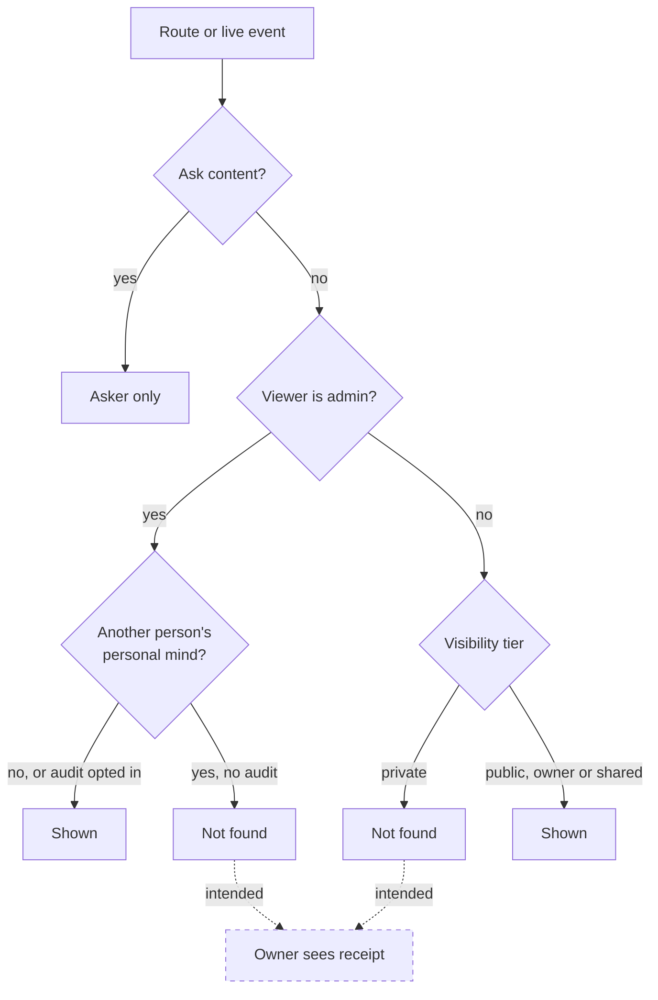
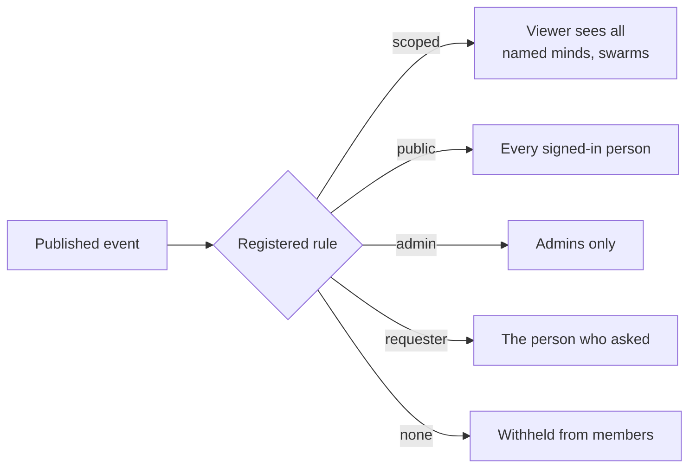
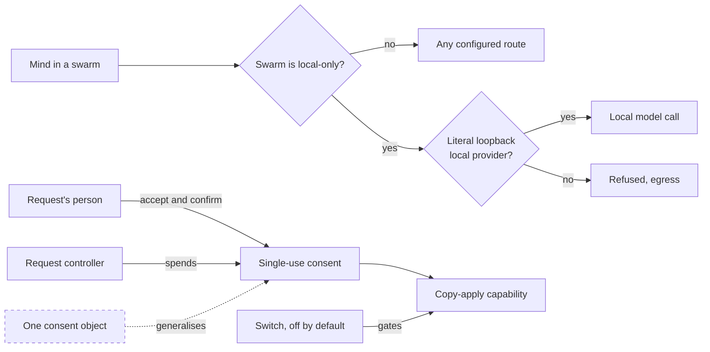

# Visibility, privacy and consent
> Status key: solid line = built; dashed line = intended, not finished. Code refs are to omegahive @ 34b0fb3 unless named. Refs marked *(idle-minds PR)* point at the omegahive pull request branch `port/idle-minds` (merged); refs marked *(idle-minds r2.5 PR)* point at `port/idle-minds-r2.5`, which brings the later privacy follow-ups.

**What this shows.** Who can see which minds, swarms, goals, rooms and live events. Each person's personal mind is hidden from everyone else. A local-only swarm is refused any model route that leaves the machine. Copy-apply needs a person's consent bound to one exact operation. That consent is built and switched off by default. Visibility governs who sees; policy governs what minds do (`hive/core/visibility.py:10`).

**Who should read it.** Owners of any route or event that names a mind, swarm, room, goal, share or asset. Owners of personal minds, Ask, the gateway and the Code linkage. Reviewers of `visibility.py`, `personal.py`, `gateway.py` egress and the copy-apply code in `minds.py`.

## Diagrams

### 1. Can this person see this thing?

### 2. Live events by rule

### 3. Local-only swarms and copy-apply consent

## How it works

**Three tiers.** Minds and swarms are `private`, `shared` or `public` (`visibility.py:1-9`, `:24`):
- **Private:** the owner and admins see it.
- **Shared:** the principals named in `shared_with` see it too.
- **Public:** every signed-in person sees it.

New ones default to private; things that existed before the rule stay public (`visibility.py:7-8`, `:182-190`). Only the owner or an admin changes a tier (`visibility.py:559-576`). `Viewer.sees` is the one test (`visibility.py:205-221`).

**Not found, never forbidden.** Every operator route runs `check_path` on the mind, swarm or goal in its path (`hive/core/app.py:274-279`, `visibility.py:299-310`). Lists are filtered per person (`visibility.py:384-394`, `:553-557`). A hidden thing answers 404, so its existence is not revealed (`visibility.py:9-10`). Requests sent to apps are scanned for mind references in every encoding an app could decode. Any named mind must be visible to the person. An unsupported spelling, or a scan that runs out of budget, is refused (`visibility.py:27-34`, `:61-68`, `:281-297`).

**Live events have registered rules.** Every event kind maps to a rule in `EVENT_RULES` (`visibility.py:224-256`):
- **scoped:** delivered when the viewer can see every named mind, swarm and room.
- **public:** every signed-in person.
- **admin:** admins only.
- **share**, **requester**, **motivation:** checked against their stored rows.
- **asker:** the person who asked.

An unregistered kind is withheld from members (`visibility.py:262-267`, `:526-529`). A scoped event that names nothing recognisable is withheld and logged once (`visibility.py:538-545`). Another person's chat with a mind is withheld from everyone, admins included; admins audit it over HTTP (`visibility.py:485-497`).

**Personal minds are hidden from others.** Every named person has exactly one personal mind (`hive/core/personal.py:1-24`, `:42-49`):
- It is asleep, alone in its own swarm, owned by the person and private.
- The hive keeps no memory or history for it. Ask turns that speak as it are stored content-free.

Admins keep sight of private things in general, but not of another person's personal mind or swarm. Those are dropped from every admin default list and live event (`visibility.py:312-351`, `:396-404`). An admin lifts that filter only by asking explicitly, with `?include=personal` or a by-id read (`app.py:280-295`, `visibility.py:206-208`). Ask content goes to its asker only, admins included (`visibility.py:252-255`, `:416-449`).

**A personal mind's conversations are its person's.** A person reads only their own chats with a mind; an admin audits every person's with `?include=all` or `?include=personal` (`hive/core/app.py:1323-1335`) *(idle-minds PR)*. Three rules make that hold for a personal mind (`hive/core/hive.py:1235-1254`, `:1305-1335`) *(idle-minds PR)*:
- **The loopback operator is scoped like any admin.** It still reads the whole stream of every other mind, but not a personal mind's chats with its person, unless it audits.
- **Another mind's message to a personal mind is its person's.** In someone else's chat only real hive notes (`hive:*` senders) show; an `agent:*` message to a personal mind does not, in the transcript, by conversation id or in live frames. Shared minds keep the old rule (any non-person sender is a note).
- **A conversation named for a person is theirs** (`c_<mind>~user:<id>`), even before they speak in it.

**Health's idle question follows the chat it sits in.** Health asks an idle mind one question through the normal message path (see the [mind observability card](../components/mind-observability.md)). For a personal mind it goes to the person's own conversation with it, never the operator's `c_<mind>` chat, and no room is made or extended (`hive/core/health.py:420-426`) *(idle-minds PR)*. It is recognised by its structured event (`extra.event = "health_question"`), with the text prefix used only for a row with no readable `extra`, which fails closed; it is never shown as a hive note in someone else's chat (`hive/core/hive.py:1256-1274`) *(idle-minds PR)*. A personal mind's idle record is its person's whatever its visibility: making the mind public or sharing it never grants another admin, the loopback operator or a member its record. An admin reads it only by explicit audit (`?include=all` or `?include=personal`), read-only; a Remind on a personal mind is its person's alone (`hive/core/app.py:2674-2717`) *(idle-minds r2.5 PR)*.

**The host decides who may Remind and Sleep.** Every idle row and every agent view (`GET /api/agents`, `GET /api/agents/{id}`) carries per-viewer flags `is_mine`, `may_remind` and `may_sleep`, each computed from the same refusal the Remind or Sleep route would give (`remind_refusal`, `sleep_refusal`, `mind_flags`: `hive/core/app.py:2698-2732`) *(idle-minds r2.5 PR)*. `personal_of` is never exposed; the UI shows Remind and Sleep only when a flag is true and the mind is awake.

**Export and import keep a person's chats theirs.** A personal mind's bundle carries its person's conversations only for that person (the rows their own transcript shows, `Hive.reader_scope`) or an admin's explicit audit; anyone else gets the rows they may read, marked `excluded` (`hive/core/app.py:1878-1890`; `hive/core/placement.py:110-199`; `hive/core/hive.py:1380`) *(idle-minds r2.5 PR)*. The bundle imports only back home, as that person's personal mind; anywhere else it is refused whole (409 `personal_mind_unbound`). A `conversation_owners` map travels with it, and an import that would attribute rows to someone else is refused (409 `conversation_owner_mismatch`, nothing lands) (`hive/core/placement.py:397-422`) *(idle-minds r2.5 PR)*.

**Local-only swarms refuse outside model calls.** `HIVE_LOCAL_ONLY_SWARMS` is a JSON list of swarm ids (`hive/core/gateway.py:230-253`). For a mind in one of those swarms, every model call must use a provider marked local. Its base URL must be a literal loopback address over http or https, with no credentials, query or fragment. The built-in mock is the one exception. Anything else is refused 403 `egress_refused`. A malformed setting fails closed. The check runs in the cost estimate and in each call path, so it applies to free calls too (`gateway.py:293`, `:343`, `:378`). It also applies to embeddings and media (`app.py:2150`, `hive/core/media.py:496`).

**Copy-apply consent is built and switched off.** Copy-apply lets a request's controller mind apply one retained Code proposal to a workspace copy. It is off unless `HIVE_COPY_APPLY_CLAIMS=on` (`hive/core/config.py:179`; `hive/core/minds.py:23-25`, `:1509-1510`; `app.py:539-541`).

1. The request's own person accepts, or declines, one exact proposal. They use `POST /api/requests/{rq}/proposals/{suggestion}/accept|decline` (`app.py:3298-3311`).
2. An accept is bound to the proposal id and digest, the request binding, the person, the controller and ten minutes. It is single use (`minds.py:26-30`, `:78`, `:1395-1438`).
3. Either decision voids every earlier accept for that proposal. It also revokes every capability issued under one, in the same transaction (`minds.py:1427-1430`, `:1440-1452`).
4. The controller's capability issue spends the consent in the same transaction as the capability (`minds.py:1505-1530`). The capability names the consent it spent (`hive/core/services.py:251-255`, `:300-303`).
5. Every live-status call re-checks that the consent is still the newest (`minds.py:1454-1462`, `services.py:337-342`).

The consent route itself is not behind the switch. Only the capability issue is.

## Intended shape and upgrade path

- **Built: tiers and the floor.** Visibility tiers, admin sight, and "not found" for hidden things. This is the transparency floor: no true secrets, privacy as opaque by default with deliberate access. Source: `docs/theory/governance-and-gating.md:156-164`.
- **Built: the two audit gaps are closed.** (a) A public or shared personal mind's Health idle record and (b) a mind export carrying the person's private conversation were readable without explicit audit; both now follow the person's transcript or an explicit audit (*(idle-minds r2.5 PR)*; K65 and K66 in FINDINGS.md (in the private omegahive-security repo; ask Kabir), marked fixed).
- **Intended: access receipts.** When an admin audit lifts a filter, the owner sees a receipt. Source: `governance-and-gating.md:166`. Today, `?include=personal` lifts the filter without any owner-visible record. None was found in `visibility.py` or `app.py:280-284`.
- **Built, off: operation-bound consent.** Copy-apply consent ships exactly this frame, and the switch is off by default. Source: `governance-and-gating.md:145-152`.
- **Intended: one shared consent object.** Extracted from the copy-apply code, with a precedence check. Source: `governance-and-gating.md:154`.
- **Intended: the promotion ladder.** Today the hive has private-by-default, timed shares, and requests that spend nothing until granted. Intended are an explicit candidate state and one promotion route. Source: `governance-and-gating.md:168-177`.
- **Intended: one visibility layer.** Visibility is applied at many call sites. `docs/MODULARITY.md:43-44` names this as a risk and `docs/MODULARITY.md:62` as the plan: route modules that call one shared visibility layer.

## Seams and contracts

| Seam | Where |
|---|---|
| Set a tier | `Visibility.set(table, id, viewer, visibility, shared_with)`; `shared_with` is a list of principals like `user:<id>`, `visibility.py:193-202`, `:559-576` |
| Path check | `Visibility.check_path(viewer, path_params)`, applied in `operator()`, `app.py:274-285` |
| List filters | `Visibility.agents`, `swarms`, `filter_items`, `hide_others_personal`, `visibility.py:343-394`, `:553-557` |
| Event delivery | `Visibility.event_visible(viewer, text)`, `visibility.py:499-551`; the registry is `EVENT_RULES` |
| Mind references to apps | `Visibility.check_named_minds(viewer, *values)`; only the `mind:<id>` or `agent:<id>` spelling, `visibility.py:281-297` |
| Admin audit | `?include=personal` (admin only), `app.py:280-284` |
| Personal mind | `GET/POST /api/me/mind`, `app.py:1774-1788` |
| Local-only egress | `HIVE_LOCAL_ONLY_SWARMS` (a JSON list of swarm ids); refusal 403 `egress_refused`, `gateway.py:230-253` |
| Copy-apply | Consent: `POST /api/requests/{rq}/proposals/{suggestion}/{accept or decline}` `{suggestion_digest}`. Capability: `POST /api/agent/code/capability` `{service, copy_apply}`. Switch: `HIVE_COPY_APPLY_CLAIMS`, `app.py:530-543`, `:3298-3311` |

## For owners: how to plug in

1. **A new route that returns minds, swarms, rooms, goals, shares or assets.** Take the viewer from `operator()`. Filter the response with `hive.visibility.filter_items(viewer, items)`, or with the table-specific helper (`docs/MODULARITY.md:43-44`).
2. **A new live event kind.** Add it to `EVENT_RULES` in `hive/core/visibility.py`. `hive/tests/test_visibility.py::test_every_published_event_kind_has_a_rule` fails until you do.
3. **A scoped event.** Put the mind, swarm or room id under a key the scan reads: `agent_id`, `mind_id`, `swarm_id`, `room_id`, `conversation_id`, or `id` with an `a_` or `s_` prefix (`visibility.py:451-483`). Otherwise it is withheld.
4. **An app that receives mind references.** Accept only `mind:<id>` or `agent:<id>`, and resolve minds through `ProgramContext.agents()` or `mind()` (`visibility.py:31-33`).
5. **A team that must never leave the machine.** Add its swarm id to `HIVE_LOCAL_ONLY_SWARMS`, and give it a provider marked local on a literal loopback address.

## For reviewers: what to check

- **Hidden means 404.** Never 403 for a hidden thing (`visibility.py:299-310`). Tests: `hive/tests/test_visibility.py`, `hive/tests/test_request_visibility.py`, `hive/tests/test_archive_visibility.py`, `hive/tests/test_focus_visibility.py`.
- **Personal minds stay out of admin default lists and events.** Unless an admin opts into audit (`visibility.py:312-351`). Tests: `hive/tests/test_personal_visibility.py`, `hive/tests/test_personal_mind*.py`, `hive/tests/test_personal_ask_control.py`.
- **Event rules fail closed.** Unregistered kinds are withheld, and so are scoped events that name nothing (`visibility.py:262-267`, `:538-545`). Test: `hive/tests/test_events_websocket.py`.
- **Shares are judged against the stored row** (`visibility.py:512-525`). Test: `hive/tests/test_share_visibility.py`.
- **Local-only egress.** Malformed settings, non-loopback hosts, and URLs with credentials or a query all refuse (`gateway.py:230-253`). Test: `hive/tests/test_local_only_egress.py`.
- **Consent is newest-only, single use and in-transaction.** A later decision revokes earlier capabilities (`minds.py:1427-1462`). Tests: `hive/tests/test_copy_apply_consent.py`, `hive/tests/test_copy_apply_claims.py`.
- **A personal mind's chats stay its person's.** The operator is scoped, peer `agent:*` messages are the person's, and Health's question stays in the person's own chat. Tests: `hive/tests/test_idle_minds.py`, `hive/tests/test_mind_chat_identity.py` *(idle-minds PR)*.
- **The idle record and an export follow the person, whatever the visibility.** Making a personal mind public or shared must not widen who reads its record or its exported chats; the per-viewer flags must equal what the routes do. Test: `hive/tests/test_idle_minds.py` *(idle-minds r2.5 PR)*.
- **Open point: no audit receipt.** The theory doc lists an owner-visible audit receipt as the path back. No such receipt exists today, so an admin audit of a personal mind leaves no trace the owner can see.

## References

- `hive/core/visibility.py:1-576`
- `hive/core/personal.py:1-49`
- `hive/core/gateway.py:230-253`, `:293`, `:343`, `:378`
- `hive/core/media.py:496`
- `hive/core/minds.py:1-31`, `:78`, `:1395-1530`
- `hive/core/services.py:251-255`, `:300-303`, `:337-342`
- `hive/core/config.py:179`
- `hive/core/app.py:274-295`, `:530-543`, `:1774-1788`, `:2150`, `:3298-3311`
- `docs/MODULARITY.md:43-44`, `:62`
- `docs/theory/governance-and-gating.md:145-177`
