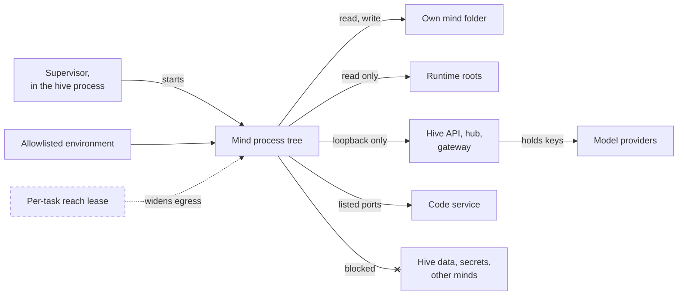
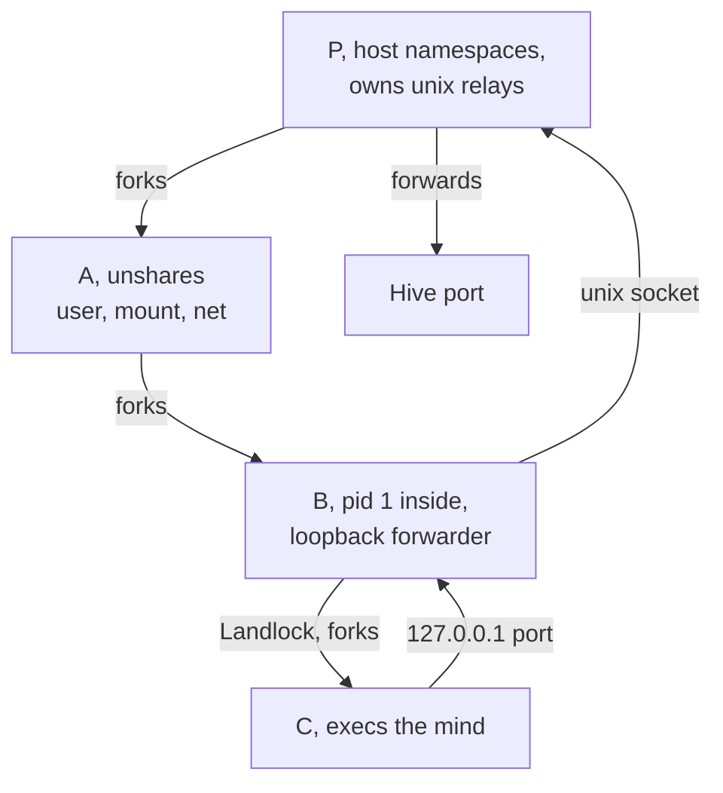
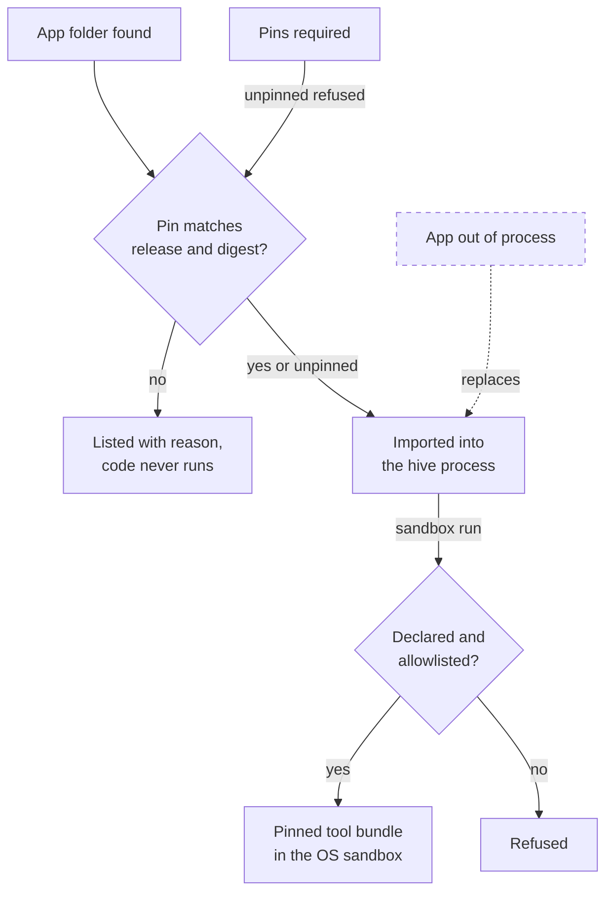

# Isolation: the OS sandbox, the Docker driver and app pins
> Status key: solid line = built; dashed line = intended, not finished. Code refs are to omegahive @ 34b0fb3 unless named.

**What this shows.** The boundaries below the policy gate. A mind runs as the hive's own OS user, so the gate alone cannot stop a mind's shell or Python from reading the hive's files (`hive/supervisor/sandbox.py:3-4`). The supervisor gives each mind an allowlisted environment. When requested, it also wraps the mind's process tree in an OS sandbox: sandbox-exec on macOS, namespaces plus Landlock on Linux. The Docker driver is the other way to run a mind. Apps are different: they are imported into the hive process. For apps, the code-loading boundary is the release pin.

**Who should read it.** Owners of the supervisor and drivers, deployment owners, and app owners who ship releases. Reviewers of `hive/supervisor/*`, `hive/core/sandbox_run.py` and the pin code in `hive/core/programs.py`.

## Diagrams

### 1. What a local mind process can reach

### 2. Linux process layout

### 3. App code loading and sandboxed tools

## How it works

**The environment is an allowlist.** A mind never inherits the hive's environment. It gets a short list of variables plus non-secret `OMEGACLAW_*` ones, then its own variables on top (`hive/supervisor/sandbox.py:22-36`, `hive/supervisor/drivers.py:180-181`). Provider keys stay in the gateway, and minds pay through their member token (`sandbox.py:6-7`).

**OS isolation is opt-in, and fails closed.** With `HIVE_MIND_SANDBOX=1`, the local driver wraps the command with `sandbox.wrap` (`drivers.py:184-196`). If the host has no boundary, the driver refuses to start the mind rather than running it bare (`drivers.py:185-188`). `backend()` chooses sandbox-exec on macOS, or Landlock on Linux when it is available (`sandbox.py:39-50`). Each start records what isolation the process actually got (`drivers.py:189-196`). Delegation reads that record before a coordinator may start a specialist (`hive/core/delegation.py:104-122`).

**macOS profile.** A deny-by-default sandbox-exec profile written for each mind (`sandbox.py:100-125`). It allows:
- reading system roots and the listed runtime roots;
- reading and writing the mind's own folder only;
- writing to `/dev/null` (and the dyld helper device), never `/dev/tty`;
- outbound network only to loopback on the allowed ports.

The runtime roots are PeTTa, SWI-Prolog, the venv and the platform code, never the hive's data folder (`sandbox.py:128-143`). `safe_roots` drops `/`, the home folder or any ancestor of either (`sandbox.py:146-157`). The allowed ports are the hive's own plus an operator list (`sandbox.py:82-97`).

**Linux layout.** A launcher sets up four processes (`hive/supervisor/landlock.py:1-33`):
- **P** stays in the host namespaces and owns one unix-socket relay per allowed port.
- **A** unshares user, mount, network, pid and ipc namespaces.
- **B** is pid 1 inside. It brings up loopback, forwards 127.0.0.1 to P's relay, and restricts itself with Landlock.
- **C** inherits every restriction and runs the mind.

Files are limited to system and runtime roots plus the mind's folder. The network namespace has only loopback, so the relay is the only way out. With Landlock ABI 4 or later, TCP connect is also limited to those ports. If anything cannot be set up, the launcher exits 78 and the mind never starts.

**The mind dials 127.0.0.1.** A local mind is handed the hive address it can reach inside the sandbox. If the hive binds somewhere else, a sandboxed start is refused (`drivers.py:452-491`).

**The Docker driver.** It runs one container per mind (`drivers.py:243-298`):
- The mind's memory folder is mounted read-write.
- Its run file, the core checkout and the chromadb library are mounted read-only.
- The environment is the mind's own variables only (`drivers.py:493-505`).
- The network is `HIVE_DOCKER_NETWORK`, default `host` (`drivers.py:255`).

Iter minds must use Docker unless the operator accepts local runs (`drivers.py:175-177`). Their containers get `--memory 1g` and `--pids-limit 256` (`drivers.py:275-280`). Ordinary Docker minds get neither limit (`drivers.py:286-292`). The default driver is `HIVE_DRIVER`, `local` by default (`hive/core/config.py:165`). New substrates are new drivers with the same shape (`drivers.py:1-6`).

**App pins are the code-loading boundary.** Apps are imported into the hive process with `exec_module` (`hive/core/programs.py:672-675`). No OS boundary sits around app code, so loading is the boundary. `HIVE_APP_PINS` is a JSON object that maps an app id to `{release, digest, files?, env?}` (`programs.py:593-602`, `:1183-1193`). It is read once per full reload, before any app in that reload runs. An app that has already loaded cannot change it for itself (`programs.py:580-591`, `:595-602`).

A pinned app must meet four conditions to load (`programs.py:613-652`):
- it is found exactly once;
- it loads from exactly its release folder;
- its source digest matches, covering manifest, Python, MeTTa and the UI lock (`programs.py:546-565`);
- every pinned file and environment value matches.

Otherwise it is listed with its reason and nothing of it is imported (`programs.py:604-606`, `:661-663`). A pinned app that is missing is listed closed (`programs.py:541-542`, `:608-611`). With `HIVE_APP_PINS_REQUIRED=1`, every non-built-in app must be pinned (`programs.py:617-618`). A malformed setting closes every non-built-in app (`programs.py:615-616`).

**Sandboxed app tools.** An app's own processes do not run inside the hive. An app may run a pinned tool bundle in the OS sandbox through `sandbox:run`, and it needs both conditions below (`hive/core/sandbox_run.py:1-19`, `programs.py:180-190`):
- it declares the capability;
- it is on the operator's allowlist, `HIVE_SANDBOX_RUN_APPS`.

The bundle is checked file by file against its lock before every run. It has no network, writes only to a fresh job folder, runs under CPU and file-size limits, and fails closed.

## Intended shape and upgrade path

- **Built: the host-native OS boundary.** Sandbox-exec, Landlock, the allowlisted environment and the fail-closed start. The theory doc says V2 ruled and built this but never assembled it into the live V2 body. Source: `docs/theory/governance-and-gating.md:41`, `:57-68`.
- **Known gap: opt-in.** The mind sandbox is opt-in: deployment sets it, development does not. Source: `governance-and-gating.md:226`.
- **Known gap: Docker hardening.** The Docker driver defaults to host networking and has no hardening flags. Source: `governance-and-gating.md:227`. The code agrees (`drivers.py:255`, `:286-292`).
- **Intended: confined Code runs.** A sealed launcher profile, a pinned bundle census, a custody lock, a cgroup kill ladder, and closed status and refusal sets. Contract reviewed, not built. Source: `governance-and-gating.md:213-222`, `docs/handoff/platform/code-owner-contract.md`.
- **Intended: reach-gated network.** Network reach granted per task and expiring, a small pinned set of standing services, all other egress denied. Today the boundary is a fixed loopback port list, with no per-task lease. Source: `governance-and-gating.md:50-55`, `:72`.
- **Intended: out-of-process apps.** Today app code is trusted server code inside the hive process; capabilities limit the context, not the OS. Out-of-process isolation is planned for contract v0.2 and later. Source: `hive/PROGRAMS.md:42`, `:240-244`, `docs/FEATURES.md:216` (AP24, Planned).
- **Intended: more substrates.** Kubernetes, VMs and others as new drivers. Source: `drivers.py:5-6`.

## Seams and contracts

| Seam | Where |
|---|---|
| Driver interface | `start(agent, env)`, `stop(agent_id)`, `status(agent_id)` returning `running`, `exited` or `absent`, `logs(agent_id, tail)`, `execution(agent_id)`, `drivers.py:3-6`, `:62-80` |
| Driver choice | a mind's `driver` field, else `HIVE_DRIVER`, `drivers.py:421-422`, `config.py:165` |
| OS sandbox switch | `HIVE_MIND_SANDBOX=1`; `HIVE_MIND_SANDBOX_PORTS` (comma list of extra loopback ports), `drivers.py:184`, `sandbox.py:82-97` |
| Profile files | `<data>/sandbox/<agent>.sb` or `<agent>.landlock.json`, `sandbox.py:53-69`, `drivers.py:193-195` |
| Isolation evidence | `LocalDriver.isolation[agent_id]` = `{environment, os_sandbox, profile, started_at}`, `drivers.py:189-196` |
| Docker settings | `HIVE_AGENT_IMAGE`, `HIVE_DOCKER_NETWORK`, `HIVE_ITER_IMAGE`, `drivers.py:254-256`, `:269` |
| App pins | `HIVE_APP_PINS` = `{app_id: {release: absolute path, digest: "sha256:<64 hex>", files?: {relpath: hex}, env?: {VAR: value}}}`; `HIVE_APP_PINS_REQUIRED=1`; refusal codes in `PIN_REFUSALS`, `programs.py:22`, `:593-652` |
| Sandboxed app tools | capability `sandbox:run`; `HIVE_SANDBOX_RUN_APPS`, `HIVE_SANDBOX_RUNTIMES`; `<bundle>/bundle.lock.json`, `sandbox_run.py:7-13` |

## For owners: how to plug in

1. **A new driver.** Implement the `Driver` interface in `hive/supervisor/drivers.py` and register it in `Supervisor.__init__` (`drivers.py:359-362`). If it can be isolated, record isolation evidence the way `LocalDriver` does, so delegation can check it.
2. **A new runtime a mind must read.** Add its root through `runtime_roots` (`sandbox.py:128-143`). Never add the hive's data folder, home or `/`; `safe_roots` drops them.
3. **An app release.** Build the release folder, compute its digest the way `Programs.source_digest` does (`programs.py:546-565`), and add the entry to `HIVE_APP_PINS`. The app loads only from that folder.
4. **App tools that need a process.** Declare `sandbox:run`, ship a `bundle.lock.json` for the bundle, and ask the operator to allowlist the app (`sandbox_run.py:7-13`).

## For reviewers: what to check

- **The sandbox fails closed.** A start with `HIVE_MIND_SANDBOX=1` on a host without isolation is refused (`drivers.py:185-188`). On Linux, a missing namespace or Landlock exits 78 (`landlock.py:29-32`). Tests: `hive/tests/test_mind_sandbox.py`, `hive/tests/test_mind_sandbox_linux.py`.
- **No widening of what minds can read.** No root may widen to `/` or home, and no secret-looking variable may pass to a mind (`sandbox.py:22-36`, `:146-157`).
- **Docker driver.** Tests: `hive/tests/test_docker_driver.py`, `hive/tests/test_docker_driver_stop.py`, `hive/tests/test_agent_driver.py`, `hive/tests/test_local_driver_adopt.py`.
- **Any pin mismatch refuses without running the app.** Duplicates refuse both copies (`programs.py:613-652`). Test: `hive/tests/test_app_pins.py`.
- **Sandboxed tools.** Hash-checked bundles, no network, and refusal when there is no sandbox. Test: `hive/tests/test_sandbox_run.py`.
- **Open point: which Landlock version is required.** The texts disagree:
  - `drivers.py:187-188` says "Linux Landlock ABI 4+" is required.
  - `sandbox.py:45` says "ABI 1+", and so does `landlock.py:29`, which also says ABI 4 adds the TCP port limit.
  - The `sandbox.py:1` docstring still says the OS boundary is "on macOS".

## References

- `hive/supervisor/sandbox.py:1-157`
- `hive/supervisor/landlock.py:1-60`
- `hive/supervisor/drivers.py:1-80`, `:172-204`, `:243-300`, `:353-362`, `:421-505`
- `hive/core/delegation.py:104-122`
- `hive/core/programs.py:22`, `:180-190`, `:527-680`, `:1183-1198`
- `hive/core/sandbox_run.py:1-20`
- `hive/core/config.py:165`
- `docs/theory/governance-and-gating.md:41`, `:48-72`, `:213-227`
