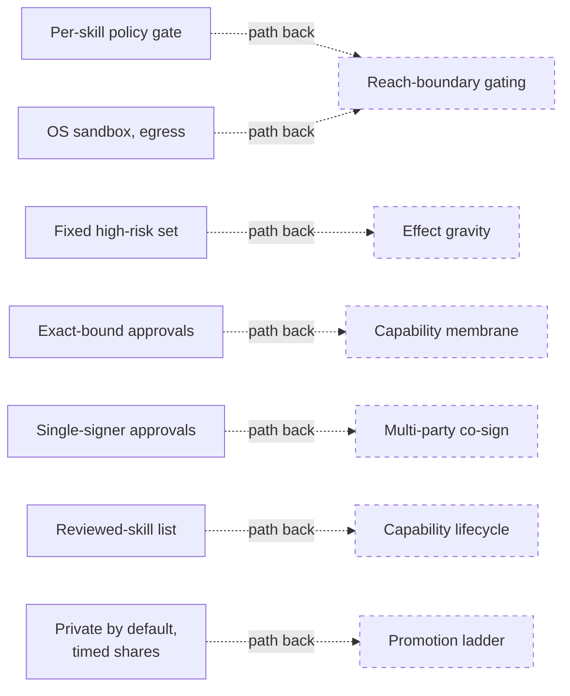
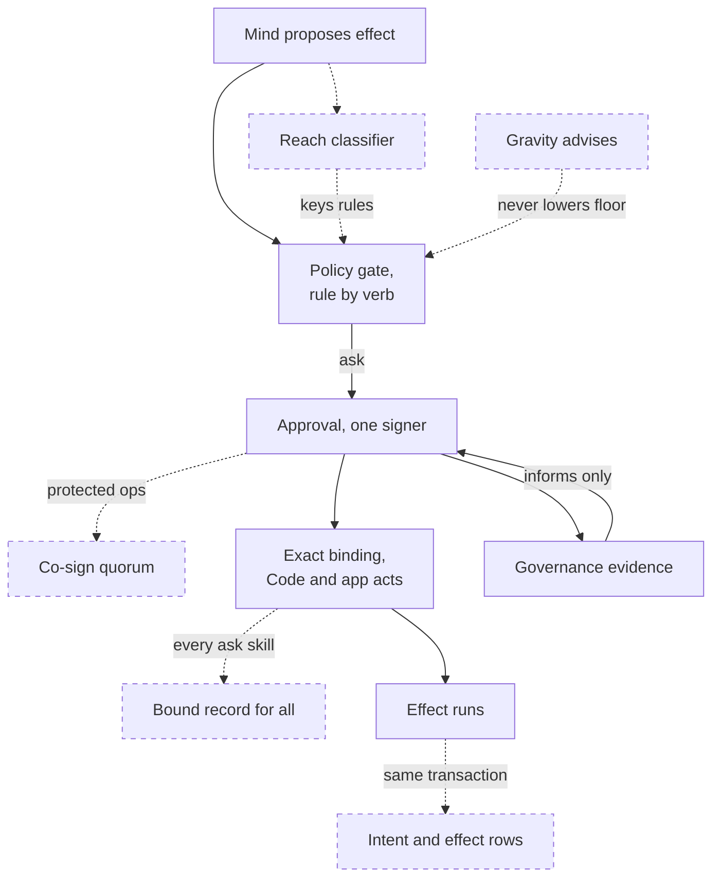
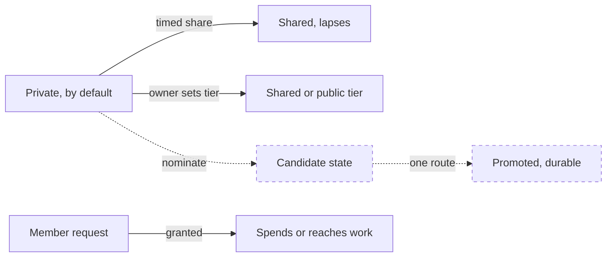

# Intended governance: how the deeper V2 model maps onto this build
> Status key: solid line = built; dashed line = intended, not finished. Code refs are to omegahive @ 34b0fb3 unless named.

**What this shows.** The hive's safety layer is a deliberate simplification of a deeper governance model from the OmegaClaw V2 programme (`docs/theory/governance-and-gating.md:1-3`). This page puts each V2 mechanism beside what this build ships. It marks what is built and what is intended, and names the seam where each richer mechanism would plug in. The theory doc is the source for every "intended" item here. The other pages in this folder are the source for every "built" item.

**Who should read it.** Anyone planning governance work on the platform, owners of the policy gate, approvals, visibility and budgets, and reviewers who must tell a built guarantee from a stated intention.

## Diagrams

### 1. What ships now, and the path back to each V2 mechanism

### 2. Intended path of one effect

### 3. The promotion ladder

## How it works

**The governing principle.** Evidence never mints authority. A model output, a reasoning trace, a passing test or a past approval may justify a proposal. None of them is permission to act (`governance-and-gating.md:44-46`). This build applies that principle in two places:
- **Governance evidence informs and never decides.** Each person's answer to an approval is stored as evidence that later approval cards show (`hive/core/governance_evidence.py:1-13`).
- **Advertising a skill is not permission.** The skill list a mind is shown is display only; the gate decides every command outside the local skip list (`modules/hive/src/hive_commons.py:965-970`; bypasses K10, K30).

**Maturity words.** The theory doc uses designed, ruled, built and shadow-tested strictly (`governance-and-gating.md:5-9`). This page reduces them to two:
- **Built** means source plus focused tests in this repository.
- **Intended** means anything that is ruled or designed but not built here.

### Built versus intended, mechanism by mechanism

| V2 mechanism | Built in this build | Intended (path back) | Sources |
|---|---|---|---|
| Reach-boundary effect gating | Per-skill allow/ask/deny gate; OS sandbox with loopback-only reach; gateway egress check for local-only swarms | A reach classifier inside `Policy.authorize`; rules keyed on reach class; "For a time" becomes a revocable reach lease | Built: `hive/core/policy.py:181-219`, `hive/supervisor/sandbox.py:100-125`, `hive/core/gateway.py:230-253`. Intended: `governance-and-gating.md:48-72` |
| Effect gravity (risk vector, five bands) | A fixed high-risk set, approved one at a time | A pure `gravity()` that advises the gate, never lowers a floor, and maps onto the five answers | Built: `policy.py:61`, `:357-361`. Intended: `governance-and-gating.md:74-80` |
| Capability membrane | Digest-bound Code approvals redeemed once; signed, scoped capability tokens checked live; exact-request app actions | The same bound record (action, target, scope, version, nonce, expiry, reach) for every ask-mode skill | Built: `hive/core/services.py:8-17`, `:292-380`, `hive/core/program_actions.py:1-10`. Intended: `governance-and-gating.md:82-93` |
| Capability lifecycle | A new `hive-*` skill asks until it is reviewed and listed; CI enforces the list | A lifecycle table with gap, candidate, trial, promote and receipt states | Built: `policy.py:24-41`, `hive/tests/test_policy_hive_skills.py`. Intended: `governance-and-gating.md:95-101` |
| Inspectable-inert reasoning | Governance evidence that informs and never decides | A trace store that no decision path reads, enforced by a test | Built: `governance_evidence.py:1-13`. Intended: `governance-and-gating.md:103-113` |
| No process judges its own outputs | People answer approvals; most-restrictive rule wins at a tie | — (practised) | Built: `policy.py:206-212`. Source: `governance-and-gating.md:115-122` |
| Multi-party co-sign | Single-signer approvals | A hash-chained signatures table and a per-skill quorum; a mind signs with its member token | Built: `policy.py:381-405`. Intended: `governance-and-gating.md:124-130` |
| Governed law amendment | Policy rules are data; answers supersede and expire earlier rules, never delete them | Policy suggestions from the governance commons, as amendment proposals ratified through co-sign | Built: `policy.py:148-153`. Intended: `governance-and-gating.md:132-143` |
| Operation-bound consent | Copy-apply consent, built exactly this way and off by default; timed, revocable shares | One shared consent object with a precedence check | Built: `hive/core/minds.py:26-30`, `:1395-1462`, `hive/core/shares.py:1-14`. Intended: `governance-and-gating.md:145-154` |
| Transparency floor | Private, shared and public tiers; admins keep sight; personal minds hidden unless an admin opts into audit; hidden things answer "not found" | An access receipt the owner can see whenever an admin audit lifts a filter | Built: `hive/core/visibility.py:1-11`, `:312-351`. Intended: `governance-and-gating.md:156-166` |
| Promotion ladder | Private by default; timed shares; member requests spend nothing until granted | An explicit candidate state and one promotion route | Built: `visibility.py:7`, `shares.py:3-14`, `hive/core/person_requests.py:14`. Intended: `governance-and-gating.md:168-177` |
| Budget as physics | Worst-case checks before every paid call; durable reservations; keys never reach minds | — (ruled and enforced here) | Built: `hive/core/hive.py:1687-1733`, `hive/core/cost_reservations.py:119-154`, `sandbox.py:6-7`. Source: `governance-and-gating.md:179-183` |
| Gated effect pairs | The services redeem pattern | Intent and terminal effect rows written in the same transaction as the approval redemption | Built: `services.py:363-380`. Intended: `governance-and-gating.md:207-211` |
| Confined Code runs and host guard | No delegation over Code runs; tokens live-checked; copy-apply held off | Sealed launcher, pinned bundle census, custody lock, cgroup kill ladder | Built: `services.py:33`, `:312-349`. Intended: `governance-and-gating.md:213-222` |
| Rollback without forgetting | Off, Wake all and Stop all, with a durable snapshot; one transactional startup recovery | A hash-chained event log, with co-signed restore | Built: `hive/core/power.py:1-5`, `hive/core/exclusive.py:1-9`. Intended: `governance-and-gating.md:197-205` |

**Reach-boundary gating today.** The gate decides on the verb. A shell command's reach cannot be known in advance, so `shell` and `metta` are "ask" (`policy.py:55`, `governance-and-gating.md:70`). The reach boundary is enforced lower down, by the OS sandbox and the gateway. A sandboxed mind can reach only its own folder, its runtime and loopback ports, and every model call goes through the gateway (`sandbox.py:8-12`). What is missing is the decision layer: rules that name a reach, and a per-task lease that widens it.

**Multi-signature today.** Every approval has one signer: the person who answers it (`policy.py:381-391`). Nothing in this build counts a second signature. The theory doc reserves co-sign for operations on continuity, memory or constitutional state. Its examples are rollback, recovery and changes to the membrane. A co-signature would be an exact-scope lease with an expiry, recorded in a hash-chained journal (`governance-and-gating.md:124-130`). The hive's operations log is append-only but not hash-chained, so that journal is intended too (`governance-and-gating.md:205`).

**The promotion ladder today.** The ladder's rule is: ephemeral or private, then candidate, then durable or shared, and only by deliberate promotion (`governance-and-gating.md:168-170`). This build has the first and last rungs:
- New minds and swarms are private (`visibility.py:7`).
- Memory sharing between minds is always timed and the owner's choice. Shares lapse on their own and can be revoked (`shares.py:1-14`).
- A member's request spends nothing until it is granted (`person_requests.py:14`).

The candidate rung and a single promotion route are intended.

## Intended shape and upgrade path

The theory doc says where each upgrade attaches, and the order below follows its dependencies. It is a reading of the doc, not a ruled schedule.
1. **A bound record for every ask.** It generalises the Code binding (`services.py:86-95`) and is the base for co-sign and effect pairs.
2. **A reach classifier inside `Policy.authorize`**, with reach leases replacing "For a time" rules.
3. **A signatures table and per-skill quorum**, on the bound record. The hash-chained journal would record each exercise.
4. **A gravity advisor**, which may only raise the gate's caution.
5. **One consent object, and the candidate rung of the ladder.**

Governance that concerns a resident mind's own consent, keys, jurisdictions or recovery is described in the theory doc only in general terms (`governance-and-gating.md:239-240`). This page does the same.

## Seams and contracts

| Where an upgrade plugs in | File and function |
|---|---|
| Reach classifier, gravity advisor | `Policy.decide` and `Policy.authorize`, `hive/core/policy.py:181-288` |
| Co-sign quorum | `Policy.decide_approval`, `policy.py:381-405`; the approvals table rows filed by `Policy._file`, `policy.py:324-333` |
| Bound record for every ask | `parse_binding` and `Services.redeem`, `services.py:86-95`, `:363-380` |
| Lifecycle states for skills | `REVIEWED_HIVE_SKILLS`, `policy.py:24-41` |
| Amendment proposals from evidence | `hive/core/governance_evidence.py`, read through `GET /api/approvals/{id}/track-record`, `hive/core/app.py:2290-2296` |
| Shared consent object | `Minds.copy_apply_consent`, `_void_consents`, `_consent_current`, `minds.py:1395-1462` |
| Access receipt on audit | `operator()` `?include=personal`, `app.py:280-284`; `Visibility.hidden_ids`, `visibility.py:324-336` |
| Reach leases for network | `sandbox.loopback_ports`, `hive/supervisor/sandbox.py:82-97`; `Gateway.enforce_egress`, `gateway.py:230-253` |

## For owners: how to plug in

1. **Before building any row marked intended, check the closed V2 sources.** The full governance theory, with its laws, rulings and dossiers, is in the closed `omegav2` repository (`governance-and-gating.md:13-15`). Work from the ruled text, not this summary.
2. **Keep the built guarantees while upgrading.** Most restrictive wins at a tie, hidden means not found, worst-case spend before dispatch, and fail-closed sandbox start. Each has a guarding test, named on the matching page in this folder.
3. **Upgrade in place.** Add the new mechanism at the seam above and keep the simpler form as its floor. For example, a reach classifier may only add deny or ask, never turn an existing deny into allow.

## For reviewers: what to check

- **Intended is never presented as built.** Co-sign, gravity, reach classes, the candidate rung, access receipts, the hash-chained journal and gated effect pairs are not in this build. A change or doc that claims one must cite the code and a test.
- **"Evidence never mints authority."** No path may let governance evidence, a model output or a track record decide an approval (`governance_evidence.py:11-12`). Search for any reader of `&commons_governance` inside `Policy.decide`.
- **Simplifications are stated plainly.** Known gaps: the mind sandbox is opt-in, the Docker driver defaults to host networking and has no hardening flags, approvals have one signer, and risk has two levels (`governance-and-gating.md:224-228`, `STATUS.md:56`).
- **Doc versus code.** Three findings on the other pages here narrow what "per-skill gate" covers today:
  - Native minds skip the hive gate for a local skill list (page 01).
  - The policy and approval routes accept any signed-in person (page 01).
  - The required Landlock version is stated two ways (page 04).

## References

- `docs/theory/governance-and-gating.md:1-240`
- `hive/core/policy.py:24-61`, `:148-153`, `:181-288`, `:324-333`, `:357-405`
- `hive/core/services.py:8-17`, `:33`, `:86-95`, `:292-380`
- `hive/core/program_actions.py:1-10`
- `hive/core/governance_evidence.py:1-13`
- `hive/core/visibility.py:1-11`, `:312-351`
- `hive/core/shares.py:1-14`
- `hive/core/person_requests.py:1-15`
- `hive/core/minds.py:26-30`, `:1395-1462`
- `hive/core/hive.py:1687-1733`
- `hive/core/cost_reservations.py:119-154`
- `hive/core/gateway.py:230-253`
- `hive/supervisor/sandbox.py:6-12`, `:82-125`
- `hive/core/app.py:280-284`, `:2290-2296`
- `modules/hive/src/hive_commons.py:965-970`
- `STATUS.md:56`
