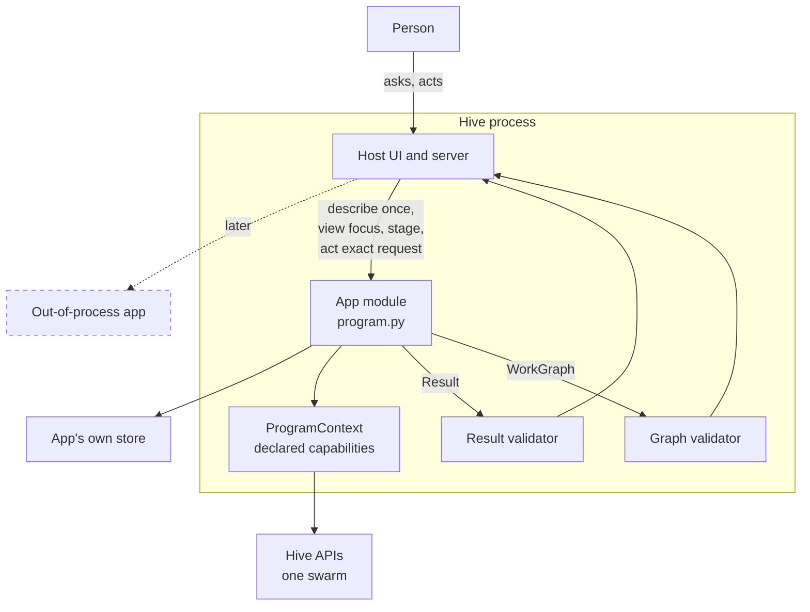
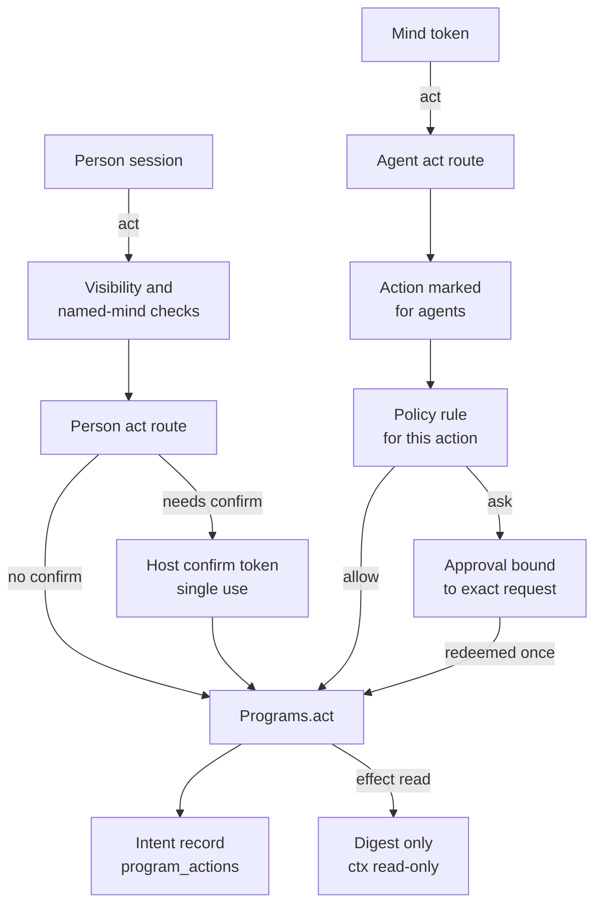
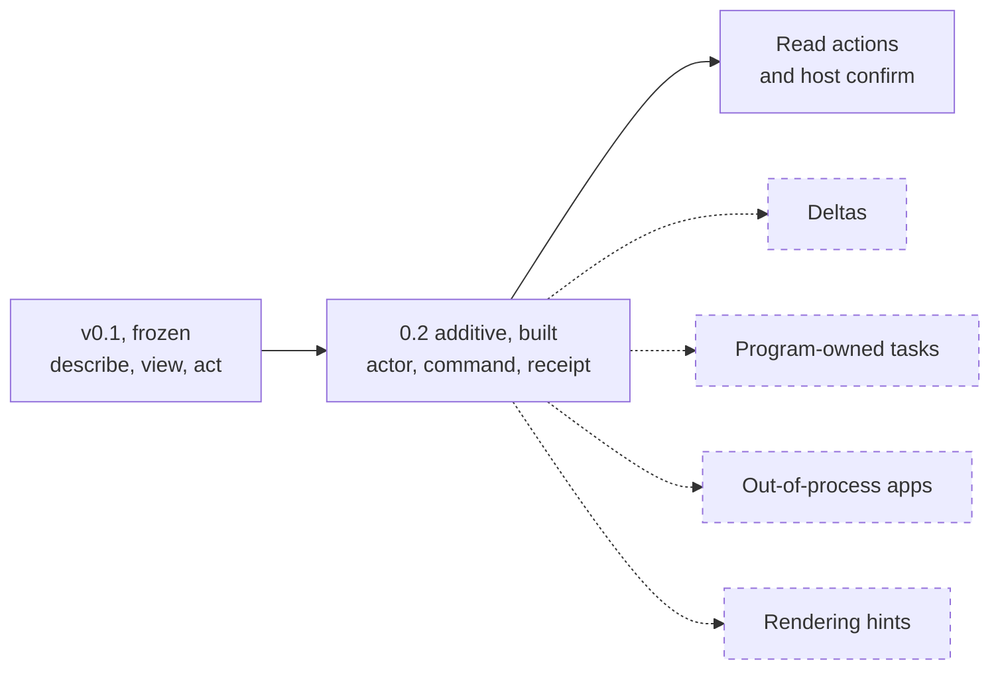

# Programs contract: describe, view, act

> Status key: solid line = built; dashed line = intended, not finished. Code refs are to omegahive @ 34b0fb3 unless named.

**What this shows.** The boundary between the hive (the host) and an app (a "program"). An app supplies meaning as plain JSON through three functions. The host checks every answer, decides who may act, and draws the result.

**Who should read it.** App owners writing or changing `program.py`. Reviewers of `hive/core/programs.py`, `program_actions.py` and anything that changes the shapes in `hive/PROGRAMS.md`.

## Diagrams

### 1. The three calls

### 2. Who may act, and how

### 3. Contract versions

## How it works

**Three functions.** An app module must define `describe()`, `view(ctx, focus, stage)` and `act(ctx, action, items, params)`. The loader refuses a module that lacks any of them (`hive/core/programs.py:676-678`). **`describe()` must be synchronous.** The loader calls it directly and does not await it (`hive/core/programs.py:680`); an async `describe()` returns a coroutine, which fails the description check, so the app does not load. **`view()` and `act()` may be sync or async;** `_call` awaits either (`hive/core/programs.py:885-892`).

**Errors from `view()` and `act()` fall into three cases** (`hive/core/programs.py:893-900`):
- **Refusal.** A `PermissionError` (for example, a swarm the app has not enrolled) becomes `403 program_refused` with the app's message, cut to 300 characters.
- **Status-bearing errors.** An exception that carries a `status`, such as a hive error the context raised, passes through unchanged, with its own status and code.
- **Unexpected errors.** Anything else becomes `500 program_error`, with the last lines of the traceback, including errors raised after an `await`.

**The app runs inside the hive process.** The loader imports `program.py` with `importlib` (`hive/core/programs.py:673-675`). Capabilities limit which hive APIs the context offers. They are not a sandbox: in-process code can still reach the filesystem and network as the hive's user (`hive/PROGRAMS.md:241-245`). Out-of-process apps are planned, not built (`hive/PROGRAMS.md:42`).

**describe() is read once, at load and reload.** It lists the app's kinds (each with a shared `role`), relations (each with a `polarity`), actions and optional reads. The host checks it before the app is usable (`hive/core/programs.py:686-719`). Roles are fixed by the host (`hive/core/programs.py:35`); polarities are `support`, `oppose`, `qualify`, `neutral` (`hive/core/programs.py:36`).

**view() returns a full WorkGraph snapshot.** The host calls it on every navigation, with `stage` one of `unfold`, `map`, `compare`, `detail` (`hive/core/programs.py:34`, `:995`). A graph has a required `revision` and items with stable ids, plus links, groups and notes (`hive/PROGRAMS.md:88-113`). The host validates it and adds `contract`, `program` and `stage` (`hive/core/programs.py:1227-1289`).

**act() returns a Result.** Its `status` is one of `done`, `started`, `needs_input`, `stale`, `refused`, `error` (`hive/core/programs.py:39`). The host always sets `params.base_revision` to the revision the person was looking at (`hive/core/programs.py:1064`). A `started` result must carry `task.id`, which is a swarm goal, or a pending or unknown receipt (`hive/core/programs.py:1312-1314`).

**The view is data.** The host renders text as text. An app cannot inject markup or code into the page (`hive/PROGRAMS.md:239-240`). A `url` or `local_ref` is a reference, not access: the host fetches nothing by itself (`hive/PROGRAMS.md:137-139`).

**Uncertainty is labelled with its method.** `nal` needs `f` and `c` in [0, 1]; `pln` needs `strength` and `confidence` in [0, 1]; `qualitative` needs a `status`; any other method is allowed. The host never converts one method into another (`hive/core/programs.py:1213-1224`).

**Capabilities limit the context.** A context method checks the app's declared capabilities and answers `403 capability_missing` otherwise (`hive/core/programs.py:113-122`). The known set is `commons:read`, `goals:read`, `goals:write`, `exhibits:write`, `evolve:read`, `evolve:write`, `sandbox:run`, `artifacts:read` and `artifacts:write` (`hive/core/programs.py:93-94`). Every context is scoped to one swarm (`hive/core/programs.py:106-109`).

**People act through the person route.** `POST /api/programs/{id}/act` runs visibility and named-mind checks, refuses identity or credential fields in the body, and builds the actor from the session (`hive/core/app.py:2899-2912`, `hive/core/program_actions.py:119-126`). An action marked `confirm: true` or `person_activity: true` needs a host confirm token, minted by `POST /api/programs/{id}/confirm` after the person confirms in the host's dialog (`hive/core/program_actions.py:311-350`, `hive/core/programs.py:1175-1177`).

**Minds act through the agent route.** `POST /api/agent/programs/{id}/act` takes the identity from the mind's token (`hive/core/app.py:3358-3361`). A mind may use only actions the app marks `"agents": true` (`hive/core/program_actions.py:151-152`), and only under an explicit policy rule for skill `program:<id>:<action>`. There is no default allow (`hive/core/program_actions.py:233-248`). On `ask`, the hive files an approval bound to the exact request and redeems it once (`hive/core/program_actions.py:250-273`).

**Every act has an intent key.** A mind must send an `idempotency_key`; an identical retry returns the recorded result, and a different request under the same key is refused `409 idempotency_conflict` (`hive/core/program_actions.py:145-188`). A person's `person_activity` action needs a key too (`hive/core/program_actions.py:411-412`).

**Read actions store no content.** An action with `"effect": "read"` stores only `{redacted, digest, status}`, re-runs under the grants in force on a repeat, and gets a read-only context (`hive/core/program_actions.py:184-227`, `hive/PROGRAMS.md:978-989`). A separate named read, declared in `describe().reads` and answered by an optional `read(ctx, query, params)` hook, returns JSON that is not a WorkGraph, at most 4 MB, never stored (`hive/core/programs.py:1024-1051`).

## Intended shape and upgrade path

- **0.1 is frozen.** Changes come as 0.2 and later, and an app declares the version it speaks (`hive/PROGRAMS.md:8-10`).
- **0.2 additive, built.** The trusted actor and request identity on `act()` (`ctx.actor`, `ctx.command`), and action receipts with state `committed`, `pending`, `unknown` or `refused` (`hive/core/programs.py:100-102`, `:1292-1311`; `docs/COMPATIBILITY.md:10`). Read actions, the agent route and host confirm are also built and additive (`hive/PROGRAMS.md:883-989`).
- **Later, intended.** Deltas instead of full snapshots, program-owned tasks with their own cancel, out-of-process apps and rendering hints (`hive/PROGRAMS.md:42`, `:167`, `:283-284`; `docs/FEATURES.md:216` AP24, "Planned").
- **Out-of-process isolation is the intended security boundary.** Today the boundary is code review of every mounted app (`hive/PROGRAMS.md:221-224`, `:241-245`).

## Seams and contracts

| Seam | Shape | Where |
|---|---|---|
| `describe()` | `{contract, kinds[], relations[], actions[], reads[]}` | `hive/PROGRAMS.md:72-86`; `hive/core/programs.py:686-719` |
| `view(ctx, focus, stage)` | WorkGraph: `revision`, `items`, `links`, `groups`, `notes`, `focus`, `selected` | `hive/PROGRAMS.md:88-113`, `:328-330`; `hive/core/programs.py:1227-1289` |
| `act(ctx, action, items, params)` | Result: `status`, `graph?`, `task?`, `needs?`, `detail?`, `message`, `receipt?` | `hive/PROGRAMS.md:143-160`; `hive/core/programs.py:1295-1315` |
| `read(ctx, query, params)` (optional) | JSON object, at most 4 MB | `hive/core/programs.py:342`, `:1024-1051` |
| Action fields | `id`, `label`, `applies_to`, `stage`, `params`, `agents`, `effect`, `confirm`, `person_activity`, `approver`, `accepts_file`, `binding_params`, `revalidate` | `hive/core/programs.py:700-717`; `hive/core/program_actions.py:151-163`, `:184-185`, `:334-340` |
| Limits | 400 items and 1,200 links per view, refused not cut | `hive/core/programs.py:92`, `:1237-1239` |
| Ids | unique items; links point inside the graph; link id defaults to `from|rel|to`; focus must be an item | `hive/core/programs.py:1244-1285` |
| Item status | `current`, `corrected`, `superseded`, `retracted` | `hive/core/programs.py:37` |
| Source status | `retrieved`, `inspected`, `cited`, `unavailable` | `hive/core/programs.py:38` |
| Proposal on an item | `transport` (hive checked) and `review` (app decided), shown apart | `hive/core/programs.py:43-44`, `:1263-1268`; `hive/PROGRAMS.md:400-406` |
| File on an act | person only, at most 20 MB, declared `accepts_file` | `hive/core/programs.py:344`, `:702-710`; `hive/core/program_actions.py:275-306` |
| Confirm payload | `{items, params, base_revision, file?}`, canonical JSON, integers only, 2 MB | `hive/core/program_actions.py:37-40`, `:59-83`; `hive/PROGRAMS.md:893-927` |
| Person routes | `GET /api/programs`, `GET /api/programs/{id}`, `POST .../view`, `.../read`, `.../act`, `.../confirm` | `hive/core/app.py:2820-2933` |
| Mind route | `POST /api/agent/programs/{id}/act` | `hive/core/app.py:3358-3361` |
| Errors | `400 bad_graph`, `400 bad_result`, `403 capability_missing`, `403 program_refused` (the app raised `PermissionError`, `programs.py:893-895`), `409 program_disabled`, `500 program_error` | `hive/PROGRAMS.md:273-281`; `hive/core/programs.py:825-835`, `:1170-1173` |

## For owners: how to plug in

1. Write `describe()`, `view()` and `act()` over your own store. Use your own kind and relation ids; pick roles and polarities from the host's sets.
2. Keep item ids stable across revisions, and change `revision` whenever content changes.
3. Return `stale` with the current graph when `params.base_revision` is old. Keep the item id on a correction, append the prior state to `revisions`, and flag dependents `affected-by-correction` (`hive/PROGRAMS.md:162-166`).
4. Mark an action `"agents": true` only if minds should use it. Mark it `"effect": "read"` only if it is safe to repeat.
5. Mark a consequential person action `confirm: true`, or `person_activity: true` for named-person participation.
6. Run `python -m hive.programs_check <your folder>` until it prints `COMPATIBLE`. The worked example is [03-connect-a-new-app.md](03-connect-a-new-app.md).

## For reviewers: what to check

- **No default allow for minds.** Only `program:` rules count, a hive-wide `*` allow never lets a mind act in an app, and no rule means deny (`hive/core/program_actions.py:233-248`). Tests: `hive/tests/test_program_actions.py`.
- **Identity comes from the hive.** A body naming `principal`, `actor`, `swarm_id`, `agent_id` or `member_id`, or carrying a credential-like key, is refused (`hive/core/program_actions.py:18-21`, `:119-126`). Tests: `hive/tests/test_program_actions.py`, `hive/tests/test_program_viewer.py`.
- **Confirm tokens bind everything.** Principal, session, program, swarm, action and payload digest, spent by one conditional update (`hive/core/program_actions.py:360-379`). Tests: `hive/tests/test_program_confirm.py`.
- **Read actions keep no content.** Tests: `hive/tests/test_read_actions.py`, `hive/tests/test_program_read.py`.
- **Graphs and results are validated on every call,** including graphs inside a Result (`hive/core/programs.py:1295-1302`). Tests: `hive/tests/test_programs_api.py`.
- **File bytes are never kept.** Only name, type, size and digest enter the record (`hive/core/program_actions.py:456-468`). Tests: `hive/tests/test_program_file.py`.
- **Async errors stay clean.** Tests: `hive/tests/test_programs_check_async.py`, `hive/tests/test_program_refusal.py`.
- **Risk.** Capabilities are not a sandbox. Any mounted app can do what the hive process can. Review every mounted app's code.

## References

- `hive/PROGRAMS.md:1-170` (contract 0.1), `:237-285` (permissions and errors), `:316-335` (clarifications), `:883-976` (host confirm), `:978-989` (read actions)
- `hive/core/programs.py:33-44` (constants), `:92-122` (limits, capabilities, context guard), `:654-719` (load and describe check), `:885-900` (call boundary), `:992-1066` (view, read, act), `:1175-1177` (confirms), `:1213-1315` (validators)
- `hive/core/program_actions.py:1-11` (mind route summary), `:130-231` (agent act), `:233-248` (policy decision), `:311-379` (confirm), `:381-454` (person act)
- `hive/core/app.py:2820-2933`, `:3358-3361`
- `docs/COMPATIBILITY.md:6-13`; `docs/FEATURES.md:193-216`
