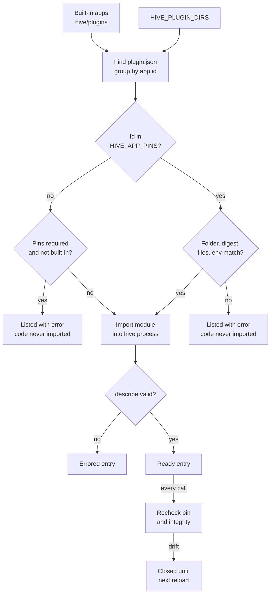
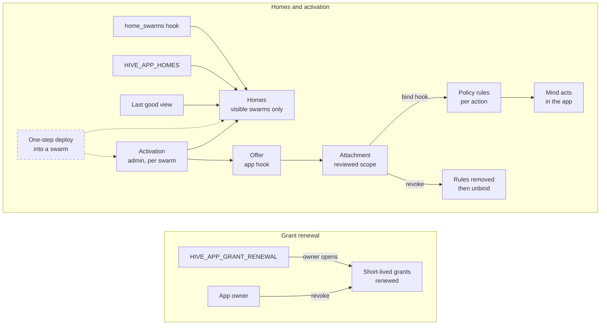
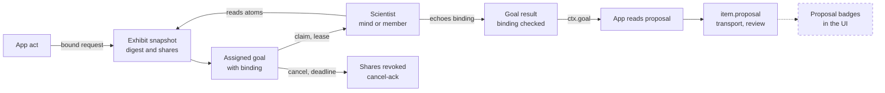

# App lifecycle: discovery, pins, homes, activations and grants

> Status key: solid line = built; dashed line = intended, not finished. Code refs are to omegahive @ 34b0fb3 unless named.

**What this shows.** How an app gets from a folder on disk to a running app in a swarm: discovery, release pins, loading, homes, activations, mind attachments, grants, the Scientist route, reload and errors.

**Who should read it.** App owners deploying or updating an app. Operators setting `HIVE_PLUGIN_DIRS`, `HIVE_APP_PINS` and `HIVE_APP_HOMES`. Reviewers of `hive/core/programs.py` and `hive/core/program_attachments.py`.

## Diagrams

### 1. Discovery and the pin gate

### 2. Homes, activations, attachments and grants

### 3. The Scientist route

## How it works

**Discovery.** The hive looks in `hive/plugins/` (built-in) and then in each folder of `HIVE_PLUGIN_DIRS`, split on the path separator (`hive/core/programs.py:505-509`). A folder in that list may be one app folder or a folder of app folders; an app folder is one that holds `plugin.json` (`hive/core/programs.py:511-519`). Copies are grouped by the manifest `id` without running anything (`hive/core/programs.py:527-532`). An unpinned id found twice keeps the last copy (`hive/core/programs.py:538`).

**Release pins.** `HIVE_APP_PINS` is JSON `{app_id: {release, digest, files?, env?}}`. `release` is the absolute, normalised path of the app folder; `digest` is its source digest; `files` and `env` are optional exact checks (`hive/PROGRAMS.md:181-196`; `hive/core/programs.py:1183-1198`). Pins are read once per full reload, before any app in it runs (`hive/core/programs.py:595-602`). A pinned app loads only from exactly that folder with every digest, file and value matching; otherwise its code is never imported (`hive/core/programs.py:604-652`).

**The source digest.** It covers `plugin.json`, every `.py` and `.metta` file outside data folders, and `ui/bundle.lock.json` if present (`hive/core/programs.py:547-565`). It does not cover data or JSON files other than those, so use `files` in the pin for any other file that must not drift (`hive/PROGRAMS.md:184-186`).

**Pins are enforced for pinned apps; requiring one is opt-in.** A declared pin is always checked. An app with no pin still loads, unless `HIVE_APP_PINS_REQUIRED=1`, which refuses every non-built-in app without a pin (`hive/core/programs.py:613-617`). That switch is off by default and is the intended end state (`hive/PROGRAMS.md:228-230`). If `HIVE_APP_PINS` is not a JSON object, every non-built-in app is refused (`hive/core/programs.py:615-616`).

**Refusal codes.** `release_mismatch`, `duplicate_discovery`, `pin_conflict`, `unpinned` and `pins_invalid` (`hive/core/programs.py:22`). A refused app is listed with `enabled: false` and serves no view, act, read or UI (`403` with the code) (`hive/core/programs.py:825-831`). Only admins see the reason; everyone else sees `<code>: not its pinned release` (`hive/core/programs.py:723-728`).

**Loading.** The loader checks the id (`[a-z0-9][a-z0-9-]{1,40}`), refuses unknown capabilities, validates the optional `app` identity block, imports the module, requires the three functions and checks `describe()` (`hive/core/programs.py:654-684`). Any failure marks the entry errored with the reason; it never stops the hive (`hive/core/programs.py:682-683`).

**Every call rechecks.** `_ready` refuses errored, refused or disabled apps, then rechecks the whole pin and the grant-renewal integrity on every view, act, read, result validation and UI serve (`hive/core/programs.py:825-881`). A mismatch closes the app until the next reload, even if the file is put back (`hive/PROGRAMS.md:214-218`).

**Reload.** `POST /api/programs/reload` re-reads pins and reloads every app (`hive/core/app.py:2825-2828`; `hive/core/programs.py:534-545`). Reloading one app in place keeps the pins of the last full reload, because a loaded app can write the environment (`hive/core/programs.py:580-593`). Updates show "update available" by comparing loaded code with disk, and an app update reloads that app alone (`hive/core/updates.py:1-12`).

**Enable and disable.** These are operator switches stored in `app_authority`, so they survive a restart (`hive/core/programs.py:817-823`, `:366-381`).

**Homes.** An app's homes are the swarms it works in, best first, limited to swarms the caller can see. Sources, in order: the app's own `home_swarms()` hook, the operator's `HIVE_APP_HOMES`, active activations, then swarms where a view last succeeded (`hive/core/programs.py:475-503`). `GET /api/programs/{id}/homes` returns them (`hive/core/app.py:2860-2865`). Drafts exist only where the app is set up; elsewhere the hive answers `404 app_not_here` (`hive/core/app_drafts.py:46`; `hive/PROGRAMS.md:702`).

**Admission.** A person's successful view or read records that the app admitted them in that swarm; the app's own refusal removes it (`hive/core/programs.py:1005-1022`). File actions require this admission (`hive/core/program_actions.py:286-287`).

**Activations.** A named signed-in admin activates an app in a swarm (`hive/core/program_attachments.py:26-28`, `:55-60`). An app needs activation when it defines a `bind` hook or has any activation row (`hive/core/program_attachments.py:36-37`). Deactivating revokes every attachment in that swarm (`hive/core/program_attachments.py:190-196`).

**Attachments.** An admin attaches an existing mind to an app. The app's `offer` hook says which actions and channels it offers; the admin reviews a subset with one `allow` or `ask` per action (`hive/core/program_attachments.py:62-118`). The app's `bind` hook must return a stable actor; the hive then writes one policy rule per action and sends the mind a notice, in one transaction (`hive/core/program_attachments.py:138-160`). Revoking deletes the rules first, then calls `unbind` (`hive/core/program_attachments.py:162-188`). A pending state holds no authority, and `reconcile` retries later (`hive/core/program_attachments.py:214-224`).

**Grants.** For an app configured in `HIVE_APP_GRANT_RENEWAL`, the host renews short-lived read grants when its recorded owner opens it, all or nothing, and only from the reviewed release and digest (`hive/core/programs.py:902-990`). The owner can revoke grants; revoked grants are dropped at every start, and only the owner can restore them (`hive/core/programs.py:444-473`; `hive/core/app.py:2845-2853`).

**The Scientist route.** An app shows a snapshot to one named mind with `ctx.exhibit` or `ctx.bound_request`, which also posts a goal only that mind can claim (`hive/core/programs.py:313-337`). The result must echo the binding exactly, or it is refused `409 binding_mismatch` (`hive/PROGRAMS.md:355-359`). Cancelling or a deadline revokes the snapshot shares (`hive/PROGRAMS.md:360-366`, `:379-383`). An app can also check a mind's result with `validate_result(ctx, goal, proposal)` before the goal can be done; without that hook, completion is refused (`hive/core/programs.py:1100-1168`).

## Intended shape and upgrade path

- **One guided deploy flow (known issue).** There is no single flow for deploying an app with its swarm. The release pin, the swarm, the home and the grants are configured in separate places (environment settings such as `HIVE_APP_PINS` and per-app `*_SWARMS` variables, plus hive actions), with no step that checks they agree. A one-step "deploy app into swarm" flow is wanted (`STATUS.md:67`).
- **Pins required everywhere.** `HIVE_APP_PINS_REQUIRED=1` is the end state, once every mounted app is pinned; the grant-renewal app moves its release and digest into `HIVE_APP_PINS` (`hive/PROGRAMS.md:225-230`).
- **App store.** Installing apps from the UI is planned; there is no store code today (`docs/FEATURES.md:215` AP23).
- **Scientist UI.** The app morph, the switcher and the proposal badges are pending; the backend is built (`hive/PROGRAMS.md:39-40`).
- **Grant boundary.** Grants and their config live in the process environment, which every loaded app can read and write. The intended boundary is out-of-process apps; today it is code review (`hive/core/programs.py:918-920`).
- **One settings module.** App settings are read with `os.environ.get` across modules; one settings module is planned (`docs/MODULARITY.md:54-57`, `:66`).

## Seams and contracts

| Seam | What | Where |
|---|---|---|
| `HIVE_PLUGIN_DIRS` | app folders, path-separator list | `hive/core/programs.py:505-509` |
| `HIVE_APP_PINS` | `{id: {release, digest, files?, env?}}` | `hive/PROGRAMS.md:181-212`; `hive/core/programs.py:595-652`, `:1183-1198` |
| `HIVE_APP_PINS_REQUIRED` | `1` refuses unpinned non-built-in apps | `hive/core/programs.py:602`, `:617-618` |
| `HIVE_APP_HOMES` | `{id: [swarm ids]}` | `hive/core/programs.py:491-496` |
| `HIVE_APP_GRANT_RENEWAL` | `{id: {owner, release, digest, swarms, scope, fields, vars, ttl}}` | `hive/core/programs.py:902-990` |
| Hooks | `home_swarms()`, `offer`, `bind`, `unbind`, `validate_result`, `validate_finding_target`, `on_approval` | `hive/core/programs.py:484`, `:1069-1168`; `hive/core/program_attachments.py:30-34`; `hive/core/program_actions.py:470-494` |
| Lifecycle routes | `/api/programs/reload`, `/{id}/enable`, `/disable`, `/grants/revoke`, `/grants/restore`, `/homes`, `/ui` | `hive/core/app.py:2825-2865` |
| Attachment routes | `/{id}/activations`, `/offers`, `/attachments` | `hive/core/app.py:2935-2969` |
| Activity | `GET /api/program-activity` | `hive/core/app.py:3363-3366` |
| Events | `program.updated`, `program.activation`, `program.attachment`, `program.action`, `app.release_refused`, `app.grants_*` | `hive/core/programs.py:822`, `:865`, `:880`; `hive/core/program_attachments.py:59`, `:159` |
| Tables | `program_homes`, `app_admissions`, `app_authority`, `app_activations`, `app_attachments`, `program_actions` | `hive/core/programs.py:355-368`; `hive/core/program_attachments.py:20-24`; `hive/core/program_actions.py:23-36` |

## For owners: how to plug in

1. Point `HIVE_PLUGIN_DIRS` at the folder that holds your `plugin.json`, never at a working copy beside a release (two copies of a pinned id refuse both).
2. Compute your folder's source digest (`Programs.source_digest`) from the exact release folder and pin it in `HIVE_APP_PINS`, adding `files` for data files that must not drift.
3. Declare where the app lives: a `home_swarms()` hook, `HIVE_APP_HOMES`, or an admin activation. Refuse swarms you have not enrolled with `PermissionError`; the host turns it into `403 program_refused` (`hive/core/programs.py:893-895`).
4. If minds should use the app, add `offer`, `bind` and `unbind`, and let an admin attach each mind.
5. After changing code, reload the app and check that it still loads at its pin.

## For reviewers: what to check

- **No code from an unreviewed folder.** A refused app's module is never imported (`hive/core/programs.py:604-606`, `:661-663`). Tests: `hive/tests/test_app_pins.py`.
- **Swap and restore stays closed** until a reload. Tests: `hive/tests/test_app_pins.py`.
- **Refusal detail for admins only.** Tests: `hive/tests/test_app_pins.py`.
- **Homes respect visibility.** Tests: `hive/tests/test_program_homes.py`.
- **Attachments revoke first.** Rules are removed before `unbind`; pending states hold no authority. Tests: `hive/tests/test_app_attachments.py`.
- **Grant renewal is all or nothing, owner only.** Tests: `hive/tests/test_app_grant_renewal.py`.
- **Scientist binding and revocation.** Tests: `hive/tests/test_scientist_route.py`.
- **Updates and holds.** Tests: `hive/tests/test_updates.py`.
- **Risk.** Settings that must agree (pin, home, enrolment) live in several places. Check them together on every rollout.

## References

- `hive/PROGRAMS.md:173-235` (mounting, pins, migration), `:337-425` (Scientist route, identity block)
- `hive/core/programs.py:347-381` (tables, start-up), `:382-503` (grants, homes), `:505-684` (discovery, pins, load), `:817-881` (enable, ready, integrity), `:902-1022` (renewal, view, admission), `:1100-1168` (result validation)
- `hive/core/program_attachments.py:1-224`
- `hive/core/app.py:2820-2969`
- `hive/core/updates.py:1-12`; `hive/core/app_drafts.py:46`
- `STATUS.md:67`; `docs/FEATURES.md:194-215`
