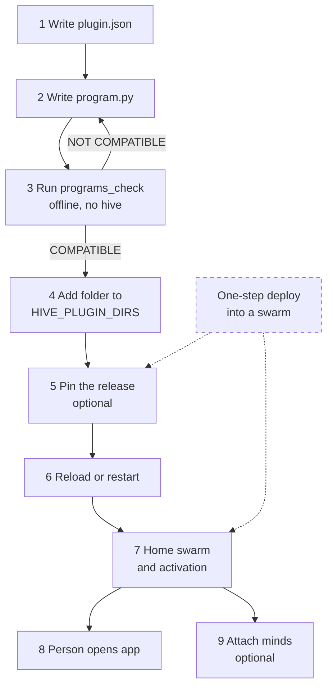
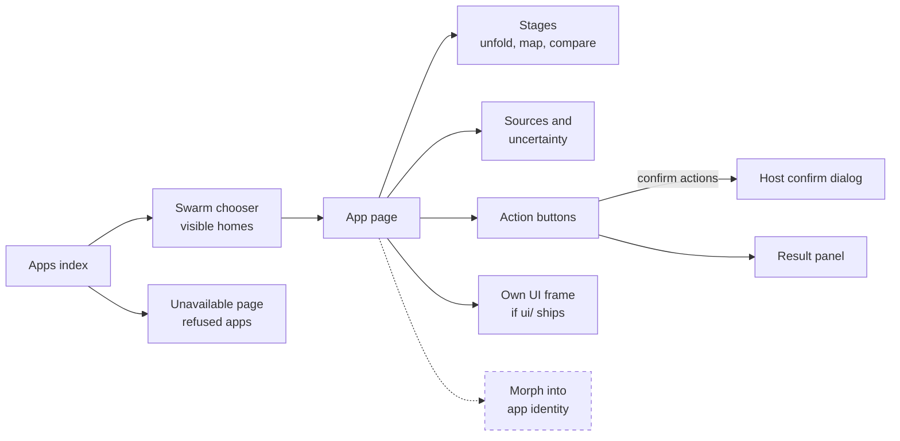

# Connect a new app: a worked example

> Status key: solid line = built; dashed line = intended, not finished. Code refs are to omegahive @ 34b0fb3 unless named.

**What this shows.** Every step from an empty folder to an app a person can open in a swarm: `plugin.json`, a minimal `program.py`, the offline checker, mounting, an optional pin, the home swarm, grants and what the person sees. It follows the public fixture `hive/plugins/contract_fixture/`.

**Who should read it.** Anyone writing a new app. Reviewers admitting a new app to a hive.

## Diagrams

### 1. From zero to running



### 2. What the person sees



## How it works

### Step 1: `plugin.json`

```json
{ "id": "hello-notes", "name": "Hello notes", "version": "0.1.0", "contract": "0.1",
  "description": "A one-question example app.", "module": "program.py",
  "capabilities": ["goals:write"], "icon": "spark" }
```

- `id`: lowercase letters, digits and dashes, 2 to 41 characters (`hive/core/programs.py:664-665`). It is the key for pins, homes and policy rules.
- `name`, `version`, `description`, `icon`: shown in the app list (`hive/core/programs.py:660`).
- `module`: the file to import; the default is `program.py` (`hive/core/programs.py:672`).
- `capabilities`: only names from the known set, or the load fails (`hive/core/programs.py:93-94`, `:666-670`). Declare only what you call.
- `app` (optional): the identity block (theme, home item, opening stage, tagline). Bad values fall back to defaults with a warning, never a failed load (`hive/core/programs.py:61-91`; `hive/PROGRAMS.md:407-425`).
- `contract`: kept for people and tools. The loader does not read it; the contract the host reports comes from `describe()` (`hive/core/programs.py:718`).

The fixture's manifest is `hive/plugins/contract_fixture/plugin.json`.

### Step 2: a minimal `program.py`

```python
STATE = {}  # swarm id -> records; a real app keeps its own store


def describe():
    return {
        "contract": "0.1",
        "kinds": [
            {"id": "question", "label": "Question", "role": "question"},
            {"id": "claim", "label": "Claim", "role": "claim"},
            {"id": "evidence", "label": "Evidence", "role": "evidence"},
        ],
        "relations": [
            {"id": "answers", "label": "answers", "polarity": "neutral"},
            {"id": "supports", "label": "supports", "polarity": "support"},
        ],
        "actions": [
            {"id": "inspect-source", "label": "Open source", "applies_to": ["evidence"]},
            {"id": "investigate-gap", "label": "Investigate", "applies_to": ["claim"]},
        ],
    }


def _state(ctx):
    return STATE.setdefault(ctx.swarm_id, {"n": 1})


def view(ctx, focus, stage):
    s = _state(ctx)
    return {
        "revision": f"r{s['n']}", "focus": focus or "q1", "title": "Hello notes",
        "items": [
            {"id": "q1", "kind": "question", "label": "Is the example working?"},
            {"id": "c1", "kind": "claim", "label": "Yes, it loads",
             "uncertainty": {"method": "qualitative", "status": "unverified"}},
            {"id": "e1", "kind": "evidence", "label": "The checker said COMPATIBLE",
             "sources": [{"id": "s1", "label": "Checker output", "kind": "document", "status": "cited"}]},
        ],
        "links": [
            {"from": "c1", "to": "q1", "rel": "answers"},
            {"from": "e1", "to": "c1", "rel": "supports"},
        ],
        "notes": ["Synthetic example data."],
    }


async def act(ctx, action, items, params):
    s = _state(ctx)
    if params.get("base_revision") not in (None, f"r{s['n']}"):
        return {"status": "stale", "graph": view(ctx, None, "unfold"), "message": "the view changed"}
    if action == "inspect-source" and "e1" in items:
        graph = view(ctx, None, "detail")
        return {"status": "done", "detail": {"sources": graph["items"][2]["sources"]}}
    if action == "investigate-gap" and items:
        goal = await ctx.create_goal("Check: " + items[0], "opened from Hello notes")
        return {"status": "started", "task": {"id": goal["id"], "kind": "goal", "status": goal["status"]}}
    return {"status": "refused", "message": "choose an item this action applies to"}
```

This mirrors the fixture's structure: per-swarm state, a full snapshot from `view()`, a `stale` answer on an old base revision, `inspect-source` returning `detail.sources`, and a long action that returns a goal as its task (`hive/plugins/contract_fixture/program.py:97-136`). The fixture adds a rival hypothesis, an assessment, a gap, overlapping groups and the `correct` action (`hive/plugins/contract_fixture/program.py:18-94`, `:137-155`).

### Step 3: the checker

From an omegahive checkout, with the hive's Python environment:

```sh
python -m hive.programs_check path/to/hello-notes
```

On the example above it prints:

```
contract 0.1 (checker 0.1); 3 kinds, 2 relations, actions: inspect-source, investigate-gap
views valid in every stage: unfold, map, compare, detail
ids stable across views (revision r1, 3 items)
inspect-source returns 1 source(s) for e1
COMPATIBLE with program contract 0.1
```

The checker needs no hive, UI or network. It imports the module, checks `describe()` with the host's own check, validates `view()` in every stage with the host's own validator, checks that ids and the revision are stable across two views, and runs `inspect-source` if offered (`hive/programs_check.py:87-129`). It awaits async functions as the host does (`hive/programs_check.py:65-72`). Exit code 0 means compatible (`hive/programs_check.py:166-171`).

Two checks run only on request. `--scenario` requires a question with one supporting and one opposing link; it is a check on a test scenario only (`hive/programs_check.py:112-118`). `--allow-mutation` runs `correct`, which changes data; use it only on a disposable copy (`hive/programs_check.py:131-153`).

### Step 4: mount

Add the folder to `HIVE_PLUGIN_DIRS`. It may name one app folder or a folder of app folders (`hive/core/programs.py:505-519`). Nothing is copied into the hive; the app's store stays where the app keeps it (`hive/PROGRAMS.md:179-180`).

### Step 5 (optional): pin the release

Compute the source digest of the exact release folder:

```sh
python -c "import pathlib,sys; from hive.core.programs import Programs; print(Programs.source_digest(pathlib.Path(sys.argv[1])))" /abs/path/to/hello-notes
```

Then set `HIVE_APP_PINS='{"hello-notes": {"release": "/abs/path/to/hello-notes", "digest": "sha256:<64 hex>"}}'`. The path must be absolute and in normal form (`hive/core/programs.py:1183-1199`). The pin is checked whenever it exists. With `HIVE_APP_PINS_REQUIRED=1`, an unpinned non-built-in app is refused (`hive/core/programs.py:613-618`).

### Step 6: reload

Restart the hive, or call `POST /api/programs/reload` as an operator (`hive/core/app.py:2825-2828`). `GET /api/programs` should list the app with `enabled: true` and `error: null` (`hive/core/programs.py:723-735`).

### Step 7: home swarm, activation and grants

- **Home.** Choose the swarm the app lives in. Use a `home_swarms()` hook in `program.py`, or `HIVE_APP_HOMES='{"hello-notes": ["<swarm id>"]}'` (`hive/core/programs.py:475-503`). A swarm is created in the UI or with `POST /api/swarms` (`hive/core/app.py:1159`).
- **Enrolment.** If your app should refuse other swarms, raise `PermissionError` in `view()`; the host answers `403 program_refused` (`hive/core/programs.py:893-895`). Many apps read their enrolled swarms from their own `*_SWARMS` setting.
- **Activation.** Needed only if the app has `bind` hooks or already has activations. A named admin activates it with `POST /api/programs/{id}/activations {swarm_id}` (`hive/core/app.py:2941-2944`; `hive/core/program_attachments.py:36-37`).
- **Capabilities.** `goals:write` above is what lets `ctx.create_goal` work (`hive/core/programs.py:290-296`).

### Step 8: what the person sees

- The apps index lists the app with its icon and identity (`hive/ui/src/features/programs/ProgramsIndex.tsx`; `docs/FEATURES.md:196`).
- Opening it picks a swarm that is visible and usable, with a chooser when none qualifies (`hive/ui/src/features/programs/pickSwarm.ts`, `OpenIn.tsx`; `docs/FEATURES.md:209`).
- The app page draws the WorkGraph in four stages, with a trail, sources and uncertainty always visible (`ProgramPage.tsx`, `Scene.tsx`, `Rail.tsx`, `Detail.tsx`; `docs/FEATURES.md:196`).
- Actions show as buttons. A confirm action opens the host's own dialog first (`HostConfirm.tsx`; `docs/FEATURES.md:198`). A `started` result links to its goal.
- An app that ships `ui/` with a lock file runs its own screen in a sandboxed frame (`hive/PROGRAMS.md:478-534`).
- A refused or unknown app gets a generic unavailable page (`RefusedHere.tsx`; `docs/FEATURES.md:210`).

### Step 9 (optional): attach minds

Mark actions `"agents": true`, add `offer`, `bind` and `unbind` hooks, and have an admin attach each mind with one `allow` or `ask` per action. See [02-app-lifecycle.md](02-app-lifecycle.md).

## Intended shape and upgrade path

- **A guided deploy.** Today steps 4, 5 and 7 live in separate places with no check that they agree. A one-step "deploy app into swarm" flow is wanted (`STATUS.md:67`).
- **App store.** Installing from the UI is planned; today the operator installs and pins apps (`docs/FEATURES.md:215`).
- **App morph.** Morphing into the app's identity, the hive spine and the app switcher are pending UI work (`hive/PROGRAMS.md:40`).
- **Out-of-process apps** with real isolation are later contract work (`hive/PROGRAMS.md:42`).

## Seams and contracts

| Seam | Where |
|---|---|
| Manifest fields | `hive/core/programs.py:654-684`; `hive/PROGRAMS.md:232-235` |
| Checker | `hive/programs_check.py:1-175` |
| Mount setting | `HIVE_PLUGIN_DIRS`, `hive/core/programs.py:505-509` |
| Pin setting | `HIVE_APP_PINS`, `HIVE_APP_PINS_REQUIRED`, `hive/core/programs.py:595-652` |
| Home setting | `HIVE_APP_HOMES`, `home_swarms()`, `hive/core/programs.py:475-503` |
| Reload route | `POST /api/programs/reload`, `hive/core/app.py:2825` |
| Fixture | `hive/plugins/contract_fixture/plugin.json`, `program.py` |

## For owners: how to plug in

1. Copy the shape of `hive/plugins/contract_fixture/` into your own repository. Do not copy your app into the hive repository.
2. Run the checker until `COMPATIBLE`; run `--allow-mutation` only on a disposable copy.
3. Mount, pin, reload, set the home, open the app as a person, and check that `GET /api/programs` shows no error.
4. Record your release folder and digest in your repository so the operator can pin exactly that.

## For reviewers: what to check

- **Capabilities are minimal** and match what the code calls.
- **The checker passes on the release folder,** not a working copy. Tests for the checker: `hive/tests/test_programs_check_async.py`.
- **The fixture still passes through the real API.** Tests: `hive/tests/test_programs_api.py`.
- **The pin names the release folder** and every non-source file that matters (`files`).
- **The app refuses swarms it has not enrolled.**
- **Known gap.** A COMPATIBLE checker run does not prove the app loads in a hive: the checker does not check the manifest id format or capability names, and its stub context (`StubContext`) does not enforce capabilities (`hive/programs_check.py:38-59`, `:87-98`; compare `hive/core/programs.py:664-670`).

## References

- `hive/plugins/contract_fixture/plugin.json`; `hive/plugins/contract_fixture/program.py:1-155`
- `hive/programs_check.py:1-175`
- `hive/core/programs.py:61-91`, `:475-519`, `:595-684`, `:723-735`, `:1183-1199`
- `hive/core/app.py:1159`, `:2820-2865`, `:2941-2944`
- `hive/PROGRAMS.md:173-235`, `:286-314`
- `STATUS.md:67`; `docs/FEATURES.md:193-215`
