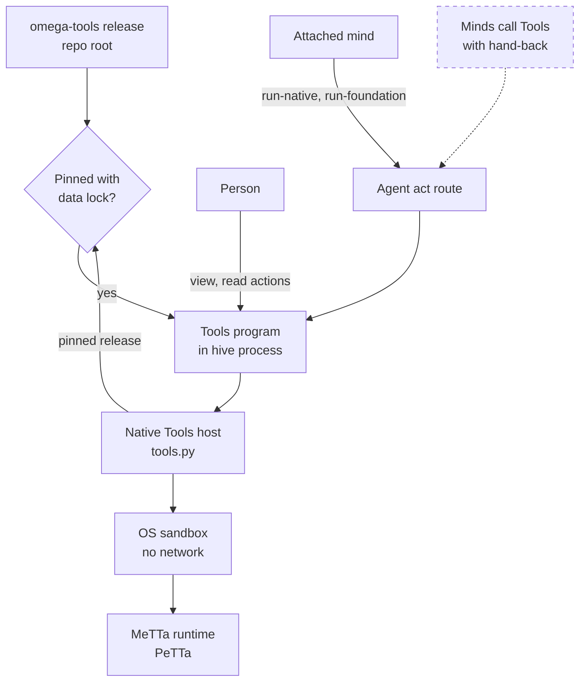

# Tools (omega-tools)

> Status key: solid line = built; dashed line = intended, not finished. Code refs are to omegahive @ 34b0fb3 unless named.

**What this shows.** How the Tools app plugs into the hive: a programs-contract app whose catalogue people browse, and whose sandboxed runs only minds with an exact grant can start, through the hive's native Tools host.

**Who should read it.** The Tools owner. Reviewers of `hive/core/tools.py`, `hive/core/sandbox_run.py` and Tools releases.

## Diagram

## How it works

**It is a programs-contract app.** The repository root holds `plugin.json` and `program.py`. It declares contract 0.2 and the single capability `sandbox:run` (`omega-tools: plugin.json`). `view()` returns the catalogue; read actions inspect tools, sets and foundations and never execute (`omega-tools: README.md:101-110`).

**Runs go through the hive's Tools host.** `run-native` and `run-foundation` reach `hive/core/tools.py`, which refuses anything but an authenticated mind on the agent route, the exact host action, and the app id `omega-tools` (`hive/core/tools.py:330-347`).

**The Tools host trusts only the pinned release.** It reads the package from `Programs.pinned_release("omega-tools")` and refuses when there is none (`hive/core/tools.py:165-168`; `hive/core/programs.py:837-853`). The pin must also list `release-data.lock.json` in `files`, or the run is refused `release_data_unpinned` (`hive/core/tools.py:175-180`). So Tools needs a pin to run anything, whatever `HIVE_APP_PINS_REQUIRED` says.

**Runs are sandboxed.** The app must be in `HIVE_SANDBOX_RUN_APPS`, the sandbox must be available, and a `metta` runtime must be configured (`hive/core/tools.py:282-292`; `hive/core/sandbox_run.py:1-14`).

**Tier.** Open (Apache-2.0) (`docs/START_HERE.md:12`).

## Intended shape and upgrade path

- **Callers.** Minds invoking Tools with a live hand-back are in review; app admission and a real caller run are still owed (`docs/FEATURES.md:243` TO5).
- **Advisory only.** Modules and recipes return advisory data and perform no effect (`omega-tools: STATUS.md`, "Limited or known broken").

## Seams and contracts

| Seam | Value | Where |
|---|---|---|
| App id | `omega-tools` (hard-coded in the Tools host) | `hive/core/tools.py:167`, `:288`, `:346` |
| Contract and capability | 0.2, `sandbox:run` | `omega-tools: plugin.json` |
| Host actions | `run-native`, `run-foundation` | `hive/core/tools.py:344` |
| Pin | `HIVE_APP_PINS` with `files: {"release-data.lock.json": ...}` | `hive/core/tools.py:175-180` |
| Sandbox | `HIVE_SANDBOX_RUN_APPS`, `HIVE_SANDBOX_RUNTIMES` (`metta`), `PETTA_PATH` | `hive/core/tools.py:282-292`; `omega-tools: README.md:35-45` |
| Homes | `HIVE_APP_HOMES` | `omega-tools: README.md:40-41` |

## For owners: how to plug in

1. Mount the repository root in `HIVE_PLUGIN_DIRS` (`omega-tools: README.md:37`).
2. Add `omega-tools` to `HIVE_SANDBOX_RUN_APPS` and give `HIVE_SANDBOX_RUNTIMES` a `metta` runtime that can import PeTTa.
3. Pin the release with its source digest and the `release-data.lock.json` hash in `files`.
4. Set its homes, reload, and attach minds that should run tools.

**Keep stable:** the app id, the two host action names, `release-data.lock.json` as the data lock, and the `sandbox:run` capability. Changing any of them breaks the Tools host.

## For reviewers: what to check

- Only a mind on the agent route can run a tool. Tests: `hive/tests/test_tools.py`, `hive/tests/test_tools_api.py`.
- A run refuses without the pin and the data lock. Tests: `hive/tests/test_tools.py`.
- Sandbox runs have no network and write only a job folder. Tests: `hive/tests/test_sandbox_run.py`.

## References

- `hive/core/tools.py:153-180`, `:282-292`, `:330-347`
- `hive/core/programs.py:837-853`; `hive/core/sandbox_run.py:1-14`
- `omega-tools` (575c5ff): `plugin.json`; `README.md:35-45`, `:101-110`; `STATUS.md`
- `docs/FEATURES.md:239-245`; `docs/COMPATIBILITY.md:22`
