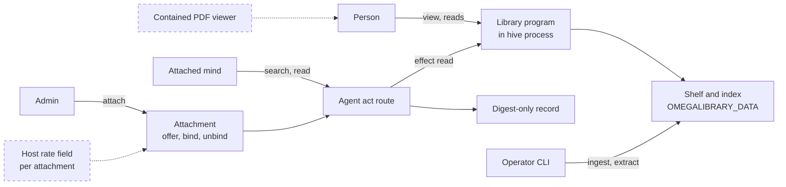

# Library (omegalibrary)

> Status key: solid line = built; dashed line = intended, not finished. Code refs are to omegahive @ 34b0fb3 unless named.

**What this shows.** How the Library app plugs into the hive: a programs-contract app with read-only actions that people and attached minds use to search and read a pinned source shelf, with page citations.

**Who should read it.** The Library owner. Reviewers of read actions (`effect: "read"`), named reads and mind attachments.

## Diagram

## How it works

**It is a programs-contract app mounted from `app/`.** Contract 0.1, no capabilities (`omegalibrary: app/plugin.json`). It defines `describe`, `view`, `act`, `read`, `home_swarms`, `offer`, `bind` and `unbind`.

**Its mind actions are read actions.** `library_search` and `library_read` are marked `"agents": true`, `"revalidate": true` and `"effect": "read"` (`omegalibrary: app/program.py:68-71`). The hive therefore stores only a digest, re-runs a repeat under the current grants, and gives the app a read-only context (`hive/core/program_actions.py:184-227`).

**People use named reads.** `describe().reads` lists `shelf`, `search`, `read` and `original` (`omegalibrary: app/program.py:73-75`), answered through `POST /api/programs/{id}/read` (`hive/core/programs.py:1024-1051`).

**Access fails closed.** A source the caller may not see answers exactly like one that does not exist (`omegalibrary: README.md`, opening paragraph).

**It runs in the hive process.** Its package imports as `olib`; another app with a top-level `olib` would collide (`omegalibrary: STATUS.md`, "Module name"). This follows from in-process loading (`hive/core/programs.py:673-675`).

**Tier.** Open (Apache-2.0) (`docs/START_HERE.md:14`).

## Intended shape and upgrade path

Open host seams, from the app's own design notes (`omegalibrary: docs/DESIGN.md:177-200`; `STATUS.md:27-31`):

- a per-mind rate field on the attachment policy, enforced by the hive in `program_attachments.authorize` (today the app keeps its own ledger);
- a per-app read-only data mount for large sources;
- originals in the host asset store;
- collection grants held by the host rather than the app's data folder;
- a contained PDF viewer that opens a citation at its page (today the host's show-file path is download-only, `hive/PROGRAMS.md:793-800`).

## Seams and contracts

| Seam | Value | Where |
|---|---|---|
| App id | `omegalibrary` | `omegalibrary: app/plugin.json` |
| Mount folder | `app/` | `omegalibrary: README.md:77`; `omegalibrary: docs/DESIGN.md:26` |
| Data | `OMEGALIBRARY_DATA` (required; the app refuses to load without it) | `omegalibrary: README.md:77` |
| Homes | `OMEGALIBRARY_SWARMS`, `home_swarms()` | `omegalibrary: docs/DESIGN.md:161` |
| Pin | `HIVE_APP_PINS` with `tools/bundle.lock.json` in `files` | `omegalibrary: README.md:78` |
| Sandbox | not in `HIVE_SANDBOX_RUN_APPS`; extraction is operator-only | `omegalibrary: README.md:78-79` |
| Mind actions | `library_search`, `library_read` (read effect) | `omegalibrary: app/program.py:68-71` |

## For owners: how to plug in

1. Build the shelf with the operator command line into `OMEGALIBRARY_DATA`.
2. Mount a release copy of `app/`, pin it with the bundle lock in `files`, and set its home swarms.
3. Have an admin attach each mind that should search, with an `allow` or `ask` per action.

**Keep stable:** the app id, the two mind action ids and their read effect, the read ids, and the fail-closed answer for hidden sources.

## For reviewers: what to check

- Mind reads store no page text and disclose nothing after a grant is withdrawn. Tests: `hive/tests/test_read_actions.py`; the app's `tests/test_host_integration.py`.
- Attachments revoke rules before `unbind`. Tests: `hive/tests/test_app_attachments.py`.
- The app is not on the sandbox allowlist.

## References

- `hive/core/program_actions.py:184-227`; `hive/core/programs.py:673-675`, `:1024-1051`; `hive/PROGRAMS.md:978-989`
- `omegalibrary` (c09e7d8): `omegalibrary/app/plugin.json`; `omegalibrary/app/program.py:68-75`; `omegalibrary/README.md:67-84`; `omegalibrary/STATUS.md`; `omegalibrary/docs/DESIGN.md:26`, `omegalibrary/docs/DESIGN.md:159-200`
- `docs/FEATURES.md:272`; `docs/COMPATIBILITY.md:24`
