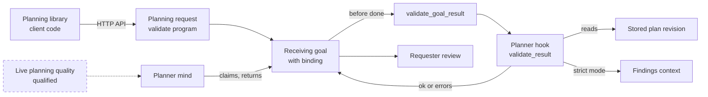

# Planner (omegaplanner)

> Status key: solid line = built; dashed line = intended, not finished. Code refs are to omegahive @ 34b0fb3 unless named.

**What this shows.** How the Planner plan checker plugs into the hive. It is a programs-contract app whose main job is a result-validation hook: the hive calls it before a planning goal can be done.

**Who should read it.** The Planner owner. Reviewers of `hive/core/goals.py` (result validation) and `hive/core/programs.py` (`validate_goal_result`).

## Diagram

## How it works

**It is a programs-contract app mounted from `program/`.** The folder holds `plugin.json` and a generated, dependency-free `program.py` for contract 0.1. It declares no capabilities and no person actions (`omegaplanner: README.md:79-87`; `omegaplanner: program/plugin.json`).

**The hive calls it through the goal binding.** A goal whose binding or request names `validate: program:<id>` gets that app's validator (`hive/core/goals.py:112-126`). Before such a goal can be done, the hive runs `validate_goal_result`, which calls the app's `validate_result(ctx, goal, proposal)` and refuses completion if the app has none (`hive/core/goals.py:144-150`; `hive/core/programs.py:1100-1108`).

**The hive hands it host records, not the worker's claims.** The context carries `ctx.validation` (goal, request, deadline, attempts), `ctx.artifact_revision` (the hive's stored revision) and `ctx.findings` (review findings), and records read guards so the host can recheck freshness (`hive/core/programs.py:1109-1168`).

**Homes come from the app.** It implements `home_swarms()` and advertises only the swarms in `OMEGAPLANNER_SWARMS`; with that unset it advertises none (`omegaplanner: README.md:39`; `omegaplanner: STATUS.md:28-31`; `hive/core/programs.py:484-489`).

**The planning library is not loaded by the hive.** It is client code a planner mind or harness uses against the Hive HTTP API (`omegaplanner: README.md:88-89`).

**Tier.** Open (Apache-2.0) (`docs/START_HERE.md:13`).

## Intended shape and upgrade path

- **Not a planner by itself.** It validates what a planner mind returns; it does not plan, dispatch or grant execution. Live planning quality is not qualified (`omegaplanner: STATUS.md`, "Limited or known broken").
- **Freshness.** Changes between reads are not guaranteed atomically; the host must recheck at admission, which the read guards support (`omegaplanner: STATUS.md`; `hive/core/programs.py:25-30`, `:1151-1159`).
- **Boards retired.** The earlier Boards candidate is retired and not installed (`omegaplanner: STATUS.md`).

## Seams and contracts

| Seam | Value | Where |
|---|---|---|
| App id | `omegaplanner` | `omegaplanner: program/plugin.json` |
| Mount folder | `program/`, not the repository root | `omegaplanner: README.md:38` |
| Request opt-in | `validate: program:omegaplanner`; strict mode `constraints.require_review_complete` | `omegaplanner: README.md:41-42`; `hive/core/goals.py:112-126` |
| Hook | `validate_result(ctx, goal, proposal)` returns `{ok: true}` or `{errors: [...]}` | `hive/core/programs.py:1100-1168` |
| Context | `ctx.validation`, `ctx.artifact_revision`, `ctx.findings` | `hive/core/programs.py:1115-1159` |
| Homes | `home_swarms()`, `OMEGAPLANNER_SWARMS` | `hive/core/programs.py:484-489` |

## For owners: how to plug in

1. Mount `program/` in `HIVE_PLUGIN_DIRS` and set `OMEGAPLANNER_SWARMS`.
2. Pin the `program/` folder with its source digest.
3. Requests opt in by naming the checker in `validate`.

**Keep stable:** the app id (requests name it), the `validate_result` signature and its `{ok}` / `{errors}` answer, and the context fields it reads.

## For reviewers: what to check

- A goal naming a validator cannot finish when the app is missing, failing or lacks the hook (`hive/core/goals.py:144-155`).
- The hook sees only host-stored revisions readable from the goal's swarm or its real request (`hive/core/programs.py:1134-1149`).
- Tests: `hive/tests/test_app_seams.py`, `hive/tests/test_planning_review_context.py`, `hive/tests/test_review_gate.py`; the app's own suite (`omegaplanner: README.md`, "Test").

## References

- `hive/core/goals.py:118-155`; `hive/core/programs.py:25-30`, `:484-489`, `:1100-1168`
- `omegaplanner` (74c2b35): `program/plugin.json`; `README.md:36-42`, `:79-89`; `STATUS.md`
- `docs/FEATURES.md:266`; `docs/COMPATIBILITY.md:23`
