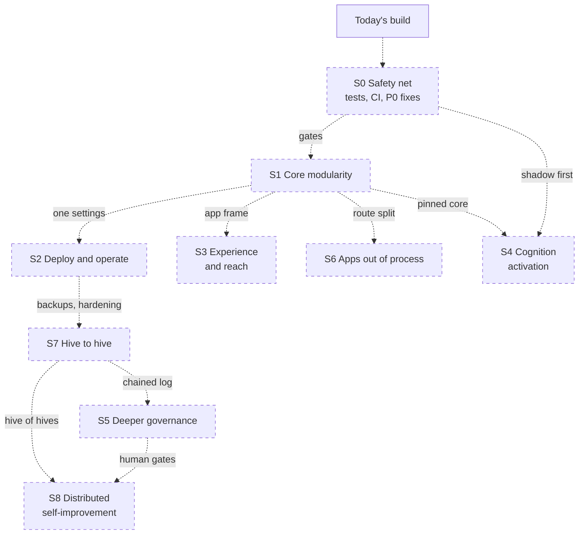
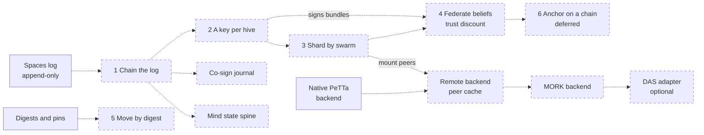
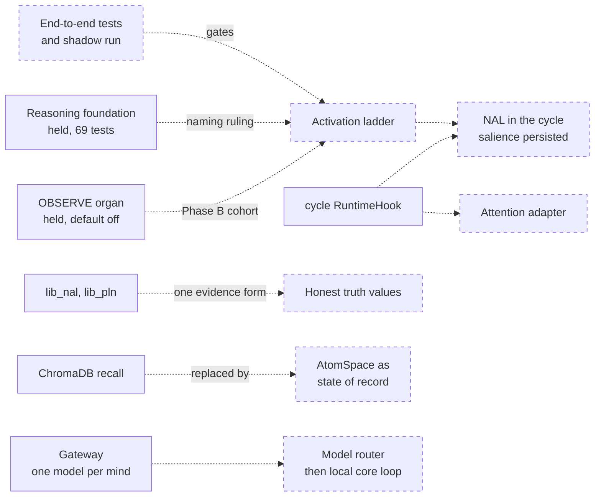

# Intended evolution of the platform
> Status key: solid line = built; dashed line = intended, not finished. Code refs are to omegahive @ 34b0fb3 unless named.

**What this shows.** The whole platform's intended upgrade path as nine ordered stages, with the dependencies between them. Each item names where its intent is written down. The grouping into stages and the cross-stage arrows are this page's reading of those documents; where an arrow is inferred rather than written, the tables say so.

**Who should read it.** Owners planning their piece's next step, so they can see what must land first. Reviewers judging whether a proposal skips a prerequisite. Leads setting priorities: this page orders the work but does not rule a schedule.

## Diagrams

Arrows on this page point from a prerequisite to what it unlocks.

### 1. The nine stages

### 2. Knowledge and federation track

### 3. Minds and cognition track

## How it works

**Today's build is the baseline.** One hive process owns one data folder, runs native minds as separate processes, keeps one MeTTa commons per swarm, and loads apps in process ([01-system-overview.md](../01-system/01-system-overview.md)). Everything on this page starts from that.

**The stages come from five written sources.** The improvement order in `docs/MODULARITY.md:60-68`; the known issues in `STATUS.md:63-78`; the held and V2-body capabilities in `docs/EARLIER_EXPERIMENTS.md:19-47`; the theory pages in `docs/theory/` (governance, ledger and DAS, language routing); and the "Intended shape" section of every finished page in this repo. None of these is a ruled schedule. The theory pages say so directly: "Theory grants no build authority" (`docs/theory/README.md:74`).

**S0 comes first because everything else changes shared code.** The hive has 2,414 passing tests and CI now runs and passes on GitHub (`.github/workflows/ci.yml:1-15`), but end-to-end testing across features is limited (`STATUS.md:15,74`). The house rule is that nothing is accepted or frozen without an end-to-end shadow run (`docs/theory/README.md:75`; `docs/theory/governance-and-gating.md:185-195`). Cognition activation in S4 depends on this directly.

**S1 is the written improvement order, unchanged.** `docs/MODULARITY.md:62-66` lists five steps in order and says none of them changes what users see (`docs/MODULARITY.md:68`). Several later stages lean on them: one settings module before a guided deploy, a pinned runtime before activating reasoning in it, the app frame before more custom UI.

**S4 has its own ladder.** The reasoning foundation and the OBSERVE organ are built, tested and held on purpose (`STATUS.md:49`). Each has a written route in: the naming ruling, then offline MeTTa, a scratch hive, two opt-in minds, and wider only with the project lead (`docs/EARLIER_EXPERIMENTS.md:23-24`). V2-body capabilities need adapters on existing seams (`docs/EARLIER_EXPERIMENTS.md:36-45`).

**S8 builds on S7 and S5.** A hive-of-hives flow needs hives that link (S7) and a human gate at every hop (S5). Its own page holds the design.

**S7 is six steps, each useful alone.** The ledger page orders them and says none requires the next (`docs/theory/ledger-provenance-and-das.md:118-136`). Step 1, chaining the spaces log, is also what co-sign in S5 and a mind's state spine in S4 need (`docs/theory/governance-and-gating.md:126`; `docs/EARLIER_EXPERIMENTS.md:43`).

## Intended shape and upgrade path

Each row is intended unless it says "built". "Depends on" names the stage or item that should land first; **(inferred)** marks a dependency this page reads into the sources rather than one they state.

### S0 Safety net

| Item | Today | Source | Depends on |
|---|---|---|---|
| First CI run, recorded | Done: runs and passes on GitHub Actions (omegahive PR #3) | `.github/workflows/ci.yml:1-15` | — |
| End-to-end tests across features | Limited; pieces lived together about a week | `STATUS.md:74` | — |
| A zero-authority shadow hive on a scratch data folder | Acceptance ladder L0 to L3 | `docs/theory/governance-and-gating.md:193-195` | — |
| Demo mode brought up to date | Fixed by the live demo fixes since the handover snapshot (omegahive pull requests `port/demo-mode-fix`, `port/surface-followups-r4`) | `STATUS.md:77` (as handed over) | — |
| P0 findings fixed or ruled | Open | 03-hardening-for-launch.md (in the private omegahive-security repo; ask Kabir) | — |

### S1 Core modularity (written order)

| Item | Today | Source | Depends on |
|---|---|---|---|
| 1. Split `app.py` into route modules, each calling one visibility layer | About 3,400 lines of routes in one file | `docs/MODULARITY.md:40-44,62` | S0 |
| 2. OmegaClaw Core as a pinned dependency | Vendored copy; fixes carried by hand | `docs/MODULARITY.md:45-48,63` | S0 |
| 3. Apps serve their own screens through the frame; then the design canvas leaves the platform UI | Frame built; one Studio form still compiled in | `docs/MODULARITY.md:49-53,64` | S0 |
| 4. Evolve and Commons Explorer as normal apps | Built into this repo | `docs/MODULARITY.md:58,65` | S1.3 (inferred) |
| 5. One settings module, every `HIVE_*` setting listed with default and validation | 93 settings read across modules | `docs/MODULARITY.md:54-57,66` | S0 |

### S2 Deploy and operate

| Item | Today | Source | Depends on |
|---|---|---|---|
| One-step "deploy app into swarm" that checks pin, swarm, home and grants agree | Set in separate places, no agreement check | `STATUS.md:67` | S1.5 (inferred) |
| First-time deployer for a single mind | Compatibility exists, no guided flow | `STATUS.md:68` | S1.2 (inferred) |
| Local deploy as its own app | Runs through the web interface | `STATUS.md:69` | S1.4 (inferred) |
| Mind sandbox always on; Docker driver hardened | Opt-in; host networking, no hardening flags | `STATUS.md:54-55`; `docs/theory/governance-and-gating.md:226-227` | S0 |
| Backups, metrics and tracing as platform features | Manual stop-then-copy backup | `docs/omegadots/PLAN.md:809`; `deploy/RUNBOOK.md:193` | — |
| Control-plane store from SQLite to Postgres | SQLite, schemas grown in place | `docs/omegadots/PLAN.md:113` | Migrations (K22, inferred) |
| More substrates as drivers (cloud supervisor, Kubernetes, VMs) | Local and Docker only | `docs/omegadots/PLAN.md:806`; `hive/supervisor/drivers.py:5-6` | Driver hardening (inferred) |

### S3 Experience and reach

| Item | Today | Source | Depends on |
|---|---|---|---|
| Full custom "any UI" finished and tested | Mostly finished, untested | `STATUS.md:72` | S1.3 (inferred) |
| Experiences built by a mind from a description | Panel says "coming next" | `hive/ui/src/features/requestExperience/RequestPanel.tsx:13` | Any UI (inferred) |
| Hive, folder and screen organisation; infinite hives | Scoped, partly built | `STATUS.md:75` | — |
| Computer use, browser use, draw on screen, vibe coding on Linux | Tested on macOS hosts only; none fully implemented | `STATUS.md:70` | S2 sandbox (inferred) |
| The Ask reading hive memory (`/api/me/recall`), "about this swarm", `see_view` | Not built | `docs/STATUS.md:60` | — |
| Browser-Iter personal mind; hive view as galaxies | Plans cleared review, wait for the owner | `docs/STATUS.md:59` | — |
| Modules and add-ons ported to this hive | Many untested against it | `STATUS.md:76` | S1.2 (inferred) |

### S4 Cognition activation

| Item | Today | Source | Depends on |
|---|---|---|---|
| Reasoning foundation through the activation ladder | Held; 69 passed, gate passed | `docs/EARLIER_EXPERIMENTS.md:23`; `STATUS.md:49,73` | S0 e2e and shadow; naming ruling |
| OBSERVE organ, Phase B: shared gates, telemetry, two-mind cohort | Held, default off; 64 passed | `docs/EARLIER_EXPERIMENTS.md:24` | S0 |
| NAL inside the autonomous cycle, on the `cycle` RuntimeHook | Built in the V2 body; needs an adapter | `docs/EARLIER_EXPERIMENTS.md:36`; `src/loop.metta:142` | Ladder; salience persisted first |
| Native attention bank behind `lib_omegaclaw_attention.metta` | Heuristic classifier | `docs/EARLIER_EXPERIMENTS.md:42`; `STATUS.md:51` | A utility gate (ECAN spreading is a qualified negative) |
| Honest truth values: one evidence-count form | Plan cleared review, waits for the owner | `docs/reasoning-deviations.md:93-96`; `docs/STATUS.md:59` | Reasoning domain author |
| Standalone PLN as a library swap | Compatible in principle; changes truth semantics | `docs/EARLIER_EXPERIMENTS.md:54` | PLN author first |
| AtomSpace as the state of record | ChromaDB beside the AtomSpace | `docs/EARLIER_EXPERIMENTS.md:38` | A journal; S7.1 (inferred) |
| Model router; later a local core loop | One fixed model per mind | `docs/theory/language-routing-reasoning.md:40-62` | A hard borrow ceiling (`:64-66`) |
| Predictive-coding organ (Assume) for hive minds | Optional, not enabled; FabricPC unpinned | `docs/EARLIER_EXPERIMENTS.md:26` | Pin FabricPC; fix the failing smoke |

### S5 Deeper governance

The order and seams are on [05-intended-governance.md](../05-governance/05-intended-governance.md); this page does not repeat them. In short: a bound record for every ask, then reach rules and reach leases, then co-sign with a per-skill quorum, then a gravity advisor, then one consent object and the candidate rung (`docs/theory/governance-and-gating.md:72,80,93,130,154,177`). Co-sign needs the hash-chained journal (`docs/theory/governance-and-gating.md:126`), so it follows S7 step 1. Owner-visible access receipts on admin audit belong here too (`docs/theory/governance-and-gating.md:166`).

### S6 Apps out of process

| Item | Today | Source | Depends on |
|---|---|---|---|
| Contract v0.2 later items: deltas, program-owned tasks, rendering hints | 0.1 frozen; additive 0.2 actor and receipts built | `hive/PROGRAMS.md:8-10,42`; `docs/COMPATIBILITY.md:10` | — |
| Out-of-process apps as the security boundary | Apps import into the hive; boundary is code review | `hive/PROGRAMS.md:240-244`; `docs/FEATURES.md:216` | S1.1, S1.5 (inferred) |
| Pins required for every app | Off by default | `hive/PROGRAMS.md:225-230` | Every mounted app pinned |
| App store | No store code | `docs/FEATURES.md:215` | Out-of-process apps (inferred) |

### S7 Hive to hive

| Step | Today | Source |
|---|---|---|
| 1. Chain the spaces log, publish a per-swarm head | Append-only, not chained | `docs/theory/ledger-provenance-and-das.md:118-119` |
| 2. A key per hive; sign pin sets, heads, bundles, receipts | None | `ledger-provenance-and-das.md:120-122` |
| 3. Shard by swarm: one writer under a lease, read replicas elsewhere | One hive owns every swarm it holds | `ledger-provenance-and-das.md:123-125` |
| 4. Federate stamped beliefs; discount by earned trust | Not built | `ledger-provenance-and-das.md:126-127`; `docs/omegadots/PLAN.md:348-363` |
| 5. Move assets, exhibits and releases by digest | Digests exist | `ledger-provenance-and-das.md:128-129` |
| 6. Anchor signed heads on a chain | Deliberately deferred | `ledger-provenance-and-das.md:100-111,130-134` |
| Backends: native, remote, MORK, optional DAS | Native only; MORK never built or run | `docs/omegadots/PLAN.md:285-291`; `docs/EARLIER_EXPERIMENTS.md:82` |
| Phase 4 acceptance: two hives on two hosts, trust-discounted revision, provenance visible across hives | Not run | `docs/omegadots/PLAN.md:795-802` |
| Each person's hive as a node of a shared hive | The owner's direction; no reviewed plan | `docs/STATUS.md:60`; `docs/FEATURES.md:143` |

### S8 Distributed self-improvement

The owner's hive-of-hives evolve flow: opt-in, tiered re-evaluation, a human gate at every hop, release through the core repo, and upgrades offered to every mind rather than pushed. Its content is on its own page, [04-distributed-self-improvement.md](04-distributed-self-improvement.md), with the theory in `docs/theory/distributed-self-improvement.md`; this page only places it. Both arrows into S8 in diagram 1 (from S7 and S5) are **(inferred)** from that summary; the S8 page governs.

## Seams and contracts

Each stage changes one or more swap seams. The seam contracts, their conformance tests and what must not break are on [02-swap-seams.md](02-swap-seams.md).

| Stage | Seams it touches |
|---|---|
| S1 | Route guards and visibility (`hive/core/app.py:274-316`); the vendored runtime (`src/`, `modules/`, `lib_*.metta`); the app frame (`hive/PROGRAMS.md:498-569`); settings (`hive/core/config.py`) |
| S2 | Driver interface (`hive/supervisor/drivers.py:62-80`); sandbox wrap (`hive/supervisor/sandbox.py:53-69`); app pins and homes (`hive/core/programs.py:491-652`) |
| S3 | Experience registry and SDK (`hive/ui/src/experiences/registry.ts`, `sdk.ts`); Ask routes (`hive/core/app.py:1554-1790`) |
| S4 | Runtime hooks (`src/skills_reasoning_spaces.metta:24-61`); reasoning libraries; memory (`src/memory.metta:57-113`); gateway |
| S5 | `Policy.decide`, `Policy.authorize` (`hive/core/policy.py:181,237`); `Services.redeem` (`hive/core/services.py:363-380`) |
| S6 | Programs contract (`hive/PROGRAMS.md`; `hive/core/programs.py`) |
| S7 | `SpaceService` (`hive/spaces/service.py:104-264`); the spaces log; member routes (`hive/core/app.py:2238-2256`) |
| S8 | See [04-distributed-self-improvement.md](04-distributed-self-improvement.md) |

## For reviewers: what to check

- **Intended is never presented as built.** Every row above except those marked "built" or "held" is intent. A proposal that says otherwise must cite code and a test.
- **No stage skips its gate.** A change that activates reasoning, OBSERVE or child minds without the written ladder and an end-to-end shadow run is blocking (`docs/EARLIER_EXPERIMENTS.md:23-24`; `docs/theory/README.md:75`).
- **Truth semantics change only through their author.** Honest truth values and a PLN swap both change the commons' revision maths, because `lib_hive.metta` uses the same truth functions (`CONTRIBUTING.md:25-26`; `docs/EARLIER_EXPERIMENTS.md:54`).
- **"Federated" needs step 3 or 4 and a two-host test.** See [04-federation.md](../04-knowledge/04-federation.md).
- **Inferred dependencies are open to challenge.** If the owner of a stage disagrees with an "(inferred)" arrow, the owner's reading wins; update this page.

## References

- `STATUS.md:15,49-56,60,63-78`
- `docs/STATUS.md:46-61`
- `docs/MODULARITY.md:40-68`
- `docs/EARLIER_EXPERIMENTS.md:19-54,77-96`
- `docs/theory/README.md:72-78`
- `docs/theory/governance-and-gating.md:70-211,224-228`
- `docs/theory/ledger-provenance-and-das.md:84-136`
- `docs/theory/language-routing-reasoning.md:40-66`
- `docs/omegadots/PLAN.md:113,253-292,348-363,789-813`
- `docs/reasoning-deviations.md:93-96`
- `docs/FEATURES.md:143,215-216`
- `hive/PROGRAMS.md:8-10,36-42,218-246`
- `docs/COMPATIBILITY.md:1-12`
- `.github/workflows/ci.yml:1-13`
- `CONTRIBUTING.md:18-32`
- `src/loop.metta:142`
- `hive/ui/src/features/requestExperience/RequestPanel.tsx:13`
