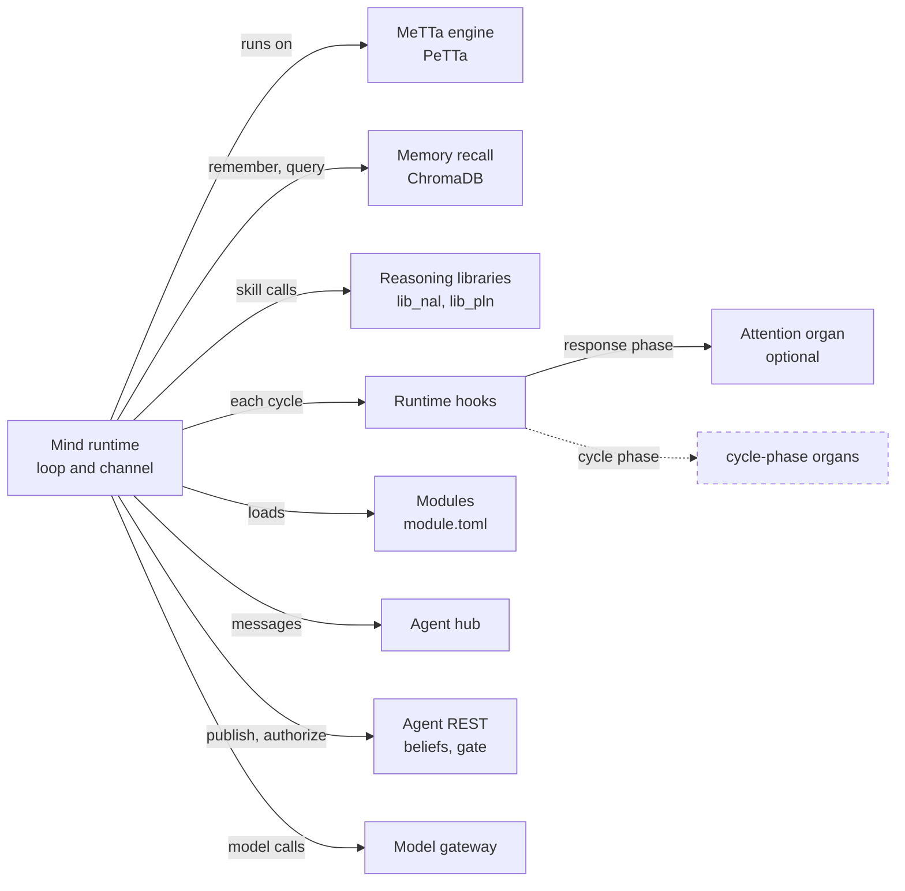
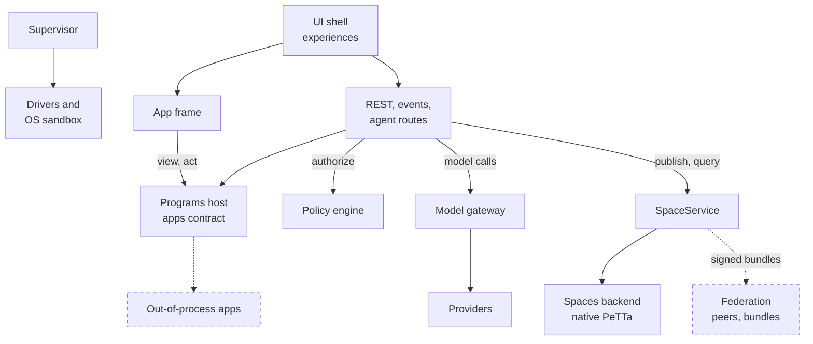
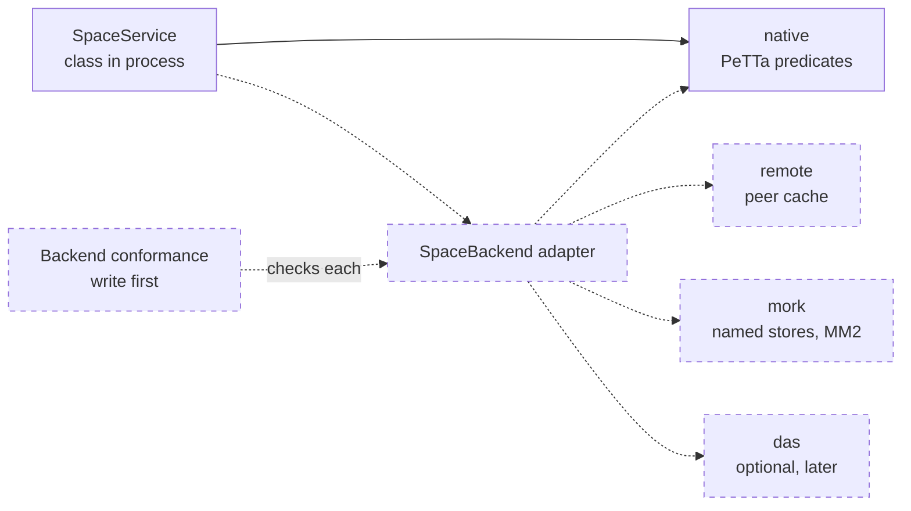

# Swap seams: where your own tech plugs in
> Status key: solid line = built; dashed line = intended, not finished. Code refs are to omegahive @ 34b0fb3 unless named.

**What this shows.** The twelve places where a team can replace a whole component with its own module: the mind runtime, the MeTTa engine, the spaces backend, memory recall, the reasoning libraries, attention, the model gateway, the policy engine, the sandbox and drivers, the apps contract, federation and the UI shell. For each one: the contract you must meet, the test that proves you met it (or "write first"), candidate replacements from the SingularityNET stack as options, and what must not break.

**Who should read it.** Owners deciding whether to keep a component or swap in their own. Reviewers checking that a swap keeps the guarantees the rest of the platform relies on.

## Diagrams

### 1. Seams inside a mind

### 2. Seams inside the hive

### 3. The spaces backend, in its intended order

## How it works

**A seam is a contract plus a test.** A replacement is acceptable when it meets the contract below and passes the conformance test without changing the test. Where no such test exists, the row says **write first**: write the test against today's component, see it pass, and only then swap.

**Candidate replacements are options, not decisions.** Each row lists parts of the SingularityNET and Hyperon stack that could fill the seam. Where a repo document has assessed the option, the row cites it. "Not assessed here" means no document in this repo evaluates it; treat it as a lead, not a claim. Keep-or-swap is the owner's decision.

**Some seams have no interface today.** The spaces backend has no adapter class: `SpaceService` talks to PeTTa directly (`hive/spaces/service.py:104-112`). The `SpaceBackend` adapter is written in the plan only (`docs/omegadots/PLAN.md:285-291`). Apps have no out-of-process transport (`hive/PROGRAMS.md:240-244`). Federation has no routes (`docs/omegadots/PLAN.md:348-363`). For these, the first step of a swap is to cut the seam, with no change in behaviour.

**The cheapest swap for a whole mind is the external-member path.** Any runtime that speaks the agent API over MCP or HTTP joins a swarm through the same policy gate, without being started by the hive (`hive/core/mcp.py:1-12`; `hive/JOINING.md:3-5`). Use it to trial a runtime before making it a native mind kind.

## Intended shape and upgrade path

The twelve seams follow. Each "Must not break" list links to [02-invariants.md](../08-reviewers/02-invariants.md) by id.

### 1. The mind runtime

| | |
|---|---|
| **Contract** | Workspace with `run.metta` that imports `lib_omegaclaw` then runs `!(omegaclaw)` (`hive/supervisor/workspace.py:1-11,24-28`). Environment from the supervisor: `HIVE_WS_URL`, `HIVE_WS_TOKEN`, `HIVE_API_URL`, `HIVE_AGENT_ID`, `HIVE_LLM_URL`, `OMEGACLAW_MEMORY_DIR` and others (`hive/supervisor/workspace.py:221-256`). Hub frames `resume`, `user_message`, `agent_message`, `ack` (`modules/channel_hive/src/hive_channel.py:18-30`; `hive/core/app.py:2042-2057`). REST `POST /api/agent/publish`, `/query`, `/authorize`, `GET /api/agent/belief` (`hive/core/app.py:2238-2256,2679-2683`). Mind kinds `omega`, `iter`, `module` (`hive/core/hive.py:39`). Details: [01-mind-runtime.md](../03-minds/01-mind-runtime.md). |
| **Conformance test** | Hub behaviour: `hive/tests/test_core_api.py::test_hub_delivers_replays_and_records_replies`, `::test_hub_refuses_a_stopped_mind_and_keeps_it_stopped`; `hive/tests/test_stop_reconcile_race.py`; `hive/tests/test_channel_launch.py`; channel side `tests/test_channel_hive.py`. Member path: `hive/tests/test_mcp_api.py`, `hive/tests/test_mcp_s3.py`. **Write first:** one black-box runtime suite that drives any runtime through connect, resume, reply, publish, query, authorize, a model call and stop. Today these checks are spread across files written for the OmegaClaw runtime. |
| **Candidates** | A Hyperon agent loop on the reference MeTTa interpreter (not assessed here). The V2 body (closed `omegav2`): its organs need adapters, not a port (`docs/EARLIER_EXPERIMENTS.md:32-47`). Any runtime as an external member first. |
| **Must not break** | I-M1 stop wins, I-M2 fail closed on the gate, I-M3 no hive secrets in the mind's environment, I-M5 personal minds never woken by a personal Ask. Known gap: the native loop's local skip list (K10). |

### 2. The MeTTa engine

| | |
|---|---|
| **Contract** | Two uses. **Shared spaces:** one process-wide PeTTa through janus, on one worker thread; `SpaceService.run(code, timeout)` is the only entry (`hive/spaces/service.py:1-8,52-60,113`). Agent text is spliced only after `safe_statement`, `safe_pattern` or `safe_symbol` (`hive/spaces/sexpr.py:130-143`). **Each mind:** PeTTa runs the mind's `run.metta`. Pinned toolchain: PeTTa `ae66fa8`, SWI-Prolog 10.1.14, janus-swi 1.5.3 (`STATUS.md:10-11`; `.github/workflows/ci.yml:22-25`). The browser runs the same libraries in MeTTaScript (`docs/EARLIER_EXPERIMENTS.md:27`). |
| **Conformance test** | `tests/hive_lib_smoke.metta`, `tests/reasoning_space_smoke.metta`, `tests/space_registry_smoke.metta` and the rest of `tests/*_smoke.metta`, run by `tests/run_metta_smokes.py`; `docs/probes/nal_pln_reference_probe.metta` against its `.out`. The MeTTaScript parity receipt (86 cases, 0 mismatches) was a one-off run. **Write first:** the live conformance runner shared by every engine, which the source names as the next step (`docs/EARLIER_EXPERIMENTS.md:27`). |
| **Candidates** | A newer PeTTa (ruled the official AtomSpace implementation in the V2 programme, `docs/EARLIER_EXPERIMENTS.md:38`). The Hyperon reference interpreter (not assessed here). MeTTaScript, already used in the browser. |
| **Must not break** | I-K1 one interpreter thread, I-K2 nothing raw reaches MeTTa, I-R1 truth semantics, I-K6 and I-M7 load order. Watch: the Docker image builds a different toolchain (K29). |

### 3. The spaces backend (native, then MORK, then DAS)

| | |
|---|---|
| **Contract** | The `SpaceService` methods `grant`, `revoke`, `is_member`, `add_vocab`, `vocab`, `publish`, `beliefs`, `belief`, `query` (`hive/spaces/service.py:153-264`). Every mutation is logged and replayed through `_apply_<op>` (`hive/spaces/service.py:125-137`). Atom shapes `Current`, `Asserted`, `Chosen`, `Quarantined`, `Grant`, `Term` (`hive/spaces/lib_hive.metta:49-133`). Details: [01-metta-and-atomspace.md](../04-knowledge/01-metta-and-atomspace.md), [02-beliefs-sharing.md](../04-knowledge/02-beliefs-sharing.md). |
| **Conformance test** | `tests/hive_lib_smoke.metta` (ACL, quarantine, stamps, echo, revision); `hive/tests/test_acceptance.py::test_three_omegas_share_revise_and_survive_restart`; `hive/tests/test_core_api.py:168,211` and `hive/tests/test_drift_guards.py` (no self-inflation). **Write first:** a backend-neutral suite against the intended `SpaceBackend` adapter, so native, remote, MORK and DAS each run the same cases. |
| **Candidates** | In the written order (`docs/omegadots/PLAN.md:285-291`; `docs/theory/ledger-provenance-and-das.md:90-91`): **remote**, a peer cache over another hive's API, in phase 4. **MORK**, named stores plus MM2 rules for batch revision, in phase 5; never built or run here, evaluated from source only, and its speed-up figure is upstream's own (`docs/EARLIER_EXPERIMENTS.md:82`). **DAS**, an optional adapter to its command-router API; between hives only, because it has no PeTTa bridge and inside one mind it would break the single-writer rule (`docs/theory/ledger-provenance-and-das.md:105-107`). |
| **Must not break** | I-K3 stamp-disjoint revision, no self-inflation; I-K4 restart survival; I-K5 own-swarm query scope; one writer per commons (`docs/theory/ledger-provenance-and-das.md:123-125`). Known gaps: quarantine unreachable and unlogged (K3, K4); two non-atomic belief writes (K21). |

### 4. Memory recall

| | |
|---|---|
| **Contract** | **In a mind:** the MeTTa functions `(remember $str)`, `(query $str)`, `(embed $str)`, `(input-recall ...)` (`src/memory.metta:57-113`), with recall caps set in `initMemory` (`src/memory.metta:16-37`). They call `src/helper_recall.py:266-314`, which queries the ChromaDB library (`lib_omegaclaw_core.metta:37-38`), linked into each workspace (`hive/supervisor/workspace.py:73-85`). Hive embedder: `HIVE_EMBEDDING_MODEL`, default `mock/hash` (`hive/core/config.py:168`). **For a person:** the browser `Recaller` interface, built so a MeTTa memory core can replace the lexical recaller (`hive/ui/src/lib/askMemory/recall.ts:1-12`). |
| **Conformance test** | `tests/test_memory_runtime.py`, `tests/test_memory_safety.py`, `tests/structured_memory_contract_guard_smoke.metta`, `tests/multi_instance_memory_smoke.metta`; browser side `hive/tests/test_ask_memory.py` and the UI suite. **Write first:** a recall-quality benchmark. The V2 linked recall passed 14/14 offline checks, but real-model quality is unknown (`docs/EARLIER_EXPERIMENTS.md:40`). |
| **Candidates** | AtomSpace as the state of record, from the V2 body; it needs a journal this repo lacks (`docs/EARLIER_EXPERIMENTS.md:38`). Atom, vector and history recall linked, from V2 (`docs/EARLIER_EXPERIMENTS.md:40`). A MORK- or DAS-backed index (not assessed here). |
| **Must not break** | I-P1 personal memory stays in the browser, I-P2 forgotten items are never recalled, I-S6 nothing a mind did is deleted, I-P3 private app names never reach a model. |

### 5. The reasoning libraries

| | |
|---|---|
| **Contract** | `lib_nal.metta` and `lib_pln.metta`, loaded in a fixed order (`lib_omegaclaw_core.metta:12-14`). Skill shapes `nal-step`, `pln-step`, `nars-query`, `nars-derive` returning prefixed strings (`src/skills_reasoning_spaces.metta:1-19`). Truth values `(stv f c)` (`lib_nal.metta:101`). The commons' revision uses the same truth functions. Deviations from the references are listed in `docs/reasoning-deviations.md`. Details: [03-reasoning.md](../04-knowledge/03-reasoning.md). |
| **Conformance test** | `docs/probes/nal_pln_reference_probe.metta` and its `.out`; `tests/reasoning_space_smoke.metta`, `tests/nars_assimilation_smoke.metta`, `tests/hive_lib_smoke.metta`. |
| **Candidates** | Standalone PLN v0.9 (trueagi-io/PLN), which passes on pinned PeTTa. It is "compatible as a library swap" but changes truth semantics, so it goes to the PLN author first (`docs/EARLIER_EXPERIMENTS.md:54`). Pressure-field PLN is a donor of ideas, not a port (`docs/theory/hyperon-alignment-and-peer-work.md:62-64`). |
| **Must not break** | I-R1 truth semantics only with the domain author, I-R2 no duplicate truth definitions, I-R3 nothing activates by accident. Also the browser's MeTTaScript parity. |

### 6. Attention

| | |
|---|---|
| **Contract** | An optional organ, `lib_omegaclaw_attention.metta`, which loads `src/attention_ledger.py`, registers an `attention` space and a trusted `response`-phase runtime hook (`lib_omegaclaw_attention.metta:1-17`). Hooks run from the loop at `cycle` and `response` (`src/loop.metta:142,180`); they are registered with `register-runtime-hook` and trusted with `trust-runtime-hook` (`src/skills_reasoning_spaces.metta:24-61`). The commons has no attention today; ECAN-lite `hive-attend!`, `hive-rent!`, `hive-forget!` are planned (`docs/omegadots/PLAN.md:275-278`). |
| **Conformance test** | `tests/attention_ledger_smoke.metta`, `tests/attention_spin_counter_smoke.metta`, `tests/attention_spin_hook_smoke.metta`, `tests/test_attention_ledger.py`, `tests/test_syntax_attention_smoke.py`. **Write first:** a test that attention output never reaches a decision path. |
| **Candidates** | `metta-attention`, planned to replace ECAN-lite in phase 4 "if its API has stabilised" (`docs/omegadots/PLAN.md:799`). The DAS Attention Broker, named as a source for per-context attention (`docs/omegadots/PLAN.md:83`). The V2 native attention bank, with an adapter behind this organ; raw ECAN spreading cut focus precision and needed a utility gate (`docs/EARLIER_EXPERIMENTS.md:42`). |
| **Must not break** | I-R4 attention never decides: it may rank and propose, never confer truth, consent or authority (`docs/theory/cognition-attention-importance.md:85-88`). |

### 7. The model gateway

| | |
|---|---|
| **Contract** | OpenAI-compatible `POST /llm/v1/chat/completions` and `/llm/v1/embeddings` with the mind's token (`hive/core/app.py:2063-2200`). Model strings are `<provider>/<model>`. A provider record is `name`, `base_url`, `key_env`, `local`, `prices`, `models`, `media` (`hive/core/config.py:16-42`), added through `HIVE_PROVIDERS_FILE` (`hive/core/config.py:121-131`). In the mind, a `Hive` provider points at the gateway (`lib_llm_ext.py:289-290`). Details: [05-models-and-gateway.md](../03-minds/05-models-and-gateway.md). |
| **Conformance test** | `hive/tests/test_cost_reservations.py`, `hive/tests/test_drift_guards.py`, `hive/tests/test_budget_review_fixes.py`, `hive/tests/test_local_only_egress.py`, `hive/tests/test_providers_api.py`; mind side `tests/test_llm_provider.py`, `tests/llm_portability_contract_guard_smoke.metta`. |
| **Candidates** | A local model server through `HIVE_LOCAL_LLM_URL` (built, `hive/core/config.py:60-61,128-130`). SingularityNET AI services behind a provider adapter (not assessed here; each must declare prices or it is refused as unpriced). The model router and a local core loop (`docs/theory/language-routing-reasoning.md:40-62`). |
| **Must not break** | I-G1 worst case is a true bound, I-G2 holds see each other, I-G3 keys never reach a mind, I-V6 local-only swarms, I-G4 nothing raises after the provider answers. Known gaps: K12, K25, K31. |

### 8. The policy engine

| | |
|---|---|
| **Contract** | `Policy.decide(agent, skill)`, `Policy.authorize(agent, command)`, `Policy.enforce(agent, skill, command)`, `Policy.decide_approval(...)` (`hive/core/policy.py:181,237,290,381`). Mind route `POST /api/agent/authorize {command}` returns allow, deny or pending (`hive/core/app.py:2679-2683`). Rules are data: scope `hive`, `swarm:<id>` or `agent:<id>`, mode allow, ask or deny (`hive/core/policy.py:132-146`). Details: [01-permissions-and-policy.md](../05-governance/01-permissions-and-policy.md). |
| **Conformance test** | `hive/tests/test_five_way_decisions.py`, `hive/tests/test_policy_hive_skills.py`, `hive/tests/test_sensitive_action_revalidation.py`, `hive/tests/test_services_api.py`, `hive/tests/test_program_actions.py`. **Write first:** tests that pin the native local skip list and the guard on the policy write routes (K10, K11). |
| **Candidates** | Rules held as MeTTa atoms and decided in PeTTa (not assessed here; governance evidence must still never decide). The V2 capability membrane and reach classifier, entering at `Policy.decide` and `Policy.authorize` ([05-intended-governance.md](../05-governance/05-intended-governance.md)). |
| **Must not break** | I-A1 most restrictive wins, I-A2 no glob widening, I-A3 exact only for risky actions, I-A5 evidence never mints authority. Known gaps: K10, K11, K30. |

### 9. The sandbox and drivers

| | |
|---|---|
| **Contract** | `Driver` with `start(agent, env)`, `stop(agent_id)`, `status(agent_id)`, `logs(agent_id, tail)`, `execution(agent_id)`, and optional `verify_stopped` (`hive/supervisor/drivers.py:62-80,552-567`). Refuse with `StartRefused(reason)` (`hive/supervisor/drivers.py:31-33`). Register in the driver map (`hive/supervisor/drivers.py:359-362`). Sandbox `wrap(command, mind_dir, read_roots, profile_dir, agent_id, ports)` (`hive/supervisor/sandbox.py:53-69`). Details: [02-supervisor-drivers-sandbox.md](../03-minds/02-supervisor-drivers-sandbox.md), [04-isolation.md](../05-governance/04-isolation.md). |
| **Conformance test** | `hive/tests/test_mind_sandbox.py`, `hive/tests/test_mind_sandbox_linux.py`, `hive/tests/test_mind_url.py`, `hive/tests/test_local_driver_adopt.py`, `hive/tests/test_docker_driver.py`, `hive/tests/test_docker_driver_stop.py`, `hive/tests/test_agent_driver.py`, `hive/tests/test_stop_reconcile_race.py`. **Write first:** one driver suite that runs every registered driver through the same start, status, stop and verify-stopped cases. |
| **Candidates** | The planned cloud supervisor driver (`docs/omegadots/PLAN.md:806`); Kubernetes or VMs (`hive/supervisor/drivers.py:5-6`). Decentralised compute from the SingularityNET ecosystem, such as NuNet, as a driver (not assessed here). |
| **Must not break** | I-M1 stop wins, I-M3 no secrets reach a mind, I-I1 sandbox requested means enforced, I-M4 delete only over a confirmed stop. Known gaps: K16, K26, K14. |

### 10. The apps contract, v0.2 out of process

| | |
|---|---|
| **Contract** | `plugin.json` plus `describe()`, `view(ctx, focus, stage)`, `act(ctx, action, items, params)` and optional `read()` (`hive/PROGRAMS.md:72-160`; `hive/core/programs.py:654-719,1227-1315`). 0.1 is frozen; changes come as 0.2 and later (`hive/PROGRAMS.md:8-10`). The intended v0.2 adds deltas, program-owned tasks and out-of-process programs (`hive/PROGRAMS.md:42`). Details: [01-programs-contract.md](../06-apps/01-programs-contract.md). |
| **Conformance test** | The standalone checker `python -m hive.programs_check <dir>` (`hive/programs_check.py`); the public fixture `hive/plugins/contract_fixture/`; `hive/tests/test_programs_api.py`, `hive/tests/test_program_actions.py`, `hive/tests/test_program_confirm.py`, `hive/tests/fixtures/confirm_digest_vectors.json`. Known gap: the checker does not check the id format or capability names (`hive/programs_check.py:38-59,87-98`). **Write first:** an out-of-process transport spec, then run the fixture over it. |
| **Candidates** | SingularityNET AI services exposed as programs through an out-of-process adapter (not assessed here). MeTTa-native programs whose `view` and `act` are computed in MeTTa (not assessed here). |
| **Must not break** | I-AP1 no default allow for minds, I-AP2 identity comes from the hive, I-AP3 confirm binds the exact payload, I-AP4 pins hold. The contract is plain JSON and depends on no truth calculus (`hive/PROGRAMS.md:11-12`). |

### 11. Federation

| | |
|---|---|
| **Contract** | Built: member routes, the agent hub, MCP, invites and mind moves (`hive/core/app.py:629-675,1872-1893,2017,2238-2256`). Designed only: `POST /federation/peers`, `POST /federation/bundles`, `POST /spaces/{swarm}/promote`, `WS /spaces/{space}/subscribe`, and atoms `(Peer hive url (trust t))` (`docs/omegadots/PLAN.md:253-292,348-363`). Details: [04-federation.md](../04-knowledge/04-federation.md). |
| **Conformance test** | `hive/tests/test_placement.py`, `hive/tests/test_mcp_api.py`, `hive/tests/test_shares_api.py`. **Write first:** the phase 4 acceptance: two hives on different hosts; a conflicting belief from the other hive is discounted by trust and revised; its provenance is visible across hives (`docs/omegadots/PLAN.md:795-802`). |
| **Candidates** | DAS, after its `RemoteAtomDB` and `AuthorizationManifest` patterns (`docs/theory/ledger-provenance-and-das.md:86-91`). ASI:Chain to anchor signed heads, deliberately deferred; the chain orders and commits, never authorises (`docs/theory/ledger-provenance-and-das.md:100-111`). The Agentverse module for agent identity and discovery, already built and optional (`docs/theory/ledger-provenance-and-das.md:57-59`; `modules/agentverse`). |
| **Must not break** | I-K5 own-swarm scope until federation is built, I-K3 stamps across hives, I-F1 moves keep identity and hashes. |

### 12. The UI shell

| | |
|---|---|
| **Contract** | The whole REST and live-event API is open to any client (`hive/API.md`). Inside the platform UI, an experience is an `ExperienceDef` in the registry with its chrome and navigation (`hive/ui/src/experiences/registry.ts:10-28,153-175`), and reaches data only through `hive/ui/src/experiences/sdk.ts:1-5`. Apps draw in the sandboxed frame (`hive/PROGRAMS.md:498-569`). Looks are data (`hive/ui/src/shell/uiVariant.ts:23-38`). Details: [02-ui-experiences-and-looks.md](../02-ask-and-ui/02-ui-experiences-and-looks.md), [03-app-frame-bridge.md](../02-ask-and-ui/03-app-frame-bridge.md). |
| **Conformance test** | `hive/ui/src/experiences/ask.test.ts`, `coverage.test.ts`, `askSkins.test.ts`; `hive/ui/src/lib/appFrame.browser.test.ts`; `hive/tests/test_ui_prefs.py`. Known friction: a new experience still edits four shared lists (K9). |
| **Candidates** | A separate shell on the open API. Per-app screens through the frame (`docs/MODULARITY.md:64`). No SingularityNET-specific option is assessed here. |
| **Must not break** | I-U1 every experience has the Ask and reaches every feature, I-U2 no direct network calls, I-U3 frame CSP first and opaque origin. Visibility is enforced on the host, so no shell can widen what a person sees (I-V1). |

## Seams and contracts

The contract rows above are the seams. Three rules apply to every swap:

1. **Keep the wire shape.** Minds, members and apps already depend on the routes and frames above. A swap behind them must not change them. If it must, version it, as the apps contract does (`hive/PROGRAMS.md:8-10`).
2. **Keep the tests unchanged.** A swap that edits a conformance test to pass is not a swap. Add tests; do not loosen them. A green suite proves only what its default invocation runs, so name the command you ran.
3. **Settings go in one place.** New settings for a replacement go to one settings module with a default and validation (`docs/MODULARITY.md:57,66`).

## For owners: how to plug in

1. **Pick the seam** above and read its detail page.
2. **Write the missing conformance test first** if the row says so. Run it against today's component; it must pass.
3. **Cut the seam if it has no interface** (spaces backend, out-of-process apps, federation), as a change with no behaviour difference. Review it on its own.
4. **Build the replacement behind the seam**, selected by one setting, with today's component as the default.
5. **Run the conformance test and the area's suite** on both. For core plumbing (auth, spaces, gateway, supervisor, policy), run the full `hive/tests` with a working PeTTa (`CONTRIBUTING.md:20-22`).
6. **Shadow it** on a scratch data folder before any live use (`docs/theory/governance-and-gating.md:185-195`).
7. **Get two independent reviews**, plus the reasoning domain author for any truth-function change (`CONTRIBUTING.md:25-32`).

## For reviewers: what to check

- **The conformance test did not change** in the same change as the swap, except to add cases.
- **The default did not change.** A new backend, driver or engine ships off, selected by a setting.
- **The invariants listed under "Must not break" still hold**, with their guarding tests green ([02-invariants.md](../08-reviewers/02-invariants.md)).
- **No new egress.** A replacement that opens its own network connection bypasses the gateway's budgets and local-only rule; only the OS sandbox stops it (K27).
- **Options are not claims.** A proposal that cites a SingularityNET component as working here must cite a run, not this page.

## References

- `hive/supervisor/workspace.py:1-11,24-28,73-85,221-256`
- `hive/supervisor/drivers.py:5-6,31-33,62-80,359-362,552-567`
- `hive/supervisor/sandbox.py:53-69`
- `hive/spaces/service.py:1-8,52-60,104-137,153-264`
- `hive/spaces/sexpr.py:130-143`
- `hive/spaces/lib_hive.metta:49-133`
- `hive/core/policy.py:132-146,181,237,290,381`
- `hive/core/config.py:16-42,60-61,121-131,168`
- `hive/core/app.py:629-675,1872-1893,2017-2256,2679-2683`
- `hive/core/mcp.py:1-12`
- `hive/core/programs.py:654-719,1227-1315`
- `hive/programs_check.py:38-59,87-98`
- `hive/PROGRAMS.md:8-12,42,72-160,240-244,498-569`
- `hive/ui/src/experiences/registry.ts:10-28,153-175`; `hive/ui/src/experiences/sdk.ts:1-5`
- `hive/ui/src/lib/askMemory/recall.ts:1-12`
- `src/memory.metta:16-37,57-113`; `src/helper_recall.py:266-314`
- `src/loop.metta:142,180`; `src/skills_reasoning_spaces.metta:1-61`
- `lib_omegaclaw_core.metta:12-14,37-38`; `lib_omegaclaw_attention.metta:1-17`; `lib_llm_ext.py:289-290`
- `docs/omegadots/PLAN.md:83,253-292,348-363,795-806`
- `docs/EARLIER_EXPERIMENTS.md:27,32-54,82`
- `docs/theory/ledger-provenance-and-das.md:57-59,86-111,123-125`
- `docs/theory/cognition-attention-importance.md:85-88`
- `docs/theory/language-routing-reasoning.md:40-62`
- `CONTRIBUTING.md:20-32`
