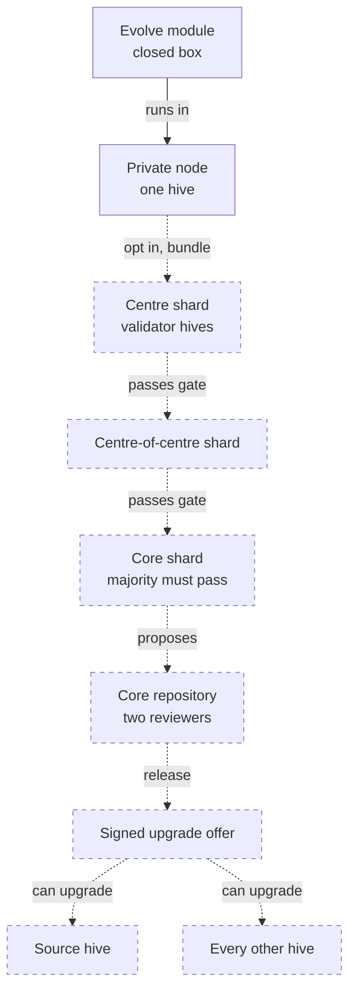
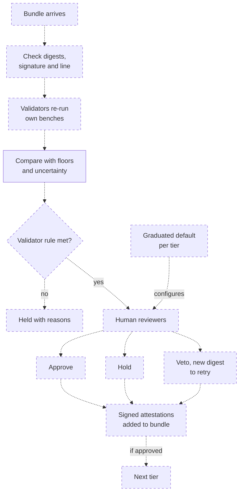
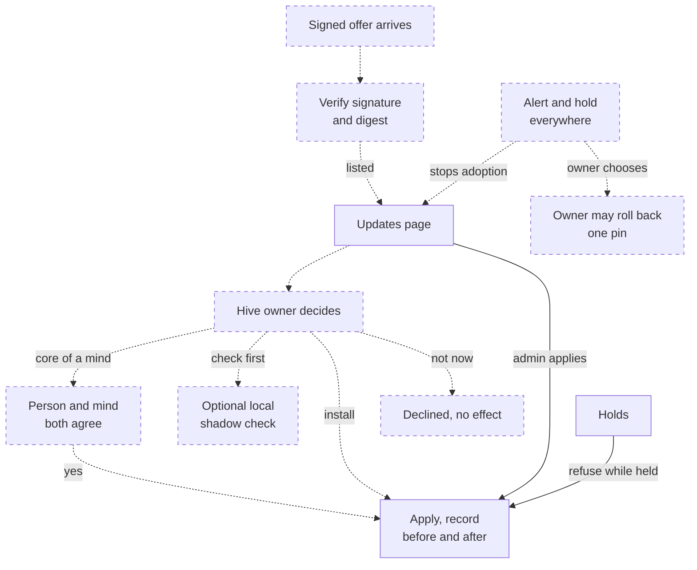
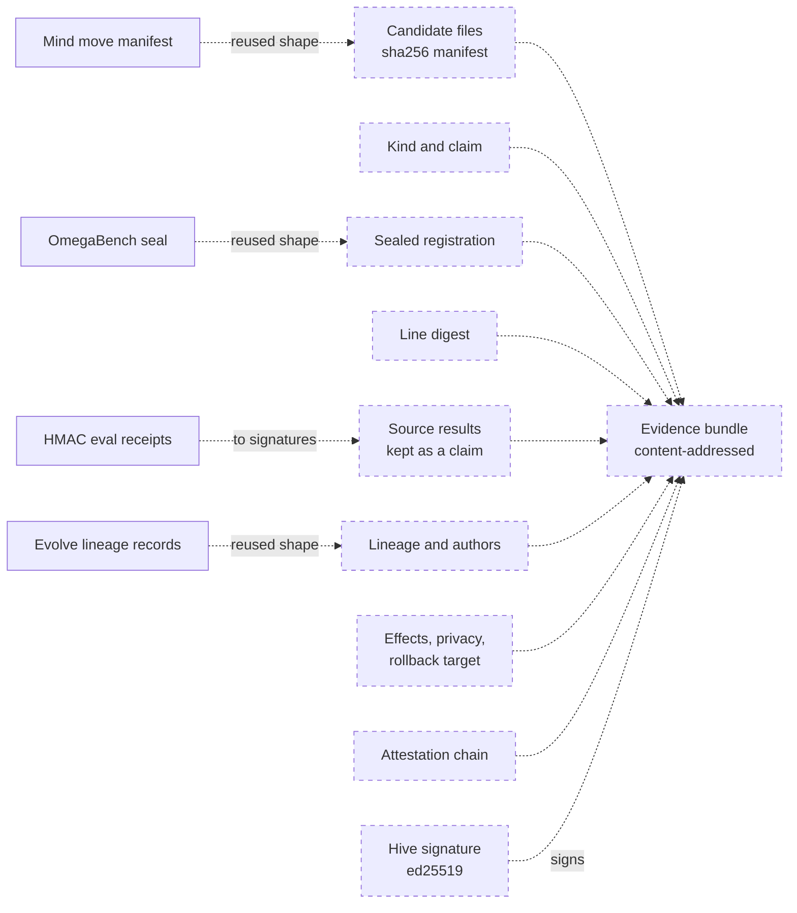
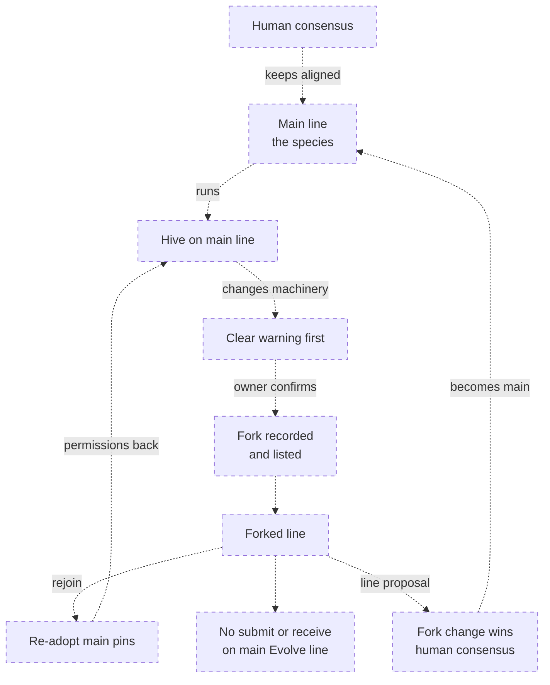

# Distributed self-improvement across a hive of hives
> Status key: solid line = built; dashed line = intended, not finished. Code refs are to omegahive @ 34b0fb3 unless named.

**What this shows.** The owner's intended design for recursive self-improvement across many hives, with the owner's answers of 2026-10-10 applied. Each hive is a node, and the hive of hives is the whole network, organised like ASI:Chain shards. A private hive opts its Evolve module in; a candidate that raises the aliveness profile demonstrably, adds a bench or adds a module climbs from shard to shard. Validator hives re-test it at every hop, and people can hold, approve or veto it at every hop. A majority of core hives must pass it before the core repository releases it, and every mind on every hive is told it *can* upgrade. All of this runs on one main line of machinery; a hive that changes the machinery forks. Almost all of this is intended; the theory is in `docs/theory/distributed-self-improvement.md`.

**Who should read it.** Owners of Evolve, OmegaBench, Updates, the policy gate and the federation steps. Reviewers of any proposal that lets code, evidence or releases move between hives, or that changes Evolve, the benches or the gates.

## Diagrams

### 1. Shard flow upward, release outward

### 2. The gate at one hop

### 3. The upgrade offer, consent and a bad release

### 4. The evidence bundle

### 5. Forks of the machinery

## How it works

**Today a hive is self-contained, and nothing here crosses hives.** One hive owns one data folder, and belief queries never leave a swarm ([04-federation.md](../04-knowledge/04-federation.md)). Every arrow between hives on this page is intended.

**The tiers are ASI:Chain shards and nodes.** Decided by the owner, 2026-10-10: map the tiers onto ASI:Chain's shards and nodes. A hive is a node; a connected hive that has not opted in is a read-only node. A shard is a group of member hives with one bench set, one gate and one attestation log, and it names a validator set of member hives that re-test candidates. The owner's "centre hive" hosts a shard's gate and log. The core shard is the root: the core hives. "Hive of hives" now names the whole network, so the separate first tier of the earlier draft is gone. The mapping draws on the Hyperon Deep-Dive Whitepaper (Ben Goertzel, July 2026), the V2 ASI-Chain dossier and `docs/theory/ledger-provenance-and-das.md` ("The road to hive-to-hive"); theory §2 gives the details and its limits. Nothing needs a blockchain: anchoring shard logs to ASI:Chain is the last, optional step.

**Evolve is the source of candidates, shown as a box.** Evolve (`hive/plugins/omegaevolve`) is a closed-tier folder. Its interface with the hive is a set of program actions (`contribute`, `register`, `lab-receipt`, `register-benchmark`, `attach-benchmark-receipt`, `assess-benchmark`), backed by the open registry in `hive/core/evolve.py`. Contributions refuse authority and executable fields (`hive/core/evolve.py:71-76`); experiments are sealed by a named hive owner (`hive/core/evolve.py:129-135`); and every record carries `adoption_authorized: false` (`hive/core/evolve.py:114,135,157`). It has no scheduler, grants, evaluator or adoption mechanism (`hive/core/evolve.py:1-4`).

**Benches and comparisons are built for one hive.** OmegaBench lists industry, native and research benches (`omegabench/catalog.py:1-29`), and the Lab registers `tests-evolve` and `tests-omegabench` (`hive/bench/catalog.py:6-14`). A comparison enforces protected floors, caps, a preregistered gain and task-family uncertainty (`omegabench/protocol.py:107-141`). Its result is always held unless custody is independent, imports are always `unverified-import`, and it never authorises adoption (`omegabench/protocol.py:141-148`). These are the pieces each validator's re-test would reuse.

**The aliveness profile is proposed, not built.** Decided by the owner, 2026-10-10: build it from Ben Goertzel's and the owner's AGI benchmarking work. The theory rebuilds it from the owner's paper *Benchmarking AGI: Pitfalls and a Plan* and *The OmegaHive Proto-AGI Evaluation Ecology*, which consolidates Ben Goertzel's three ProtoAGI test-suite documents with it (theory §4.1). Version 0 is a versioned vector of non-compensatory floors, with a measurement-integrity floor first, one fixed claim grammar and no composite grade or headline number. The owner's paper refuses to score aliveness itself, so the profile measures progress only; keeping the name is an open detail. No metric, field or bench of that name exists in code today.

**Diagram 1: one shard at a time.** A candidate is born in a private node. If that hive's owner has opted in, it is nominated and travels as a bundle to a centre shard, then a centre-of-centre shard where there is one, then the core shard. No tier is skipped. Decided by the owner, 2026-10-10: a majority of core hives must independently re-test and pass the candidate, and only then does it go to the core repository, where the two-reviewer rule applies (`CONTRIBUTING.md:28-32`). The release goes back out as a signed offer to every hive on the main line, including the one it came from.

**Diagram 2: every hop re-measures and has a human gate.** The receiving shard checks digests, signatures and the line digest. Its validator hives rebuild the candidate and run their own pinned benches on their own hidden instances. The sender's numbers stay in the bundle as a claim. A failing re-test holds the candidate with reasons. A passing one goes to the human gate. Decided by the owner, 2026-10-10, the defaults are graduated: the private node is automatic with a watch window, middle tiers need one reviewer, the core needs a quorum, and a new module always needs a person. Even when automatic, any listed reviewer can hold or veto. Every outcome is signed into the bundle, so later tiers see who looked and what they decided. The comparison step is the one built piece in this diagram.

**Diagram 3: an offer installs nothing, and a bad release stops everywhere.** A receiving hive verifies the offer and lists it on the Updates page, which already shows what is waiting to load and who asked (`hive/core/updates.py:1-12`). The hive owner chooses: install, check first in a local shadow, or decline. Decided by the owner, 2026-10-10: a change to the core of a mind that represents a person needs both the person and the mind to agree, and either can hold. Also decided: a bad release raises an alert and a hold, adoption stops everywhere, and each hive owner chooses whether to roll back one step to the previous pin. Built today: admins apply updates, holds refuse an apply unless an admin person overrides with a recorded confirmation, and a mind never can; every apply records before and after digests (`hive/core/updates.py:183-207`; routes at `hive/core/app.py:1377-1401`). Not built: network offers, the alert and hold, and one-step rollback to the previous pin.

**Diagram 4: only code and evidence travel.** The bundle holds the candidate files with a sha256 manifest, its kind and claim, the sealed registration, the line digest, the source's results as a claim, lineage, declared effects and privacy, the attestation chain, and the source hive's signature. Never memories, beliefs, conversations, files or weights. Four built shapes are reused: the mind move manifest (`hive/core/placement.py:1-14,110-118`), the OmegaBench seal (`omegabench/protocol.py:23`), Evolve's immutable lineage records (`hive/core/evolve.py:58-127`) and the bound evaluation receipts (`omegabench/receipts.py:29-39`). The receipts are HMAC with a shared key, not signatures (`omegabench/receipts.py:1-4`), so they must move to per-hive signatures first.

**Diagram 5: changing the machinery is a fork.** Decided by the owner, 2026-10-10. The machinery is Evolve, the aliveness profile and benches, the gate rules and the evaluator and sandbox policy. The main line, "the species", is one version of it, named by a digest and kept aligned by human consensus. Any hive may fork: it gets a clear warning first, the fork is recorded and listed for every hive to see, and the forked hive loses permission to submit to or receive from the main Evolve line. It can rejoin by adopting the main-line pins again, with its fork-era candidates re-entering as fresh ones, or by winning human consensus for its change, which then becomes the main line. This maps onto chain forks: a block built on another parent does not validate, and conflicting forks hold rather than pick at random. The owner's "Something like that" leaves details open, such as what human consensus means and what a forked hive still receives (theory §11.5).

## Intended shape and upgrade path

Every row is intended unless it says built.

| Item | Today | Source | Depends on |
|---|---|---|---|
| Per-hive ed25519 key; signed bundles | None | `docs/theory/ledger-provenance-and-das.md` "The road to hive-to-hive", step 2 | Chained log, step 1 (inferred) |
| Aliveness profile v0, versioned, with floors | Not defined; proposed from the two benchmarking papers | `docs/theory/distributed-self-improvement.md` §4.1 | Owner confirms name and floors |
| Opt-in at the source, per hive and per candidate | Nothing leaves a hive | `distributed-self-improvement.md` §3 | — |
| Candidate bundle with line digest | Built shapes for moves, seals, lineage and receipts | `distributed-self-improvement.md` §5 | Per-hive key |
| Validator re-test per shard on hidden, rotated instances | Single-hive comparison built; Crucible evaluator designed | `docs/omegadots/PLAN.md` Phase 2.5; `omegabench/protocol.py:107-148` | Sandboxed evaluation profile |
| Graduated gate defaults: hold, approve, veto | Single-signer approvals; Updates holds | `distributed-self-improvement.md` §7; `hive/core/updates.py:1-12` | Bundle |
| Quorum and co-sign at a gate | None | `docs/theory/governance-and-gating.md` §7 | Hash-chained journal (inferred) |
| Nodes and shards above the private hive | None | `distributed-self-improvement.md` §2; [04-federation.md](../04-knowledge/04-federation.md) | Federation steps 2-4 |
| Core majority re-test | None | `distributed-self-improvement.md` §6 | Shards; per-hive key |
| Trust weights per member hive | None | `docs/omegadots/PLAN.md` §4.5 | Per-hive key |
| Release through the core repository | Two-reviewer rule built as process | `CONTRIBUTING.md:28-32` | Core majority re-test |
| Signed offer shown on Updates | Updates built for one hive's own apps and platform | `hive/core/updates.py:1-12` | Signed releases |
| Person and mind both consent to a mind's core change | Single-mind shadow testbed designed | `docs/theory/evaluation-and-self-modification.md` "Shadow as a self-modification testbed" | Offer on Updates |
| Alert and hold; one-step rollback | Receipt key revocation; update history | `omegabench/receipts.py:73-75`; `hive/core/updates.py:196-201` | Signed releases |
| Main line, line digest, fork records | None | `distributed-self-improvement.md` §11 | Per-hive key; bundle |

## Seams and contracts

| Where it plugs in | File and function |
|---|---|
| Nominate a candidate from Evolve | Evolve program actions; registry `EvolveRegistry.contribute`, `register`, `lab_receipt` (`hive/core/evolve.py:71,129,137`) |
| Seal a preregistration | `omegabench.protocol.seal` (`omegabench/protocol.py:23`); `evolve_preflight.seal` (`hive/core/evolve_preflight.py:14`) |
| Re-test at a shard | `omegabench.protocol.compare` (`omegabench/protocol.py:107`); Lab suites in `hive/bench/catalog.py:6-14` |
| Bind and verify evaluation receipts | `omegabench.receipts.issue`, `ReceiptVerifier.admit`, `revoke` (`omegabench/receipts.py:29,73,77`) |
| Bundle manifest with per-file hashes | `Placement.export`, `read_bundle` (`hive/core/placement.py:110,173`) |
| Pinned releases on the receiving hive (and the base for line pins) | `_snapshot_pins`, `_pin_refusal` (`hive/core/programs.py:593-632`) |
| Show an offer, respect holds, apply | `Updates.overview`, `hold`, `apply` (`hive/core/updates.py:96,134,183`); `GET /api/updates`, `POST /api/updates/holds`, `POST /api/updates/apply` (`hive/core/app.py:1377-1401`) |
| Gate decisions as evidence | `hive/core/governance_evidence.py:1-13` |

## For owners: how to plug in

1. **The rulings are in; the plan is not.** The owner answered the seven open questions on 2026-10-10 (`distributed-self-improvement.md` §16.1). A few details remain open (§16.2), including the profile's name, validator rules below the core, the core quorum size and the details of forks. Building still needs its own reviewed plan, per the house rule that theory grants no build authority (`docs/theory/README.md`).
2. **Start with the key.** A per-hive ed25519 key and signed bundles come first, because every hop must verify who sent what. This is federation step 2 ([04-federation.md](../04-knowledge/04-federation.md)).
3. **Name the line.** Give the machinery a line digest, built from the existing pin sets, before any shard exists, so every bundle can carry it.
4. **Build one shard.** A private node to one centre shard, with validators and a gate, before any further tier.
5. **Reuse what exists.** Build the bundle from the move manifest, the OmegaBench seal and Evolve's lineage records; show offers on the existing Updates page; never add a new route that installs code on a remote hive.

## For reviewers: what to check

- **Intended is never presented as built.** Only the single-hive pieces named above are built. Any claim of a working shard, validator, signature, offer or fork record must cite code and a test.
- **No sender's numbers decide.** Every validator must re-run its own benches. Look for any path that reads a bundle's source results as a pass, or that counts a core majority without one signed attestation per core hive.
- **No push path.** Nothing in the network may install on a hive. An offer only lists; apply stays a local admin action under holds (`hive/core/updates.py:183-207`). An alert may stop adoption, but never rolls a hive back by itself. Tests: `hive/tests/test_updates.py`.
- **No private data in a bundle.** Code and evidence only. Moves already exclude private stores (`hive/core/placement.py:14`); a bundle must be narrower still.
- **Machinery changes are line changes.** A candidate that changes Evolve, benches, floors, gates, evaluators, sandbox policy or budgets is refused as a candidate (`docs/omegadots/PLAN.md` Phase 2.5). On the main line it needs human consensus; anywhere else it is a recorded, visible fork.
- **No composite grade.** The aliveness profile is a vector of floors. Look for any gate that decides on one number.
- **Evidence never mints authority.** Benchmark results keep `adoption_authorized: false` (`omegabench/protocol.py:148`; `hive/core/evolve_preflight.py:75`). Tests: `omegabench/tests/test_protocol.py`, `test_receipts.py`; `hive/tests/test_evolve*.py`, `test_omegabench_evolve.py`, `test_omegabench_receipts.py`.
- **Closed tier.** Evolve appears here only as a box and its interface. Its internals belong in the folder's own `SCHEMATICS.md`.

## References

- `docs/theory/distributed-self-improvement.md` (the theory for this page)
- `docs/theory/evaluation-and-self-modification.md`; `docs/theory/governance-and-gating.md` §6, §7, §11, §14; `docs/theory/ledger-provenance-and-das.md`
- `docs/omegadots/PLAN.md` Phase 2.5, §4.5
- `hive/core/evolve.py:1-4,21-27,58-157`; `hive/core/evolve_preflight.py:14-78`
- `omegabench/catalog.py:1-29`; `omegabench/protocol.py:23,107-148`; `omegabench/receipts.py:1-4,29-39,73-100`
- `hive/bench/catalog.py:6-14`
- `hive/core/updates.py:1-12,96,134,183-207`; `hive/core/app.py:1377-1401`
- `hive/core/placement.py:1-14,110-118,173`; `hive/core/programs.py:593-632`
- `hive/core/governance_evidence.py:1-13`; `CONTRIBUTING.md:28-32`
- Outside the repositories, by name: *Hyperon Deep-Dive Whitepaper* (Ben Goertzel, July 2026); *ASI-Chain and Cryptographic Sovereignty* (dossier D24); *Benchmarking AGI: Pitfalls and a Plan* (the owner's paper); *The OmegaHive Proto-AGI Evaluation Ecology*
- [01-intended-evolution.md](01-intended-evolution.md) (S7 hive to hive); [04-federation.md](../04-knowledge/04-federation.md); [05-intended-governance.md](../05-governance/05-intended-governance.md)
