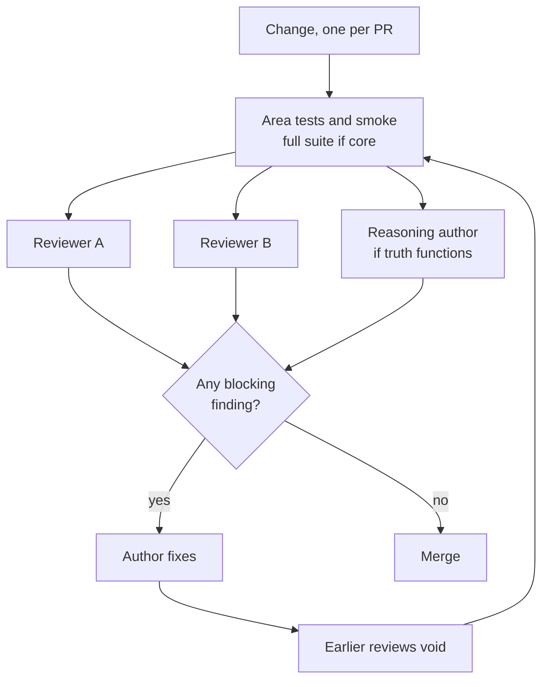
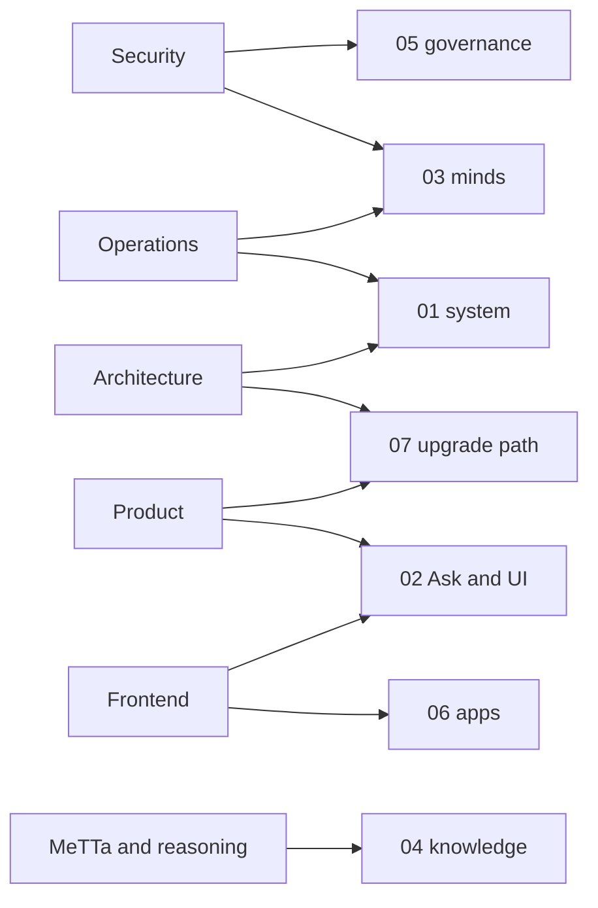

# How to review
> Status key: solid line = built; dashed line = intended, not finished. Code refs are to omegahive @ 34b0fb3 unless named.

**What this shows.** How a change gets reviewed: the two-reviewer rule, what counts as a blocking finding, and, for each kind of reviewer, which pages, component cards and tests to use.

**Who should read it.** Anyone reviewing a change to the platform or an app: architecture, security, MeTTa and reasoning, frontend, operations and product reviewers.

## Diagrams

### 1. One change, two reviews

### 2. Which reviewer reads which section

## How it works

**Two independent reviews, neither by the author.** Every change needs two independent reviews before merge. Code written with a language model must be read and understood by the person who submits it. A review is void if the change is altered after it (`CONTRIBUTING.md:28-32`). The same rule is part of the governance model: no process judges its own outputs (`docs/theory/governance-and-gating.md:115-122`).

**The author runs the tests first.** Tests for the changed area plus a smoke run. Changes to core plumbing (auth, spaces, gateway, supervisor, policy) need the full `hive/tests` run with a working PeTTa. UI changes need `npx tsc -b --noEmit`, `npx vitest run` and a look in a browser (`CONTRIBUTING.md:18-24`). CI makes every job blocking (`.github/workflows/ci.yml:1`), and it runs and passes on GitHub Actions on every push and pull request (`.github/workflows/ci.yml:1-15`).

**Truth-function changes have a third reviewer.** Changes to NAL, PLN or commons truth functions go to the reasoning domain author before merge and must update `docs/reasoning-deviations.md` (`CONTRIBUTING.md:25-26`).

**Each finding is blocking or non-blocking.** The reviewer says which, and why.

**A finding is blocking when any of these is true:**
- it breaks an invariant on [02-invariants.md](02-invariants.md), or weakens its guard test;
- it presents intended work as built, in code comments, docs or a status line;
- it widens what runs without a hive decision: a new policy skip, a new default allow, a new egress, a new environment variable passed to minds;
- it adds a route or event without a guard, a visibility check or an event rule;
- it changes truth semantics without the domain author;
- it puts private data, a personal name, a secret or a real record into code, tests, fixtures or docs (`CONTRIBUTING.md:34-38`);
- it copies closed-tier code into open code (`docs/MODULARITY.md:22-24`);
- the stated tests were not run, or ran with the guards skipped.

**Everything else is non-blocking:** naming, structure, a missing test for new behaviour that is not an invariant, docs that could be clearer, follow-up refactors. Non-blocking findings are still recorded. If they recur, raise them to the backlog.

**A review cites what it read.** Name the commit, the files and lines, the tests and the command used. A claim without a command is a reading, and says so.

## For each kind of reviewer

The component cards are in [`components/`](../components/); the test map is in [`10-testing/`](../10-testing/); the threat model is 01-threat-model.md (in the private omegahive-security repo; ask Kabir).

### Architecture

- **Look at:** whether the change sits behind the right seam, keeps the wire shapes, and keeps built and intended apart. Whether it adds coupling the improvement order is removing: more routes in `app.py`, settings read outside one module, app screens compiled into the platform UI (`docs/MODULARITY.md:38-66`).
- **Pages:** [01-system-overview.md](../01-system/01-system-overview.md), [02-hive-server-map.md](../01-system/02-hive-server-map.md), [01-intended-evolution.md](../07-upgrade-path/01-intended-evolution.md), [02-swap-seams.md](../07-upgrade-path/02-swap-seams.md).
- **Tests:** the conformance tests named for the seam on [02-swap-seams.md](../07-upgrade-path/02-swap-seams.md).

### Security

- **Look at:** the public gate, guards and visibility on every new route; the policy gate on every new skill or tool; what reaches a mind's environment; any new egress; the sandbox's fail-closed start; capability and confirm binding; secrets in the diff.
- **Pages:** [04-request-lifecycle.md](../01-system/04-request-lifecycle.md), all of [05-governance/](../05-governance/), [02-supervisor-drivers-sandbox.md](../03-minds/02-supervisor-drivers-sandbox.md), [03-modules.md](../03-minds/03-modules.md), 03-hardening-for-launch.md (in the private omegahive-security repo; ask Kabir), the threat model.
- **Tests:** `hive/tests/test_sso_and_budgets.py`, `test_visibility.py`, `test_five_way_decisions.py`, `test_policy_hive_skills.py`, `test_mind_sandbox.py`, `test_mind_sandbox_linux.py`, `test_local_only_egress.py`, `test_program_actions.py`, `test_program_confirm.py`, `test_app_pins.py`.
- **Invariant groups:** I-D, I-V, I-A, I-I, I-MD, I-G3.

### MeTTa and reasoning

- **Look at:** truth semantics against the deviations doc and the reference probe; duplicate `|-` or `Truth_*` definitions; S-expression structure, not just balanced parentheses; that agent text is sanitised before it is spliced; import order; that nothing activates by accident.
- **Pages:** all of [04-knowledge/](../04-knowledge/), [01-mind-runtime.md](../03-minds/01-mind-runtime.md), [03-modules.md](../03-minds/03-modules.md).
- **Tests:** `tests/run_metta_smokes.py` over `tests/*_smoke.metta`; `docs/probes/nal_pln_reference_probe.metta` against its `.out`; `hive/tests/test_acceptance.py`, `test_core_api.py`, `test_drift_guards.py`.
- **Invariant groups:** I-K, I-R, I-M7.

### Frontend

- **Look at:** that every experience keeps the Ask and reaches every feature; no direct network calls from an experience; the app frame's CSP, opaque origin and sender checks; looks as data only; the reviewed gate; per-person state reset when the signed-in identity changes.
- **Pages:** all of [02-ask-and-ui/](../02-ask-and-ui/), [01-programs-contract.md](../06-apps/01-programs-contract.md).
- **Tests:** `npx tsc -b --noEmit` and `npx vitest run` in `hive/ui`; `hive/ui/src/experiences/*.test.ts`; `hive/ui/src/lib/appFrame.browser.test.ts`; `hive/tests/test_ui_prefs.py`; a render check in a real browser.
- **Invariant groups:** I-U, I-Q, I-P.

### Operations

- **Look at:** startup order and recovery; schema changes (there are no migrations); the spaces log; backup and restore; settings and their defaults; pinned toolchain versions; app pins, homes and grants agreeing on rollout.
- **Pages:** [03-state-and-storage.md](../01-system/03-state-and-storage.md), [02-hive-server-map.md](../01-system/02-hive-server-map.md), [02-supervisor-drivers-sandbox.md](../03-minds/02-supervisor-drivers-sandbox.md), [02-app-lifecycle.md](../06-apps/02-app-lifecycle.md), [04-isolation.md](../05-governance/04-isolation.md).
- **Tests:** `hive/tests/test_startup_exclusive.py`, `test_archive.py`, `test_placement.py`, `test_app_pins.py`, `test_updates.py`, `test_docker_driver.py`.
- **Invariant groups:** I-S, I-M, I-D6.

### Product

- **Look at:** whether the change matches what the status and feature docs say is live, held or planned; whether a "built" claim names its test and a "live" claim names a live receipt kept apart from mock or replay demos; whether demos use invented data only.
- **Pages:** [01-intended-evolution.md](../07-upgrade-path/01-intended-evolution.md), [01-ask-and-conductor.md](../02-ask-and-ui/01-ask-and-conductor.md), the app pages under [06-apps/apps/](../06-apps/apps/).
- **Tests:** the acceptance tests for the feature; `hive/tests/test_acceptance.py`.
- **Sources:** `STATUS.md`, `docs/FEATURES.md`, `docs/STATUS.md`.

## Intended shape and upgrade path

- **CI as the first gate.** The workflow makes every job blocking; its first run on GitHub is still owed (`.github/workflows/ci.yml:1,12`).
- **A zero-authority shadow hive** on a scratch data folder as the standard acceptance step before freeze (`docs/theory/governance-and-gating.md:185-195`).
- **Co-signed changes** for continuity, memory or constitutional state, once co-sign exists (`docs/theory/governance-and-gating.md:124-130`).

## Seams and contracts

- `CONTRIBUTING.md:13-32`: branch, pull request, tests and the two-reviewer rule.
- `SECURITY.md:1-25`: private vulnerability reporting and scope.
- `.github/workflows/ci.yml`: jobs `core-tests`, `hive-petta`, `hive-ui`.

## For reviewers: what to check

- **Two reviews, neither the author's, both on the final change.**
- **Every finding marked blocking or non-blocking, with the reason.**
- **The invariant ids the change touches named in the review.**
- **The test command named, and the skip summary read.**

## References

- `CONTRIBUTING.md:13-38`
- `SECURITY.md:1-25`
- `.github/workflows/ci.yml:1-13`
- `STATUS.md:60`
- `docs/MODULARITY.md:22-24,38-68`
- `docs/theory/governance-and-gating.md:115-130,185-195`
