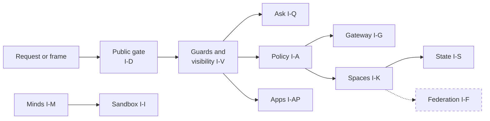

# Invariants
> Status key: solid line = built; dashed line = intended, not finished. Code refs are to omegahive @ 34b0fb3 unless named.

**What this shows.** The rules that must always hold, collected from the "For reviewers" section of every page in this repo. Each has an id, the code that enforces it, and the test that guards it. A rule with no test is marked **unguarded**. A rule the code is known to break today is marked **known violation**, with its finding number from 03-hardening-for-launch.md (in the private omegahive-security repo; ask Kabir).

**Who should read it.** Every reviewer, before approving a change in the area. Owners swapping a component: the "Must not break" lists on [02-swap-seams.md](../07-upgrade-path/02-swap-seams.md) point here by id.

## Diagrams

### 1. Where each invariant group sits on a request's path

## How it works

**An invariant is a sentence a test can check.** Each row says what must hold, where the code enforces it, and which test fails if it stops holding. "Unguarded" means no test was found that would fail. It does not mean the rule is broken.

**A guard proves only what its default run exercises.** Tests that skip without PeTTa, macOS sandbox-exec, Docker or a closed sibling repo do not guard anything in that run (`.github/workflows/ci.yml:1-10`). Check the skip summary.

**Known violations stay listed.** Removing a row because the code breaks it would hide the gap. Fix the code, add the guard, then change the status.

## The invariants

### I-D Front door and routes

| Id | Invariant | Enforced at | Guard |
|---|---|---|---|
| I-D1 | Public requests never reach agent routes or log in with the operator password | `hive/core/sso.py:26,86-137` | `hive/tests/test_sso_and_budgets.py::test_public_requests_cannot_reach_agent_routes_or_traverse` |
| I-D2 | Agent routes stay under `/agent-hub`, `/llm/` or `/api/agent/` | `hive/core/sso.py:26` | Same test as I-D1, for existing routes; a new route outside the prefixes is **unguarded** |
| I-D3 | Every person route starts with a guard | `hive/core/app.py:274-316` | `hive/tests/test_visibility.py`, `hive/tests/test_request_visibility.py` (partial) |
| I-D4 | Every live event kind has a delivery rule | `hive/core/visibility.py:232-256` | `hive/tests/test_visibility.py::test_every_published_event_kind_has_a_rule` |
| I-D5 | Authority named in a request body is refused | `hive/core/ask.py`; `hive/core/program_actions.py:18-21,119-126` | `hive/tests/test_ask.py:278`; `hive/tests/test_program_actions.py` |
| I-D6 | One failing reconcile step does not skip the others | `hive/core/app.py:181-201` | **Known violation** (K20); **unguarded** |
| I-D7 | A feature object is built after the objects it reads | `hive/core/hive.py:122-176` | **Unguarded** |
| I-D8 | Events about a write are sent only after it commits | `hive/core/db.py:205-215` | **Unguarded**; some events publish right after a commit rather than through `after_commit` (`hive/core/db.py:205-208`) |

### I-V Visibility and privacy

| Id | Invariant | Enforced at | Guard |
|---|---|---|---|
| I-V1 | Every list and read route that returns ids of minds, swarms, rooms, shares or assets goes through `Visibility` | `hive/core/visibility.py:343-394` | `hive/tests/test_visibility.py`, `test_request_visibility.py`, `test_personal_visibility.py` |
| I-V2 | A hidden thing answers 404, never 403 | `hive/core/visibility.py:299-310` | `hive/tests/test_visibility.py`, `test_archive_visibility.py`, `test_focus_visibility.py` |
| I-V3 | Personal minds stay out of admin default lists and events unless an admin opts into audit | `hive/core/visibility.py:312-351` | `hive/tests/test_personal_visibility.py`, `test_personal_ask_control.py` |
| I-V4 | Event rules fail closed: unregistered kinds and scoped events that name nothing are withheld | `hive/core/visibility.py:262-267,538-545` | `hive/tests/test_events_websocket.py` |
| I-V5 | Shares are judged against the stored row | `hive/core/visibility.py:512-525` | `hive/tests/test_share_visibility.py` |
| I-V6 | Local-only swarms refuse every outside model call; malformed settings refuse | `hive/core/gateway.py:230-253` | `hive/tests/test_local_only_egress.py` (model and embedding calls only; see I-MD5) |
| I-V7 | Every row is private unless set otherwise | create routes, `hive/core/app.py:1254` | **Known violation** for rows older than the column (K19); **unguarded** |
| I-V8 | An admin audit that lifts a filter leaves an owner-visible receipt | intended, `docs/theory/governance-and-gating.md:166` | **Not built** (K15) |

### I-P Personal memory

| Id | Invariant | Enforced at | Guard |
|---|---|---|---|
| I-P1 | A personal Ask turn stores no content on the host; personal memory stays in the browser | `hive/core/ask.py:24-34`; `hive/ui/src/lib/askMemory/backend.ts:1-3` | `hive/tests/test_personal_mind_ask.py:41,151`; `hive/tests/test_personal_mind_r3.py`; `hive/tests/test_ask_memory.py:132,166` |
| I-P2 | Forgotten items are never recalled | `hive/ui/src/lib/askMemory/recall.ts:7-11` | `hive/ui/src/lib/askMemory/forgetAll.test.ts`, `askMemory.test.ts` |
| I-P3 | Private app names never reach a model | both private-app fences | `hive/tests/test_ask_conductor.py:236,527-573,734,764-773` |
| I-P4 | Held copies are erased with no trace | `hive/core/db.py:217-254`; `hive/core/personal_inbox.py:14-15,90` | `hive/tests/test_personal_mind_r2.py`, `test_personal_mind_r3.py` |

### I-Q The Ask

| Id | Invariant | Enforced at | Guard |
|---|---|---|---|
| I-Q1 | No silent fallback: a refusal never routes to another mind | `hive/core/ask.py:6-8` | `hive/tests/test_ask.py:131,151,204`; `test_personal_mind_ask.py:74,89` |
| I-Q2 | The conductor never wakes or queues to a mind | `hive/core/conductor.py` | `hive/tests/test_ask_conductor.py:255,282`; `test_personal_mind_ask.py:135,192` |
| I-Q3 | Conductor dispatch only records an intent; only the submit route submits | `hive/core/ask_intents.py:189` | `hive/tests/test_ask_conductor.py:372`; `test_ask_intents.py:115,254`; `test_personal_ask_control.py:34` |
| I-Q4 | Turn, thread and spend caps hold | `hive/core/conductor.py:71-98` | `hive/tests/test_ask_conductor.py:189-235,588,708`; `test_ask.py:475,601` |

### I-M Minds and the supervisor

| Id | Invariant | Enforced at | Guard |
|---|---|---|---|
| I-M1 | Stop wins: a hub connection admitted before a stop never registers; a stop withdraws a registered one | `hive/supervisor/drivers.py:401-410`; `hive/core/hive.py:1425-1452` | `hive/tests/test_stop_reconcile_race.py`; `test_core_api.py::test_hub_refuses_a_stopped_mind_and_keeps_it_stopped` |
| I-M2 | If the hive cannot answer the gate, the command does not run | `modules/hive/src/hive_commons.py:957-959` | **Unguarded** (no test found that cuts the gate) |
| I-M3 | No hive secret reaches a mind's environment | `hive/supervisor/sandbox.py:22-36` | `hive/tests/test_mind_sandbox.py` |
| I-M4 | A mind is deleted only over a confirmed stop | `hive/supervisor/drivers.py:552-567` | `hive/tests/test_docker_driver_stop.py`, `test_swarm_delete.py` |
| I-M5 | Personal minds are never woken by a personal Ask turn and stay alone in their swarm | `hive/core/personal.py:15-17`; `hive/core/ask.py:31-32` | `hive/tests/test_personal_mind.py`, `test_personal_mind_ask.py` |
| I-M6 | Child minds are never restarted by the host; spawning needs `HIVE_MIND_SPAWN=1` | `hive/core/minds.py:1-31` | `hive/tests/test_mind_control.py` |
| I-M7 | Nothing loads before `lib_omegaclaw_core` or after `src/loop` | `lib_omegaclaw.metta:3-11` | `tests/test_module_organs.py` (`test_standard_run_loads_modules_from_one_composition_hook`) |
| I-M8 | One launch, one channel daemon | `hive/supervisor/drivers.py:496-498` | `hive/tests/test_channel_launch.py` |
| I-M9 | A recorded process group is adopted only if it runs from this mind's workspace | `hive/supervisor/drivers.py:125-137` | `hive/tests/test_local_driver_adopt.py` |
| I-M10 | The local driver refuses Iter unless `HIVE_ALLOW_LOCAL_ITER=1` | `hive/supervisor/drivers.py:175-177` | **Unguarded** (no test found by name) |
| I-M11 | Every skill a native mind runs is decided by the hive gate | `src/loop.metta:114-117` | **Known violation** (K10): the local skip list at `modules/hive/src/hive_commons.py:932-956`. Fitness tests list it but nothing pins it |

### I-I Isolation

| Id | Invariant | Enforced at | Guard |
|---|---|---|---|
| I-I1 | Sandbox requested means sandbox enforced; a host without one refuses | `hive/supervisor/drivers.py:185-188`; `hive/supervisor/landlock.py:29-32` | `hive/tests/test_mind_sandbox.py`, `test_mind_sandbox_linux.py` (skip without the OS feature) |
| I-I2 | A mind dials only an address the sandbox allows | `hive/supervisor/drivers.py:479-483` | `hive/tests/test_mind_url.py` |
| I-I3 | No read root widens to `/` or the home folder | `hive/supervisor/sandbox.py:146-157` | `hive/tests/test_mind_sandbox.py` |
| I-I4 | Only Docker's exact missing-container text counts as gone | `hive/supervisor/drivers.py:328-335` | `hive/tests/test_docker_driver_stop.py` |
| I-I5 | Every mind runs under CPU, memory and process limits | not built for native minds; Iter only on Docker | **Known violation** (K16, K26); **unguarded** |
| I-I6 | Sandboxed app tool runs have no network, check bundle hashes, and refuse without a sandbox | `hive/core/sandbox_run.py:7-13` | `hive/tests/test_sandbox_run.py` |
| I-I7 | The stated Landlock requirement matches the check | `hive/supervisor/landlock.py:135-136` | **Known violation** (K14); **unguarded** |

### I-MD Modules

| Id | Invariant | Enforced at | Guard |
|---|---|---|---|
| I-MD1 | A module's manifest and its entry atoms agree | `modules/*/module.toml` | `tests/test_module_organs.py:157-193` |
| I-MD2 | The manifest has the contract shape | `tests/test_module_contract.py:27-56` | `tests/test_module_contract.py` |
| I-MD3 | A module is removable without breaking boot | `docs/reference-omegaclaw-module-contract.md:62-71` | **Unguarded** (no remove-and-boot test found) |
| I-MD4 | A new side-effecting skill asks before it runs | `hive/core/policy.py:213-219` | **Known violation** (K30); **unguarded** |
| I-MD5 | A module opens no network connection of its own | OS sandbox only | **Known violation** (K27); **unguarded** |

### I-A Governance

| Id | Invariant | Enforced at | Guard |
|---|---|---|---|
| I-A1 | At equal specificity the most restrictive rule wins; no role or admin rule outvotes a person's Never | `hive/core/policy.py:210` | `hive/tests/test_five_way_decisions.py` |
| I-A2 | No glob allows an unreviewed `hive-*` or `EXPLICIT_ONLY` skill | `hive/core/policy.py:185-201` | `hive/tests/test_policy_hive_skills.py` |
| I-A3 | High-risk and `program:*` approvals are one at a time | `hive/core/policy.py:357-361,386-389` | `hive/tests/test_program_actions.py` (partial) |
| I-A4 | Code redeem compares canonical bindings byte for byte; a second concurrent redeem fails | `hive/core/services.py:372-377` | `hive/tests/test_services_api.py`, `test_sensitive_action_revalidation.py` |
| I-A5 | Evidence never mints authority: no governance evidence, model output or track record decides an approval | `hive/core/governance_evidence.py:11-12` | Partly: `hive/tests/test_five_way_decisions.py` checks evidence is recorded, not that `Policy.decide` never reads it; **unguarded** for the decision path |
| I-A6 | A lease fails when its issuing admin loses admin; no specialist starts without OS isolation | `hive/core/delegation.py:74-122` | `hive/tests/test_delegation.py` |
| I-A7 | Only admins change policy rules or answer approvals | `hive/core/app.py:2264-2309` | **Known violation** (K11); **unguarded** |
| I-A8 | Consent is newest-only, single use and in transaction | `hive/core/minds.py:1427-1462` | `hive/tests/test_copy_apply_consent.py`, `test_copy_apply_claims.py` |
| I-A9 | Every MCP tool goes through the gate; a new `hive-*` skill is reviewed | `hive/core/mcp.py:159-164`; `hive/core/policy.py:23-28` | `hive/tests/test_mcp_api.py`, `test_mcp_s3.py`, `test_policy_hive_skills.py` |
| I-A10 | An MCP member never gains operator authority or another member's identity; invite codes are single use and expire | `hive/core/mcp.py:10-12,291-301` | `hive/tests/test_mcp_api.py` |

### I-G Spend and models

| Id | Invariant | Enforced at | Guard |
|---|---|---|---|
| I-G1 | The worst-case estimate is a true bound; `n>1`, `best_of>1`, streaming and non-text content are refused | `hive/core/gateway.py:303-334` | `hive/tests/test_cost_reservations.py`, `test_drift_guards.py`, `test_budget_review_fixes.py` |
| I-G2 | Holds count by subject, so a rule added later still sees them | `hive/core/cost_reservations.py:102-118,145-153` | `hive/tests/test_cost_reservations.py`, `test_reservation_resolvable.py`, `test_auto_budgets.py` |
| I-G3 | Provider keys never reach a mind and are never returned except as a hint | `hive/core/providers.py:146-148` | `hive/tests/test_providers_api.py`; `hive/tests/test_mind_sandbox.py` |
| I-G4 | After the provider answers, nothing raises to the caller; every failure becomes a held liability | `hive/core/app.py:2101-2125` | `hive/tests/test_cost_reservations.py` (partial) |
| I-G5 | No float drift: limits floor and spends ceiling in micro-dollars | `hive/core/limits_auto.py:42-50`; `hive/core/cost_reservations.py:9-12` | `hive/tests/test_limits_auto.py` |
| I-G6 | Unknown holds are never dropped: a person resolves them, or they settle at worst case after 24 hours | `hive/core/cost_reservations.py:285-358` | `hive/tests/test_reservation_resolvable.py` |
| I-G7 | A stored rule beats auto at its own key and never removes limits above it | `hive/core/limits_auto.py:8-11` | `hive/tests/test_auto_budgets.py` |

### I-K Knowledge and spaces

| Id | Invariant | Enforced at | Guard |
|---|---|---|---|
| I-K1 | No code calls PeTTa outside the one interpreter thread | `hive/spaces/service.py:52-102` | **Unguarded** by a test; a violation deadlocks |
| I-K2 | Every agent string passes `safe_statement`, `safe_pattern` or `safe_symbol` before it is spliced into MeTTa | `hive/spaces/service.py:142,150,205-206,261-262` | Partial: publish and query tests in `hive/tests/test_core_api.py`; no direct test of `hive/spaces/sexpr.py` found |
| I-K3 | No self-inflation: repeats and echoes reuse the existing stamp; revision only on disjoint evidence | `hive/spaces/lib_hive.metta:98-133` | `hive/tests/test_core_api.py:168,211`; `test_drift_guards.py:20,30`; `tests/hive_lib_smoke.metta` |
| I-K4 | The commons survive a restart | `hive/spaces/service.py:125-137` | `hive/tests/test_acceptance.py::test_three_omegas_share_revise_and_survive_restart` |
| I-K5 | Belief queries reach only the mind's own swarm | `hive/core/hive.py:1642` | `hive/tests/test_shares_api.py:82` (shares); query scope itself **unguarded** |
| I-K6 | Affordances load before the loop that calls them; otherwise calls compile as inert literals | `lib_omegaclaw.metta:3-6` | `tests/test_module_organs.py` (load order) |
| I-K7 | Every change to a space is logged, and every logged op has an `_apply_` handler | `hive/spaces/service.py:125-137,225-228` | **Known violation** (K4: quarantine not logged); **unguarded** |
| I-K8 | Cited evidence ids are minted or seen, matched exactly | `hive/core/hive.py:1550-1566` | `hive/tests/test_core_api.py` (partial) |
| I-K9 | The spaces log and the `assertions` row agree after a crash | `hive/spaces/service.py:226-228`; `hive/core/hive.py:1569-1578` | **Known violation** (K21); **unguarded** |
| I-K10 | The vocabulary gate quarantines unknown symbols from members | `hive/spaces/service.py:214-220` | **Known violation** (K3); `tests/hive_lib_smoke.metta` covers the library only |

### I-R Reasoning

| Id | Invariant | Enforced at | Guard |
|---|---|---|---|
| I-R1 | Truth semantics change only with the reasoning domain author, recorded in `docs/reasoning-deviations.md` | `CONTRIBUTING.md:25-26` | `docs/probes/nal_pln_reference_probe.metta` and its `.out`; `tests/reasoning_space_smoke.metta` |
| I-R2 | No new duplicate `|-` or `Truth_*` definitions | `docs/reasoning-deviations.md:33-39` | **Unguarded** |
| I-R3 | Automatic reasoning and OBSERVE stay off unless an activation review says otherwise | `STATUS.md:49` | **Unguarded** by a default-off test at host level |
| I-R4 | Attention may rank and propose; it never confers truth, consent or authority | `docs/theory/cognition-attention-importance.md:85-88` | **Unguarded** |
| I-R5 | Skill-path revision is not cited as evidence (no echo guard) | `docs/reasoning-deviations.md:40-43` | **Unguarded** |

### I-S State and storage

| Id | Invariant | Enforced at | Guard |
|---|---|---|---|
| I-S1 | One process owns one data folder | `hive/core/exclusive.py:3-5,21-22` | `hive/tests/test_startup_exclusive.py` |
| I-S2 | Startup recovery is all or nothing; a failure exits 70 | `hive/core/exclusive.py:157-224` | `hive/tests/test_startup_exclusive.py` |
| I-S3 | The database keeps only a hash of each mind token | `hive/core/hive.py:1162-1165` | **Unguarded** (no test found by name) |
| I-S4 | The spaces log append is durable | `hive/spaces/service.py:125-127` | **Known violation** (no fsync, K21); **unguarded** |
| I-S5 | A backup is consistent | `deploy/RUNBOOK.md:193` (stop first) | **Unguarded**; manual procedure (K24) |
| I-S6 | Nothing a mind did is deleted, only archived | `hive/core/archive.py:1-11` | `hive/tests/test_archive.py` |

### I-AP Apps

| Id | Invariant | Enforced at | Guard |
|---|---|---|---|
| I-AP1 | No default allow for minds in apps: only `program:` rules count; no rule means deny | `hive/core/program_actions.py:233-248` | `hive/tests/test_program_actions.py` |
| I-AP2 | Identity comes from the hive, never the body | `hive/core/program_actions.py:18-21,119-126` | `hive/tests/test_program_actions.py`, `test_program_viewer.py` |
| I-AP3 | A confirm token binds principal, session, program, swarm, action and payload digest, and is spent once | `hive/core/program_actions.py:360-379` | `hive/tests/test_program_confirm.py`; `hive/ui/src/lib/hostConfirm.test.ts` |
| I-AP4 | An unreviewed, changed or duplicate app folder is never imported | `hive/core/programs.py:604-606,613-652,661-663` | `hive/tests/test_app_pins.py` |
| I-AP5 | Read actions keep no content | `hive/core/programs.py:1024-1051` | `hive/tests/test_read_actions.py`, `test_program_read.py` |
| I-AP6 | Graphs and results are validated on every call, including graphs inside a result | `hive/core/programs.py:1295-1302` | `hive/tests/test_programs_api.py` |
| I-AP7 | File bytes are never kept; only name, type, size and digest | `hive/core/program_actions.py:456-468` | `hive/tests/test_program_file.py` |
| I-AP8 | Attachments remove rules before `unbind`; pending states hold no authority | `hive/core/program_attachments.py` | `hive/tests/test_app_attachments.py` |
| I-AP9 | Grant renewal is owner only and all or nothing | `hive/core/programs.py:902-990` | `hive/tests/test_app_grant_renewal.py` |
| I-AP10 | Mounted app code is reviewed: capabilities are not a sandbox | `hive/PROGRAMS.md:240-244` | **Unguarded** by design; process rule until out-of-process apps |

### I-F Federation and moves

| Id | Invariant | Enforced at | Guard |
|---|---|---|---|
| I-F1 | A mind move keeps identity, checks every file hash and refuses non-plain files | `hive/core/placement.py:7-9` | `hive/tests/test_placement.py` |
| I-F2 | Nothing crosses a swarm by accident: shares stay in the swarm; members cannot reach other swarms | `hive/core/shares.py:14` | `hive/tests/test_shares_api.py:82`; `test_collab.py`, `test_request_visibility.py` |
| I-F3 | No doc or proposal calls a hive "federated" without step 3 or 4 built and a two-host test | review rule, [04-federation.md](../04-knowledge/04-federation.md) | **Unguarded** (process rule) |

### I-U UI

| Id | Invariant | Enforced at | Guard |
|---|---|---|---|
| I-U1 | Every experience has the Ask and reaches every feature | `hive/ui/src/experiences/coverage.ts` | `hive/ui/src/experiences/ask.test.ts`, `coverage.test.ts`, `askSkins.test.ts` |
| I-U2 | An experience makes no direct network calls; all data goes through the SDK | `hive/ui/src/experiences/sdk.ts:1-5` | **Unguarded** by a lint or test found here |
| I-U3 | The app frame: CSP first, opaque origin, exact sender and channel | `hive/ui/src/features/programs/AppFrame.tsx:386`; `hive/ui/src/lib/appFrame.ts:51-53` | `hive/ui/src/lib/appFrame.browser.test.ts`, `appFrame.test.ts`, `frameIdentity.test.ts`, `frameOps.test.ts` |
| I-U4 | Looks stay data only: no CSS text, URLs or scripts; illegible looks refused | `hive/core/ui_prefs.py` | `hive/tests/test_ui_prefs.py` |
| I-U5 | Only reviewed experiences are offered; production builds compile candidates out | `hive/ui/src/experiences/registry.ts:22-27,47-57` | **Unguarded** at host level (the host checks only the slug, `hive/core/ui_prefs.py:146-148`) |

## Intended shape and upgrade path

- **Every "unguarded" row gets a test.** The P0 and P1 items in 03-hardening-for-launch.md (in the private omegahive-security repo; ask Kabir) list the guards to write first.
- **Every "known violation" row is fixed or ruled** before launch.
- **Intended invariants arrive with their features**: reach rules, co-sign quorums, access receipts, chained logs and trust-discounted federation each add rows here when built ([05-intended-governance.md](../05-governance/05-intended-governance.md), [04-federation.md](../04-knowledge/04-federation.md)).

## Seams and contracts

The ids are the shared vocabulary between [02-swap-seams.md](../07-upgrade-path/02-swap-seams.md) ("Must not break"), [01-how-to-review.md](01-how-to-review.md) and [03-review-checklists.md](03-review-checklists.md). Keep ids stable: add new rows at the end of a group; never renumber.

## For reviewers: what to check

- **Name the invariant ids a change touches** in the review.
- **A change that weakens a guard test is blocking**, unless the invariant itself is being changed by a ruling.
- **A change to a "known violation" area** should add the missing guard, even if it does not fix the violation.
- **A guard that skipped proves nothing.** Read the skip summary.

## References

- The "For reviewers" section of every page in `01-system/` to `06-apps/`
- The file and test refs in each row above
- `CONTRIBUTING.md:18-32`
- `.github/workflows/ci.yml:1-10`
