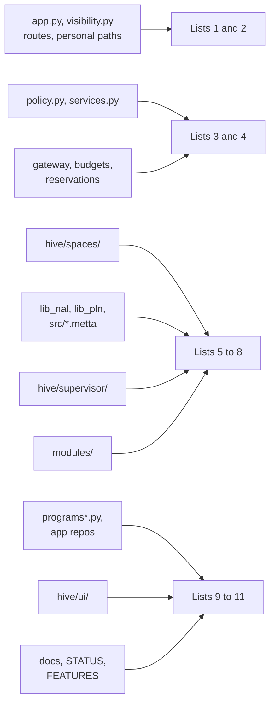

# Review checklists
> Status key: solid line = built; dashed line = intended, not finished. Code refs are to omegahive @ 34b0fb3 unless named.

**What this shows.** Short checklists, one per area of the code. Pick the lists that match the paths a change touches, and copy them into the review. Every item links to an invariant on [02-invariants.md](02-invariants.md) or to the page that explains it.

**Who should read it.** Reviewers, during a review. Authors, before asking for one.

## Diagrams

### 1. Which checklist applies

## How it works

Every change uses list 0. Then add the lists for the paths it touches. An item that does not apply is marked "n/a" with a reason, not deleted. A failed item is a blocking finding unless the item says otherwise ([01-how-to-review.md](01-how-to-review.md)).

## The checklists

### 0. Every change

- [ ] Two independent reviewers, neither the author; the change has not moved since review (`CONTRIBUTING.md:28-32`).
- [ ] Tests for the area plus a smoke run; the full `hive/tests` with PeTTa for auth, spaces, gateway, supervisor or policy (`CONTRIBUTING.md:20-22`). Command named; skip summary read.
- [ ] Nothing intended is described as built.
- [ ] No secrets, personal names, private records or personal paths in code, tests, fixtures or docs (`CONTRIBUTING.md:34-38`).
- [ ] No closed-tier code copied into open code (`docs/MODULARITY.md:22-24`).
- [ ] New settings have one home, a default and validation (`docs/MODULARITY.md:57`). Non-blocking until the settings module exists.

### 1. Routes and the server core

- [ ] Every new person route has `operator()`, `admin()` or `agent_from` as fits (I-D3). Policy and approval writes use `admin()` (I-A7).
- [ ] Agent routes stay under `/agent-hub`, `/llm/` or `/api/agent/` (I-D2).
- [ ] Every new event kind is in `EVENT_RULES` (I-D4).
- [ ] Notices for a write go through `after_commit` (I-D8).
- [ ] A new reconcile step is short, idempotent and cannot raise for one bad row (I-D6).
- [ ] A new feature object is built after what it reads (I-D7).
- [ ] Errors use `HiveError(status, code, message)` (`hive/core/hive.py:46-48`). Non-blocking.

### 2. Visibility and personal privacy

- [ ] Every list or read that returns ids passes through `Visibility` (I-V1).
- [ ] Hidden things answer 404 (I-V2).
- [ ] Personal minds stay out of default lists and events (I-V3); new rows default to private (I-V7).
- [ ] No personal Ask content is stored on the host; no new read path skips `_is_personal` (I-P1).
- [ ] Private app names never reach a model, in both fences (I-P3).

### 3. Policy, approvals and capabilities

- [ ] A new skill or MCP tool goes through the gate and has a policy entry (I-A9); a new side-effecting skill asks by default (I-MD4).
- [ ] Nothing is added to the native local skip list (I-M11).
- [ ] Most restrictive wins at a tie; no glob widens to an unreviewed skill (I-A1, I-A2).
- [ ] Risky and `program:*` approvals stay exact (I-A3); bindings compare byte for byte (I-A4).
- [ ] No evidence, model output or track record decides an approval (I-A5).

### 4. Models, gateway and spend

- [ ] Every new billable field is counted at worst case, or refused (I-G1).
- [ ] Holds are counted by subject (I-G2); unknown holds are never dropped (I-G6).
- [ ] No provider key reaches a mind or an API response (I-G3).
- [ ] After the provider answers, nothing raises to the caller (I-G4).
- [ ] Local-only swarms still refuse outside calls (I-V6).
- [ ] A new provider declares prices, or is refused as unpriced (K25). Non-blocking for local or mock providers.

### 5. Spaces and the commons

- [ ] No PeTTa call outside the one interpreter thread (I-K1).
- [ ] Every agent string is sanitised before it is spliced (I-K2).
- [ ] Every change to a space is logged with an `_apply_` handler; replay rebuilds it (I-K7, I-K4).
- [ ] Repeats and echoes reuse the stamp (I-K3); cited evidence is minted or seen (I-K8).
- [ ] Queries stay inside the mind's own swarm until federation is built (I-K5).

### 6. Reasoning and MeTTa libraries

- [ ] Truth-function changes have the reasoning domain author's sign-off and update `docs/reasoning-deviations.md` (I-R1).
- [ ] The reference probe output is unchanged, or the change is explained (I-R1).
- [ ] No new duplicate `|-` or `Truth_*` definitions (I-R2).
- [ ] S-expressions are checked for structure, not only balance; mis-nested clauses can drop later definitions silently.
- [ ] Nothing activates automatic reasoning, OBSERVE or attention-driven decisions by default (I-R3, I-R4).

### 7. Minds, supervisor, drivers and sandbox

- [ ] Stop wins over every start and hub admission (I-M1).
- [ ] A gate failure stops the command (I-M2).
- [ ] No new variable passes to a mind's environment without review (I-M3).
- [ ] Sandbox requested means enforced; no read root widens (I-I1, I-I3).
- [ ] Delete only over a confirmed stop (I-M4).
- [ ] Personal and child minds keep their rules (I-M5, I-M6).

### 8. Modules

- [ ] `module.toml` and entry atoms agree (I-MD1, I-MD2).
- [ ] The module loads after anything its hooks call (I-M7).
- [ ] The module opens no network connection of its own, or the review records why and under which sandbox (I-MD5).
- [ ] `[env]` secrets are declared, never committed (`docs/reference-omegaclaw-module-contract.md:67`).

### 9. Apps and the programs contract

- [ ] The app declares its contract version; 0.1 behaviour is unchanged (`hive/PROGRAMS.md:8-10`).
- [ ] No default allow for minds; identity from the hive (I-AP1, I-AP2).
- [ ] Confirm binds the exact payload (I-AP3).
- [ ] The pin names the release folder and every file that matters; pin, home and enrolment agree (I-AP4).
- [ ] `python -m hive.programs_check` passes on the release folder, and the app also loads in a hive: the checker alone does not prove it ([03-connect-a-new-app.md](../06-apps/03-connect-a-new-app.md)).
- [ ] The app's code was read: capabilities are not a sandbox (I-AP10).

### 10. UI, experiences and the app frame

- [ ] `npx tsc -b --noEmit` and `npx vitest run` pass in `hive/ui`; the page was looked at in a browser (`CONTRIBUTING.md:23-24`).
- [ ] Every experience keeps the Ask and reaches every feature (I-U1).
- [ ] No direct network calls from an experience (I-U2).
- [ ] The frame keeps CSP first, an opaque origin and the sender check (I-U3).
- [ ] Looks stay data only (I-U4); only reviewed experiences are offered (I-U5).
- [ ] Per-person state resets when the signed-in identity changes.

### 11. Docs and status claims

- [ ] Every claim about current behaviour cites a file and line that was read.
- [ ] "Built" names a test; "live" names a live receipt kept apart from mock or replay demos.
- [ ] Status, features and these schematics agree, or the disagreement is listed as a finding (03-hardening-for-launch.md (in the private omegahive-security repo; ask Kabir)).
- [ ] Counts are computed from the artifact, not typed by hand.

## Intended shape and upgrade path

- **Checklists become CI checks** where they can: event rules, reviewed skills and module manifests already are. Candidates next: the native skip list (I-M11), the policy route guards (I-A7), no direct network calls from experiences (I-U2) and duplicate truth definitions (I-R2).
- **New lists arrive with new seams**: out-of-process apps, federation and co-sign each add a list when built.

## Seams and contracts

These lists use the ids on [02-invariants.md](02-invariants.md). When an invariant is added or retired there, update the list that cites it.

## For reviewers: what to check

- **Paste the lists you used** into the review, with each item ticked, failed or "n/a" with a reason.
- **A failed item is blocking** unless it says non-blocking.

## References

- `CONTRIBUTING.md:18-38`
- `docs/MODULARITY.md:22-24,57`
- `hive/PROGRAMS.md:8-10`
- `hive/core/hive.py:46-48`
- `docs/reference-omegaclaw-module-contract.md:67`
- [02-invariants.md](02-invariants.md)
