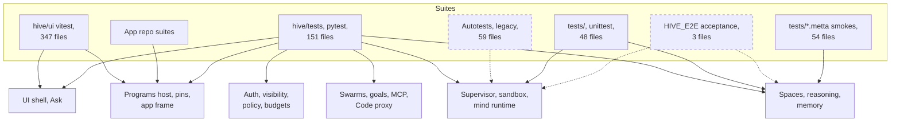

# Test map
> Status key: solid line = a suite that runs today; dashed line = runs only when opted in or with a missing piece supplied. Code refs are to omegahive @ 34b0fb3 unless named.

**What this shows.** Every test suite in the handover, and which components each one covers. Use it to find the tests to run for a change, and to see which components have thin cover.

**Who should read it.** Component owners deciding to keep or swap a piece (the tests listed for your card are the contract your replacement must pass), and reviewers. How to run each suite is on [02-how-to-run.md](02-how-to-run.md). The gaps are on [03-gaps.md](03-gaps.md).

## Diagram: suites and what they cover

- **Dashed suites.** The three acceptance files skip unless `HIVE_E2E=1` (`hive/tests/test_acceptance.py:22`). The Autotests are marked legacy and outdated (`Autotests/LEGACY.md:3`) and are not in CI.
- **File counts** are counts of test files with every omegahive port pull request applied, up to live release f3f4bb8 (the second round adds `port/demo-mode-fix-r2` to `port/lab-pc-band`; `main` after the first round: 323 UI, 150 hive, 48 core, 54 smokes; at the handover: 321 UI, 149 hive, 47 core, 53 smokes), not test counts. Test counts are on [02-how-to-run.md](02-how-to-run.md).

## The suites

| Suite | Where | Runner | What it exercises | In CI (`.github/workflows/ci.yml`) |
|---|---|---|---|---|
| Hive server | `hive/tests/` (151 files) | pytest | The hive server in process: routes, governance, supervisor with fake and real drivers, apps, spaces. Most tests start PeTTa (`.github/workflows/ci.yml:5-9`) | job `hive-petta` |
| Hive acceptance | `hive/tests/test_acceptance.py`, `test_phase2_acceptance.py`, `test_sharing_acceptance.py` | pytest, opt-in | A real hive with three real native minds in one swarm, an offline mock model, no API keys (`test_acceptance.py:1-7`) | skipped (needs `HIVE_E2E=1`) |
| OmegaClaw core | `tests/test_*.py` (48 files) | unittest | The native mind runtime: modules, memory, channels, syntax, installers. PeTTa-free (`README.md:121`) | job `core-tests` |
| MeTTa smokes | `tests/*.metta` (54 files) | `tests/run_metta_smokes.py` | MeTTa libraries and organs in a mind: hive library, reasoning space, attention, memory. Runs only files classed as isolated unless told otherwise (`tests/run_metta_smokes.py:1-8`) | no |
| UI | `hive/ui/src/**/*.test.ts` (347 files) | vitest in `node` (`hive/ui/vite.config.ts:20-23`), plus `tsc` and `eslint` | Shell, experiences, features, store, the app-frame bridge, demo data guards. One file drives a real Chromium and skips without one (`hive/ui/src/lib/appFrame.browser.test.ts:10`) | job `hive-ui` |
| Autotests | `Autotests/` (25 live, 27 mock, 7 mock-memory) | pytest | A single legacy OmegaClaw agent doing files, git, search and memory tasks; the mock variants replace the model and the chat channel with local servers (`Autotests/mock/conftest.py:1-29`) | no |
| App repos | each repo's `tests/` and related folders | pytest, or `node --test` for Studio | The app's own logic, and its contract with the hive where the host is on `PYTHONPATH` | not in omegahive CI |

## Components and their tests

Component ids are the cards in [`../components/`](../components/). Tests are `hive/tests/` unless another folder is named. Where a schematics page lists its guard tests, it is linked.

| Component | Main tests | Notes |
|---|---|---|
| [people-auth](../components/people-and-auth.md) | `test_people_api.py`, `test_sso_and_budgets.py`, `test_sessions.py`, `test_person_session_ref.py`, `test_roles_api.py`, `test_settings.py`; UI `shell/signinError.test.ts`, `lib/authContext.test.ts` | Google sign-in itself is not exercised end to end |
| [visibility](../components/visibility.md) | `test_visibility.py`, `test_request_visibility.py`, `test_personal_visibility.py`, `test_share_visibility.py`, `test_archive_visibility.py`, `test_focus_visibility.py` | See [visibility page](../05-governance/03-visibility-and-privacy.md) |
| [ask-conductor](../components/ask-and-conductor.md) | `test_ask.py`, `test_ask_conductor.py`, `test_ask_intents.py`, `test_ask_memory.py`, `test_personal_ask_control.py`, `test_personal_mind_ask.py`; UI `features/ask/*` (11 files) | See [Ask page](../02-ask-and-ui/01-ask-and-conductor.md) |
| [gateway](../components/llm-gateway-and-providers.md) | `test_cost_reservations.py`, `test_drift_guards.py`, `test_local_only_egress.py`, `test_providers_api.py`, `test_media_route.py` | No test calls a real provider |
| [budgets](../components/budgets.md) | `test_auto_budgets.py`, `test_budget_review_fixes.py`, `test_limits_auto.py`, `test_person_allowance.py`, `test_reservation_resolvable.py` | |
| [policy-approvals](../components/policy-and-approvals.md) | `test_five_way_decisions.py`, `test_policy_hive_skills.py`, `test_phase2_api.py`, `test_review_gate.py`; UI `lib/approvalDecision.test.ts`, `lib/decisionGate.test.ts` | The native mind's `LOCAL_ALLOW` shortcut has no test asserting its list |
| [capability-tokens](../components/capability-tokens-and-delegation.md) | `test_services_api.py`, `test_sensitive_action_revalidation.py`, `test_grant_scope.py` | |
| [supervisor](../components/supervisor-and-drivers.md) | `test_mind_control.py`, `test_stop_reconcile_race.py`, `test_agent_driver.py`, `test_docker_driver.py`, `test_docker_driver_stop.py`, `test_local_driver_adopt.py`, `test_power_modes.py`, `test_delegation.py`, `test_bounded_run.py`, `test_health.py` | Docker tests need a daemon and an image |
| [sandbox](../components/sandbox.md) | `test_mind_sandbox.py`, `test_mind_sandbox_linux.py`, `test_mind_url.py`, `test_sandbox_run.py`, `test_tools.py` | Linux tests need Landlock and user namespaces; macOS tests need sandbox-exec. Each platform skips the other's |
| [mind-runtime](../components/mind-runtime.md) | `tests/test_module_organs.py`, `tests/test_module_contract.py`, `tests/test_skill_*_contract.py`, `tests/test_syntax_*`; `test_mind_fitness_*.py` (7 files), `test_mind_chat_identity.py`; MeTTa smokes `tests/module_*_smoke.metta`; chosen wait `tests/test_wait_quiet_runtime.py`, `tests/wait_quiet_runtime_smoke.metta` (with `port/idle-minds`) | See [mind runtime page](../03-minds/01-mind-runtime.md) |
| [mind-memory](../components/mind-memory.md) | `tests/test_memory_runtime.py`, `tests/test_memory_safety.py`, `tests/test_memory_file.py`, `tests/test_multi_instance_memory.py`; `test_mind_assets.py`; Autotests `test_memory_*` | Long-term recall uses a mock embedder by default (`STATUS.md:52`) |
| [hive-spaces](../components/hive-spaces.md) | repository maps `test_repo_map.py` (with `port/repo-map-host`); `test_core_api.py` (publish, query, hub), `test_drift_guards.py`, `test_shares_api.py`, `test_share_body_through_harness.py`; `tests/hive_lib_smoke.metta`; acceptance `test_acceptance.py` (opt-in) | Restart survival is only in the opt-in acceptance file |
| [reasoning](../components/reasoning.md) | `tests/reasoning_space_smoke.metta`, `tests/nars_assimilation_smoke.metta`, `tests/attention_*_smoke.metta`, `tests/test_attention_ledger.py`; `test_inventory.py` | Automatic reasoning is deliberately not wired (`STATUS.md:49`); see [reasoning page](../04-knowledge/03-reasoning.md) |
| [programs-host](../components/programs-host.md) | `test_programs_api.py`, `test_program_actions.py`, `test_program_confirm.py`, `test_program_read.py`, `test_program_file.py`, `test_program_homes.py`, `test_program_viewer.py`, `test_program_refusal.py`, `test_program_room_boundary.py`, `test_program_publish_atomic.py`, `test_read_actions.py`, `test_result_schema.py`, `test_app_seams.py`, `test_app_attachments.py`, `test_app_artifacts.py`, `test_app_drafts.py`, `test_programs_check_async.py`, `test_scientist_route.py`, `test_updates.py` | App repos' own suites also check the contract |
| [app-pins](../components/app-pins.md) | `test_app_pins.py`, `test_app_grant_renewal.py`, `test_app_ui.py` | |
| [code-proxy](../components/code-proxy.md) | `test_code_api.py`, `test_code_proxy_actions.py`, `test_code_module.py`, `test_code_evidence_skills.py`, `test_code_file_skills.py`, `test_code_retrieval_proof_skills.py`, `test_code_source_review_skills.py`; UI `features/code/*` (37 files); omegacode repo suite | The runbook expects one failure until a Code service release is installed beside the hive (`deploy/RUNBOOK.md` §7) |
| [channels](../components/channels.md) | `test_channel_launch.py`; `tests/test_channel_hive.py`, `tests/test_channel_hive_runtime.py`, `tests/test_channel_event_normalization.py`, `tests/test_telegram_send_guard.py`, `tests/test_whatsapp_jid_guard.py` | Outside channels are tested as units only |
| [ui-shell](../components/ui-shell.md) | UI `shell/*` (25 files), `experiences/*` (42), `store/*` (21), `scene/*` (9), `features/*` (145 in total), `privateNames.test.ts`, `wordingGuard.test.ts`; `test_ui_prefs.py` | No browser end-to-end |
| [app-frame](../components/app-frame.md) | UI `lib/appFrame.test.ts`, `lib/frameIdentity.test.ts`, `lib/frameOps.test.ts`, `lib/hostConfirm.test.ts`, `lib/appFrame.browser.test.ts` (needs Chromium); `test_app_ui_parts.py` | See [app frame page](../02-ask-and-ui/03-app-frame-bridge.md) |
| [sqlite-state](../components/sqlite-state.md) | `test_startup_exclusive.py`, `test_guarded_save.py`, `test_archive.py`, `test_swarm_archive.py`, `test_swarm_delete.py`, `test_personal_mind_r2.py`, `test_personal_mind_r3.py` | No backup and restore test |
| [events](../components/events.md) | `test_events_websocket.py`, `test_visibility.py::test_every_published_event_kind_has_a_rule` | |
| [federation](../components/federation.md) | `test_placement.py` (mind export and import), `test_connections.py` (agreements between swarms) | Hive-to-hive is not built, so not tested; moving a mind between hives is not verified live |
| [mcp](../components/mcp-interface.md) | `test_mcp_api.py`, `test_mcp_s3.py` | |
| [agent-hub](../components/agent-hub.md) | `test_core_api.py` (hub cases), `test_stop_reconcile_race.py` (`test_hub_*`) | |
| [swarms-rooms](../components/swarms-and-rooms.md) | `test_rooms.py`, `test_team_rooms.py`, `test_coffee_room.py`, `test_collab.py`, `test_holarchy_api.py`, `test_explore.py`; UI `features/swarm/*` | |
| [goals-motivations](../components/goals-and-motivations.md) | `test_motivations.py`, `test_motivation_links.py`, `test_motivations_correction1.py`, `test_goal_review.py`, `test_error_hygiene.py`; UI `features/goals/*`, `lib/motivations.r*.test.ts` | `test_boards.py` covers the retired Boards path |
| [mind-observability](../components/mind-observability.md) | `test_health.py`, `test_inventory.py`, `test_archive.py`, `test_trace_truncation.py`; idle monitor `test_idle_minds.py` (with `port/idle-minds`) | Health asks an idle mind one question; never a limit |

**Other hive tests** not tied to one card: `test_flows.py`, `test_copy_apply_claims.py` and `test_copy_apply_consent.py` (copy-apply, feature off), `test_proposal_tests.py`, `test_lab_api.py` and `test_omegabench_*.py` (benchmarks), `test_assets.py`, `test_tools_api.py`, `test_inventory.py`, `test_trace_truncation.py`, `test_hive_module_semicolons.py`, and the review-round regression files `test_review_round1_fixes.py` and `test_next9_review_fixes.py`. The `test_evolve*.py` files cover a closed-tier plugin inside omegahive; its own `SCHEMATICS.md` describes it.

## App repo suites

Counts and commands are on [02-how-to-run.md](02-how-to-run.md#app-repositories). Closed-tier repos are listed by name only; their own `docs/schematics/` describe what the tests cover.

| Repo | Tier | Runner | Covers on the hive side |
|---|---|---|---|
| omega-tools | Open | pytest | [programs-host](../components/programs-host.md), [sandbox](../components/sandbox.md) (concurrency recipes on real PeTTa) |
| omegalibrary | Open | pytest | [programs-host](../components/programs-host.md) |
| omegaplanner | Open | pytest | [programs-host](../components/programs-host.md), [goals-motivations](../components/goals-and-motivations.md) |
| omegahive-candidates | Open | pytest, per folder | candidate apps; nothing installed |
| omegacode | Closed | pytest | [code-proxy](../components/code-proxy.md), [capability-tokens](../components/capability-tokens-and-delegation.md) |
| omegadesign | Closed | `node --test` | [app-frame](../components/app-frame.md) |
| omegafusion | Closed | pytest | [programs-host](../components/programs-host.md) |
| omegapurple | Closed | pytest | [programs-host](../components/programs-host.md), [supervisor](../components/supervisor-and-drivers.md) (lifecycle broker) |
| omegasocial | Closed | pytest | [programs-host](../components/programs-host.md) |
| omegaatlas | Closed (private app) | pytest | [programs-host](../components/programs-host.md) |
| omegatruth | Closed (private app) | pytest | [programs-host](../components/programs-host.md) |
| omegav2 | Closed | pytest, per file | not the hive; the separate V2 mind body |

## For reviewers: what to check

- **A change names its tests.** For a change to one component, run the tests in its row plus a smoke run. Run the whole hive suite only for core plumbing: auth, spaces, gateway, supervisor (`README.md:131-133`).
- **A skip is not a pass.** Check the `-rs` summary for platform and opt-in skips (Linux isolation, Docker, `HIVE_E2E`, sibling repos).
- **A swap keeps the row green.** A replacement component must pass the tests in its row, or the row must be rewritten with the reason.

## References

- `.github/workflows/ci.yml:1-27`
- `hive/tests/test_acceptance.py:1-22`
- `hive/ui/vite.config.ts:20-23`; `hive/ui/src/lib/appFrame.browser.test.ts:1-25`
- `tests/run_metta_smokes.py:1-8`
- `Autotests/LEGACY.md:1-3`; `Autotests/mock/conftest.py:1-29`
- `README.md:116-133`; `STATUS.md:13-18`
- Each app repo's `STATUS.md` (2026-10-10)
