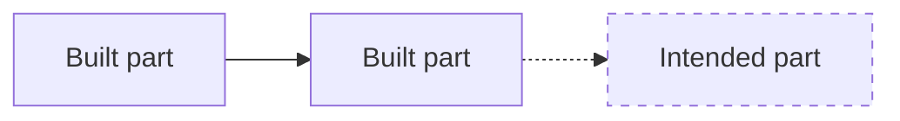

# How to read these schematics

## Lines and boxes

- **Solid line or box:** built and in the code today.
- **Dashed line or box:** intended. It is part of the designed shape but not finished. Each page says where that intent is written down.
- **Arrow direction:** who calls or sends to whom.

## Words used on every page
| Word | Meaning |
|---|---|
| Hive | The server, its UI and its shared state. One hive owns one data directory. |
| Mind | An agent process the hive runs, with its own workspace and memory. |
| Swarm | A group of minds and people, with its own rooms and shared commons. |
| Personal mind | The mind each person has. It lives in the hive and represents that person. |
| Commons | A swarm's shared MeTTa space of beliefs, with truth values and evidence. |
| App (program) | A plug-in that supplies a work graph, through the programs contract. |
| Module | A removable organ for a mind (a skill, sense, channel or body app). |
| Gateway | The path for the hive's configured model and embedding calls, with budgets. Not an egress boundary: modules can open their own connections (K27). |
| Representative | A person's personal mind acting for them toward a hive. |

## Code references
- **Format:** `path:line` refers to the `omegahive` repo at the commit named on each page, unless another repo is named.
- **Line drift:** line numbers drift as code changes. Each reference also names the file, so search for the symbol if the line has moved.

## Tiers
Pages about closed-tier apps describe only how they connect to the hive, never their internals. See `omegahive-start-here` for the tier of each repo.
